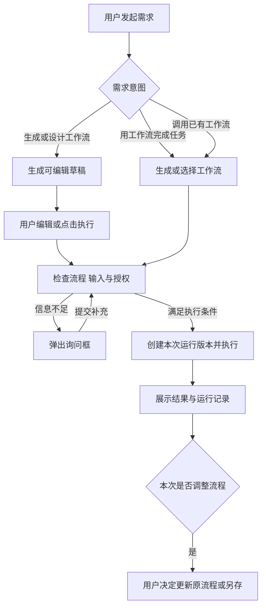
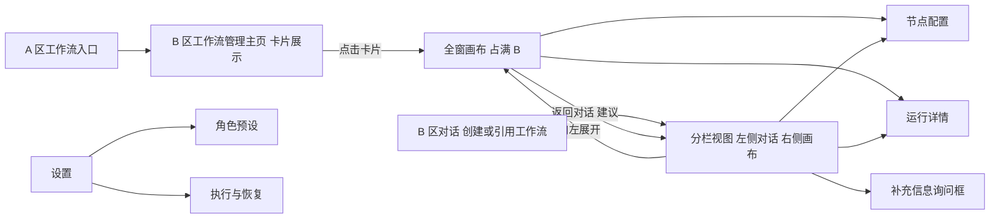
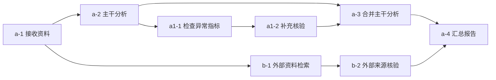
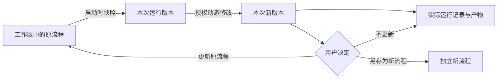

# DeepSeekHarness 可视化动态工作流 PRD

| 项目 | 内容 |
| --- | --- |
| 文档版本 | v0.0.1 设计讨论稿（原编号 v0.4；下方修改记录中的 v0.1—v0.4 为本稿内部修订） |
| 更新日期 | 2026-10-14 |
| 产品形态 | DeepSeekHarness 工作流插件 |
| 主要用户 | 使用 AI 完成复杂任务、需要理解和调整执行过程的知识工作者；兼顾重复任务的流程复用需求 |
| 当前阶段 | 先讨论设计文档；按用户要求暂停 MVP、代码与交互原型制作；本文不代表功能已经实现 |

本插件让用户把任务转成可查看、可修改、可执行的工作流。用户可以让 Agent 生成和调整流程，也可以自己在画布上搭建；同一份流程既能由用户直接运行，也能由 Agent 调用。

**需求状态：**“已确认”为讨论中确定的规则；“建议”为本次补齐的默认方案，可集中评审；“待核验”为需要实际产品、宿主接口或工程验证才能确定的内容。未经验证的接口、性能和兼容能力不作为现有事实。

**本轮讨论入口：**[设计文档](设计文档.md)。该文档集中呈现页面布局、状态与交互建议；完整能力、编号和工程规格在文末附件索引中。

## 1 产品问题与目标

### 1.1 用户问题

- 复杂任务由 Agent 连续完成时，用户难以判断当前步骤、前后依赖，以及应该从哪里调整。
- 手动画流程需要理解节点、参数和连接关系，创建成本较高。
- 单纯使用自然语言修改长流程，容易出现定位不准、修改范围过大、破坏用户已确定步骤等问题。
- 一次任务完成后，执行方法难以保留下来供下一次使用。

### 1.2 产品目标

1. 降低创建成本：从自然语言生成可执行流程，支持继续手动编辑。
2. 提高调整精度：通过结构编号、稳定引用和节点注释，把修改要求定位到具体步骤。
3. 保留用户控制：固定节点、授权范围、撤销重做和运行版本共同约束自动调整。
4. 支持独立使用：不启动主对话 Agent，也可以打开流程、填写输入并运行。
5. 支持复用：流程按工作区保存，可从不同会话通过 `@` 调用。

最新 Dify 手册已经提供自然语言生成和改图能力。本项目的差异化应集中在宿主任务上下文、节点精确引用、固定保护、受控动态执行与运行版本管理，不能将“Dify 无法自然语言生成”作为依据。见[官方 Go to Anything](https://docs.dify.ai/en/cloud/use-dify/build/goto-anything)。

### 1.3 评价指标（建议）

统计从发起创建到首次成功运行的耗时、生成流程的校验通过率、定向修改成功率、工作流执行成功率、重复调用率、自动修复成功率。定向修改成功应同时满足“目标发生预期变化”和“固定节点及授权外节点没有被误改”。具体目标值在基线测试后确定，不以未经测量的百分比作为承诺。

## 2 范围与交付边界

### 2.1 已确认范围

| 能力 | 要求 |
| --- | --- |
| 完整画布 | 覆盖约定 Dify 基线中的画布编辑功能，包括添加节点、工具、便签、指针、手模式、整理、导出视图；不能仅实现这些例举按钮就声称完成全部功能 |
| 真实执行 | 画布承诺支持的节点、连接和流程必须真实可执行；不支持或配置缺失时明确提示 |
| 创建方式 | Agent 生成、用户手动创建，两种方式操作同一工作流 |
| 调整方式 | 画布编辑、自然语言调整、引用指定节点修改 |
| 动态调整 | Agent 可在授权范围内调整本次运行流程，不能擅改固定节点 |
| 独立运行 | 点击执行不要求主对话 Agent 在线；模型或 Agent 节点按节点配置调用对应能力 |
| 配置能力 | 节点可设置模型、思考强度、角色预设，其他参数按节点类型提供 |
| 使用入口 | 左侧“工作流”入口、会话中的画布、聊天输入框中的 `@工作流` |
| 页面布局 | 管理主页及从卡片进入的画布占满 B 主内容区；从对话创建或引用的画布默认在 B 右侧栏显示，可向左扩展占满 B |
| 视觉与控件 | 设置、菜单、功能页面及画布内部的字体、字号、文案、间距、颜色、圆角和状态反馈均契合 DeepSeekHarness；画布布局和完整能力参考 Dify |

### 2.2 对标范围与基线

以 2026-10-14 核对的最新稳定开源版本 **Dify 1.17.1** 为固定实现证据，同时检查当日 Cloud 与 Self-Host 工作流手册；环境、beta 和手册/源码差异分别记录。完整对照见[画布能力对照](docs/Dify画布能力对照.md)和[节点执行规格](docs/Dify节点执行规格.md)，不再只按功能族推定覆盖。

画布对标纳入编辑、八项对齐/均分、模式与快捷键、小地图、便签、三格式视图导出、变量、片段、单节点与全图调试、缓存、版本、DSL、多人协作及持久评论。约定 Dify 基线内的全部画布能力，以及相应节点、触发器和错误策略，均需逐项实现、真实执行和验收；不得自行挑选子集后称其为“全部受支持能力”。与发布关联的 Web/API/MCP、事件订阅和批量运行单列设计和工程工作包，不能以占位按钮宣称对齐。

普通工作流、Chatflow 特有能力与知识库入库管线是不同语境。节点规格标明适用条件；本插件在宿主聊天中提供相应会话上下文，不强行把会话变量塞进无会话运行。模型、工具和知识库依赖可以接入/映射；全站计费、市场运营和独立知识库管理平台不属于画布本身，不以此宣称全 Dify 平台已复制。

### 2.3 交付组织与当前暂停范围

设计分为五部分：Dify 全量对照、页面与交互、编号与引用、宿主接入、验收指标与工作包。先完成设计讨论，再决定恢复实现。已有交互原型保留为未完成草稿，不继续制作 MVP。工程计划中的人日与性能阈值均为带假设的建议，不是实测结果或发布日期承诺。

## 3 核心对象与职责

| 对象 | 定义 |
| --- | --- |
| 工作流 | 按工作区保存的流程，包含节点、连接、输入输出、配置和版本 |
| 节点 | 流程中的执行步骤；稳定身份用于引用，显示编号用于阅读和交流 |
| 主对话 Agent | 负责生成、编辑、理解调用意图、协助运行及授权内修复；不是独立执行的必备组件 |
| 节点内 Agent | 某个节点实际调用的智能体，与主对话 Agent 的职责和配置区分 |
| 执行器 | 按流程定义调度节点、传递数据、处理状态、保存结果；直接运行与 Agent 调用共用 |
| 本次运行版本 | 以启动时的流程及配置为基础，承载本次运行中的授权调整，不自动覆盖原流程 |
| 运行记录 | 记录实际执行过的步骤、输入输出、失败、修复与配置快照 |
| 便签 | 长期保存在画布上的说明文字，不参与执行 |
| 注释 | 为聊天草稿附加的修改要求，绑定一个或多个节点；发送成功后移除临时序号 |
| 协作评论 | 面向成员的持久讨论串、成员提及和解决状态，与临时 Agent 注释独立 |

## 4 典型任务与业务流程

### 4.1 贯穿案例（建议）

用户提供多份资料，要求提取事实、交叉核验并生成带来源的分析报告。Agent 生成含并行分析、条件判断、核验和汇总的流程；用户固定核验节点，给两个分析节点添加一条注释，要求缩短分析范围。运行中某个资料读取步骤失败，按设置进入修复；完成后，用户决定是否把本次调整更新到原流程。

验收数据使用固定样例文件和可控制的工具返回结果，避免以一次模型自由输出作为全部功能通过的依据。

### 4.2 创建与执行



已确认规则：

- 明确要求“生成工作流”或“用工作流完成任务”时直接进入工作流模式。
- 只要求设计或修改流程时，不因保存或生成成功而自动执行。
- 明确要求执行，输入、依赖和授权充分时，直接执行，不额外询问“是否开始”。
- 必要信息不足或含义存在关键歧义时，弹出询问框；优先利用当前消息、附件、明确的会话信息和流程配置，只问缺失内容。
- 多个缺项尽量一次询问；有默认值的可选项不阻塞运行。提交回答后再次检查，满足条件即继续。
- 用户取消询问框时保持待补充状态，不启动执行（建议）。

### 4.3 普通任务结束后转换

普通任务先完成并交付；适合复用时，Agent 可在最终回答的最后一句建议生成工作流。用户接受建议后，弹出选择框：

| 选项 | 生成规则 |
| --- | --- |
| 生成可复用流程 | 将本次文件、研究对象、时间范围等抽成输入项，保留必要步骤和合适默认值 |
| 保留本次任务配置 | 保留本次具体输入和配置，便于查看、调整或再次执行 |

点击“生成工作流”后生成可编辑草稿，不重新执行已完成任务。取消或关闭不创建流程。已有最终产物不被当作未来任务的固定答案。

## 5 页面与交互需求

### 5.1 页面结构

**已确认的区域定义：**沿用用户标注，A 为宿主左侧导航区域，B 为 A 右侧的整个主内容区。本文“全窗画布”指占满 B，不是操作系统全屏，也不覆盖 A。点击工作流入口在当前窗口的 B 中切换页面，不另开应用窗口。



| 进入方式 | 默认展示 | 备注 |
| --- | --- | --- |
| 点击 A 中的“工作流”按钮 | 专门的管理主页直接占满 B | 主页包含卡片和两个独立筛选入口 |
| 从管理主页点击工作流卡片 | 对应画布默认占满 B | 打开查看或编辑，不因打开卡片自动执行 |
| 通过对话创建工作流 | 画布默认在 B 右侧栏展示 | B 左侧保留当前对话 |
| 通过对话引用工作流 | 对应画布默认在 B 右侧栏展示 | 引用和打开画布本身不等于发送执行指令 |
| 在对话侧栏中展开画布 | 画布向左扩展，占满 B | A 保留；只是显示区域变化 |

布局示意：

```text
管理主页：        [ A 导航 ][ B：筛选 / 工作区筛选 + 工作流卡片网格 ]
从卡片进入：      [ A 导航 ][ B：工作流画布                         ]
从对话进入：      [ A 导航 ][ B：当前对话          | 工作流画布侧栏 ]
侧栏向左展开：    [ A 导航 ][ B：工作流画布                         ]
```

### 5.2 工作流管理主页 P01

**已确认：**管理主页占满 B；不同工作流以卡片形式展示；主页提供独立的“筛选”和“工作区筛选”按钮。流程按工作区保存，同工作区不同会话可以调用；跨工作区使用时复制一份，后续分别修改。

**页面规则：**入口、卡片呈现和两个筛选按钮为已确认要求；下表的字段、筛选条件、排序及状态保留方式为建议默认。

| 区域 | 默认内容及操作 | 校验和结果 |
| --- | --- | --- |
| 导航入口 | 位于 A 的“插件”下方、“工作区”上方 | 点击后管理主页占满 B，不以对话侧栏或居中弹窗代替 |
| 卡片网格 | 每份工作流对应一张卡片；建议显示名称、简介、工作区、修改时间、最近一次运行状态；按可用宽度调整列数 | 点击卡片主体进入占满 B 的画布；卡片内更多操作不同时触发打开 |
| 筛选按钮 | 独立提供“筛选”；建议按最近一次运行状态、修改时间筛选 | 与工作区筛选和名称搜索共同生效；可清除属性筛选而保留工作区选择 |
| 工作区筛选按钮 | 独立提供“工作区筛选”；建议提供当前工作区、指定工作区及全部工作区，默认当前工作区，无当前工作区时为全部 | 只改变卡片展示范围，不迁移工作流，也不改变其所属工作区或运行上下文 |
| 排序 | 建议按最近修改优先 | 同名卡片通过工作区和简介区分 |
| 新建 | 空白创建或输入需求交给 Agent | 管理主页新建默认打开占满 B 的画布；在全部工作区视图中新建时需明确保存归属 |
| 搜索 | 按名称搜索 | 在筛选结果中搜索；无结果时可清除条件，不能误显示为从未创建过工作流 |
| 管理 | 重命名、复制、查看运行记录、删除 | 复制生成独立身份；跨工作区复制检查文件、工具和模型依赖 |
| 删除 | 删除前说明关联运行记录和会话引用的影响 | 不删除外部产物；运行中的流程先处理运行状态；建议保留可读的历史运行快照 |

建议：没有任何工作流时显示新建引导；筛选后无匹配时显示筛选空状态。由卡片进入画布再返回主页时，保留搜索、筛选、排序和滚动位置。

在管理主页查看另一工作区卡片时，打开的是该流程所属工作区的对象；若要用于当前对话所属的其他工作区，仍需复制后使用。展示全部工作区不等于把流程改为全局共享。

保存位置属于产品上的工作区归属；具体文件格式、存储位置和数据库方案待工程设计，不在此虚构。

### 5.3 画布 P02

#### 5.3.1 两种展示方式

**已确认：**管理主页卡片进入默认全窗；对话创建或引用进入默认右侧栏。两种方式呈现同一个工作流，不因展开或收起复制流程、创建新运行或改变流程所属工作区。

**建议补齐的切换规则：**

- 侧栏标题区提供“展开画布”按钮，向左扩展至 B 的左边界；也可支持拖动分隔线调整侧栏宽度，默认宽度与最小可用宽度在原型中确定。
- 从对话侧栏展开后，提供“返回对话”按钮恢复 B 左侧对话、右侧画布的布局；保留消息、输入草稿和会话关联。
- 从管理主页卡片进入全窗画布，提供“返回工作流主页”入口。需要自然语言修改时，可用“打开对话”进入分栏；没有关联会话时建立当前流程所属工作区的会话草稿，不自动发送请求。
- 新进入的默认布局按本次入口决定；用户在当前查看过程中主动切换后，不因运行状态刷新而被切回默认布局。
- 视图切换保留工作流版本、节点配置、选中节点、未发送注释、撤销重做记录和运行状态。画布可视范围随容器调整，但不自动整理节点或更改结构编号。
- 全窗下添加注释仍只提交到聊天草稿；提供查看草稿的路径，打开对话后可继续补充和发送，不因聊天暂时隐藏而直接发送。

#### 5.3.2 画布操作与状态

画布布局参考 Dify：点阵画布、卡片式节点、左侧浮动工具栏、顶部保存/运行/发布、右侧配置、底部历史和缩放。各区域的文字、间距、控件及交互状态统一遵循 DeepSeekHarness，并覆盖设置、菜单、功能页和弹窗。优先采用宿主组件及设计变量，具体数值以同版本宿主核对结果为准。详见[设计文档第 2、4 节](设计文档.md)。画布完整操作和执行能力按 Dify 对照表落实，不因样式适配或侧栏空间而删减。

**已确认：多选不显示勾选框或勾选图标，只用高亮边框表示选中。**支持点击、Shift 增减选择与框选；选中状态与节点执行状态分开。

选中节点时，在**画布区域右上角**出现上下文操作按钮，其中包含“添加注释”。分栏时，该位置指画布侧栏自身右上角；全窗时随画布扩展到 B 右上角。右键菜单也提供同一操作，不在屏幕正中央自动弹出菜单。右键已选节点时保留多选；右键未选节点时切换到该节点。

建议区分以下状态：

| 状态 | 展示与操作 |
| --- | --- |
| 空白 | 新建节点、从自然语言生成、DSL 导入及依赖映射入口 |
| 普通编辑 | 添加、删除、连线、拖动、配置；保存状态持续可见 |
| 单选或多选 | 选中边框、右上操作区、配置或批量操作入口 |
| 运行中 | 显示节点运行状态、当前路径、等待原因；允许查看并按版本规则修改 |
| 校验失败 | 标出问题节点或连线；提供可理解的修正说明 |
| 运行失败 | 错误定位、已有结果、重试和 Agent 排查入口 |

拖动、整理只改变布局，不因位置变化重排结构编号。导出视图与导出可执行工作流文件是不同能力，分别验收。

### 5.4 节点配置 P03

通用内容包括编号、名称、节点类型、输入、输出、固定状态，以及本类型需要的参数。模型、思考强度和角色预设仅在相关节点上显示，不强加给普通转换或条件节点。

模型与思考强度可手动调整。角色预设通过下拉框选择，可查看提示词；新增和修改只能前往设置，不在节点中直接改写预设。切换角色预设不改变模型、工具或其他无关配置。

建议为配置字段展示来源：用户手动指定、Agent 自动配置或继承默认值。用户手动指定的模型和强度，Agent 后续优化时应遵守授权范围，不悄悄替换。

### 5.5 节点注释与聊天 P04

**操作路径：**选择一个或多个节点 → 右上“添加注释”或右键同名菜单 → 输入修改要求 → 点击“提交” → 注释进入聊天草稿 → 用户继续补充 → 点击“发送”。

| 规则 | 要求 |
| --- | --- |
| 提交与发送 | “提交”只生成草稿；“发送”才将要求交给 Agent |
| 输入框呈现 | 用“1 条注释”等小按钮展示；可以继续输入普通文字、添加其他引用 |
| 画布标记 | 注释目标显示临时序号，如 ①；与节点编号 `a-2` 区分 |
| 多节点 | 一条注释可以关联多个节点，各目标显示同一注释序号 |
| 双向编辑 | 点画布标记或输入框计数按钮，均可回到同一条注释编辑；单条直达，多条先选条目 |
| 删除注释 | 删除草稿注释及相应标记，不删除节点 |
| 发送成功 | 消息被接受后立即清除本批画布序号和草稿计数，不等待 Agent 执行结束 |
| 历史 | 不保留或恢复历史注释序号；已发送消息中的修改要求和必要节点引用仍然可读 |
| 发送失败 | 保留草稿和标记以便重试；Agent 后续执行失败不恢复已清除标记 |
| 新批次 | 从 1 开始编号；发送期间新增的草稿不被上一批成功回执误清除（建议） |
| 失效引用 | 节点已删除时标明失效，不转而指向恰好占用旧编号的新节点 |

长期说明文字使用“便签”；多人持久讨论使用“协作评论”；均不与上述临时注释混用，也不随注释发送而删除。

### 5.6 通过 @ 调用

聊天输入 `@` 后，在候选项中提供“工作流”分类；支持名称搜索，默认展示当前工作区流程。选中后插入可点击的引用标签，用户可继续补充文字和附件，选中本身不触发执行。

通过对话引用流程时，对应画布默认在 B 右侧栏展示，并支持向左展开占满 B；遵循第 5.3 节的视图与状态保留规则。

| 发送内容 | 处理 |
| --- | --- |
| `@财报分析 分析附件中的两家公司` | 解析输入，检查条件，满足时运行 |
| `@财报分析 把总结改成表格输出` | 修改流程，不自动运行 |
| 仅发送工作流引用 | 以调用为默认意图；缺少必要信息时弹出询问框 |

引用绑定流程身份，改名不失效。跨工作区使用沿用复制规则，不因 `@` 而静默共享另一工作区原流程。

### 5.7 运行详情 P05（建议）

展示运行状态、使用的流程版本、输入摘要、开始结束时间、节点进度、中间结果、最终产物、错误和修复记录。模型用量与费用仅在可可靠获得时展示，未知值不显示为零。

点击运行中的节点可查看该次输入、输出、错误、模型和有效配置。展示用户可理解的执行信息，不要求暴露模型内部推理过程。最终产物以文件、文本或链接呈现，并可定位产生它的节点。

### 5.8 设置 P06

| 设置 | 已确认规则 |
| --- | --- |
| 角色预设管理 | 名称用于识别，预设内容只保存角色提示词；提供搜索、新增和修改，参考用户提供的预设管理页面 |
| 预设更新 | 统一更新所有引用该预设的节点；后续新运行使用新版本，已开始的运行保留启动快照 |
| Agent 故障处理 | A：先出方案，用户确认后修复；B：授权范围内自动修复并继续。默认 B |
| 自动修复上限 | 同一次故障默认最多 2 轮，允许设置调整；仍失败则暂停并说明已尝试内容 |

建议：修改正在被使用的预设时展示影响范围；引用中的预设删除前需选择替代或清空关联，不能静默换成其他角色。设置变更默认影响新运行，当前运行保持快照；用户明确修改本次运行时另记变更。

### 5.9 询问框 P07

用于补齐必要输入、澄清影响执行的歧义，或处理超出当前授权的动作。问题具体，已有信息不重复询问；适合选择时给出选项，允许补充自由文本。回答提交后继续原请求，不要求用户重新发送一遍调用命令。

缺失模型凭据等安装配置问题需引导到对应设置，不让用户在普通问题文本中填入密钥（建议）。同一运行同时只保留一个有效待回答状态，防止重复提交启动多个执行（建议）。

## 6 编号与稳定引用

### 6.1 已确认原则

- 同一主干顺序显示 `a-1、a-2……`，其他分支和嵌套分支可用 `b-1、b-2……`、`a1-1、a1-2……` 等形式。
- 编号随流程结构调整，引用始终绑定同一节点身份。
- 纯布局调整不改变编号。历史原始文字中的编号需结合当时版本解析，不能直接映射到当前同号节点。

### 6.2 结构示意与补齐规则（建议）

下面用 `a` 表示主干，`b` 表示另一条顶层并行路径，`a1` 表示主干内部的子分支。字母是定位标签，不代表执行先后或优先级；先后关系由连接和节点规则决定。



路径归属和分支层级保存在结构中，不按屏幕坐标猜测。多重汇合、跨边、非树形 DAG、嵌套循环、导入及重编号事务已补入[节点编号与引用规则](docs/节点编号与引用规则.md)，包含 15 组验收场景。该方案用于设计讨论，未声称编号算法已实现或运行通过。

| 场景 | 显示变化 | 引用结果 |
| --- | --- | --- |
| 在原 `a-1` 和 `a-2` 之间插入节点 | 新节点为 `a-2`，原节点变为 `a-3` | 原注释继续指向原节点 |
| 复制节点 | 分配新的显示位置和新身份 | 旧引用不指向副本 |
| 删除节点 | 后续编号按结构调整 | 指向被删节点的草稿引用标明失效 |
| 撤销删除 | 建议恢复原身份及配置 | 可恢复对原节点的关联 |
| 循环多次执行 | 节点编号不因轮次改变 | 运行详情通过迭代次数区分执行实例 |

## 7 节点与执行规则

### 7.1 执行能力矩阵

[节点执行规格](docs/Dify节点执行规格.md)已记录 22 类节点以及起点触发、变量文件和运行规则，共 50 项规格。每种节点记录配置、输入输出、依赖、正常/失败行为与验收样例。工具“可以添加”与“能够执行”分别验收；模型/预设字段只对适用节点展示。

### 7.2 统一校验（建议）

手动创建、Agent 生成和 Agent 修改后的流程使用同一套校验规则：

1. 节点配置合法，所选模型、工具和必要权限可用。
2. 连线符合控制流规则，变量引用存在且类型兼容。
3. 必需输入有来源；条件分支未执行时，其输出不能被当作必然存在。
4. 并行和汇合有明确的等待规则，不因某条未选分支未运行而无限等待。
5. 循环和迭代使用明确的结构与结束条件，不用任意回边制造不可控循环。
6. 按实际激活路径判断完成；Output 可选且不提前终止其他并行分支。有约定输出时校验其可产生；孤立节点、断开连接和无效引用显示在画布上。
7. 修改没有突破固定节点和授权范围。

草稿允许暂时不完整，运行前必须给出明确的阻塞位置和原因；校验通过不等于模型输出质量已经达标。

### 7.3 运行状态（建议）

| 状态 | 含义与后续动作 |
| --- | --- |
| 待补充 | 缺少执行必需的信息，等待询问框回答 |
| 校验失败 | 流程或依赖不满足执行条件，修正后重新校验 |
| 待执行 | 已通过检查，尚未开始调度 |
| 运行中 | 节点正在执行或调度 |
| 等待用户 | 执行到需要人工输入或确认的步骤，保存等待原因和有效版本 |
| 修复中 | Agent 正在进行本次故障的授权内修复 |
| 已暂停 | 不再启动新节点，保留结果，可处理问题后继续 |
| 成功 | 必需执行路径完成，得到约定输出 |
| 失败 | 本次无法完成，保留错误与已完成结果 |
| 已取消 | 用户终止本次运行；外部已发生动作和既有结果仍保留 |

分支未选中的节点显示“已跳过”；不能把它算作失败，也不能把所有节点变绿作为成功标准。

### 7.4 暂停 继续与重跑（建议）

暂停优先停止后续节点调度。已发出的调用能否取消取决于能力；无法立即中断时显示“等待当前步骤结束”，不能在后台仍运行时伪装已停止。

继续执行时复用仍有效的已完成结果。输入、提示词或连接变化使下游结果失效时，明确标出需要重跑的范围。对发送消息、写入外部系统等操作，结果不确定时先核验是否已完成，不无条件重复。

宿主退出后运行如何恢复、是否支持真正后台运行，需要核验执行环境和检查点能力；退出重开时不得自动重复有外部影响的步骤。

### 7.5 故障处理

**已确认：**独立点击执行失败时，展示错误、保留结果，提供重试、修改后继续和“让 Agent 排查”。设置中的自动修复策略用于 Agent 已参与运行或用户主动要求其排查，不让主对话 Agent 成为独立运行的强制前置条件。

节点已配置的重试、默认值和错误分支先按规则执行；仍未处理的故障才进入 Agent 修复。默认 B：Agent 在授权范围内修复并继续；A：先展示方案，确认后再应用。涉及固定节点的未授权修改，仍需用户明确授权。同一次故障默认最多 2 轮，每轮为“分析 → 应用修复 → 尝试继续”，达到设定上限仍失败时立即暂停并展示已尝试内容；按默认 2 轮设置，不自动开始第 3 轮。

**建议：**执行报错、超时或明确输出校验失败可触发故障处理；Agent 仅认为结果“不够好”，不自动等同故障。修改节点名称、插入替代节点或再次重试不能重置同一次故障的轮次。网络层重试应独立记录，不冒充新的修复轮次；用户明确要求继续尝试时记为新的人工操作。

## 8 Agent 权限与用户控制

### 8.1 固定节点

固定保护节点任务、提示词、模型、强度、角色预设、工具配置、输入输出要求，以及影响该节点执行的输入来源和条件；不能通过删除、绕过或间接更改预设来规避保护。布局移动和整理允许进行。

用户可自行编辑固定节点。用户明确指定某节点某项变更，例如“把 `a-2` 换成某模型”，构成本次、该字段的定向授权；其他属性不因此开放，修改后仍固定。“优化整个流程”或仅添加引用不视为解除固定。

### 8.2 动态修改

运行中的授权调整先形成有效的本次运行版本，再执行新计划；画布显示实际有效流程，不能只在对话里说已修改却执行另一套计划。

正在运行的节点默认继续使用启动时配置，新配置对该节点下一次执行生效。用户可明确选择停止并按新配置重跑；普通编辑不隐式触发重跑。

建议 Agent 变更以完整批次提交：写明目标和变化、做合法性检查，再应用。用户与 Agent 同时修改同一版本且存在冲突时，展示冲突并保留双方内容，不静默覆盖。

### 8.3 撤销与重做

一次用户操作或一批完整 Agent 修改作为一个撤销单位，包含相关节点与连接。重做恢复同一批结果，不重新请求模型生成。只恢复某个节点属于新的编辑操作，需要重新校验关联关系。

撤销修改不能撤回已完成的工具调用、外部文件写入或运行记录；涉及重新执行时走运行控制，不用“撤销”伪装外部动作已被还原。

## 9 模型 思考强度与角色预设

### 9.1 自动生成时

- 默认沿用生成该流程的当前主 Agent 模型。
- Agent 根据节点任务选择思考强度，自动配置的上限不能超过当前主 Agent 所选强度。
- 用户已授权可选模型范围时，Agent 可以在该范围内选择其他模型并说明原因。
- 将实际选定的模型和强度保存在节点配置中；以后切换聊天 Agent 不自动重配已有流程。

### 9.2 手动调整与兼容

用户可逐节点修改模型和思考强度；手动选择可超过主 Agent 的自动配置上限，但必须在该模型支持范围内。

手动新建、导入或旧流程中没有指定模型的节点，默认选择“跟随 DSH”：有当前工作区对话时采用该对话当前选择的模型，否则使用 DSH 设置中的默认模型。模型和密钥复用宿主配置，不需要在插件重复设置。用户可以改选具体模型，也可切回“跟随 DSH”。不擅自覆盖已经保存的具体模型，不以模型目录第一项作为兜底。

跟随值在每次启动时解析，并随实际思考强度保存至本次运行快照；运行中的节点、循环、迭代及子工作流沿用该快照。运行途中切换 DSH 模型只影响之后启动的运行。无可用默认模型时明确提示配置；不需要模型的流程仍可独立执行。

不同模型的同名强度不视为天然等价。工程需核验各模型能力和映射；不支持的强度不提供可选项，不静默提交不存在的参数。自动跨模型选择在无法保证上限时，应保留可验证配置或请用户明确选择（建议）。

### 9.3 角色预设

预设只包含角色提示词，名称等用于管理识别；不打包模型、强度或工具。节点下拉选择预设，只有设置页可以新增或修改。建议提供“无预设”和只读查看内容入口。

统一更新影响后续新运行，已开始的运行使用原提示词快照。用户在设置中主动保存预设修改，也会更新引用它的固定节点在后续新运行中使用的提示词；固定保护限制的是 Agent 未经授权直接修改或通过共享预设绕过保护，不阻止用户主动统一更新。节点任务要求与角色提示词分别保存，避免修改任务时误写全局预设。

## 10 保存 版本与关联数据

### 10.1 版本关系



已确认：本次运行调整不自动覆盖原流程；角色预设等共享配置按启动时快照记录；历史记录不因后续编辑而改变。

建议：原流程草稿自动保存，并展示“保存中、已保存、保存失败”。运行快照与正在编辑的草稿分开，避免自动保存意外改变正在执行的计划。更新原流程前展示差异；若原流程已有其他新修改，先处理冲突。

### 10.2 关键数据项（产品数据要求）

| 对象 | 必须能够区分和记录的内容 |
| --- | --- |
| 工作流 | 稳定身份、名称、工作区、当前草稿、版本、修改时间 |
| 节点 | 稳定身份、显示编号、类型、配置、输入输出、固定状态、布局 |
| 连接 | 来源与目标、对应端口、条件或控制关系 |
| 运行 | 运行身份、源工作流和版本、有效输入、配置快照、状态、产物 |
| 节点执行 | 节点身份、迭代或重试序次、输入输出、错误、实际模型与配置 |
| 修改批次 | 基础版本、发起方、修改范围、授权依据、变更前后内容、应用状态 |
| 注释草稿 | 草稿批次、临时序号、目标节点身份、修改要求、发送状态 |
| 角色预设 | 稳定身份、名称、提示词、修订版本、引用关系 |

具体字段名、接口路径和存储结构交由技术设计确定；上述不是已存在接口。

## 11 宿主接入与异常处理

已检查本机 DeepSeekHarness **0.2.0-rc.2** 的 SDK 声明、文档和现有插件实现，其中 9 份 SDK 文档与安装包内容比对一致。完整证据、接口限制及拟议契约见[宿主接入与交付计划](docs/宿主接入与交付计划.md)。静态核对不等于运行中的服务探测或插件接入成功。

| 能力 | 已知依据 | 设计与验证要求 |
| --- | --- | --- |
| A 导航与 B 主区 | 公开全局面板及主面板选择能力 | 精确入口顺序、全窗画布及返回状态需安装版验证 |
| 对话侧栏 | 存在右侧 Tab 与资源入口 | 原生 fullscreen 可能覆盖 A；采用共享状态的主面板/侧栏切换路线，验证仅占 B |
| @ 与注释 | 存在来源注册、结构引用和输入框扩展区 | 发送成功通知是否可被插件可靠关联尚需证明，不以草稿变空猜测成功 |
| 询问框 | 原生问答具有根 Agent/消息卡片限制 | 设计独立问题记录和弹窗回答通道，验证无需主 Agent、重复回答和重启恢复 |
| 模型与工具 | 模型能力、工具注册、授权存在 SDK 依据 | 各模型强度为适配器标识，不能按同名字符串假设跨模型等价 |
| 工作流执行 | 原生脚本工作流有执行和取消，但依赖 parent Agent，缺图修改/检查点契约 | 本插件需要独立图运行层，复用已验证模型/工具适配能力 |
| 存储与恢复 | 工作区身份、领域持久化有依据 | 图、版本、变更批次原子提交与外部动作回执需要独立设计和中断验证 |

## 12 非功能要求与可观测性

[工程附件](docs/宿主接入与交付计划.md)已给出参考硬件、样例规模、p95 测量口径、两平台矩阵和恢复验证。建议目标包括：200 节点/300 连线打开 ≤1 秒；1,000 节点/1,500 连线打开 ≤3 秒；常规图交互帧间隔 p95 ≤33ms；100 组中断样例中已确认保存不丢失、未知外部动作不盲重放。这些是待评审验收目标，**本轮未实测**，不等于产品节点数上限。

macOS 与 Windows 分别做安装桌面验收；本机 macOS 静态证据不代替 Windows 可用性。保存失败、配置缺失和运行冲突必须可见；未知用量、费用和进度不填零或虚构数值。事件记录关联流程、节点、版本、运行和修改批次；是否远端上报遵循宿主设置，不默认新增远端采集。

## 13 核心验收清单

验收项是需要实现后验证的要求，当前没有标记为已通过。涉及“建议”的规则须在相应方案确定后作为最终验收口径。

| 编号 | 场景 | 预期结果 |
| --- | --- | --- |
| AC01 | 用户要求生成流程 | 进入工作流模式，生成可编辑草稿，不自动运行 |
| AC02 | 用户要求用流程完成任务且条件齐全 | 生成或选择流程后直接运行，无重复确认 |
| AC03 | 普通任务适合复用 | 先完整交付，最后一句建议转换；未经选择不生成 |
| AC04 | 接受转换建议 | 弹出两种转换方式，确认后只生成草稿 |
| AC05 | 不使用主 Agent 手动创建并执行 | 执行器完成已支持节点的流程，结果可查看 |
| AC06 | 手动与 Agent 调用同一固定流程及样例输入 | 使用同一执行语义；差异能由配置和授权解释 |
| AC07 | 输入缺失 | 弹出询问框，只问必要缺项，回答后恢复同次请求 |
| AC08 | 输入已充分 | 不弹框追问，直接执行 |
| AC09 | 选择多个节点 | 只显示高亮边框，不显示勾选框或勾选图标；画布右上显示操作按钮，右键也可添加注释 |
| AC10 | 一条注释关联三个节点 | 输入框显示 1 条注释，三个目标显示同一临时序号 |
| AC11 | 从任一入口编辑注释 | 画布标记与输入框引用的内容同步 |
| AC12 | 提交注释 | 只进入聊天草稿，Agent 不提前执行 |
| AC13 | 注释发送成功或失败 | 成功清除本批标记；失败保留；执行失败不恢复历史序号 |
| AC14 | 插入或删除前序节点 | 编号按结构变化，已有引用仍指向原节点 |
| AC15 | 布局整理 | 节点身份和结构编号不因位置变化而改变 |
| AC16 | 引用目标被删除 | 明确失效，不误改占用原编号的其他节点 |
| AC17 | Agent 普通优化含固定节点的流程 | 受保护配置、执行条件和必经步骤不被擅改 |
| AC18 | 用户明确修改固定节点的某字段 | 仅授权范围发生改变，节点仍固定 |
| AC19 | 运行中授权修改 | 本次版本与画布同步，原流程不被自动覆盖 |
| AC20 | 修改正在运行节点的模型 | 当前执行继续旧配置，下次执行使用新配置；明确停止重跑另处理 |
| AC21 | 撤销与重做 Agent 修改批次 | 整批恢复相应内容，重做不重新生成，执行历史不被删除 |
| AC22 | 自动配置模型和强度 | 默认同主 Agent 模型；自动强度不超上限；手动覆盖可保存 |
| AC23 | 切换角色预设 | 仅角色提示词关联变化，模型和工具不随之改动 |
| AC24 | 在设置统一修改预设 | 新运行使用新版，已开始运行使用原快照 |
| AC25 | 默认故障处理 | Agent 在权限内自动修复；同一故障两轮失败后暂停 |
| AC26 | 故障处理设为 A | 修复方案未获确认前不应用 |
| AC27 | 独立执行失败 | 保留结果并提供处理入口，不强制先启动主对话 Agent |
| AC28 | 只修改节点名或新增替代节点 | 不清零同一故障的自动修复计数 |
| AC29 | 同工作区其他会话通过 @ 调用 | 选中时不执行，发送后按意图执行或修改 |
| AC30 | 工作流改名与跨工作区复制 | 原引用保持有效；副本独立，修改不串联 |
| AC31 | 分支和汇合 | 只执行符合条件的路径，汇合不等待未选路径，输出正确传递 |
| AC32 | 循环和迭代 | 轮次、终止条件、每次结果可区分，节点引用保持稳定 |
| AC33 | 模型、工具、预设或文件不可用 | 明确定位依赖问题，不静默替换或伪造成功 |
| AC34 | 重试具有外部影响的步骤 | 不在结果未知时无判断重复发送或写入 |
| AC35 | 导出视图 | 内容范围、节点与便签呈现符合选项；不能当作流程文件兼容验收 |
| AC36 | 保存失败或编辑冲突 | 错误可见，用户内容可恢复，冲突不被静默覆盖 |
| AC37 | 点击 A 中的工作流按钮 | 专门管理主页直接占满 B，保留 A；不另开应用窗口或只打开侧栏 |
| AC38 | 点击管理主页工作流卡片 | 对应画布默认占满 B，打开本身不触发执行 |
| AC39 | 从对话创建工作流 | B 中保留左侧对话，画布默认在右侧栏展示 |
| AC40 | 从对话引用已有工作流 | 画布默认在 B 右侧栏展示；选中引用和打开画布均不提前执行 |
| AC41 | 侧栏展开 | 画布向左扩展占满 B，不覆盖 A，不产生副本或重复运行 |
| AC42 | 从对话展开后恢复分栏 | 原会话、草稿、节点编辑、注释和运行状态保持有效 |
| AC43 | 使用管理主页筛选 | 卡片展示；“筛选”与“工作区筛选”为两个入口，组合条件正确且空状态可区分 |
| AC44 | 查看其他工作区卡片 | 显示正确归属，不因筛选或打开而迁移流程；跨工作区使用遵守复制规则 |
| AC45 | 对比宿主与插件的设置、菜单和功能页面 | 字体、字号、文案、间距、颜色、圆角、图标和各交互状态遵循同版本宿主规范；具体按 DS01—DS05 验收 |
| AC46 | 在全窗与侧栏核对 Dify 功能 | 各项能力有可达入口、完整配置、实际执行和错误反馈；不以视觉一致或同名按钮代替功能通过，按 DS06 和能力矩阵验收 |

## 14 参考与 Dify 能力核对

写作结构参考项目早期的 PRD 写作教程，采用页面、状态、校验和关联结果的组织方式。

早期注释交互原型仅用于验证注释操作，不代表已接入宿主；当前行为以实现及验收文档为准。

### 14.1 已完成的官方核对材料

- [画布能力对照](docs/Dify画布能力对照.md)：76 项；阅读 17 个工作流相关手册页面，并核对固定版本源码及发布说明。每项列官方依据、产品规则、验收动作与环境限制。
- [节点执行规格](docs/Dify节点执行规格.md)：50 项；读取 Cloud/通用与 Self-Host 正文共 61 份，覆盖节点、触发、数据与执行。两环境同一主题按两份资料计，不宣称 61 个互不重复功能。
- 固定版本：**1.17.1**，commit `8387590ace4a094de812b7847fc6a4c3a27cd52b`；文档仓库快照 `1d9517e4da34261ad81aaf0c8efb2e246aff0cdc`。证据与直达链接随附件保存，后续升级应做增量核对。
- 输出节点不终止其他分支、变量聚合器不等于并行数组汇总、触发型正式发布与手动测试入口、节点重试与 Agent 修复，均已分别定义。手册与源码不一致的项目单列，不混成无条件兼容承诺。

### 14.2 需求、设计和实现的区别

“完整对标”仍是最终交付要求。阅读、写规格、绘制原型都不能标记为该能力已经实现。工程验收需逐项绑定实现、固定输入、实际结果和差异证据；核心 AC、画布矩阵、节点矩阵、编号样例和平台/恢复/性能用例共同构成验收包。

## 15 五部分补齐情况与讨论入口

| 部分 | 本轮设计产物 | 当前状态 |
| --- | --- | --- |
| Dify 全面对照 | [76 项画布对照](docs/Dify画布能力对照.md) + [50 项节点与执行规格](docs/Dify节点执行规格.md) | 已完成资料核对和需求规格；未开发验收 |
| 页面与交互 | [设计文档](设计文档.md)，含 P01—P14 页面、布局线框、状态和操作规则 | 先与用户讨论设计；HTML 原型按要求暂停，未定稿 |
| 复杂编号 | [编号与引用规则](docs/节点编号与引用规则.md)，含多汇合、跨边、嵌套和 15 组样例 | 设计方案已补齐，算法实现待后续 |
| 宿主接入 | [接入计划](docs/宿主接入与交付计划.md)，附本机 SDK 证据、拟议契约与 H01—H06 | 静态调查完成，真实接入验证待恢复开发 |
| 验收与工程计划 | 同一附件中的平台矩阵、量化目标、恢复用例、工作包与阶段门槛 | 带假设的建议方案，未实测、未承诺发布日期 |

当前先讨论页面设计，优先确认窄侧栏的节点配置与调试面板摆放。不会要求用户重复确认已明确的完整画布目标、边框多选、注释生命周期或独立运行规则。MVP 和交互原型恢复时间由用户另行决定。

## 16 修改记录

| 版本 | 日期 | 内容 |
| --- | --- | --- |
| v0.1 | 2026-10-14 | 汇总已确认需求，补充页面规则、编号示意、执行状态、版本关系和核心验收清单；新增建议与待核验内容单独标注 |
| v0.2 | 2026-10-14 | 明确 A/B 区域；管理主页采用卡片和两个独立筛选入口；按进入来源区分全窗画布与对话侧栏，补充展开、返回和状态保留建议，新增 AC37—AC44 |
| v0.3 | 2026-10-14 | 固定 Dify 1.17.1 与最新手册基线；新增能力/节点、复杂编号、宿主证据、验收与计划附件；按最新要求改为边框多选，先讨论设计文档，暂停 MVP 和交互原型制作 |
| v0.4 | 2026-10-14 | 明确所有页面的文字、间距、控件与状态契合 DeepSeekHarness，画布布局与完整能力对标 Dify；增加 AC45—AC46 和设计文档 DS01—DS06；侧栏配置方式仍待讨论 |
