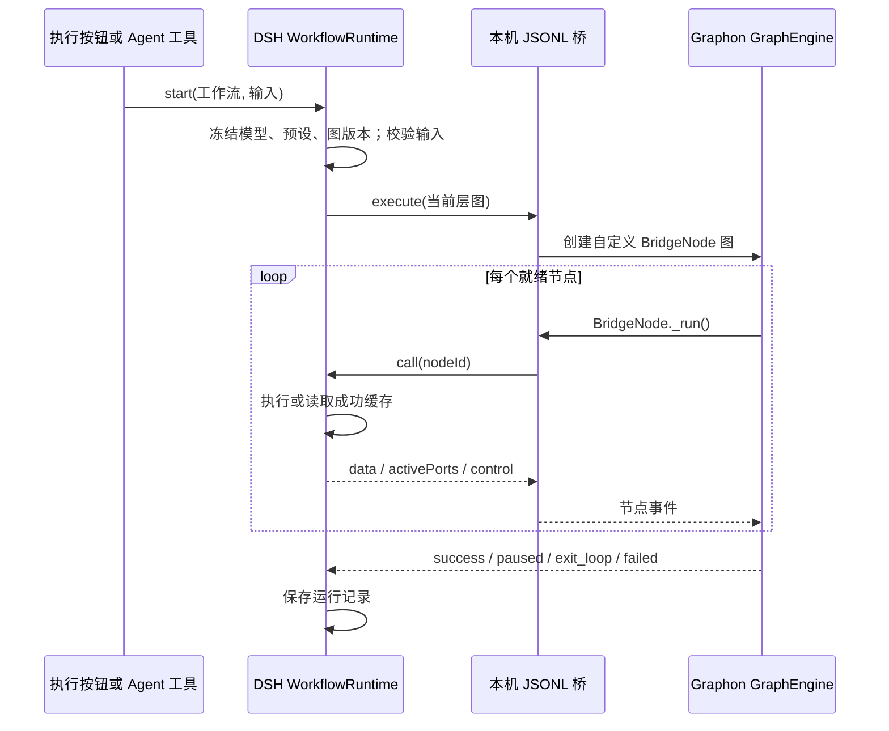

# Graphon 执行边界

> 核对日期：2026-10-21。依据当前源码和锁定的 Graphon 0.7.0；本页是实现审计，不代替[总索引](../README.md)中的运行结果。

当前插件采用“Graphon 调度 + DSH 宿主执行节点”的组合。20 种节点都能进入同一条 Graphon 调度链，但不是使用 Graphon 自带的 20 种节点实现，更不是把画布、聊天和插件管理交给 Graphon。

Agent 生成工作流由独立 `WorkflowPlanningService` 完成，生成阶段不启动 Graphon。保存新图或接受修改提案后，用户另行发起执行才进入下图；详见[规划引擎职责与数据流](../规划引擎/01-职责边界与数据流.md)。

## 一次执行经过哪里

模型、工具、代码和文件的执行依然经过宿主适配器及其权限检查。Python 进程通过标准输入输出通信，没有额外 HTTP 服务或 TCP 端口。

## 责任划分

| 能力 | 当前负责方 | Graphon 参与方式 |
|---|---|---|
| 依赖就绪、边激活、未选分支跳过、汇合 | Graphon | 真正调用 `GraphEngine.run()` |
| 输入、条件判断、模板、输出、列表、赋值、聚合 | TypeScript 运行器 | 调度到节点后回调宿主 |
| LLM、分类、参数提取 | DSH 模型后端 + 运行器校验 | 调度节点；不调用 Graphon 模型节点 |
| Agent、知识检索、代码、文档、HTTP、工具 | DSH 执行适配器 | 调度节点；执行效果由宿主承担 |
| 迭代、循环、退出循环 | 宿主管理容器与状态 | 每个内部图再次提交 Graphon |
| 人工等待、恢复、超时 | 宿主快照与定时器 | 用 Graphon 暂停事件停止本层后续调度 |
| 画布、连线编辑、菜单、便签、注释、撤销 | 客户端与存储 | 不属于 Graphon 执行节点 |
| 模型 token 估算 | 私有 Python 桥中的 tiktoken | 与 Graphon 共用环境；只作输入规模与性能估算 |

## 必须保留的结论边界

- `GraphonBridge` 按插件生命周期共享一个私有子进程，第一次执行或分词时才启动。
- 一个输入缺失的运行先进入等待，不会为了展示表单先启动图引擎。
- 每次 `executeGraph()` 都提交一个新的 Graphon 图：顶层一次，迭代每项/循环每轮各一次；人工恢复会重新提交并回放宿主成功缓存。
- 每层图的 worker 数默认 3，依据 `executionPolicy.maxConcurrentAgents` 可设 1～8；该层存在 `human` 或 `assigner` 时强制为 1。就绪分支可以并行，模型调用还受共享准入限制；见[分支、合流与并发](03-分支合流与并发.md)。
- 当前存在[失败与重试缺口](06-失败与重试边界.md)，不能用“所有节点经过 Graphon”推导“已完整实现 Dify 的全部能力”。

## 证据

- [宿主执行入口与 executeGraph](../../../src/host/runtime.ts)：`start`、`executeGraph`、`executeNode`。
- [TypeScript 子进程桥](../../../src/host/graphon.ts)：`GraphonBridge.execute`、`request`、`receive`。
- [Python BridgeNode 与 GraphEngine](../../../runtime/graphon_bridge/main.py)：`BridgeNode._run`、`BridgeService._execute`。
- [桥协议说明](../../../runtime/graphon_bridge/README.md)。
- [实际 Python 协议测试](../../../tests/graphon-python/test_bridge.py)与[引擎故障测试](../../../tests/graphon-bridge.test.ts)；是否在本轮通过，见[总索引](../README.md)。

相关：[图编译与端口](02-图编译与端口.md) · [预构建环境与轻量分词](09-预构建环境与轻量分词.md)
