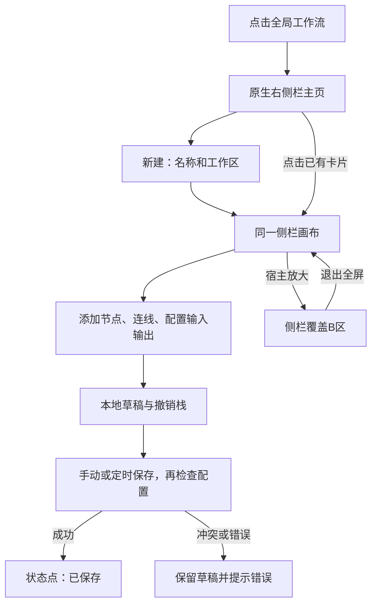

# 创建、编辑与保存工作流

[返回总索引](../README.md)

这条流程解决“从入口得到可保存的流程草稿”，不自动执行。

1. 通过[主页](../交互/01-工作流主页.md)选择正确工作区。创建默认输入和输出节点；名称较长只在导航中省略，数据不截断。
2. 使用[节点目录](../交互/04-节点目录与添加.md)或[工具目录](../交互/05-工具目录与OpenAPI.md)添加节点；连接应明确表达先后依赖。
3. 在[节点面板](../交互/11-节点配置与变量引用.md)配置字段、模型、变量引用；看[20 类节点](../节点/README.md)确认输入输出契约。
4. 使用标题后的保存按钮或 `⌘S / Ctrl+S`，也可在原生设置选择自动模式；默认每 5 分钟保存有变化的流程。执行前始终强制保存并检查，参见[保存规则](../交互/08-撤销重做与自动保存.md)。
5. 缺失配置可留在同一画布并保存，只有运行被阻止；点击执行显示处理指引。另存为创建独立流程，保留结构及普通变量，Secret 值和授权须在副本中重新配置。

通过对话新建时，主 Agent 收集需求并调用规划引擎；候选经宿主校验后保存，新图不生成已退役的历史控制字段。原生权限、节点步数、超时、并发和修复轮次上限仍生效。画布“高级设置 → 执行策略”可配置输出修复策略、Agent 并发上限和最大修复轮次；详见[现行设置](../交互/19-设置与角色预设.md)。

缩放、便签、标题和菜单为客户端能力，不会变成 Graphon 的执行步骤。Graphon 从执行启动时才接收图结构。无依赖边的已知兄弟节点引用会被可执行预检与运行守卫拒绝，不能用其执行先后当作数据依赖；未知缺失值仍保留原有可选/失败兜底，见[引用修复记录](../验证/问题/02-兄弟支路越依赖引用.md)。

依据：[app.tsx](../../../src/client/app.tsx)、[store.ts](../../../src/client/store.ts)、[storage.ts](../../../src/host/storage.ts)。本轮组件测试结果见[验证报告](../验证/01-验证范围与结果.md)，不代表本轮新增了全套实机点击验收。
