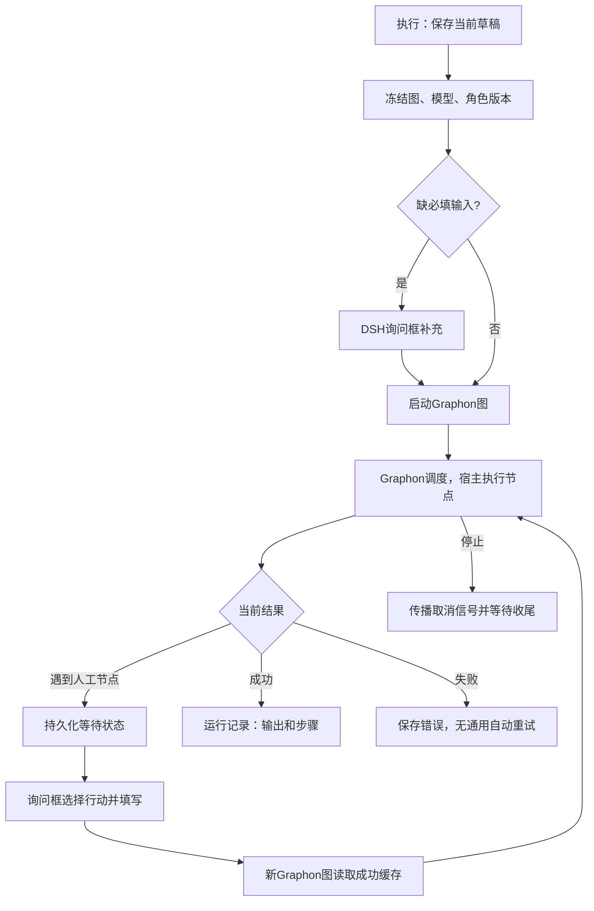

# 执行、人工暂停与恢复

[返回总索引](../README.md)

这条流程解决“怎样得到一次有版本、有状态的运行结果”。

1. [执行按钮](../交互/15-执行与停止.md)运行已保存版本。默认模型来自 DSH；显示编号不用于变量寻址。
2. 输入不足或到达[人工介入](../节点/human-人工介入.md)时，通过[询问框](../交互/16-运行询问.md)补充，不在普通聊天中猜测答案。
3. 暂停期间会保存已成功步骤。回答后重新提交图，读取成功缓存；[集成测试](../../../tests/graphon-capability-audit.test.ts)检查模型调用数及成功步骤时间未改变。
4. 在[上次运行和运行记录](../交互/14-运行数据与记录.md)查看字段、JSON、错误与本次模型配置。停止不是撤销外部操作。

人工恢复不等于失败重试，也不等于持久化 Graphon 原生 frame；参见[暂停机制](../原理/05-暂停恢复与停止.md)和[失败边界](../原理/06-失败与重试边界.md)。

可复现的复杂例子是“代码 → 列表 → 迭代 → 人工确认 → 时间工具”和“赋值 → 条件 → 退出循环”，本轮已用真实 Graphon 在隔离存储中执行，见[存量流程核验](../验证/02-存量流程核验.md)。
