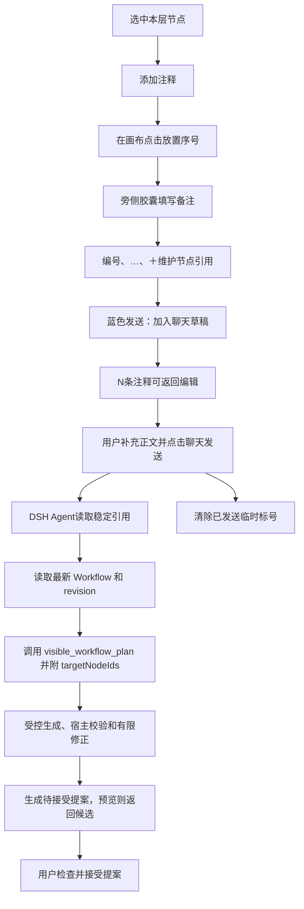

# 聊天引用、批注与 Agent 修改

[返回总索引](../README.md)

这条流程解决“如何把准确节点和修改要求交给 Agent”，并区分加入草稿与真正发送。

核对日期：2026-10-21。规划后端已接入，当前证据是源码及离线测试；安装后的真实模型与完整界面验收见[当前限制](../规划引擎/11-验收范围与当前限制.md)。

**批注序号、节点结构编号、稳定节点 ID 是三种身份。** 备注标号只服务本批草稿；节点编号便于识别；Agent 引用使用稳定 ID。详见[批注](../交互/17-节点批注与聊天草稿.md)和[稳定身份](../原理/07-变量与稳定身份.md)。

- 编号按钮只显示当前层编号。父流程不列子流程节点；要标注内部节点，先进入内部流程。
- “交给 Agent”是另一种生成草稿的入口。`@` 选择保存工作流后，也由用户发送才能交给主 Agent。
- 自然语言生成和修改统一调用规划工具；权限、固定节点、节点范围和当前版本由宿主控制。Graphon 不负责自然语言理解、生成画布或发送聊天。
- 规划候选最多初次生成加两轮修正；信息不足时主 Agent 转达问题，等待用户回答。已有图的发布结果是待接受提案，不能提前称为原图已修改。
- 这里的修正针对候选图的结构和约束。业务运行中的失败修复由 Runtime 的独立机制管理，不能把两类任务、次数上限或状态混用。

依据：[chat-bridge.tsx](../../../src/client/chat-bridge.tsx)、[annotation-editor.tsx](../../../src/client/annotation-editor.tsx)、[host/index.ts](../../../src/host/index.ts)。相关状态和重启边界见[Agent 编辑](../交互/20-工作流引用与Agent编辑.md)及[验证范围](../验证/01-验证范围与结果.md)。

后端原理：[聊天入口与请求身份](../规划引擎/02-聊天入口与请求身份.md) · [候选校验与有限修正](../规划引擎/04-候选校验与有限修正.md) · [发布提案](../规划引擎/08-发布提案与幂等.md)。
