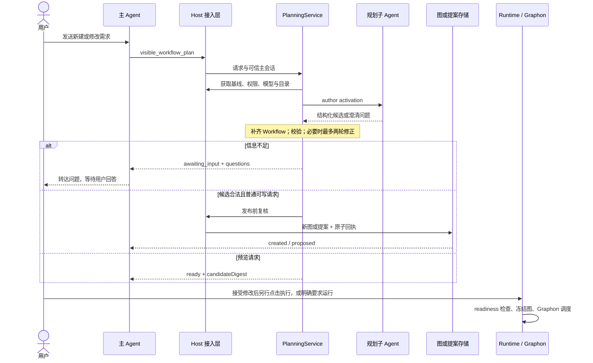

# 规划引擎的职责边界与数据流

核对日期：2026-10-21。[返回规划引擎索引](README.md)

本项目通过 `WorkflowPlanningService` 把“理解需求、产出候选、宿主校验、受控发布”连接起来。最终产物仍是可编辑的 Workflow。v0.0.1 生成阶段不运行 Graphon；本轮 v0.0.2 已增加 Graphon 受控节点变换回归，只开放 template/JavaScript code，不执行完整业务图。具体范围和实施状态见 [16](16-v0.0.2证据驱动优化执行方案.md)。

## R7 新建试做分支（R7 已安装，闭环验收暂停）

无来源 create 默认由 Host 要求 execution 规范，先通过 `WorkflowTrialService` 管理执行 child、真实文件核验及必要真人复核，再把独立 verified-trial/trialTask 交给原规划服务。该分支始终先返回预览，必要恢复日志落盘但不发布业务图；当前对话提炼、已有图修改和明确 design-only 不强制试做。R7 已安装，真实闭环验收暂停；当前进度见[暂停说明](19-R7自动闭环阶段说明与暂停交接.md)。

试做与生成图执行是不同阶段：前者使用本次白名单原生工具完成一次任务，后者仍由用户另行发起并交 WorkflowRuntime/Graphon。author/optimizer 不因此获得业务工具。源码：[trial-service](../../../src/host/planning/trial-service.ts)、[Host 接线](../../../src/host/index.ts)；完整合同见 [18](18-先执行验证再生成工作流.md)。

## 谁负责什么

| 组件 | 当前职责 | 交付物 |
| --- | --- | --- |
| 客户端聊天桥 | 把新建、整图修改和节点批注整理为聊天草稿，保留流程 ID、请求 ID 和节点范围 | 用户发送后的主 Agent 请求 |
| 主 Agent | 调用规划工具，转达澄清问题和用户答案，解释真实回执 | 任务结果或待答问题 |
| Host 接入层 | 从实际主会话解析工作区和权限；冻结图、模型、工具目录；按需采集当前对话证据；处理保存 | 可信 `PlanningContext`、readiness、发布回执 |
| `WorkflowPlanningService` | 管理阶段、资源保护、并发、校验、有限修正/优化、候选保留、澄清、持久化和发布竞争 | `PlanningTask` 与经校验的候选 |
| 规划子 Agent | 查询冻结的节点/工具元数据，提炼任务方法、生成或修正结构化结果 | `TaskProcedure`、`PlannerOutput`、确定性替换建议或问题 |
| 共享投影和校验层 | 把编辑投影补成完整 Workflow，检查当前 schema、图、范围、引用和工具参数 | 完整候选与结构化诊断 |
| 工作流存储与编辑状态存储 | 原子写入新图或修改提案，同时写入规划回执 | `created` 或 `proposed` 回执 |
| `WorkflowRuntime` 与 Graphon | 用户另行发起执行后冻结运行图、调度节点并调用业务适配器 | 运行记录、节点结果与暂停状态 |

规划用的子 Agent 和图里的 `agent` 节点也不是同一个对象。前者生成流程定义；后者是流程执行到该节点时才启动的业务任务。`workflow.subAgents[]` 保存业务角色定义，不保存规划任务会话。

## 纯设计和修改路径：从需求到可执行流程

只读和 Plan Mode 强制走预览。显式 design-only 和普通修改的可写规划在候选通过后会自动走发布流程；已有图发布时形成待接受提案。通过 Host 保存检查的合法候选可以在文件或 Secret 等依赖未就绪时保存待配置；缺少当前规划模型、模型越权或模型元数据解析失败会阻断，不能笼统认为缺模型也能保存。

## 具体接线位置

插件构造函数在 `src/host/index.ts` 同时创建 Runtime 和 Planner，并将同一个 `ModelAdmission` 实例传给两者。规划和业务运行共享模型并发容量，各自维护状态与用量记录；Planner 不启动用户正式业务图。v0.0.2 的 regression 模块另建使用私有临时存储的既有 WorkflowRuntime 实例，仅运行受限节点变换，结束后清理，不写用户运行库。

| 注入点 | 连接到当前项目的什么能力 |
| --- | --- |
| `driver` | `createPlanningAgent`，封装官方 `subagents.startActivation` |
| `context` | `planningContext`，冻结获准编辑的图和真实目录 |
| `authorize` | `authorizePlanning`，复查调用者、版本、模型和工具变化 |
| `readiness` | `readinessFor`，复用业务执行前的资源就绪诊断 |
| `publish` | `agentSave`，沿用新建保存与已有图提案逻辑；最终写入前再次授权 |
| `receipt` | 同时查询工作流存储和编辑状态存储中的原子回执 |
| 生命周期 | 插件卸载时分别调用 `runtime.close()` 和 `planner.close()` |

这种接法把规划服务与具体宿主资源解耦：纯候选校验可以独立测试，真正身份、权限和提交仍集中在 Host。现有规划 Agent 工具继续承载任务交互，没有增加专门的规划 Remote 接口；既有双端 Remote 方法继续承载原画布与提案交互。

## 从本次任务提炼的分支

`visible_workflow_from_conversation` 通过同一 Host 身份校验，只读取当前根对话已结束历史。方法提炼和图生成共用同一 `PlanningTask`、模型准入、资源保护与澄清；前者返回带来源引用的步骤，后者返回当前 Workflow 投影。提炼后生成并冻结基线，最多两轮优化；预览不保存图，v0.0.2 新增的 Graphon 局部回归不等于业务运行。证据采集、范围及来源映射详见 [12](12-当前对话任务提炼与预览.md)。

## Graphon 保留的作用

运行时仍走 `WorkflowRuntime.executeGraph()` → JSONL 桥 → Graphon `GraphEngine.run()`。Graphon 决定依赖就绪、分支激活、跳过和合流，节点业务回调 TypeScript 适配器。它不理解自然语言需求，也不负责把规划结果写入画布。

目前每层图的 worker 数依据执行策略，默认 3、可设 1～8；该层存在人工节点或赋值节点时限制为 1。这是业务执行的调度策略，与规划子 Agent 的数量限制分开。详见[Graphon 执行边界](../原理/01-Graphon执行边界.md)、[分支合流与并发](../原理/03-分支合流与并发.md)。

## 源码与证据

- [Host 组装及接入](../../../src/host/index.ts)：构造函数、`planningCaller`、`planningContext`、`authorizePlanning`、`agentSave`。
- [规划服务](../../../src/host/planning/service.ts)：注入接口与完整生命周期；不依赖 Graphon/Runtime。
- [共享协议](../../../src/shared/planning-types.ts)、[投影与校验](../../../src/shared/planning-projection.ts)。
- [Runtime](../../../src/host/runtime.ts)、[Graphon 桥](../../../runtime/graphon_bridge/main.py)。
- [Host 集成测试](../../../tests/planning-host.test.ts)、[共享模型准入测试](../../../tests/model-admission-sharing.test.ts)：实际存储和宿主服务接线，模型为测试替身，详见[验收边界](11-验收范围与当前限制.md)。

相关：[请求身份](02-聊天入口与请求身份.md) · [JSON 投影](03-JSON投影与宿主补齐.md) · [发布提案](08-发布提案与幂等.md)
