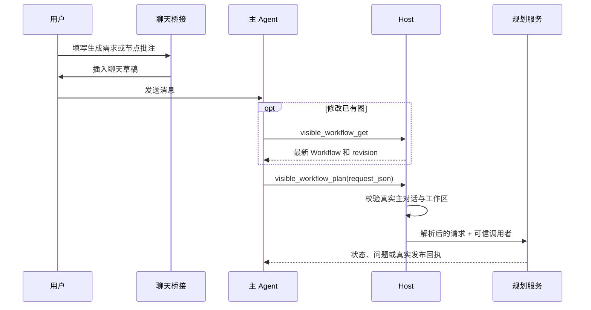

# 聊天入口与请求身份

核对日期：2026-10-21。本文说明用户需求怎样进入规划引擎，以及宿主怎样确定请求、工作流和主对话的身份。

[返回规划引擎索引](README.md) · [职责边界与数据流](01-职责边界与数据流.md) · [任务状态与澄清](06-任务状态与澄清.md)

## R7 请求分流与双身份（R7 已安装，闭环验收暂停）

可写无来源 create 缺少 execution 时返回 EXECUTION_SPEC_REQUIRED。主 Agent 提供 `execution:{mode:"execute-first",task,tools,inputs,artifacts,reviewItems}`，关键需求缺失先询问；用户明确只设计才用 `execution:{mode:"design-only"}`。只读/Plan Mode 的无 execution create 自动设计预览；显式 execute-first 同样降为 design-only 预览，只把规范作为设计资料，不声称试做、验收或证据驱动优化已发生。

试做返回 trial- taskId，get/cancel 按此前缀路由；后续规划在 planningTaskId/planning 中返回，answer/publish 使用规划身份与其 revision/digest。`visible_workflow_trial_review` 只重新核对已完成试做产物并询问真人，不续跑 needs_input child。两种来源和 trialTask 详见 [18](18-先执行验证再生成工作流.md)。

## 1. 入口只负责表达需求

原生 `/dsh-visible-workflows` 命令通过 followup 进入真实主对话，再由主 Agent 调用规划入口；“交给 Agent”、明确的自然语言优化和节点批注经主 Agent 调用 `visible_workflow_plan`。按钮仍先把需求加入原生聊天草稿，由用户发送；插入成功、消息准入成功、候选生成和发布是不同事件。主 Agent 负责完整转达需求、转交问题和解释回执；专用规划子 Agent 负责设计节点图。完整接线见[前端入口与规划引擎接入](13-前端入口与规划引擎接入.md)。

| 用户入口 | 桥接层附带的信息 | 主 Agent 下一步 |
| --- | --- | --- |
| `/dsh-visible-workflows [需求]` | 原生命令 ID、接收命令的真实 Agent、完整输入；无需求时原生问答补齐 | 原生命令只转交真实用户输入；主 Agent 根据新建、已有完成任务或修改意图选择 Host 工具 |
| 新建工作流 | 新的 `targetWorkflowId`、稳定 `requestId`、完整需求、`expectedRevision: 0` | 核对工作区并冻结 execution 规范；必要信息先原生询问，再进入试做预览 |
| 修改已有工作流 | 原工作流 ID、稳定请求 ID、完整修改需求 | 先调用 `visible_workflow_get`，把最新 `revision` 填入请求 |
| 明确说“优化这个 workflow” | 优先使用消息中的精确 @ 引用；没有引用时读取当前对话的画布目标提示 | 确认目标并读取最新图后调用规划工具；目标缺失、歧义或画布未保存时不猜测 |
| 节点批注 | 每条批注的稳定节点 ID 和原文；合并去重后的 `targetNodeIds` | 读取最新图，完整转达所有批注及本条消息补充要求 |
| 从本次任务生成工作流 | 当前对话中的用户要求与可选事件范围；不传 sessionId | 调用 `visible_workflow_from_conversation`，只生成预览并转达方法/来源 |
| 普通工作流引用 | 工作流 ID、标题、请求标识 | 默认按用户要求使用现有执行入口；只有明确要求修改时才调用规划工具 |

节点显示编号用于阅读；请求范围、变量引用和提案定位使用稳定 ID。批注的画布点位与显示编号不成为模型的编辑依据。



## 2. 请求契约

`request_json` 是下列对象序列化后的字符串。对象采用严格字段校验，不能额外传入 `workspaceId`、`sessionId` 或权限状态。

```json
{
  "requestId": "edit-request-001",
  "operation": "revise",
  "instruction": "把摘要节点改为输出三条中文要点，保留其余节点。",
  "targetWorkflowId": "flow-001",
  "expectedRevision": 7,
  "targetNodeIds": ["summary-node"]
}
```

| 字段 | 规则 |
| --- | --- |
| `requestId` | 必填，1–160 个字母、数字、下划线或连字符；一次逻辑请求保持不变 |
| `operation` | 只允许 `create` 或 `revise` |
| `instruction` | 必填，去掉首尾空白后非空，最多 100,000 字符 |
| `targetWorkflowId` | 修改时必填；新建时可指定预留 ID，Host 检查它尚未被普通或归档流程使用 |
| `expectedRevision` | 修改时必填且大于零；新建时只能省略或为零 |
| `targetNodeIds` | 可选，最多 500 个且不能重复；新建不能携带非空范围 |
| `preview` | 可选；为真时只预览候选 |
| `source` | 可选 current-conversation 或 `{kind:"verified-trial",trialId}`；仅 create + preview:true，由 Host 绑定根身份和可信来源 |
| `execution` | Host 入口扩展：无来源 create 使用 execute-first 及规范，或用户明确 design-only；不能和 source/revise 混用 |

修改时传入的范围必须存在于当前可信基线。空范围允许整图编辑，但删除既有节点仍须明确列入目标范围；细则见[候选校验与有限修正](04-候选校验与有限修正.md)。

“从本次任务生成工作流”入口的 `request_json` 只接受 `requestId`、`instruction` 和可选 `fromSeq/throughSeq`，由 Host 补齐上述 source/create/preview。普通 plan 即使手工传入 source，也不能绕过相同取证和预览限制。完整示例及范围规则见 [12](12-当前对话任务提炼与预览.md)。

## 3. 权限来自活跃主对话

Host 从工具执行上下文取得实际 Agent，经 `workflowAgentOwner` 核对注册表和主对话归属，再解析工作区。规划必须由主对话发起，子 Agent 不能递归委派另一个规划任务。

任务归属是「工作区 + 主对话」。读取、回答、取消和发布都重新校验这一归属；知道一个 `taskId` 不代表有权操作它。修改目标须是当前工作区可见或全局范围的图；全局只共享定义，不能借用定义所属项目的文件、Secret 或工具权限。

前端同步的当前画布 ID、revision 和 dirty 状态只是目标提示，不是授权。Host 再核对活跃根 Agent、工作区可见性、保存版本及是否有未保存修改。同一会话多个窗口指向不同工作流时，要求使用精确 @ 引用；过期提示不用于猜测目标。

只读或规划模式会由 Host 强制设置 `preview: true`。模型不能靠请求中的 `preview: false` 绕过该限制。普通预览保留在内存，verified-trial 预览是必要恢复日志的例外；以后显式发布仍需当前写入权限、最新任务版本与候选摘要。

## 4. 请求身份与保存版本各管一件事

`requestId` 在同一工作区、同一主对话内去重。相同 ID 和相同解析后内容返回原任务，正在处理时等待同一任务完成；同 ID 配不同内容返回 `REQUEST_ID_CONFLICT`。修改需求应使用新的请求 ID。

`expectedRevision` 防止覆盖已经变化的工作流。Host 冻结最新基线，发布前再检查版本与基线摘要；它不等同于规划任务的 `revision`。回答问题和发布预览使用的是任务版本，详见[任务状态与澄清](06-任务状态与澄清.md)与[发布提案与幂等](08-发布提案与幂等.md)。

## 5. 源码与验证入口

- [chat-bridge.tsx](../../../src/client/chat-bridge.tsx)：`insertGenerateRequest`、工作流引用序列化、批注请求和新建身份追踪。
- [command.ts](../../../src/host/planning/command.ts)：原生命令注册与真实用户 followup，不直接等待规划。
- [planning-ui.ts](../../../src/client/planning-ui.ts)、[ui-state.ts](../../../src/host/planning/ui-state.ts)：当前画布提示与真实发布回执同步。
- [planning-schema.ts](../../../src/shared/planning-schema.ts)：`parsePlanningRequest` 的字段、长度与创建/修改约束。
- [index.ts](../../../src/host/index.ts)：`planningCaller`、`planningReadOnly`、`planningContext`、原生命令与规划工具注册。
- [service.ts](../../../src/host/planning/service.ts)：`start` 的请求去重，以及 `owned` 的任务归属检查。
- [chat-bridge.test.ts](../../../tests/chat-bridge.test.ts)、[planning-service.test.ts](../../../tests/planning-service.test.ts)、[planning-host.test.ts](../../../tests/planning-host.test.ts)：覆盖请求原文保留、稳定身份、重复请求、作用域与实际 Host 接线；具体执行证据见[验收范围与当前限制](11-验收范围与当前限制.md)。
