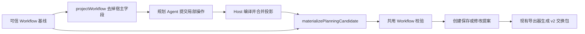

# JSON 投影与宿主补齐

核对日期：2026-10-21。本文说明当前源码中的局部编辑、Host 投影与完整 Workflow 的关系。局部编辑正在验收，安装状态见 [17](17-局部编辑意图与宿主编译.md)。

[返回规划引擎索引](README.md) · [当前 JSON 唯一标准](../原理/10-JSON字段与导入导出.md) · [候选校验与有限修正](04-候选校验与有限修正.md)

## 1. 一套定义，四种承载形式

编辑器、规划引擎、保存与导入导出共用当前 `Workflow` 和各类节点 `config` 校验规则。交换包只接受 `formatVersion: 2`、`runtime.engine: "graphon"`、`runtime.protocol: 1`；没有旧 JSON 迁移分支。

| 形式 | 用途 | 内容 |
| --- | --- | --- |
| `WorkflowPackage` | 导入导出 | 格式与运行协议、主 `workflow`、独立子流程 `workflows`、`presets`、`dependencies` |
| 完整 `Workflow` | 本地保存、画布与执行 | 节点语义、稳定身份、坐标、版本、执行策略及允许的本地元数据 |
| 局部编辑意图 | 规划子 Agent 输出 | 基线摘要、短引用和明确操作；未指定字段保留 |
| `graphJson` 内的编辑投影 | Host 内部编译结果与 canonical 规划记录 | 当前 Workflow 中允许编辑的名称、说明、节点、连线、角色与环境变量声明 |

新模型调用不再接收完整 `graphJson` 输出。Host 将局部操作合并进可信投影，再内部生成 `graphJson` 并物化；历史任务记录仍可读取这一 canonical 结构。它不能直接作为导入文件：Host 先补齐可信字段，再通过已有 `parseWorkflow`。



## 2. 投影保留的字段

| 对象 | Host 内部投影保留 |
| --- | --- |
| 顶层 | `title`、`description`、`nodes`、`edges`；可选 `subAgents`、`environmentVariables` |
| 节点 | `id`、`kind`、`title`、`config` |
| 连线 | `source`、`target`，可选 `port` |
| 容器 | `config.body` 内递归使用同样的 `nodes`、`edges` |
| 子 Agent 定义 | `id`、`name`、`prompt` |
| 环境变量 | 当前声明字段；普通变量可有 `value`，Secret 不能有值，模型不能设置 `revision` |

下面是 Host 内部投影示例；其中节点 ID 必须已经存在于基线或由 Host 的身份池分配。模型侧用 @1 / +key 短引用，由编译器转换为稳定 ID。

```json
{
  "title": "原文输出",
  "description": "收集文本并直接输出。",
  "nodes": [
    {"id":"input-node","kind":"input","title":"文本","config":{"fields":[{"name":"text","label":"文本","required":true}]}},
    {"id":"output-node","kind":"output","title":"结果","config":{"text":"{{input.text}}","outputName":"result"}}
  ],
  "edges": [{"source":"input-node","target":"output-node"}]
}
```

Agent 节点仍使用 `config.subagentId` 引用 `subAgents[].id`，`config.prompt` 保存本节点任务。共享角色正文位于定义的 `prompt`，Agent 节点禁止 `config.rolePresetId`；其他允许角色预设的模型节点继续使用各自的当前配置契约。

## 3. Host 补齐与保护什么

`materializePlanningCandidate` 从基线复制完整 Workflow，再合入允许编辑的语义字段。它不执行节点、不读取时钟；相同基线和投影可得到确定的候选。正式保存时的版本和时间由存储层处理。

| 字段类别 | 补齐规则 |
| --- | --- |
| 流程身份、工作区、保存版本、时间、执行策略及历史元数据 | 沿用可信基线，不由模型生成 |
| 既有节点 | 保留坐标、固定状态和已有显示编号 |
| 新节点 | 默认未固定，按网格分配初始坐标，再由现有编号器编号 |
| 连线 ID | 同层、同起点/终点/出口的已有边保留 ID；新边分配不冲突 ID |
| 子 Agent 本地绑定与预设来源 | 既有 `sessionId`、`rolePresetId`、`rolePresetRevision` 和编号从基线保留；投影不携带 |
| 环境变量版本 | 保留既有版本；Secret 声明不能被降成普通变量 |
| 便签、视口、批注 | 基线保留；合法删除节点后清理失效附件引用或容器定位，不删除批注正文 |

省略可选的 `subAgents` 或 `environmentVariables` 会沿用基线；显式提供数组则表示该集合的候选内容，仍须通过固定节点、共享引用和范围保护。

局部操作中的新身份由编译器取自 Host 池：每次冻结上下文最多额外提供 60 个节点 ID、20 个子 Agent 定义 ID、20 个环境变量 ID，并受当前格式总量上限约束。模型只指定本次新增对象的唯一短 key，不能自行编造 ID 或借用身份字段改变工作区。

## 4. Token 节省来自删掉重复的宿主信息

规划提示带只读节点/连线视图、需求、基线摘要、可用身份数量、模型选项及节点/工具目录摘要，不再要求抄写长身份池。需要某类节点的详细字段时，通过 `planner_node_catalog` 按需查询字段语义、输出、示例和从共用校验器生成的 schema；不把所有节点配置说明一次性放进提示。工具详情同样按需查询冻结目录。

这减少坐标、编号、版本、执行策略和本地绑定的重复输出，也减少模型填写这些字段造成的无效修正。当前源码改为明确局部操作，完整候选投影由 Host 生成；不是开放任意路径的 JSON Patch。没有受控的真实模型 Token 对照实验，不能承诺固定节省比例。用量统计与资源保护见[资源保护与并发](07-资源保护与并发.md)。

投影额外设有 2,000,000 字节限制和危险字段检查；每层最多 200 个节点、1,000 条边，整个工作流最多 500 个节点，容器最多嵌套 5 层。完整 JSON 字段限制继续以[格式说明](../原理/10-JSON字段与导入导出.md)为准。

## 5. 源码与验证入口

- [planning-edits.ts](../../../src/shared/planning-edits.ts)：内部局部编辑协议、短引用、基线摘要与 Host 编译。
- [planning-types.ts](../../../src/shared/planning-types.ts)：`PlanningProjection`、`PlanningNodeProjection` 和 `PlanningContext`。
- [planning-projection.ts](../../../src/shared/planning-projection.ts)：`projectWorkflow`、`materializePlanningCandidate` 与身份/元数据保护。
- [node-capabilities.ts](../../../src/shared/node-capabilities.ts)、[workflow-validation.ts](../../../src/shared/workflow-validation.ts)：从同一节点配置校验器生成目录，容器仅移除 Host 管理字段。
- [workflow-format.ts](../../../src/shared/workflow-format.ts)：当前交换包版本、导入解析和导出处理。
- [planning-projection.test.ts](../../../tests/planning-projection.test.ts)：投影往返、当前导出兼容、嵌套图、身份池、本地绑定和 Secret 字段检查；验收边界见[验收范围与当前限制](11-验收范围与当前限制.md)。
