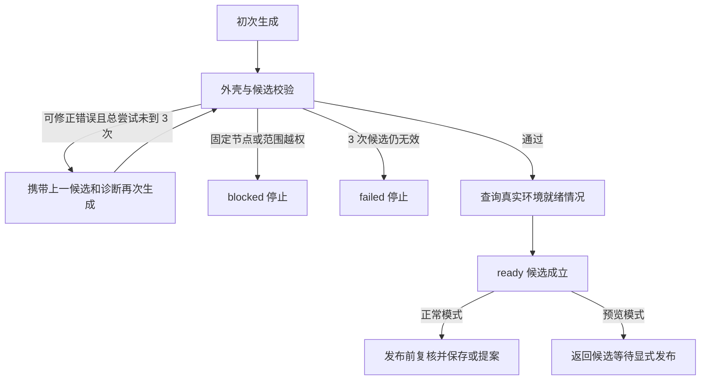

# 候选校验与有限修正

核对日期：2026-10-21。本文说明 Host 怎样把模型输出变成合法候选，以及哪些错误可以交回模型修正。

[返回规划引擎索引](README.md) · [JSON投影与宿主补齐](03-JSON投影与宿主补齐.md) · [发布提案与幂等](08-发布提案与幂等.md)

## 1. 候选必须经过宿主检查

新 author 子 Agent 提交局部编辑外壳，Host 校验协议、基线摘要和操作后组装完整候选；不接受模型重写 graphJson。当前改造状态见 [17](17-局部编辑意图与宿主编译.md)。自然语言总结不能替代候选，模型声称“校验成功”也不构成验证结果。

| 外壳字段 | 含义 |
| --- | --- |
| `outcome` | `candidate` 或 `needs-input` |
| `protocolVersion`、`baseDigest` | 内部协议版本与当前可信草稿摘要 |
| `edits` | 本轮指定操作；等待澄清时为空或省略 |
| `summary`、`assumptions` | 修改说明与采用的假设 |
| `questions` | 等待用户的结构化问题，每批最多 3 个；候选结果必须为空数组 |
| `requirementCoverage` | 需求 ID 到候选短引用的关联声明，Host 编译成真实节点 ID |

当前完整用户需求对应 `R1`。普通候选至少把 `R1` 关联到一个真实节点；当前对话提炼任务还必须包含全部 `procedure.steps[].id`，每个步骤关联实际节点。不能出现除此之外的需求 ID、重复声明或不存在的节点；`requiresReview:true` 步骤必须关联至少一个真实 `human` 节点。该检查只验证覆盖结构，不能证明业务目标已经完整满足。

## 2. 校验分层

| 层次 | 当前检查 |
| --- | --- |
| 输出外壳 | 必填字段、长度、问题身份、`candidate` 与 `needs-input` 互斥 |
| 局部编译与投影补齐 | 基线摘要、操作字段、未知/重复短引用、作用域、大小、危险字段、身份池及图总量 |
| 当前 Workflow | 共用节点 schema、唯一身份、节点配置与 Agent 角色字段 |
| 图结构 | 连线端点、合法出口、禁止普通环、每层恰好一个输入入口、所有节点从该入口可达 |
| 引用 | 上下游、分支与容器作用域；环境变量、子 Agent 定义等引用 |
| 修改权限 | 固定节点及相关连接、Host 元数据、显式目标范围、范围外共享配置 |
| 工具声明 | 真实目录或可信基线中的工具 ID、工具参数 schema、可确定的动态引用类型 |
| 需求声明 | `R1` 与每个提炼步骤指向候选实际节点；待复核步骤包含 human 节点 |

校验不执行工具、代码或整个流程。节点中可选资源缺失与结构错误分别处理：合法但缺少本地配置的图可以成为待配置候选，不能据此声称可运行。

## 3. 修改范围如何保护原图

`targetNodeIds` 为空时允许修改整图的非固定节点，但删除任何既有节点仍必须显式指定它。非空时，只有列出的节点及所选容器内部节点属于原图可编辑范围；允许新增节点，但不能用搬移或共享配置绕过范围。

- 范围外既有节点的类型、标题、配置与容器位置保持不变。
- 两端均在范围外的既有连线保持不变。
- 节点范围修改不能同时改写工作流名称与说明。
- 范围外节点仍在引用的共享角色或环境变量不能被修改或删除；环境变量识别同时支持点号和单/双引号方括号引用。
- 固定节点始终受保护；选择它不会自动解除固定，其引用的共享定义也受保护。

因此，“只修改摘要节点”不能通过改写它与其他节点共用的角色，间接改变其他节点的行为。必要时应新增独立定义，再只调整获准节点的引用。

## 4. 工具参数怎样静态检查

工具目录在规划开始时冻结。新出现的工具 ID 必须来自真实目录；基线已经引用但当前缺失的工具可保留为待配置资源，模型新编造的 ID 会产生 `UNKNOWN_TOOL_ID`。

普通工具节点及工具模式文档节点，使用 DSH 工具 schema 校验静态参数的必填项、类型、枚举和额外字段。包含 `{{...}}` 的动态参数先检查可知类型：完整引用保留其类型，混合文字按字符串处理，`oneOf` 逐分支检查。无法静态确定的运行值、枚举和整数性留到执行适配器插值后检查。

遇到当前工具 schema 校验器不支持的约束，会产生 `TOOL_SCHEMA_UNSUPPORTED`，不会默默忽略。参数合规也不表示工具服务已经连接、授权有效或调用成功。

## 5. 修正最多两次

每个任务最多 3 次候选尝试，即初次生成加最多 2 次修正。无效输出外壳、JSON 解析错误、普通图诊断或需求覆盖错误都消耗候选尝试。下一轮提示携带诊断与 Host 已物化草稿的只读视图和新摘要，允许只修正出错字段；草稿不等于已合法候选，权限/范围仍相对原始冻结上下文检查。未能物化的输出不会成为下一轮基线。

固定节点、范围或禁止操作诊断直接阻断，不通过反复生成尝试绕过保护。模型提供方故障、取消、清理失败、就绪检查异常和发布冲突也不转为候选修正，不为这些问题追加模型调用。

`needs-input` 返回用户问题，暂不消耗一次候选尝试；澄清最多 2 轮，并受独立的子任务次数、步数和时间上限约束。它不是自动猜答案的修正分支，见[任务状态与澄清](06-任务状态与澄清.md)。

## 6. 结构有效与运行就绪分开

结构通过后，Host 查询模型、工具、文件和变量等真实环境，记录 `readiness` 的待处理问题。`canRun: false` 可以与合法可编辑候选并存；就绪检查本身抛出异常则结束任务。正常模式随后尝试发布，预览模式停在 `ready`。

发布前还会重新检查当前权限、版本、模型上下文和已用工具参数定义。这里解决的是候选发布条件；真正业务执行仍须通过现有运行入口和 Graphon，详见[职责边界与数据流](01-职责边界与数据流.md)。

## 7. v0.0.2 的优化验证边界

本轮已按[证据驱动优化方案](16-v0.0.2证据驱动优化执行方案.md)在合法基线后接入最多两轮替换评估。它与“无效候选最多三次结构修正”是不同计数；优化不重置全任务的模型步骤、子 Agent 或取消保护。

替换候选继续通过本页所有 schema、图、固定节点、范围、引用和需求覆盖检查，再由 Host 做独立样本判断与真实 Graphon 的 node-transform 回归。每个替换节点至少一个完整记录样本且本轮全部样本通过；结构化 LLM 只转 code 并保留已有 outputSchema，不接受合成 expected。限定的 template/JavaScript code 回放不调用业务模型、工具、网络或业务文件写入。替换节点可设计新 config，回放必须原样使用优化候选 config.inputs，上游结果作为 seed；局部通过不能扩大为完整图成功。

回归失败、无样本、未覆盖、无收益或超过运行目标，均需保留已合法的最佳候选与报告；权限失效、清理失败和提交冲突仍按既有阻断规则处理。实现与验收结果以第 16 篇和 [11](11-验收范围与当前限制.md)为准。

## 8. 源码与验证入口

- [planning-edits.ts](../../../src/shared/planning-edits.ts)：新模型局部输出外壳、编译器与严格检查。
- [planning-schema.ts](../../../src/shared/planning-schema.ts)：请求、Host canonical 输出与历史记录解析。
- [planning-projection.ts](../../../src/shared/planning-projection.ts)：`planningCandidateIssues`、`scopedIssues`、`argumentIssues`。
- [workflow-validation.ts](../../../src/shared/workflow-validation.ts)、[reference-scope.ts](../../../src/shared/reference-scope.ts)：共用图、固定节点及引用规则。
- [service.ts](../../../src/host/planning/service.ts)：`generate` 中的尝试计数、诊断、澄清和失败分流。
- [planning-projection.test.ts](../../../tests/planning-projection.test.ts)、[planning-service.test.ts](../../../tests/planning-service.test.ts)：覆盖越权、错误修正上限、动态工具参数、待配置保存及基础设施故障不触发修正；证据与限制见[验收范围与当前限制](11-验收范围与当前限制.md)。
