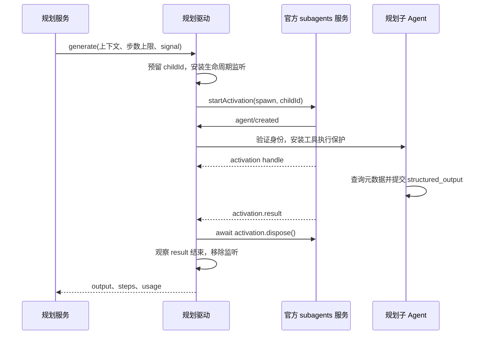

# 子 Agent 生命周期与工具隔离

> 核对日期：2026-10-21。依据当前源码；验证范围见[验收范围与当前限制](11-验收范围与当前限制.md)。

本页回答：规划模型怎样接入官方 Agent、怎样限制它只提炼方法、生成图或提出确定性替换，以及停止时怎样回收资源。入口是 `createPlanningAgent().generate()`，产物是结构化方法、候选或澄清问题。

## R7 执行 child 与规划 child 分权（R7 已安装，闭环验收暂停）

[trial-agent.ts](../../../src/host/planning/trial-agent.ts) 新增受控执行驱动，执行前冻结父会话可用工具定义，首次呈现和实际调用均检查身份、白名单、定义漂移、根权限及取消。它继承真实主请求模型，但禁止工作流保存/运行工具、再委派和 run_code；原生 approval 为 never，需要新信息或权限就停止并返回 needs-input。下文“三个工具”的限制只指 distill/author/optimizer，不是执行 child 的业务白名单。

执行的公开事件经独立投影、脱敏和限长进入 journal，私有思考不记录。完成声明必须再经过 Host 产物验证与完整证据检查；清理失败不能被成功覆盖。持久化已知 child 的 cold-resume guard 阻止重启后再激活，用户回答也不会自动续跑它。实现与定向测试：[trial-agent.test.ts](../../../tests/trial-agent.test.ts)；真实模型/原生 UI 安装验收待做，边界见 [18](18-先执行验证再生成工作流.md)。

## 每个阶段创建一个受控子 Agent

SDK 的 child 支持续聊；当前规划驱动在每次生成或修正时创建新的 activation，完成后立即清理。跨阶段的信息由任务状态显式传入，包括原需求、冻结基线、已收集答案、上次候选及诊断。

驱动要求 `spawn` 明确声明不继承父对话上下文，并支持模型选项、输出 schema 和深度限制。不满足这些条件就失败，不回退到旧 `start()` 接口或其他模型。

模型及推理强度来自 Host 冻结的当前主对话实际请求头。斜杠入口先通过官方 `followup()` 进入正常主 Agent 轮次，再由规划工具接入子 Agent；不读取 Agent 构造时可能过期的默认模型。输入框为下一轮选择的模型不改变正在执行的请求。`maxDepth` 设置为父级深度加一，交付方式为 `delivery: 'caller'`。

Host 提供 `purpose: distill | author | optimize`，分别选择固定提炼、图生成和确定性优化角色及输出 schema；用户不能传入任意角色或 schema。提炼 child 只获得 Host 脱敏裁剪后的证据，author 获得方法说明；optimize 获得方法、冻结证据、当前最佳候选、目标和已有比较。三者均不继承主会话上下文，共用工具白名单和清理路径。

优化 child 只提出 candidate/unchanged 及样本来源引用，不能运行 Graphon 或执行脚本。独立回归由 Host 调用受限 Runtime/Graphon 完成，真实结果由 Host 产生；模型不得自行填写通过结论，详见 [16](16-v0.0.2证据驱动优化执行方案.md)。

## 首次模型请求之前完成隔离

身份检查结合预留的 `childId`、创建阶段的 `AsyncLocalStorage` 标记、`source: startup` 和真实 `parentSession`。创建完成后还核对 activation 返回身份及注册表中的对象。

同一个父 Agent 同时启动多个规划任务时，监听器只接管自己的 child。子 Agent 若在返回 handle 前已经自然结束，可以接受其退出实时注册表；首次组装前捕获的精确对象仍须一致。

隔离分为两层：

1. **实际执行保护**：在 child 的工具作用域安装 `guard()`，拒绝非当前 child、已结束任务、已取消任务和白名单外工具。
2. **模型可见内容过滤**：采用 `presentAs('native')`，过滤工具 schema 与相应提示段，移除 SDK/PTC 工具说明，并确认三个必要工具实际存在。还移除该 child 无权使用的技能目录、`cliworker:delegation` 与主 Agent 的 `visible-workflows:guide`；宿主身份、规划策略和权限上下文继续保留。

因此不能只靠提示词“不要执行”，也不能把工具列表的隐藏等同于执行权限控制。这里约束的是规划 child 的工具能力，不宣称替换了整个宿主的权限或文件沙箱。

## 子 Agent 只能使用三个工具

| 工具 | 用途 | 边界 |
|---|---|---|
| `structured_output` | 提交方法、候选、澄清或优化建议的结构化结果 | 仍须通过 Host 的二次校验 |
| `planner_node_catalog` | 按需查询当前节点语义、字段、输出、例子及 schema | 只读元数据，不创建或执行节点 |
| `planner_tool_catalog` | 查询冻结的真实工具定义 | 只读元数据，不调用业务工具 |

节点词典按 `kinds`（每次最多 5 种）和 `topics` 查询，`includeSchema:true` 附带真实 schema；无参数返回紧凑索引。主 Agent 的 `visible_workflow_dictionary` 与此共用解释源，详见[语义词典](15-Agent工作流语义词典.md)。真实工具目录仍按工具 `id` 精确匹配或搜索名称说明，默认每页 3 条，`limit` 为 1–50。

目录在本次 activation 开始时序列化冻结，每次读取返回独立副本。调用方不能通过修改返回对象污染同任务或其他任务的目录。

规划 child 没有业务工作流运行、代码执行、文件读取、网络请求或再次委派的工具。若设计依赖未提供的材料，应返回澄清问题，不能声称读过文件。

每次模型步骤记录有效消息历史和本步接受消息的字节体积；已知用量立即记录，失败或取消不会丢掉已经报告的用量。规划 child 不继承绕过步骤准入的宿主自动请求重试，模型请求错误结束本次尝试。主 Agent 的重试配置不改变；具体计量规则见[资源保护与并发](07-资源保护与并发.md)。

## 停止必须等待真实清理

官方 activation 的启动 `signal` 不能单独证明已经发布的 child 会停止。这里的“发布”指 SDK 返回可管理的 activation，与[工作流发布](08-发布提案与幂等.md)是两个阶段。

- 创建前与等待结果时，驱动持续检查组合 signal。
- 取消、超时、正常成功、输出错误都会进入同一 `finally` 清理路径。
- 只要获得 handle，就对该 activation 执行并等待 `dispose()`；清理成功后观察 `result` 结束。
- 取消发生在启动中、handle 较晚返回时，仍必须清理返回的 activation。
- 服务等待驱动返回或抛错后释放模型与规划并发占位，不提前在清理尝试尚未结束时释放。
- `dispose()` 失败产生 `PLANNER_CLEANUP_FAILED`，优先于成功输出或用户取消，任务进入 `blocked`；此时并发占位仍会释放，不能确认 child 已停止，也不能报告为取消成功。

这保证“取消成功”的语义包含子任务清理；不能仅停止等待 Promise，就宣布模型活动已经结束。

## 输出的验收边界

驱动只接受 `stopReason: completed` 且存在 `structured` 的结果，先按官方支持的结构化输出 schema 检查，并限制序列化输出不超过 2 MB。author/optimizer 使用局部编辑输出 schema；distill 继续使用 TaskProcedure 合同。编辑编译器另设 1 MB、200 操作、32 层 JSON 深度保护，并验证基线与短引用；规划服务随后检查图结构、引用与修改范围。完整输出不再是新调用的兜底格式。

回收成功只证明本次子 Agent 生命周期完成。它不证明生成的业务图可以运行，更不证明流程已经执行；详见[候选校验与有限修正](04-候选校验与有限修正.md)。

## 源码与验证

- [规划驱动](../../../src/host/planning/agent.ts)：`createPlanningAgent`、`catalogTool`、`waitForResult`、`PlanningAgentCleanupError`。
- [输出契约](../../../src/shared/planning-schema.ts)：`plannerOutputSchema` 与 `parsePlannerOutput`。
- [规划服务](../../../src/host/planning/service.ts)：`generate` 的并发释放顺序、`fail` 的清理失败处理。
- [驱动测试](../../../tests/planning-agent.test.ts)：首轮工具过滤、实际调用保护、兄弟任务隔离、启动中取消、晚返回清理、清理失败和用量去重。

相关：[任务状态与澄清](06-任务状态与澄清.md) · [资源保护与并发](07-资源保护与并发.md) · [持久化恢复与取消](09-持久化恢复与取消.md)
