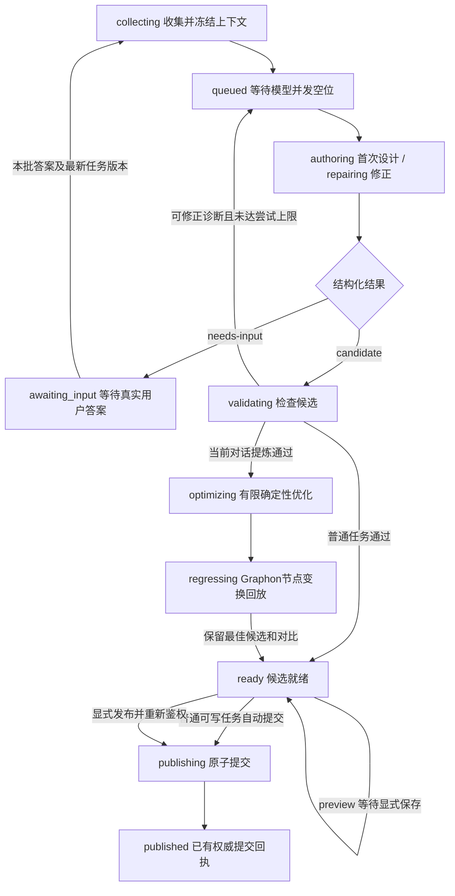

# 任务状态与澄清

> 核对日期：2026-10-21。依据当前源码；验证范围见[验收范围与当前限制](11-验收范围与当前限制.md)。

本页回答：一次自然语言请求如何变成规划任务、缺信息时怎样暂停，以及状态怎样准确表达产物。任务由 `WorkflowPlanningService` 管理；主对话用规划工具读取和推进任务。

## R7 试做状态与后续动作（R7 已安装，闭环验收暂停）

| 试做状态/结果 | 后续动作 |
| --- | --- |
| preparing/executing/verifying | 冻结记录、受控执行、Host 读回；get/cancel 使用 trial- 身份 |
| needs_input | child 已停止，转达 execution.questions；不是规划 awaiting_input，不能 plan_answer 自动续跑 |
| needs_review | 保留产物/验证/诊断；完整证据且机械检查全通过时才可原生真人复核 |
| verified/planning | Host 可信来源已建立，推进原提炼/规划 |
| ready | 已交给规划器；顶层 state 取 planning.state，不单凭 trialState 宣称候选成功 |
| failed/cancelled/interrupted | 保留事实，不换请求 ID 自动重做；重启不自动恢复业务 child |

`visible_workflow_trial_review` 仅重新复核已完成结果：问题前及真人回答后都复查文件指纹；证据不完整虽保留 needs_review，人工确认不能豁免。未完成执行由用户明确选择后在正常对话仅处理剩余动作，再从当前对话提炼。规划问题仍用 planningTaskId 和原 answer 合同，见 [18](18-先执行验证再生成工作流.md)。

## 正常路径



结构化输出的字段错误也会消耗一次候选尝试。一次任务最多三次候选尝试，即初次生成加两次修正；澄清回复本身不计入候选次数，但受独立澄清轮数和子 Agent 总次数上限约束。

## 状态表示什么

| 状态 | 含义 |
|---|---|
| `collecting` | 获取或复用冻结基线、模型、目录 |
| `queued` | 等待规划器及共享模型的并发空位 |
| `authoring` / `repairing` | 子 Agent 生成候选或根据诊断修正 |
| `validating` | Host 检查输出契约、图、引用、范围及覆盖声明 |
| `distilling` | 从冻结的当前对话证据提炼任务方法 |
| `optimizing` | 保留合法基线，受控子 Agent 建议确定性替换，最多两轮 |
| `regressing` | Host 使用真实 Graphon 回放所选记录的节点变换，不执行完整业务图 |
| `awaiting_input` | 当前批次问题需要用户补充答案 |
| `ready` | 候选结构检查通过；不代表全部运行依赖已配置 |
| `publishing` | 提交新图或修改提案，尚未确认回执 |
| `published` | 已确认 `created` 或 `proposed` 的原子提交回执 |
| `cancelling` / `cancelled` | 正在停止并等待清理 / 已完成取消 |
| `conflict` | 基线版本或摘要等发生冲突，需要重新规划 |
| `blocked` | 权限不足、清理失败或提交结果不确定，需要处理原因 |
| `interrupted` | Host 重启时发现未完成的活动任务，不自动重跑 |
| `failed` | 尚未得到有效基线时资源保护或其他错误结束任务；运行目标超出本身不导致 failed |

`published` 不表示已有图的提案被用户接受，也不表示业务流程执行过。最终语义取决于回执，见[发布提案与幂等](08-发布提案与幂等.md)。

## 澄清使用明确的输出分支

图生成子 Agent 输出只有两种合法组合：

- 模型 `candidate`：提交局部 edits 和需求覆盖，由 Host 编译为当前 JSON；不输出完整 graphJson。
- 模型 `needs-input`：不带 edits，至少一个问题，最多三个问题。

内部 canonical PlannerOutput 保留 graphJson 供既有存储使用，与模型局部编辑协议分层。

每个问题有稳定的 `id`、可读 `question` 和 `options`。问题 ID 在同批次中不能重复；每个问题最多八个建议选项。Host 不根据等待时间、建议选项或模型假设自动代答。

当前对话提炼阶段的 envelope 使用 `procedureJson`，对应 `procedure` 或 `needs-input`。提炼问题与图问题共用同一 answer 接口；回答后继续未完成阶段，已经通过的证据快照和方法不会重新从后续对话采集。

允许最多两轮澄清。子 Agent 第三次请求澄清时，任务结束为 `failed`，提示完善需求后另起任务，避免无限追问。

## 用户答案怎样继续任务

主对话先向用户转达问题，再调用 `visible_workflow_plan_answer`：

```json
{
  "task_id": "任务身份",
  "revision": 12,
  "answers_json": "[{\"questionId\":\"Q1\",\"answer\":\"用户的原始答案\"}]"
}
```

上面是接口形状示意，`revision: 12` 需替换为工具返回的最新整数。答案必须一次覆盖当前批次的全部问题，问题身份准确且不重复，每个答案非空且不超过 10,000 字符。

提交时同时检查任务归属、`awaiting_input` 状态、最新任务 `revision` 和当前没有活动段。旧问题、重复提交或其他对话的答案不会被套用到当前任务。

有效答案追加进任务，重新进入 `collecting`。原先冻结的图、模型、工具目录和 ID 池继续使用；下一次子 Agent 获得原需求、累计答案、已有候选及诊断。需要改变基线或模型时应另起规划，不能借答题悄悄换上下文。

## 预览与可写任务的差异

从当前对话提炼的请求始终强制 `preview: true`。Host 处于只读权限或 Plan Mode 时也强制 `preview: true`，显式请求也可选择预览。预览可以生成、修正和澄清，合格候选停在 `ready`；普通预览仅在内存，不写规划任务或业务图。R7 verified-trial 预览持久化必要恢复日志，但仍不发布业务图。

普通可写任务通过校验后进入发布。若预览后要求保存，主对话需要提交最新任务版本和 `candidateDigest`；Host 重新检查写权限、基线、模型和目录。

任务 `revision` 会随状态或用量事件增长；它不同于工作流 `revision`。交互时应重新读取当前任务版本，不自行推算。

## 错误什么时候不再调用模型

仅候选结构、字段、引用等可修正诊断进入有限修正。固定节点或修改范围越界直接阻断；模型驱动、运行就绪检查、权限与发布错误也不会被当作“让模型再试一次”。

任务返回的 `readiness.canRun` 单独表达依赖准备情况。合法候选在通过 Host 保存检查后，可保留文件、工具或 Secret 等待配置项；当前模型缺失、模型越权或模型信息解析失败仍会阻断。候选合法、保存成功和执行成功是三个不同结论。

## v0.0.2 阶段接入要求

[证据驱动优化实现](16-v0.0.2证据驱动优化执行方案.md)已在当前对话来源任务的首次合法候选之后接入优化与节点变换回归。新任务 engineVersion 为 0.0.2，优化状态为 optimizing/regressing；基线、选定指标、每轮诊断和停止原因随 optimization 返回。无模型节点或缺少回放证据时可直接保留基线，不要求一定启动优化 child。

运行目标未达成不是 failed 条件；有合法基线时需要保留候选和停止原因。回退不能把取消、权限失效、清理失败或提交结果不确定伪装成 ready。预览、显式发布、revision 和 candidateDigest 的既有保护继续生效。

## 源码与验证

- [状态机与答题检查](../../../src/host/planning/service.ts)：`start`、`answer`、`launch`、`generate`、`touch`、`fail`。
- [问题与输出契约](../../../src/shared/planning-schema.ts)：`outputSchema`、`parsePlannerOutput`。
- [主对话规划工具](../../../src/host/index.ts)：`registerTools`、`planningView`、`planningReadOnly`。
- [服务测试](../../../tests/planning-service.test.ts)：问题版本、完整答案、两轮上限、有限修正、预览不落盘与权限隔离。

相关：[聊天入口与请求身份](02-聊天入口与请求身份.md) · [候选校验与有限修正](04-候选校验与有限修正.md) · [资源保护与并发](07-资源保护与并发.md)
