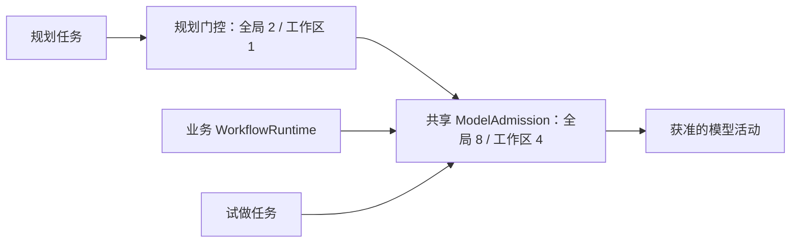

# 资源保护与并发

> 核对日期：2026-10-21。依据当前源码；验证范围见[验收范围与当前限制](11-验收范围与当前限制.md)。

本页回答：规划为什么不会无限重试、怎样与业务运行共享模型容量，以及不完整用量怎样处理。规划与业务运行都记录实际 Token 用量，作为用量与性能计量；累计 Token 和历史估计不限制新调用。生成候选不会启动业务工作流，预览和发布仍遵守权限及版本检查。

历史失败及阶段修复记录见[历史失败诊断](14-不限预算仍规划失败的诊断.md)，当前行为以本页及源码为准。

## R7 试做用量独立记录（R7 已安装，闭环验收暂停）

试做返回 `usage.scope=trial`，提炼/规划返回 `scope=planning`。试做最多 32 步、20 分钟总时限（只覆盖执行与核验；真人复核等待不计，随后的生成另按单段规划期限计时），驱动有 5 分钟无进展保护；同工作区同一时间只允许一个试做在跑业务步骤（准备、执行、核验），或一个新图在首跑；生成阶段不占工作区，首跑会先等正在跑的试做业务步骤结束（T30.2）。试做共享模型并发准入。试做只使用冻结规范中获准的工具，完成后仍须文件核验及必要真人复核。

试做默认生成预览；用户明确发布时复核权限、来源和候选。已完成动作不会因用量未知而自动重放。源码：[trial-service](../../../src/host/planning/trial-service.ts)、[trial-agent](../../../src/host/planning/trial-agent.ts)；当前闭环边界见[暂停说明](19-R7自动闭环阶段说明与暂停交接.md)，不把离线测试视为完整实机验收。

## 当前资源保护

| 项目 | 上限 | 计数或计时范围 |
|---|---:|---|
| 方法提炼尝试 | 2 次 | 来源任务的初次提炼和最多一次修正 |
| 候选尝试 | 3 次 | 初次候选与最多两次修正；无效输出契约也计入 |
| 确定性优化 | 最多 2 轮 | 来源任务的合法基线之后；不重置全任务计数 |
| 片段回归样本 | 每轮最多 20 例 | 仅完整记录证据，全部所选样本通过才采用 |
| 片段回归工作期限 | 单例 5 秒 / 本轮 30 秒 | 清理可能另需等待，不是墙钟保证 |
| 可交给用户的澄清 | 2 轮 | 每轮最多三个问题 |
| 子 Agent activation | 8 次 | 整个任务累计，不因用户答题重置 |
| 任务模型步骤准入 | 24 次 | 模型步骤开始前累计 |
| 单个规划子 Agent 步数 | 8 步 | 每次 activation 还受任务剩余步数约束 |
| 子 Agent 无进展期限 | 5 分钟 | 模型流、工具交互等进展刷新计时 |
| 单段规划处理总期限 | 20 分钟 | 包括收集与排队；用户答题等待不占活跃处理段 |
| 输入 / 输出体积 | 各 2,000,000 字节 | 限制序列化体积，与 Token 用量分开 |
| 单次模型输出配置 | 沿用宿主模型默认 | 仍受供应商与模型自身上下文/输出限制 |

提炼与图生成共用步骤、activation 和澄清计数；方法与候选各有自己的尝试次数上限，进入 author 不重置全任务保护。达到保护阈值时停止并保留诊断，不静默换模型、降低推理强度或绕过引擎保存。失败任务同 requestId 保持幂等回执；重新规划须使用新 requestId，不存在自动无限续跑。

超时会触发取消链，返回仍要等待子 Agent 清理。这是触发停止的阈值，不是强制终止后的墙钟保证。

业务图保留独立的节点执行保护。当前共享校验器中，Agent 节点 `maxSteps` 为 1–20、默认 6，显式 `timeoutMs` 为 100–3,600,000 毫秒；loop 的 `maxIterations` 为 1–100、默认 10，iteration 的 `concurrency` 为 1–10、默认 3。运行并发由 `executionPolicy.maxConcurrentAgents` 控制，允许 1–8，运行器未配置时使用 3；修复次数 `maxRepairAttempts` 允许 0–2。这些保护不由 Token 计量替代。

## 运行目标与候选保留

[本轮实现](16-v0.0.2证据驱动优化执行方案.md)的 `optimizationTarget.maxModelCalls/maxAgentCalls` 用于当前对话与 verified-trial 来源预览，比较候选的调用结构。结构计数不是实测调用次数，也不折算为 Token；循环、分支或 Agent 内部调用不确定时保留未知。

合法候选超过目标，进入剩余优化轮次。最多两轮后仍未达标、无可验证替换、无收益或优化失败时，返回最佳候选、差距和停止原因。探索/设计用量单独累计；目标本身不限制业务运行的新调用，也不允许优化器改写执行策略或历史元数据。

## 字节体积与模型用量分开

驱动统计有效消息、系统提示和工具定义的序列化 UTF-8 字节体积；这是请求体积，只用于体积保护和诊断，不与实际 Token 相加。

`spentTokens` 只累计宿主明确报告的实际 Token 数。`observedInputBytes` 单独记录输入字节，`pendingUsageCalls` 记录尚未收到回执的调用，`unknownUsageCalls` 记录没有完整用量的调用次数。未知调用不能当成零用量，也不能用字节估计补成实际 Token。

驱动按当前 child 的原生用量事件序号去重；同一步的不同 attempt 是不同调用，不能按 step 去重。已存在逐次回执时不再累加 activation 聚合用量。失败、取消及重启保留已报告用量与未知状态。恢复时将未收到回执的调用转入未知次数，具体见[持久化恢复与取消](09-持久化恢复与取消.md)。

业务运行通过 `recordUsageCall`、`observeAgentUsage` 和 `settleUsage`/`settleUsageGroup` 记录调用及可信回执。运行用量记录保存在 `run.usage`（旧名 `run.budget`，读取兼容，过渡期保存时同时写入）；新调用的 `allocations[].tokens` 为 0，`reserved` 只表示等待回执，不预留 Token。缺少回执时保留 `unknownCalls`；迟到可信回执可幂等补记，不改变节点或运行状态。

每次规划模型步骤仍经过身份、取消、步数和体积校验。规划 child 的模型请求错误结束本次尝试，不继承绕过步骤计数的自动请求重试；2026-10-26 起，回复格式损坏或临时连接错误可在同一步重发一次，重发同样计步并经过准入，见[模型请求出错时重发一次](26-模型请求出错时重发一次.md)。业务原生 Agent 的宿主重试策略与实际调用用量记录独立处理。

## 各种报错分别表示什么

- 步数或子任务次数达到上限：报告对应的规划资源限制。
- 请求体积超过保护值或供应商上下文限制：报告上下文问题。
- 无进展或总期限到达：报告相应超时，持续进展仍受单段总期限保护。
- provider 返回 `INSUFFICIENT_QUOTA`、`BILLING_HARD_LIMIT_REACHED`、`BUDGET_EXHAUSTED`：规划驱动归为 `PLANNING_PROVIDER_QUOTA`，保留真实 provider 错误码、状态及消息；其他请求错误为 `PLANNING_PROVIDER_ERROR`。
- 取消、权限丢失、清理失败、候选错误：各自保留原有含义。

## 两层并发门控

Host 创建一个 `ModelAdmission(8)`，默认工作区上限为 4，并把同一个实例注入规划服务、试做服务和 `WorkflowRuntime`。规划服务另外持有 `ModelAdmission(2, 1)`，每个任务最多一个规划 child 活动；业务运行的根运行并发另按其执行策略控制。

服务先取得规划并发占位，再取得共享模型占位。因此已占规划容量的任务也可能正在等待业务运行释放共享容量。取消排队会移除等待项；若已取得第一层占位，第二层等待取消后也会释放它。

这里的“全局”指当前插件 Host 实例，不是跨进程、跨机器或整个账户的限制。规划不会创建独立的模型池绕开业务运行的模型准入。

## 排队容量与释放时机

同一工作区最多允许六个活动规划处理段。第七个新请求或答题续跑会在加入前返回 `PLANNER_BUSY`，不会先消费这批答案。

错误信息用“一个运行和五个排队”表达容量，但代码统计的是 `active` 处理段，包含上下文收集和并发排队；不应解释为每时每刻恰有一个模型调用加五个纯队列项目。等待用户答题的任务已结束活动段，不占此计数。

驱动返回或抛错后，服务在 `finally` 中释放共享模型与规划占位。正常路径先完成 activation 清理并观察结果结束；`dispose()` 抛错时也释放占位，但任务进入 `blocked`，不能据此确认 child 已停止。排队失败同样释放已取得的资源。存储记录总量另有 100 条限制，见[持久化恢复与取消](09-持久化恢复与取消.md)。

## 旧数据兼容

| 旧字段或状态 | 当前处理 |
| --- | --- |
| 图的 `budgetDecision.mode/decidedAt` | 只读保留历史元数据，不作为授权或执行控制，不为新图生成 |
| `executionPolicy.tokenBudget/perTaskTokens/maxAgentTasks` | 仍可解析旧图；返回非阻断兼容提示，不限制调用、输出或任务数，不为新图生成 |
| 旧 run 的 `budget_waiting` | 保留读取及继续/取消处理，不再为新运行生成该状态 |
| 规划任务的 `unknownTokens/reservedTokens` | 只保留历史混合估计，启动时不归并或重标这些值，不作为实际 Token 或新调用准入依据 |
| 运行用量记录中的旧 limit/估计值 | 保留可读，执行时不作为限制；已有等待回执记录结束时释放旧记录值，不补造未知 Token 数 |

兼容读取不批量重写已有图或 run。`rootRunId` 是子 workflow 指向根运行的协调 ID，用于共享模型并发、用量归集、暂停、修复和恢复。旧记录的 `budgetRootRunId` 读取时换成 `rootRunId`，不改写文件；过渡期保存时同时写入旧名称，因为旧版本靠它级联取消子运行和保护恢复，缺失会漏掉子运行（[兼容读取](../../../src/shared/run-compatibility.ts)、[回退演练测试](../../../tests/run-usage-compatibility.test.ts)）。

## 源码与验证

- [规划服务保护与并发](../../../src/host/planning/service.ts)：`MAX_STEPS`、`MAX_CHILDREN`、`MAX_CHILD_STEPS`、`TASK_DEADLINE_MS`、`assertQueueCapacity`、`invoke`、恢复用量记录。
- [驱动步骤及体积](../../../src/host/planning/agent.ts)：输入/输出体积、无进展计时、逐次用量回执及 provider 错误分类。
- [片段回归保护](../../../src/host/planning/regression.ts)：`PLANNING_REGRESSION_LIMITS`。
- [用量回执聚合](../../../src/host/token-usage.ts)：`reportedTokenUsage`、`sessionTokenUsage`，缺少任一次调用用量时保持未知。
- [运行用量与共享并发](../../../src/host/run-usage.ts)：用量记录、幂等补记及 `ModelAdmission`；[运行器](../../../src/host/runtime.ts)负责根运行协调和具体准入。
- [共享字段校验](../../../src/shared/workflow-validation.ts)：节点保护数值、执行策略及 `executionPolicyWarnings`。
- [实例注入](../../../src/host/index.ts)：同一 `modelAdmission` 传给运行、规划和试做服务。
- [规划服务测试](../../../tests/planning-service.test.ts)、[共享容量集成测试](../../../tests/model-admission-sharing.test.ts)：离线用量、排队及释放场景；本次文档核对未重新运行测试或真实模型。

相关：[子 Agent 生命周期与工具隔离](05-子Agent生命周期与工具隔离.md) · [任务状态与澄清](06-任务状态与澄清.md)
