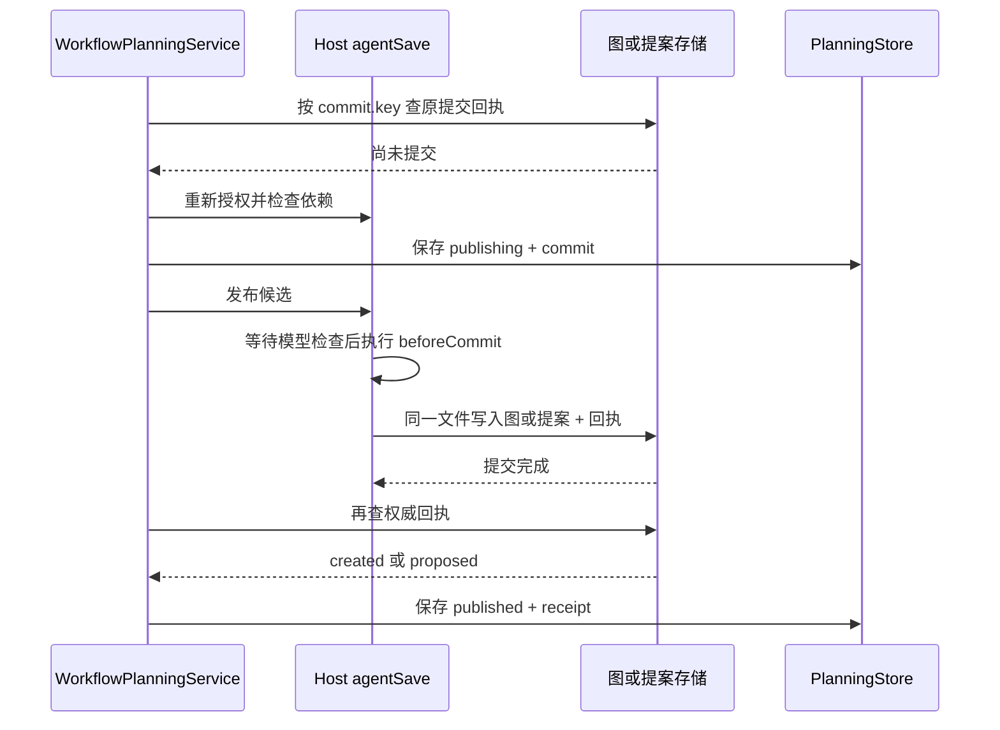

# 发布提案与幂等

> 核对日期：2026-10-21。本文说明一个已校验候选怎样进入项目存储，以及如何避免重复创建或重复提案。

## 1. 发布的结果是什么

规划引擎的发布终点是可编辑工作流或待接受提案。发布本身不会调用 Graphon，也不会运行候选中的业务节点。

| 请求 | 写入位置 | 回执 | 原工作流是否立即变化 |
| --- | --- | --- | --- |
| `create` | `WorkflowStorage` 的 `library.json` | `kind: created`，包含新图版本 | 保存一张新图 |
| `revise` | `WorkflowEditorState` 的 `editor-state.json` | `kind: proposed`，包含基础版本及 `proposalId` | 不变；需要用户接受提案 |

任务状态 `published` 只表示以上提交已完成。修改请求仍须查看提案的 `pending / accepted / rejected` 状态，不能把 `published` 描述成“修改已经生效”或“执行成功”。

## 2. 三种身份分别解决什么问题

| 身份 | 生成方法 | 防止的问题 |
| --- | --- | --- |
| 请求身份 | `workspaceId + 根对话 sessionId + requestId` | 同一聊天请求被重复提交 |
| 请求摘要 | `SHA-256(JSON.stringify(解析后的 request))` | 相同 `requestId` 被换成另一份需求 |
| 提交身份 `commit.key` | `SHA-256(JSON.stringify([task.id, candidateDigest, operation]))` | 同一任务的同一候选被重复发布 |

`candidateDigest` 是 Host 补齐并校验后的候选摘要。它代表本次提交所针对的候选；保存时还可能补充本地子 Agent 绑定、版本和时间，因此不能把回执摘要直接当作最终磁盘工作流的摘要。

重复调用 `visible_workflow_plan` 时，内容相同就返回原任务；原任务仍活跃时等待同一个处理 Promise。相同请求身份却换了内容会报 `REQUEST_ID_CONFLICT`。修订需求应使用新 `requestId`。

## 3. 发布前检查哪些条件

普通任务通过校验后自动进入发布。预览任务停在 `ready`，显式调用 `visible_workflow_plan_publish` 时，须提交最新任务 `revision` 和 `candidate_digest`。这里的任务版本与工作流 `expectedRevision` 是两种版本，不能混用。

发布前，Host 重新检查：

1. 调用者仍是有效的原根对话，工作区归属一致，并具备写权限。
2. 修改目标仍保持预期版本及冻结基线摘要；新建图的 ID 尚未被占用，包括归档图。
3. 当前模型及思考强度仍与规划上下文一致。
4. 候选使用的工具在冻结目录与当前目录均存在时，其参数 Schema 没有变化。
5. 当前依赖就绪情况，并在保存阶段检查模型和思考强度是否合法。

通过 Host 模型和保存检查后，合法图可以保留文件、工具或 Secret 等“待配置”项；结构合法本身不保证发布成功。`readiness.canRun` 不能代替发布回执，也不能据此声称图已经运行。详见[候选校验与有限修正](04-候选校验与有限修正.md)。

模型信息解析可能等待。`agentSave()` 在这些等待结束后，再检查取消信号、写权限和工作区，随后调用 `beforeCommit()` 重新验证根对话、基线、模型和工具定义。**最后一次验证与同步提交之间没有新的 `await`**，避免检查通过后、实际落盘前发生权限或基线变化。

## 4. 图与回执怎样一起提交

新图和 `created` 回执在同一次 `WorkflowStorage.persist()` 中提交；修改提案和 `proposed` 回执在同一次 `WorkflowEditorState.persist()` 中提交。存储采用临时文件再替换目标文件的方式，回执不会先于对应图或提案独立写入。

规划任务快照是另一份文件。系统没有把三份文件组成跨文件事务，而是通过图或提案存储内的回执确认提交事实。这些存储中的回执是 **权威回执（canonical receipt）**；`tasks.json` 中的 `published` 标签或回执副本不能单独证明提交完成。

回执严格记录 `key`、`digest`、`kind`、`workflowId`、`revision`；仅 `proposed` 必须携带 `proposalId`。查询时还会核对它是否属于当前候选及操作类型。相同提交键再次写入会被底层存储拒绝。

## 5. 提交后抛错、取消或重启怎么办

关键顺序是“检查实际提交结果，再决定是否失败”。`publish()` 返回或抛错后，服务都会再次查询权威回执：

| 实际证据 | 处理结果 |
| --- | --- |
| 找到归属和摘要匹配的回执 | 认定已发布；即便返回途中异常或取消已到达，也不再重复提交 |
| 没有回执，明确是版本或权限失败 | 进入 `conflict` 或 `blocked`，保留诊断 |
| 没有回执，其他异常或返回结果不确定 | `PUBLISH_UNCERTAIN`，进入 `blocked`，禁止自动重试 |
| 回执的归属或摘要不匹配 | 拒绝把该回执当作成功证据 |

因此，“取消成功”不能撤销已经发生的原子提交。如果提交事实已经存在，最终状态应是 `published`，用户仍可在画布检查新图，或处理提案。重启时同样先查权威回执，详见[持久化恢复与取消](09-持久化恢复与取消.md)。

## 6. 回执为什么不能随提案处理结果删除

接受提案时，编辑器才把候选保存到工作流库；拒绝提案时，原图保持不变。两种操作都保留生成时的规划回执，用于识别“这个候选曾经发布过”。

`proposed` 回执的 `revision` 是提交提案时的基础版本，回执也不会随提案接受或拒绝改写。历史提案列表可能裁剪已处理条目，回执仍然保留；它证明历史发布事实，不代表提案当前仍待处理。

每个存储中的规划回执数组最多 2,000 条，达到上限后拒绝新增。当前没有自动归档或回执清理 API，不应通过删除回执来规避重复发布保护。

### 6.1 接受后的界面与自动保存版本

2026-10-18 修复：接受或拒绝成功后，前端使用 `resolveProposal` 返回的最终提案立即更新状态并关闭审阅弹窗；当前工作流没有其他 `pending` 提案时，右侧修改请求卡片随之消失。其他待处理提案继续显示。后续列表刷新异步进行，刷新失败或停滞不改变已确认的处理结果；提交前启动的旧轮询响应不能恢复过期卡片。真正的版本冲突或保存失败仍保留弹窗、提案和错误信息。

自动与手动保存使用同一规则：完全相同的内容直接返回已有版本；仅 `editor.viewport / editor.scopePath` 改变时保存视图，不增加流程 `revision`，不更新时间戳；节点、节点布局、连线、参数、批注、执行策略等真实定义变化仍增加版本。运行中的冻结快照不受影响。

提案创建时由 Host 记录排除视图与保存元数据后的定义摘要。对于修复前因视图保存而增加版本的请求，只有摘要证明确切基线未变，Host 才允许在当前版本接受，并保留最新视图。没有摘要的历史请求仅可从候选完全匹配、提交回执与提案 ID 均匹配的规划记录恢复基线；证据缺失或存在真实定义变化时继续报冲突。该摘要属于内部提案记录，不改变 Workflow JSON 标准。接受操作不会顺带保存未提交的真实编辑；拒绝操作不触发画布保存。

验证见[提案处理回归记录](../../../docs/evidence/proposal-resolution-20261018/README.md)。

## 7. 实现与验证来源

- [规划服务](../../../src/host/planning/service.ts)：`start()`、`publishTask()`、`publish()`、`lookupReceipt()`。
- [Host 接入](../../../src/host/index.ts)：`authorizePlanning()`、`agentSave()` 与发布回调。
- [工作流存储](../../../src/host/storage.ts)：`save()`、`planningReceipt()`；[编辑状态存储](../../../src/host/editor-state-store.ts)：`propose()`、`resolve()`。
- [回执契约](../../../src/host/planning/receipt.ts)：严格字段、归属字段约束与容量限制。
- [发布测试](../../../tests/planning-publication.test.ts)：原子回执、重复提交、重启、提案接受及拒绝后的回执保留。
- [服务测试](../../../tests/planning-service.test.ts)：预览发布版本检查、异常后查回执、提交后取消和重启恢复。
- [Host 集成测试](../../../tests/planning-host.test.ts)：实际工具注册、发布前权限及工具漂移检查；使用离线驱动，不代表真实模型或新安装界面验收。
- [提案处理测试](../../../tests/proposal-resolution.test.ts)、[前端联动测试](../../../tests/proposal-review-client.test.tsx)：弹窗关闭、通知清理、过期响应、自动保存版本和真实冲突保护。

相关文档：[任务状态与澄清](06-任务状态与澄清.md) · [持久化恢复与取消](09-持久化恢复与取消.md) · [验收范围与当前限制](11-验收范围与当前限制.md)。
