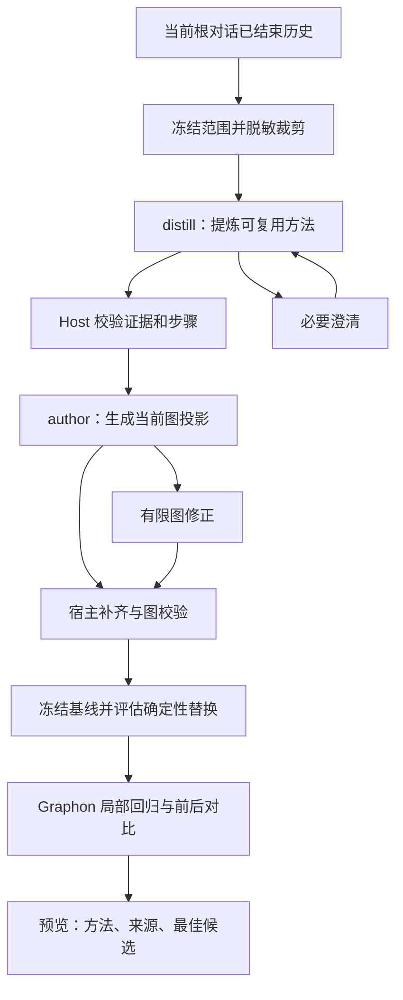

# 从本次任务生成工作流

核对日期：2026-10-21。[返回规划引擎索引](README.md) · [执行方案](../../../docs/Agent辅助生成工作流后端引擎执行方案.md)

用户先在当前主对话与 Agent 完成任务，再要求“把刚才完成任务的方法做成下次可复用的工作流”。Host 读取这段对话的公开历史，提炼输入、规则、步骤和检查，再交给现有规划引擎生成候选。最终仍是当前 Workflow 和 `formatVersion:2` 可移植包；Graphon 继续承担用户另行发起后的业务执行。

当前实现是后端工具入口及候选 JSON 预览，没有新增独立画布预览面板。安装产物后，主 Agent 根据工具结果展示方法、候选和来源；本轮离线回归不代表真实模型和已安装 Desktop 体验已验收。

## R7 的独立试做来源（R7 已安装，闭环验收暂停）

本页 current-conversation 的已闭合历史、排除转换轮次、原始预览不落盘等合同保持。新建未完成任务由 [18](18-先执行验证再生成工作流.md)的 execution-first 路径实际试做，Host 验证后使用独立 verified-trial 来源；不会把当前执行 child 冒充根会话旧历史，也不扩大到任意会话。

Host 另传可信 trialTask，保存原业务 task/inputs/artifacts/reviewItems；提炼不能只读规划 instruction 而漏掉业务条件。试做与其预览日志持久化是恢复例外，当前对话预览仍不落盘。试做 needs_input 后用户若选择在正常对话完成剩余动作，应按本页重新提炼真实已闭合历史，不能声称原 child 已自动恢复。R7 已安装并完成真实试做，提炼修复被暂停，见[暂停说明](19-R7自动闭环阶段说明与暂停交接.md)。

## 1. 用户怎样操作

例如在完成报告后发送：

> 把刚刚完成这份报告的流程做成工作流，下次换一份数据也能用；保留我最后确认的统计口径和人工核对步骤。

主 Agent 调用 `visible_workflow_from_conversation`，`request_json` 为以下对象序列化后的字符串：

```json
{
  "requestId": "report-retrospective-001",
  "instruction": "提炼刚完成报告的完整方法，下次更换数据和月份，保留最终口径及人工核对。"
}
```

可选 `fromSeq/throughSeq` 使用当前会话真实事件序号，不是屏幕消息编号。主 Agent 不知道序号时省略，不能猜测。请求不接受 `sessionId`、`workspaceId` 或任意来源日志。

Host 将请求转成 `create + preview:true + source.kind:current-conversation`，和普通规划共用任务服务。普通 `visible_workflow_plan` 带同类 source 也必须满足同样条件。

- 任务范围或关键规则不清楚：返回 `awaiting_input`，主 Agent 转达问题，收到真人回答后通过现有 `plan_answer` 继续。
- 方法和图通过检查：返回 `ready`、方法说明、当前 JSON 候选和来源映射。初次入口不会保存流程、创建提案或执行业务。
- 用户明确保存：沿用 `plan_publish` 的最新 task revision 和 candidate digest。
- 用户以后运行：沿用 Runtime 和 Graphon，使用新的输入，不重放历史执行。

预览只保存在 Host 内存中，重启后失效。它仍会调用模型，实际用量仍须记录。

## 2. 证据究竟来自哪里

Host 使用官方 `sessionQuery.observeSession` 获取**当前活跃根对话的一次固定截面**。调用前验证根 Agent 与工作区，等待 observation 返回后再次验证；验证通过前不访问惰性的 `events`。读取完在 `finally` 中释放 observation。

默认范围是当前转换请求所在轮次之前已闭合的自有历史。它可以跨多个轮次，不把“最近一轮”等同于“整个任务”；存在多个任务时由提炼阶段询问范围。轮次闭合只证明会话记录边界，不证明业务成功。继承自其他会话的 fork 前缀、当前转换轮次和未来事件不进入材料。

| 记录 | 采用内容 | 不能据此推导什么 |
| --- | --- | --- |
| 真人用户消息 | 原目标、后续纠正和约束 | 系统注入的 user 消息不当作真人要求 |
| 公开 assistant 文本 | 交付说明、公开方法和结果描述 | 助手说“已完成”不等于完成验证 |
| 工具调用及结果 | 参数、配对结果、报告状态及公开摘录 | 返回成功不证明业务口径正确或能普遍复用 |
| 子任务父级记录 | 当前根会话已有调用与结果摘要 | 不展开子会话，不能声称获得子任务完整过程 |
| 文件、图片、附件引用 | 公开文本中的引用及缺口标记 | 不读取正文、工作区文件或历史文件快照 |

记录引用使用稳定的 `e{seq}`。Host 保留实际范围、记录数、警告和 SHA-256 摘要。仅处理白名单公开内容，排除思考、系统提示及 meta；过滤敏感键和常见凭据文本。自动脱敏有边界，不能保证识别所有自然语言秘密。

当前限制为：最多观察 10,000 个会话事件、选中 100 条公开记录、证据序列化总量 24,000 字节；单记录正文通常最多保留 1,800 字符并附摘录标记。超限明确拒绝，要求缩小范围。整份日志超过上限时，即使指定了较小范围也拒绝，因为当前 SDK 的 events 可能物化全量日志；尚未实现范围分页读取。

## 3. 怎样从经历提炼方法



`TaskProcedure` 是内部方法说明，不是另一种工作流 JSON：

| 字段 | 含义 |
| --- | --- |
| `goal` | 要复用的业务目标 |
| `parameters` | 下次更换的文件、月份、对象等；名称和说明 |
| `rules` | 保留的最终业务口径和约束 |
| `steps` | 稳定步骤 ID、标题、方法说明、依赖、证据引用、`requiresReview` |
| `excluded` | 不纳入通用流程的记录及排除理由，如撤回方案、失败调试 |
| `reviewItems` | 缺失证据、未验证结论和人工核对事项 |

Host 检查步骤身份唯一、依赖存在且无环、每条引用存在、每条采集记录被步骤采用或说明排除理由。失败、未知或摘录证据进入有效步骤时，必须标记待核对并给出具体复核项。

最终规则优先于撤回方案；“九月.csv”通常变成输入参数，而“按支付日期统计”保留为规则。不能机械地把每次工具调用变成一个节点，也不能为了减少步骤丢掉最终纠正和质量检查。

## 4. 怎样证明候选与本次任务相关

图生成仍使用现有 `requirementCoverage`：整体需求 `R1` 和每个方法步骤都必须关联实际节点。Host 从该声明构造 `sourceMap`，把步骤、节点与历史引用连起来；候选改变后重新校验。

`requiresReview:true` 的步骤必须关联实际 `human` 节点，使不确定性在未来流程中保留人工核对位置。结构检查不能证明核对说明正确，也不能证明所有业务依赖均被模型理解，用户仍需检查预览。

预览工具结果包含：

- `source`：已选择的 seq 范围、digest、记录数和警告。
- `procedure`：保留步骤、参数、固定规则、排除项及待核对项。
- `sourceMap / provenanceDigest`：每个步骤到节点及证据引用的对照与摘要。
- `candidate / candidateDigest`：当前完整 Workflow 候选及摘要。
- `readiness / diagnostics / usage`：待配置资源、错误和累计用量状态。

新任务还返回 engineVersion:0.0.2 和 optimization 前后对比。默认省略报告内重复的完整图，plan_get 的 include_candidates:true 可按需查看基线与各轮候选；具体字段见 [16](16-v0.0.2证据驱动优化执行方案.md#10-实际接口与报告)。

这些来源信息属于规划任务。Workflow 和导出包不新增 source、trace、procedure 字段；私有证据原文不通过工具结果批量返回。来源映射成立只证明引用结构正确，不代表“完整还原”“全场景验证”或节点业务效果已确认。

## 5. 提炼、生成与优化怎样共用原引擎

`WorkflowPlanningService` 在 source 请求中先进入 `distilling`，通过后进入 `authoring`。两阶段共用一个 task，不另建调度器。`createPlanningAgent` 由 Host 选择固定的 `distill/author/optimize` 角色与输出 schema，均不继承父会话上下文，均只有结构化输出和两个元数据目录工具。

提炼最多提交两次方法结果，图最多提交三次候选。`needs-input` 单独受整个任务最多两批澄清约束，不作为一次无效方法或候选；但每次模型步骤均计入全任务步数。全任务仍限制 8 个 activation、24 个模型步骤；单 child 最多 8 步，5 分钟无进展停止，每段处理总期限 20 分钟。实际用量与请求字节分开统计。取消和清理失败沿用原服务处理，详见 [05](05-子Agent生命周期与工具隔离.md)、[07](07-资源保护与并发.md)。

原始证据传给提炼和 v0.0.2 优化阶段；author 和图修正获得结构化方法说明。优化阶段需要冻结证据来定位真实回放样本，不能依据模型总结伪造 expected。提炼新增调用，因此不能预先承诺首次生成更省 token。应记录“取证 + 提炼 + 生成 + 修正 + 优化”的整条链路用量，并分别比较后续复用的用量与耗时。

预览不落盘。用户明确发布、通过权限/readiness 复核并进入 `publishing` 时，脱敏证据和方法作为内部任务记录保存；后续提交失败也可能保留记录。来源摘要参与提交身份，重启时验证记录、归属、候选和来源；恢复不会自动重新执行模型或业务操作。

## 6. 已验证与尚未验证

本轮测试使用合成事件、模型替身和实际 Cordis Host 服务。覆盖范围冻结、敏感内容裁剪、失败/未知来源、步骤与图映射、同账本、澄清、取消、发布恢复及只预览无业务副作用。准确次数和构建结果见[增量验收](11-验收范围与当前限制.md)。

首版尚不支持跨对话任务、子会话日志展开、附件/产物正文读取、多案例归纳、独立预览面板或超大日志分页。真实模型的提炼质量、安装后的对话路由、实际 token/时延，以及换输入后的业务复用效果仍须单独验收。

## 7. v0.0.2 增量：提炼之后怎样优化

本轮先更新[第 16 篇执行方案](16-v0.0.2证据驱动优化执行方案.md)，再接入现有服务。在上述来源和方法检查通过后冻结基线候选，进入 optimizing/regressing，进行最多两轮确定性替换、真实 Graphon 节点变换回归和前后对比；构建与离线验收不等于已安装或真实模型效果验收。

自动替换限定顶层 llm → template / 受控 JavaScript code；Agent 即使 tools:[] 也保留并人工复核。保留节点 ID、所有连线、其他节点配置和必要 human 核对，继续使用同一 procedure/sourceMap。替换节点可设计新的 config，但回放原样使用候选 config.inputs；结构化 LLM 只转 code 且不删除原 outputSchema。只接受完整配对的成功工具记录，不接受合成样本；每个替换节点至少一例，本轮所选样本全部完整输出匹配且回放通过才自动采用。expected/upstreamOutputs 只接受工具结果根 pointer:""，并核对原 LLM 输出合同；累计确定性替换的上游实际回放，不用历史常量覆盖。证据中的上游结果只是 node-transform 回归输入 seed，不能证明完整图已经运行成功。

可选 optimizationTarget.maxModelCalls/maxAgentCalls 来自用户明确要求，独立于 executionPolicy。运行目标超出时保留候选并在剩余轮次内优化，不因超目标而丢失基线；未覆盖、无样本、失败或无收益时保留原候选和具体原因。当前 JSON 标准不变，预览仍不会保存图或重做原任务。

## 8. 源码与参考

- [证据采集与 digest](../../../src/host/planning/conversation-evidence.ts)、[方法与来源契约](../../../src/shared/retrospective.ts)。
- [任务状态及两阶段控制](../../../src/host/planning/service.ts)、[受控 activation](../../../src/host/planning/agent.ts)、[Host 入口和结果展示](../../../src/host/index.ts)。
- [证据测试](../../../tests/conversation-evidence.test.ts)、[方法测试](../../../tests/retrospective.test.ts)、[流水线测试](../../../tests/planning-service.test.ts)、[Host 集成](../../../tests/retrospective-host.test.ts)。
- 官方固定版本：[查询服务](https://github.com/deepseek-ai/deepseek-harness/blob/dsh-v0.2.1-rc.2/packages/session-query/session-query/src/index.ts)、[observation](https://github.com/deepseek-ai/deepseek-harness/blob/dsh-v0.2.1-rc.2/packages/session-query/session-query/src/observation.ts)、[事件契约](https://github.com/deepseek-ai/deepseek-harness/blob/dsh-v0.2.1-rc.2/packages/core/session/src/types.ts)。
- [前期设计研究](设计/01-从已完成任务提炼工作流.md)保留 Agent Workflow Memory、Voyager 的参考范围；这些研究是方法来源，不是本项目运行依赖或验证证据。
