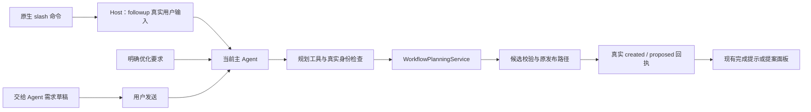

# 前端入口与规划引擎接入

核对日期：2026-10-21。本页回答：已经设计好的前端怎样调用规划后端，怎样识别“这个工作流”，以及生成完成后怎样回到现有画布和提案界面。

[返回规划引擎索引](README.md) · [请求身份](02-聊天入口与请求身份.md) · [资源保护与并发](07-资源保护与并发.md) · [发布提案](08-发布提案与幂等.md)

## R7 按意图选择后端分支（R7 已安装，闭环验收暂停）

三个入口仍进入正常主对话，展示原生工具与子 Agent 过程，不在主页阻塞或新增单独规划状态卡。无来源的新建需由主 Agent 在同一规划调用内提交 execute-first 规范；缺字段先原生询问。明确只设计用 design-only，已有图优化/批注继续 revise，已完成对话继续 from_conversation，不能仅凭 slash 命令就强制重复业务。

试做反馈使用 trialState/execution/verification，候选反馈在 planning 中；后续澄清/发布使用 planningTaskId。needs_review 的真人问题或 visible_workflow_trial_review 可以复核已完成结果；needs_input 不自动续跑 child，须说明已停止并保留已发生动作。真实 UI 安装验收待做，当前仅有离线 Host 接线证据，合同见 [18](18-先执行验证再生成工作流.md)。下图的保存路径适用于原 design-only/修改分支，试做分支先停在预览。

## 1. 三个入口共用一个服务

| 用户操作 | 进入后端的路径 | 界面保持的行为 |
| --- | --- | --- |
| 在对话输入 `/dsh-visible-workflows` 或后接需求 | 原生 `commands` 注册表 → 当前主 Agent 的真实对话轮次 → `visible_workflow_plan` | 立即进入正常对话；需求追问、工具调用和结果反馈沿用宿主聊天 |
| 点击“交给 Agent”并填写需求 | 需求弹窗 → 原生聊天草稿 → 用户发送 → 主 Agent 调用 `visible_workflow_plan` | 保留现有弹窗、可编辑草稿和发送确认，不因打开弹窗自动规划 |
| 明确说“帮我优化这个 workflow” | 主 Agent 读取精确引用或 `visible_workflow_current` → 最新图 → `visible_workflow_plan` | 优化结果是现有修改提案，由用户审阅并接受 |

三个入口都通过当前主 Agent 的真实对话调用规划服务。斜杠命令仅提交用户输入，不在命令处理器中等待规划；主 Agent 依靠系统指引、工具定义和引用序列化指引选择规划工具，没有对任意聊天文字做关键词硬拦截。普通任务仍按原意完成，明确执行已有流程仍使用业务运行入口。

## 2. 原生命令如何取得需求和目标

命令名固定为 `dsh-visible-workflows`。Host 从官方 invocation 接收实际 Agent、`rawInput` 和取消信号，校验当前主对话归属、文字长度及附件限制后，通过官方 `createUserMessage()` 和 `agent.followup()` 将原命令与需求交给当前主 Agent，立即返回无独立正文的成功结果。

`followup()` 在空闲时启动真实轮次，Agent 忙时排入下一完整轮次。宿主自己产生用户消息、`turn/start`、流式输出和工具调用；插件不手写这些事件，不等待整个规划任务结束，不把已结束的命令 RPC 信号绑定到后续模型调用。前端也不重复发送第二份输入。

只发送命令时，主 Agent 调用宿主原生 `ask_user_question` 在正常对话中收集任务需求；带需求时根据输入选择新建或已有工作流。已有图使用精确引用或当前可见画布，再读取最新定义；不明确时正常追问。模型不得猜测工作流 ID，也不得绕过规划引擎自行保存图。这个工具路由依赖真实模型遵循指引，需要实机验证，不能用提示词本身当作通过证据。

规划返回 `awaiting_input` 时，主 Agent 通过原生询问工具转达问题，得到答案后调用 `visible_workflow_plan_answer` 继续原任务。只读模式继续由 Host 强制预览。

原生 `commands` 服务存在时注册命令，插件卸载时撤销。模型配置来自正在执行的主 Agent 请求头；后续输入框为下一轮选择的模型不影响本轮规划。

页面交互完全沿用宿主正常对话：用户消息提交后进入对话页，Agent 以普通消息追问和反馈，执行过程通过原有流式回复、工具运行状态与子 Agent 记录展示。插件不再创建独立规划状态卡片，也不在空白首页用卡片替代对话。输入区仅保留无界面的画布上下文与发布通知同步。

## 3. “这个工作流”怎样绑定到当前画布

会话输入区的常驻绑定通过 `setPlanningContext` 同步 `clientId`、递增序号、workflow ID、revision 和 dirty 状态；Sidebar 只报告其实际可见性。只有当前会话的可见画布才提供目标；隐藏画布、返回主页、切换到其他会话或卸载时清除本客户端的提示。提示定期续期，过期后不可作为目标依据。

这些字段只是选择提示，不是权限凭证。Host 的 `visible_workflow_current` 仍核对实际活跃根 Agent、当前工作区、目标可见性和保存版本；模型随后读取最新图。多个窗口打开不同图时要求精确 @ 引用，不选择“最近的一个”。全局图可作目标，但只共享定义，调用方不能借用定义所属项目的资源权限。

“交给 Agent”提交路径在读取目标前完成当前画布保存，并在异步等待后复核工作流、对话和需求是否仍相同。直接 slash 或自然语言使用当前画布提示时，发现未保存修改或版本不一致就要求先保存或还原；不能以持久化旧图替代用户眼前的修改。保存失败、发送失败和目标变化均保留需求草稿。

## 4. 生成结果如何回到前端

Host 仅把已发布任务的真实回执加入通知流。客户端 `planningUpdates` 在常驻输入区按当前会话及游标读取，不依赖工作流侧栏已经打开，再使用现有界面呈现：

| 后端结果 | 前端处理 | 不代表什么 |
| --- | --- | --- |
| `receipt.kind=created` | 对精确 workflow ID 显示“工作流已就绪”，由用户点击查看 | 不自动抢走另一张画布，不自动执行 |
| `receipt.kind=proposed` | 当前对应画布刷新提案列表；仍走“查看提案 → 接受并应用” | 原工作流尚未被优化提案覆盖 |
| `ready` / `preview` | 由主 Agent 根据规划工具结果反馈候选状态 | 没有持久化新图或产生已发布通知 |
| `awaiting_input` / 错误 / 取消 | 转交问题或真实诊断，保留同一任务身份 | 不能声称工作流已生成并保存 |

通知按工作区和主对话隔离、按回执去重。客户端重挂载不能重复提示已消费回执；Host 重启需要重置对应通知游标。通知失败不重做模型调用或再次发布。通知流只是当前 Host 的有界内存状态，不是持久化任务历史；流程库、提案和规划回执仍是保存结果的依据。

本轮没有新增独立规划进度或候选画布面板。现有需求弹窗、原生问答、完成提示和提案审阅继续使用；预览不会通过导入入口覆盖当前图。

## 5. JSON 与 Graphon

当前画布上下文和通知游标均不写入可移植 Workflow。最终输出仍使用唯一 `formatVersion:2`、`runtime.engine:"graphon"`、`runtime.protocol:1`；Graphon 仍只在用户明确启动业务工作流时执行。

## 6. 提案界面的布局

本节对应 2026-10-18 的截图修订及后续提示位置调整，参数以 [DESIGN 第 28、29 节](../../../DESIGN.md)为准。

### 6.1 提案审阅与数据卡

| 部位 | 统一参数与行为 |
| --- | --- |
| 标题、正文、辅助说明 | 分别为 16/24、13/22、12/18px；标题字重 600，说明跟随宿主次要文字色 |
| 弹窗与分区 | 内容内边距和分区间距 16px；卡片内边距 12px；组内间距 8px |
| 操作按钮 | 高 32px、圆角 8px、操作间距 8px；“接受并应用”沿用原生 primary |
| 修改前后与完整定义 | 使用现有 DataViewer，独立卡片间距 12px；完整定义折叠标题至第一张卡也留 12px |
| 长内容 | 标题、关闭和底部操作保留，正文独立滚动；最大高度受宿主 Modal 可用区域约束 |

卡片使用节点菜单相同的主题底色、细边框和轻双层阴影，不改变提案的版本检查、拒绝或接受行为。数据卡仅展示当前定义与候选定义，打开审阅不会保存或执行工作流。

### 6.2 右侧修改请求卡片

待确认修改复用“补齐缺失值”的右侧通知位置与宽度：距画布右侧 12px，宽度为 `min(360px, 画布宽度 - 24px)`，顶部沿用现有 inspector 起点。卡片以浅蓝标签标明“修改请求”，显示真实待确认数量、说明和“查看修改”主按钮；点击后进入原有提案审阅流程。卡片圆角 12px、内边距 12px、组内间距 8px，按钮高 32px，高度由内容决定。进入动效为 160ms 淡入，系统要求减少动态效果时关闭。

修改请求和待补齐配置在同一通知区纵向排列，间距 8px；超高内容在通知区独立滚动。节点配置或运行详情同时打开时，该通知区最多占可用高度的 36%，给详情保留阅读空间。只有实际打开的详情参与画布 inspector 与缩略图避让；单独出现修改请求卡片不会把底部控件推向左侧。

用户已撤回前一版顶部提示条及其菜单避让方案。节点目录、高级设置、工作流管理和溢出菜单恢复原有锚点，不再根据修改请求增加顶部偏移。卡片位置调整不改变提案版本检查或接受权限。

返回、标题、保存、执行、选择操作、左侧工具栏、底部历史与缩放、小地图、保存反馈及面包屑表面继续共用浮动样式变量：10px 圆角，`0 1px 2px rgb(0 0 0 / .04),0 3px 8px rgb(0 0 0 / .03)` 阴影。单行操作模块保持 38px 高度和 2px 模块内边距，内部控件不叠加阴影；修改请求卡片只复用阴影，按上述 12px 圆角与内容高度排版。

右侧卡片的本次验证范围、截图和安装状态见[右侧修改请求卡片验收](../../../docs/右侧修改请求卡片验收-2026-10-18.md)。此前顶部提示和菜单下移的截图不作为当前布局依据。

## 7. 源码、官方依据与验证边界

- [原生命令适配](../../../src/host/planning/command.ts)：命令注册、真实主对话归属及官方 followup 提交。
- [Host 接线](../../../src/host/index.ts)：原生命令、规划工具、当前画布读取、Remote 通知。
- [前端绑定](../../../src/client/planning-ui.ts)、[Host UI 状态](../../../src/host/planning/ui-state.ts)、[共享契约](../../../src/shared/planning-ui.ts)：选择提示与真实回执。
- [聊天桥接](../../../src/client/chat-bridge.tsx)、[现有应用](../../../src/client/app.tsx)：需求和批注、发送准入、异步目标保护。
- [命令测试](../../../tests/planning-command.test.ts)、[官方注册表 fixture](../../../tests/fixtures/planning-command-fixture.ts)、[UI 绑定测试](../../../tests/planning-ui.test.ts)：离线接口和行为验证。
- [提案样式](../../../src/client/proposal-review-style.ts)、[修改请求卡片](../../../src/client/proposal-notice.tsx)、[右侧通知区](../../../src/client/workflow-readiness.tsx)、[画布布局](../../../src/client/canvas.tsx)、[共用样式变量](../../../src/client/styles.ts)：统一审阅弹窗、右侧修改请求及浮动表面的尺寸和间距。
- 官方 [`commands` 源码](https://github.com/deepseek-ai/deepseek-harness/blob/dsh-v0.2.1-rc.1/packages/interaction/commands/src/index.ts)、[命令契约](https://github.com/deepseek-ai/deepseek-harness/blob/dsh-v0.2.1-rc.1/packages/interaction/commands/src/types.ts)、[官方说明](https://github.com/deepseek-ai/deepseek-harness/blob/dsh-v0.2.1-rc.1/packages/interaction/commands/README.zh.md)：初轮核对本地 SDK `0.2.1-rc.1`；实机阶段又核对 Desktop `0.2.1-rc.2` 的命令注册表、Agent followup 和官方 `/goal` 处理器。后者同样通过 `followup(createUserMessage(...))` 将用户命令交给正常对话，而不直接写会话事件。

本轮验收数量、构建及文档检查结果由[执行方案第 19 节](../../../docs/Agent辅助生成工作流后端引擎执行方案.md#19-v15前端入口与规划后端适配)统一登记，不把各次局部测试简单相加。2026-10-18 已在 macOS Desktop 0.2.1-rc.2、GLM-5.3-Flash 上实际验证：裸命令进入正常对话并调用原生询问，三个入口调用规划工具，主对话和官方子 Agent 入口展示真实运行状态。首个描述修改提案误改了标题，经主 Agent 识别、人工拒绝和重新询问后纠正，不能称为全部首次生成正确。详细证据见[实机验收报告](../../../docs/工作流规划入口与会话预算实机验收-2026-10-18.md)。这些结果不覆盖其他模型、Web 或 Windows。历史第 17、18 节数字保留原日期和边界。
