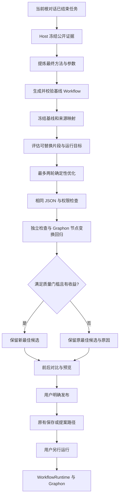

# v0.0.2 证据驱动优化执行方案

> 2026-10-21 说明：工作流预算系统已于 2026-10-20 移除（见 [S12](设计/tasks-规划提速与上下文复用.md)）。本文涉及预算问答、额度、增额或费用的内容仅为历史记录，不再执行；Token 用量只作性能计量保留。

日期：2026-10-18。**状态：主体已接入现有规划引擎，已合并自动保存/提案修复，本页原阶段安装为 v0.0.2 R6（局部编辑改造见第 17 篇）；R5 单字段及完整提炼优化预览已验收，链路仍有纠错，不宣称整体加速。R6 展示编号定点修复已安装，未重做真实模型调用；原生重启、对话与工作流入口及原始配置恢复已核验，首次白屏触发仍未确定，未公开发布。构建及分层验收结果见第 11 节。** 本页落实用户确认的第一阶段：从当前对话已完成任务提炼 workflow，做确定性替换、有限回归和前后对比。不会在本阶段自动先执行用户任务。

[规划引擎索引](README.md) · [总执行方案第 20 节](../../../docs/Agent辅助生成工作流后端引擎执行方案.md#20-v002已完成任务的证据驱动优化) · [当前对话取证](12-当前对话任务提炼与预览.md) · [唯一 JSON 标准](../原理/10-JSON字段与导入导出.md)

## 后续 R7 接入边界

本页记载的第一阶段以已经完成的对话证据为输入。R7 已安装的 [先执行验证路径](18-先执行验证再生成工作流.md)在它之前增加受控试做和独立文件验证，形成 verified-trial 与 trialTask，再复用本页基线、优化和 Graphon 节点回归；当前对话提炼及局部修改不强制试做。真实试做已完成，完整闭环因工具协议纠错耗时而暂停；优先优化算法，见[阶段说明](19-R7自动闭环阶段说明与暂停交接.md)。

试做通过不替代替换样本合同，不把完整工具结果伪装成另一种节点输出。reviewItems 和 human 节点保留；软目标超出保留候选。原任务验收、生成图结构与 Graphon 局部回归分层表达。R1—R6 证据与下述第一阶段限制保留历史归属。

## 1. 版本与不变契约

| 层次 | 本轮约定 |
| --- | --- |
| 产品/规划引擎 | 原 `v0.0.1`，本轮 `v0.0.2`；后续按明确变更继续版本管理 |
| 可移植工作流 | 仍是当前唯一 `formatVersion:2`；不新增 v0.0.2 JSON，不恢复旧格式迁移 |
| 图及节点语义 | 复用当前 Workflow、config schema、节点语义词典、变量引用及作用域 |
| 业务执行 | 仍由 WorkflowRuntime 和 Graphon 调度；规划服务不启动业务运行 |
| 方法、样本、报告 | Host 规划任务元数据；不把轨迹或优化报告塞进导出 Workflow |
| 旧数据 | 当前合法工作流正常读取；旧规划回执/恢复兼容仅保留必要边界，不倒填为新引擎已验证 |

修改前已归档 791 个源文件，保留本地未提交变更：`artifacts/version-baselines/v0.0.1-before-v0.0.2-20261018-183653.tar.gz`，SHA-256 `ef91a83177685a9589f6c8d058794724abc680e1b532c65f4751c113ae5807bf`，同前缀 `.manifest.json` 保存摘要。v0.0.1 本地基线提交为 `19011b9b6f6b7aa263d69397b5bc040a070c8ca2`，分支为 `codex/v0.0.1-working-baseline`；本轮分支为 `codex/v0.0.2-evidence-optimization`。本地归档和提交不是远端发布或安装记录。包与引擎版本均为 `0.0.2`，详见[版本记录](../../../CHANGELOG.md)。

## 2. 第一阶段的能力边界

| 纳入本轮 | 后置能力 |
| --- | --- |
| 复用当前根对话公开证据、固定范围和 TaskProcedure | 为所有任务强制完整试做一次 |
| 基线候选、最多两轮优化、最佳候选保留 | 无限制优化、多案例自动搜索 |
| 现有节点能表达的确定性替换 | 任意脚本自动生成后执行、另建业务运行器 |
| 真实 Graphon 白名单节点变换回归 | 自动抓取网站、写文件、发送、发布或调用业务模型 |
| 仅接受真实记录样本；合成样本不进入自动替换准入 | 合成样本回归入口、多样本自动构造 |
| 显式调用数量目标、结构比较、未知成本说明 | 无价格/输入规模依据的金额或 Token 精确承诺 |
| 正常对话返回报告，继续当前预览与显式发布 | 新建独立聊天系统、自动保存或执行反推图 |

取证边界继续遵守 [12](12-当前对话任务提炼与预览.md)：不展开子会话日志，不读附件正文，不扩大到任意主会话。公开“完成”说明不代表业务成功；工具成功、用户认可和完整产物验证也分别记录，不互相替代。

## 3. 数据流与模块职责



优化阶段加入同一个 `WorkflowPlanningService`，共享任务归属、ModelAdmission、累计用量、取消、澄清与发布服务。受控 child 可以建议替换；Host 决定哪些建议可验证、是否采用、何时停止。Agent 不取得更多业务工具或文件权限。

片段回归在私有临时存储中复用既有 WorkflowRuntime 和真实 Graphon，只运行输入节点、记录数据 seed、目标 template/受控 JavaScript code 及输出节点；回放后关闭 Runtime 并删除临时记录。它不遍历完整业务图，不写入用户工作流或正式业务运行记录，不另造调度器，不开放业务模型、工具、网络、业务文件写入或其他适配器。Graphon 同时是局部回归复用的调度内核和以后正式业务执行的调度内核，两者 scope 与权限明确分开。累计已替换的确定性上游也按候选配置回放，避免历史 seed 隐藏替换链上的输出不一致。

## 4. 基线与候选如何保留

第一份通过现有图、字段、范围、引用和需求覆盖检查的完整 Workflow 是基线。它与源证据、方法、节点映射共同冻结并计算摘要，后续优化不能原位改写。

每轮候选重新接受同一套校验，并保留必要人工核对环节。受保护节点、目标范围、工作区归属、模型目录和发布版本规则继续有效。需要更大权限的替换不能借“优化”绕过。

| 情况 | 结果 |
| --- | --- |
| 替换合法、所选记录样本均完整输出匹配、每个替换节点至少一例且 Graphon 回放通过 | 采用新的最佳候选，记录替换与验证范围 |
| 输出无效或片段回归失败 | 拒绝本轮替换，保留基线或之前最佳候选 |
| 没有可证明收益 | 保留之前候选并说明原因，不继续无意义循环 |
| 不支持验证或缺少证据 | 标记未覆盖/待核对，不宣称替换已获验证 |
| 预计运行目标仍超出 | 保留候选与差距，在剩余轮次内继续优化 |
| 到达两轮或规划资源保护 | 停止增加优化工作；已有合法候选及诊断可供查看 |
| 用户取消、权限丢失、清理失败或提交冲突 | 保持既有取消/阻断/冲突语义；不以回退掩盖错误 |

基线保留不意味着预览自动落盘。当前预览仍在 Host 内存，重启后失效；只有用户明确发布，才进入已有任务持久化和原子回执路径。

## 5. 怎样做确定性替换

确定性替换依据明确规则，不依赖对标题或提示词关键词的模糊猜测。第一阶段自动替换只允许顶层 llm → template / JavaScript code。Agent 节点即使 tools:[]，仍有原生 text/json/steps 等运行合同，本阶段保留并提示人工复核，不自动替换。保持节点稳定 ID、标题、位置、固定状态、所有连线、其他节点和共享配置、来源映射以及必要人工检查；不删除节点、不重写拓扑。被替换节点的 kind/config 可改变，包括为新模板或脚本设计 config.inputs；回归执行器必须原样使用优化候选的 config.inputs，不能临时覆盖映射来让测试通过。结构化 LLM 若有 outputSchema，只能替换为保留同一 schema 的 JavaScript code；不能转成输出合同不同的 template，也不能通过删除输出类型校验使回放通过。当前语义词典负责字段和输出说明，模型不能发明新节点类型、过滤器或工具。

| 原做法 | 可以考虑的替换 | 必要条件 |
| --- | --- | --- |
| 用模型按固定格式拼接已知字段 | template | 变量路径、格式和缺省行为明确，样本回归覆盖 |
| 用模型做规则明确的列表变换 | 受控 JavaScript code | 规则能够由当前节点准确表达，脚本只在现有受限计算沙箱执行 |
| Agent 完成固定转换 | 暂保留原节点并人工复核 | 即使 tools:[] 仍有原生运行合同，后续完整支持后再自动替换 |
| 开放式归纳、翻译、事实判断 | 保留模型或仅给优化建议 | 不把单个历史答案硬编码成通用规则 |

确定性处理仍消耗 CPU、内存或外部 API 资源；“减少模型调用”不等于零成本。凡涉及外部网络、文件、模型和工具的动作均不在本轮自动回归范围内；所有 Agent 节点本阶段均不自动替换。

## 6. 回归样本与验证等级

当前回归 API **只接受记录证据，不接受合成样本**。测试代码中的合成事件属于离线夹具，不代表真实用户任务曾执行成功。

每个样本通过 `{evidenceId, pointer}` 定位冻结工具记录中的数据；`pointer` 使用 RFC 6901 JSON pointer。`expected/upstreamOutputs` 仅接受根路径空串 `""`，不得把局部对象冒充完整输出；`workflowInputs` 可定位完整的字段对象。Host 要求调用与结果唯一配对、均为 `reported-success`、无截断/脱敏/省略，正文可解析为完整 JSON。私有字段被脱敏或省略也会标记证据不完整并跳过；缺失、失败、未知、口头完成说明及不安全路径都不采纳。

- `workflowInputs`：可选，引用原 input 字段对应的字符串对象，由原输入节点执行既有类型转换。
- `upstreamOutputs`：可选，按真实上游节点 ID 引用其完整工具结果根对象；非上游、容器或未提供的依赖不猜测补齐。
- `expected`：必填，只能引用 tool-result 根路径的完整节点输出对象，并核对原 LLM 的运行输出合同，不能用局部对象或单个标量字段代替。它还必须属于该节点所映射方法步骤的证据，不能借用其他任务结果。

每个替换节点至少有一条完整输出匹配的记录样本，本轮提交的全部样本均须通过。Host 使用规范化 JSON 比较完整对象；对象键顺序不同可相等，缺少或增加字段不能算相等。这证明的是**所选样本**的输出一致，不表示已经穷尽历史中的所有输入或未来情形。

对于需要冻结的上游业务调用，回归使用完整记录结果作为输入 seed；累计已被替换为确定性节点的上游则回放候选中的真实配置，不能用历史常量覆盖其新输出。回归原样运行优化候选的 config.inputs，scope 固定为 `node-transform`，`evidenceSource` 为 `recorded`。它不重新调用原 LLM/Agent，也不证明完整图会产生同样外部上游数据；累计确定性替换之间的引用会按候选实际计算。报告只保留 `expectedDigest/actualDigest`、状态和原因，不返回原始输入输出；未覆盖、缺数据、含系统/环境/容器变量、附件或不支持能力时明确跳过。

每轮最多 20 个样本，每例工作时限 5 秒，本轮工作时限 30 秒；清理可能额外等待 Graphon 启动/取消结束，不能承诺 30 秒墙钟必定返回。超限不静默截断执行；失败、跳过、取消或超时不能视为整轮通过。临时存储与子进程在返回前按既有清理路径释放。

第一阶段验证结论限于当前受测片段与样本。它不证明整个工作流执行成功、所有未来输入都正确、权限有效或外部服务稳定。`readiness.canRun` 继续仅表示依赖就绪；不能把结构校验、局部样本回归和真实业务成功合并成一个结论。

## 7. 运行目标与前后对比

| 项目 | 第一阶段处理 |
| --- | --- |
| 探索与设计用量 | 记录实际模型用量、字节、未知调用，保持现有用量归属 |
| 未来模型/Agent 图级计划调用目标 | 接受显式目标，评估图结构中可确定的部分；循环次数、分支和 Agent 内部调用不确定时标记范围或未知 |
| Token/金额目标 | 缺少可靠输入规模、用量及计价依据时不臆测；不把结构节点数换算成固定 Token |
| 无运行目标 | 满足质量要求后继续做可验证的降本，不堆积节点或子 Agent |
| 候选超目标 | 记录未达标及差距，继续有限优化；不报用户预算不足导致规划失败 |
| 实际执行硬上限 | 继续由真人选择和现有 executionPolicy 执行，不由优化报告提高或取消 |

返回报告至少回答：采用了哪个候选、基线与最终候选分别是什么、替换了什么、为什么采用或拒绝、实际验证了什么、哪些未覆盖、模型/Agent 结构指标如何变化、目标是否达成、何时停止、成本哪些仍未知。

方案超目标时，不自动删除关键校验、必要人工节点或核心质量要求。无法满足目标应交付最佳候选与可选取舍；后续用户明确降低可选内容要求后再进入下一次规划，而非偷偷降低质量。

## 8. 逐步退役 v0.0.1

| 阶段 | 可移除项 | 必须保留项 | 删除门槛 |
| --- | --- | --- | --- |
| 基线冻结 | 无 | 当前源码、未提交修改、现有数据 | 归档及 manifest 完成 |
| v0.0.2 接入 | 新旧入口重复分流、过时提示与无消费者分支 | 现有公共 schema、范围保护、权限、取消、发布、回执 | 新入口和普通规划回归通过 |
| 历史读取集中 | 分散的历史任务解析兜底 | 明确的版本识别、旧回执恢复和未知用量标记 | 覆盖旧记录的恢复/拒绝/幂等测试 |
| 后续清理 | 确认无引用的旧内部实现 | 当前 JSON、用户图及运行记录、审计证据 | 有明确替代且版本验收通过 |

普通新建、修改与批注仍需要规划能力，不能把它们当“旧引擎”整体删除。可复用模块也不能仅因创建于 v0.0.1 就删除。旧活动任务重启后继续按原规则 interrupted，不自动恢复模型调用；旧 published 结果依据真实回执读取，不重跑发布。

## 9. 实施验收清单

| 编号 | 必须验证的行为 |
| --- | --- |
| V02-A01 | 新任务标记 v0.0.2；当前 JSON 仍只允许 formatVersion:2；旧回执可识别但不伪装为新引擎结果 |
| V02-A02 | 当前对话提炼继续冻结来源、排除本转换轮次及 fork 前缀；必要 human 核对保留 |
| V02-A03 | 基线候选不可变，优化不更改源图、业务存储或原执行预算 |
| V02-A04 | 确定性替换采用/拒绝有独立原因；无效结果、失败回归和无收益保留最佳候选 |
| V02-A05 | 仅接受配对完整的记录样本，拒绝合成样本；伪造来源、摘录、未知结果和模型自述不能升级为真实验证 |
| V02-A06 | 真实 Graphon 片段回归仅开放 template/受控 JavaScript code，不调用业务模型、工具、网络或业务文件操作 |
| V02-A07 | 运行目标达标、超出和未知分别表达；超目标不直接 failed，不冒充金额或 Token 节省 |
| V02-A08 | 最多两轮优化；取消、权限丢失、清理失败、并发、用量和重启边界保持 |
| V02-A09 | 工具返回基线/最终摘要、前后比较、覆盖限制和停止原因；发布仍核验最新候选摘要 |
| V02-A10 | 普通生成、修改提案、预算一次问答、JSON 往返和 Graphon 既有测试保持 |

执行方案先更新，再实施代码并运行适当测试、类型检查、构建与文档校验。验收记录必须区分纯函数测试、模型替身、Host 集成、真实模型预览和真实业务执行。本轮不将历史实机结果沿用为 v0.0.2 通过证据。

## 10. 实际接口与报告

### 10.1 请求

`PlanningRequest.optimizationTarget` 只允许用于 `source.kind=current-conversation` 的 `create + preview:true` 请求。目标来自用户明确要求，不能由 Agent 为了触发优化自行填写；不指定目标也会尝试有证据的确定性替换。

主对话入口仍是 `visible_workflow_from_conversation`，`request_json` 示例如下：

```json
{
  "requestId": "completed-task-v002-001",
  "instruction": "把刚完成的报告任务提炼为可复用工作流，保留字段校验；按我要求将图级模型调用目标设为最多一次。",
  "optimizationTarget": { "maxModelCalls": 1 }
}
```

`maxModelCalls/maxAgentCalls` 为 0—10,000 的安全整数，至少指定一个。`fromSeq/throughSeq` 仍可省略；主 Agent 不知道真实序号时不能猜测。优化目标独立于 `executionPolicy` 和真人预算问答，预览仍不询问业务执行预算。

### 10.2 状态与输出

新任务 `engineVersion` 为 `0.0.2`，在提炼与首次合法候选之后增加 `optimizing`、`regressing` 状态。`ready` 仍不代表全流程运行过。

`task.optimization` 包含：

| 字段 | 含义 |
| --- | --- |
| `engineVersion` | 报告由 v0.0.2 生成 |
| `baseline.candidate/stats/targetEvaluation` | 冻结的首次合法完整候选、图级指标、目标评估 |
| `selected.stats/targetEvaluation` | 最终保留候选的指标与目标评估；实际图在任务 candidate 中 |
| `target` | 用户显式提供的设计目标，未提供时省略 |
| `selection` | `baseline` 或 `optimized` |
| `attempts` | 最多两轮；包含候选、替换理由、样本引用、回放报告、诊断和 accepted |
| `stopReason` | 停止理由；保留候选不等于达到目标 |

图级指标包括 `totalNodes/modelNodes/agentNodes/deterministicNodes` 和 `plannedModelCalls/plannedAgentCalls`。无法静态确定时计划调用数为 null，附 `unknownReasons`。`targetEvaluation.status` 为 `not_set/within_target/over_target/unknown`，不包含 Token、金额或延迟估算。

默认工具视图省略报告内重复的完整图，只返回摘要与统计；当前预览 candidate 继续返回。需要复核基线或每轮完整图时调用 `visible_workflow_plan_get`，传入 `task_id` 和 `include_candidates:true`。来源、优化报告和候选摘要绑定，发布及历史读取时检查一致性。

| `stopReason` | 含义 |
| --- | --- |
| `already_deterministic` | 当前图已经没有待替换模型节点 |
| `missing_replay_evidence` | 缺少可用于回放的成功工具结果，保留基线 |
| `no_supported_replacement` | 模型明确返回 unchanged，无支持的可验证替换 |
| `target_met` | 已采用替换且可静态核对的目标达成 |
| `round_limit` | 已使用两轮；最终候选和未达目标原因仍可查看 |
| `optimization_interrupted_candidate_retained` | 优化阶段出错或资源保护触发，保留已合法候选和诊断 |
| `optimization_deadline_candidate_retained` | 内部规划总时限在优化阶段触发，保留候选；外部取消仍优先 |

取消、权限失效、清理失败和提交冲突不会被包装为 ready。新任务不重新启用旧混合 Token 准入；历史预留收尾仅保留在 `legacy-task.ts`，缺少版本的旧任务明确按 v0.0.1 读取，不自动重跑优化。

## 11. 本轮验证状态

本页原阶段安装为 **R6，源码 `935a801475b77e2d4eb71ee3ac0edc68637395dc`**：147 个测试文件、1682/1682 项通过，Host/Client 类型及 52 个 Remote schema 一致，安装元数据事务另有 17/17。R5 历史真实单字段预览 25 秒、1 个子 Agent、1 次模型调用、607 字节，只改 `/nodes/1/config/text`；完整提炼优化预览 290 秒、5 个子 Agent、13 步，第二轮确定性替换通过 Graphon 完整节点样本 1/1，人工核对保留。覆盖、引用和证据字段仍需纠错；模型节点从 1 降为 0，但图级调用目标仍为 unknown，不宣称整体加速或业务全流程通过。两项均未发布、未执行业务。证据见[单字段预览](../../../docs/evidence/v002-merged-install-20261018/real-model-r5-single-edit.json)与[完整提炼优化预览](../../../docs/evidence/v002-merged-install-20261018/real-model-r5.json)。

R5 实测发现的展示编号冲突已在 R6 由 Host 确定性修正并完成构建、自动回归和安装；没有再次调用真实模型，原生重启、对话与工作流入口及原始配置恢复已核验。见[R6 构建](../../../docs/evidence/v002-merged-install-20261018/r6-verification.json)、[安装回执](../../../docs/evidence/v002-merged-install-20261018/r6-install.json)及[数据保留](../../../docs/evidence/v002-merged-install-20261018/r6-preservation.json)。以下计数和结果均保留各阶段历史边界。

主体已完成源码接入。引擎独立构建的历史结果为 **143 个文件、1613/1613 项通过**，构建及 Host/Client 类型检查、52 个 Remote 方法 schema 和 95 篇原子文档链接检查通过，保留于[引擎独立验收记录](../../../docs/evidence/planning-engine-v002-20261018/README.md)。

R3 历史安装为 v0.0.2 R3，源码提交 `ef954db`。冻结源码的 145 个文件、1639 项测试通过：初跑两份 HTTP 夹具文件遇到本机端口 `EPERM`，开放本地端口后定向复测 11 项通过，按同一冻结源码的最终断言计数，不重复累加。构建、Host/Client 类型及 52 个 Remote 方法 schema 一致性通过；17 项元数据事务测试单独计数。R1/R2 的 145 文件、1636 项结果保留为历史，不与当前计数相加。当前验收部分完成，详见[合并安装与验收记录](../../../docs/evidence/v002-merged-install-20261018/README.md)。

Desktop 已完成两轮真实 1 分钟自动保存，版本均为 `10 → 10`，随后恢复原视图及手动保存/5 分钟设置。Tabbit 隔离存储与合并前端验证的是手动视图保存 `1 → 1`，接受提案 `1 → 2` 后关闭卡片并保留 90% 视图。

R1 的真实 GLM-5.3-Flash Max 失败，记录了 13 项 `INVALID_REFERENCE`，并在 20 分钟期限后返回 `PLANNING_DEADLINE_EXCEEDED`。R2 Low 返回 `ready` 并保留基线；两轮替换均因改写 `description` 触发 `OPTIMIZATION_SCOPE_CHANGED`，未进入 Graphon 回归。R3 Low 已完成真实预览验收：3 个子 Agent、7 个模型回合，首轮 LLM→template 替换被接受，Graphon 对 1 条完整历史样本回放通过；模型节点从 1 降为 0，人工核对仍保留，图级调用次数仍标为 unknown。未发布、未执行业务，不能将节点样本通过称为全流程验收。

R1 白屏和资源 404 的首次触发原因尚未闭合；已验证的宿主缓存/事件流恢复风险不能直接当作本次根因，R2 运行期间未复现。宿主 SDK 和安装文件未修改，详见白屏核查。见[白屏核查](../../../docs/evidence/v002-merged-install-20261018/crash-diagnosis.md)。未公开发布；规划验收不代表完整业务运行。

- [优化约束与指标测试](../../../tests/planning-optimization.test.ts)：范围、确定性替换限制、目标状态和未知指标。
- [Graphon 节点回放测试](../../../tests/planning-regression.test.ts)：真实 Graphon 与隔离 JavaScript；冻结样本、不覆盖错误 inputs、完整对象比较、禁止外部效果、取消和临时目录清理。
- [v0.0.2 服务测试](../../../tests/planning-v002-service.test.ts)：基线选择、失败保留、两轮、目标、报告、版本、发布和恢复。
- 原有 [Agent 生命周期](../../../tests/planning-agent.test.ts)、[Host 提炼入口](../../../tests/retrospective-host.test.ts) 与 [规划服务](../../../tests/planning-service.test.ts) 按受影响范围回归。

离线测试中的模型为固定输出或替身，工具历史为测试构造；Graphon 片段实际执行。不能据此承诺真实模型总能提出正确替换或节省固定比例成本。

## 12. 参考来源与适用范围

- [现有证据与方法契约](../../../src/shared/retrospective.ts)、[采集与脱敏](../../../src/host/planning/conversation-evidence.ts)：本轮复用的实际基础。
- [现有规划服务](../../../src/host/planning/service.ts)、[当前图投影与校验](../../../src/shared/planning-projection.ts)：阶段接入与同源 JSON/权限检查。
- [优化契约](../../../src/shared/planning-optimization.ts)、[指标与候选约束](../../../src/host/planning/optimization.ts)、[Graphon 片段回归](../../../src/host/planning/regression.ts)：本轮实际新增能力。
- [引擎版本](../../../src/host/planning/version.ts)、[历史任务只读适配](../../../src/host/planning/legacy-task.ts)：新旧任务版本与退役边界。
- [节点语义词典](15-Agent工作流语义词典.md)、[模板计算](../../../src/host/template.ts)：确定性能力边界；不得按通用 Jinja 或任意代码能力猜测支持范围。
- [Graphon 边界](../原理/01-Graphon执行边界.md)：业务执行继续使用原运行体系，局部回归复用 Graphon 但不等于完整业务执行。
- [资源保护与并发](07-资源保护与并发.md)、[历史失败诊断](14-不限预算仍规划失败的诊断.md)：运行目标、实际执行限制、规划资源保护和未知用量分开。
- [Agent Workflow Memory](https://arxiv.org/abs/2409.07429)：参考从经历提炼可复用方法和参数化的研究方向，不直接生成本项目 JSON，不是新增依赖。
- [DSPy Flex 官方文档](https://dspy.ai/3.4.0/api/modules/Flex/)：参考确定性计算与模型处理分工、以质量指标约束优化的方法，不采用其运行器或把研究结果当项目验收。
