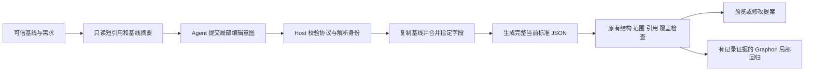

# 局部编辑意图与宿主编译

核对日期：2026-10-21。

日期：2026-10-18。**R6 阶段历史状态：已实现并安装 v0.0.2 R6，源码提交 `935a801475b77e2d4eb71ee3ac0edc68637395dc`；147 文件、1682 项测试通过。R5 单字段及完整提炼优化真实预览保留原版本归属，仍有纠错，不宣称整体加速。R6 只修复展示编号、未重做模型实测；原生重启、对话与工作流入口及原始配置恢复已核验。** 本页落实“Agent 提交局部编辑意图，Host 拼装当前标准 Workflow”的改造，继续属于 v0.0.2。

[规划引擎索引](README.md) · [JSON 投影与宿主补齐](03-JSON投影与宿主补齐.md) · [证据驱动优化](16-v0.0.2证据驱动优化执行方案.md) · [耗时证据](../../../docs/evidence/v002-merged-install-20261018/planning-efficiency.md)

## R7 复用本编译边界

R7 已安装并完成真实试做，提炼修复按用户要求暂停；先优化后端算法，详见[暂停说明](19-R7自动闭环阶段说明与暂停交接.md)。新建任务先受控执行并验证，再使用 verified-trial/trialTask 提炼；进入 author/optimizer 后仍提交本页的局部编辑，Host 拼装当前 Workflow。试做 child 不直接输出或保存完整图，也不能借来源成功扩大 fixed/targetScope/Secret 或优化范围。

业务 task/inputs/artifacts/reviewItems 由 Host 独立传递，不能只保留规划指令而漏掉业务条件；必要 human 节点不得优化删除。详情及源码见 [18](18-先执行验证再生成工作流.md)，R6 安装及 R5 实测保持原版本归属。

## 1. 问题与目标

R1/R2 的真实规划记录显示，简单图的主要重复工作来自结构化输出纠错、需求覆盖补充及完整图重写。R2 的图只有约 2 KB，却提交了 7 次完整图；6 个子 Agent 共 17 个模型回合。该案例不能证明所有任务都慢在同一原因，但足以说明单纯压缩 JSON 字段名不能解决协议反复纠错。

本轮将模型生成与持久化分开：模型只输出编辑操作，Host 在可信基线上合并。当前 Workflow、节点 config schema、唯一导入导出标准、画布、提案和 Graphon 都保持原合同。现有节点和字段含义继续来自同源语义词典，不引入第二种业务运行语言。

## 2. 数据流



新建从 Host 预留的空工作流开始。修改从当前冻结图开始。修正阶段可基于本任务已经物化的草稿继续提交局部操作；这份草稿不等于已通过验证的候选，仍相对原始请求检查权限和修改范围。优化绑定当前最佳候选，而不是早期基线或任意模型提供的图。

## 3. 编译合同

| 内容 | 处理方式 |
| --- | --- |
| 协议版本与 baseDigest | 内部协议单独版本化；省略 protocolVersion 由 Host 补为 1，显式不兼容版本拒绝；每次提交必须绑定 Host 提供的当前基线摘要，过期则拒绝 |
| 既有节点 | 使用只读短引用定位，Host 映射稳定 ID；模型不重写 UUID |
| 新节点 | 模型指定本次操作内唯一短 key，Host 从预留池分配 ID；未知引用、重复 key、池耗尽均报具体诊断 |
| 节点配置 | 仅合并明确设置/删除的字段；未指定字段保留，不因省略而丢失 |
| 连线和容器 | 使用明确增删操作与作用域；容器内节点经同一编译器处理，不允许借 body 替换绕过保护 |
| 角色与环境变量 | 只处理允许编辑的声明，现有本地绑定由 Host 保留；Secret 值、句柄、授权和密文不进入模型合同 |
| 引用转换 | 只转换明确的结构引用和合法变量引用 token，不对 prompt/code 文本做任意子串替换 |
| 空的可选说明 | 无语义的空 questions/assumptions 可由 Host 补齐；需要澄清必须有真实问题，需求覆盖不能伪造 |
| 资源与安全检查 | 限制输入大小、操作数量、递归深度和危险键；编译不执行脚本或业务工具 |

最终节点 config 仍使用当前字段名称、类型和意义。短引用只是本次模型交互的定位方式，不持久化成新的节点 ID，也不会出现在导出工作流中。

## 4. 普通设计与确定性优化分别约束

普通 author 支持明确的新建、节点更新/删除、连线增删和允许的共享声明变更。所有修改仍经过原来的 targetNodeIds、固定节点、容器作用域、工具目录、Secret、需求覆盖和发布版本校验。

optimizer 的操作面更小：仅允许目标节点的 kind/config 替换及原因、样本引用。它没有修改工作流名称/说明、拓扑、其他节点或人工核对节点的接口。Host 拼装后仍执行原来的替换范围与 Graphon 回归检查，不能因缩小模型输出就省略独立检查。

运行目标超出时保留候选并继续有限优化；实际 Token 用量单独计量。

## 5. 旧路径退役

生产中的新 author/optimizer 输出只接受局部编辑协议，不再将完整 graphJson 当备用模型输出。Host 内部生成 canonical PlannerOutput，现有持久化与回执继续使用它。旧规划记录的 graphJson 只在历史恢复读取边界保留；不能把旧记录恢复解析器用于接纳新模型的全图输出。

这是内部通信协议收敛，不是旧 Workflow JSON 的迁移或兼容。当前唯一 `formatVersion:2` 不变。

## 6. 实施与验收顺序

| 编号 | 实施项 | 必须验证 |
| --- | --- | --- |
| V02-E01 | 共享编辑协议与纯编译器 | 新建、局部配置合并、未知引用、重复 key、摘要冲突、嵌套作用域 |
| V02-E02 | author/repair 接入 | 单节点修改不重写整图；修正只改已知错误；完整候选仍通过当前全部检查 |
| V02-E03 | optimizer 接入 | 输出不能触及图元数据和拓扑；合法替换通过原 Graphon 记录样本回归 |
| V02-E04 | 历史边界与保护 | 旧任务恢复不阻断启动；固定节点、人工检查、Secret、本地绑定和范围保护保持 |
| V02-E05 | 合并构建、安装与实际调用 | 记录模型回合、子 Agent、结构输出大小、错误原因；保留失败证据，不承诺固定加速比例 |

先做纯函数和 Host 集成回归，再冻结源码、构建、安装并进行真实模型验收。真实模型预览与节点样本回归不等于完整业务执行。确定性任务直接走模板的快速路径、方法缓存和跨任务复用不纳入本轮，后续以独立证据决定。

## 7. 当前实现接口

`planningEditView(context, base)` 返回本轮只读短引用、可用身份数量和 `baseDigest`。已有节点为 `@1`、`@2`；新节点操作的 `key:"format"` 在同一提交中用 `+format` 引用。角色和环境变量分别为 `@a1` / `+a:key` 与 `@e1` / `+e:key`。下一轮重新读取视图，不能复用上轮短 key。

下面只修改一个模板的正文，其他配置、节点和连线均由 Host 保留。`baseDigest` 必须替换为当前视图返回值。

```json
{
  "protocolVersion": 1,
  "baseDigest": "<当前视图返回的摘要>",
  "outcome": "candidate",
  "edits": [{
    "op": "update-node",
    "node": "@2",
    "configSet": {"text": "你好，{{input.name}}！"}
  }],
  "requirementCoverage": [{
    "requirementId": "R1",
    "nodeIds": ["@2"],
    "note": "按已确认要求修改问候正文"
  }]
}
```

`configSet` 按 config 顶层字段合并，指定的数组或映射整体替换；它不是任意深层 JSON Patch。`configUnset` 显式删除指定顶层字段，同一字段不能同时设置和删除。节点配置的 `body` 必须通过 `scope` 内的节点操作编辑。操作必填/可选字段说明从严格解析 schema 生成，避免模型侧说明与编译器分叉。

`compilePlanningEdits()` 返回 `{output, candidate, issues}`；`output` 是 Host 生成的 canonical PlannerOutput。`compileOptimizationEdits()` 返回同形结果，其中 output 仍为既有 OptimizationOutput。优化操作形如 `replacements:[{node,kind,config,reason,evidenceCases}]`；证据仍须是当前记录的有效引用，`expected` 与 `upstreamOutputs` 的 pointer 必须为空串，不能引用包装对象的局部字段来冒充完整输出。

引用转换依据实际节点类型和配置路径。只在运行时支持引用的字段解析变量、过滤器、条件和模板标签；普通正文中的 `@2`、带引号的字面量、代码正文、业务对象中同名字段不会被当作身份。模板局部变量继续遵守原作用域。历史存储和最终导出只含稳定 ID。

## 8. 参考来源

- [真实耗时分析](../../../docs/evidence/v002-merged-install-20261018/planning-efficiency.md)：本轮改造的直接问题依据。
- [现有投影与校验实现](../../../src/shared/planning-projection.ts)：Host 补齐、稳定身份、范围与元数据保护。
- [局部编辑编译器](../../../src/shared/planning-edits.ts)：内部协议、同源操作说明、短引用和严格编译。
- [编译器测试](../../../tests/planning-edits.test.ts)与[独立 Host 集成测试](../../../tests/planning-edits-integration.test.ts)：摘要、引用、恢复、权限与 Graphon 片段回归边界。
- [现有规划服务](../../../src/host/planning/service.ts)：任务生命周期、有限修正、候选保留和优化接入位置。
- [节点语义词典](15-Agent工作流语义词典.md)：字段与引用语义的唯一说明来源。
- [持久化恢复](09-持久化恢复与取消.md)：历史记录读取和幂等回执边界。


## 9. 构建与验收证据

当前已安装 v0.0.2 R6，源码 `935a801475b77e2d4eb71ee3ac0edc68637395dc`。冻结全量 147 文件、1682/1682 项通过，Host/Client 类型及 52 个 Remote schema 一致；安装元数据事务另有 17/17。R6 仅定点修复 Host 展示编号分配，没有再次调用真实模型；R5 两项实测保留原版本归属。R6 原生重启、对话及工作流入口恢复已核验，原始 Max 与完整配置哈希已恢复。见[R6 构建](../../../docs/evidence/v002-merged-install-20261018/r6-verification.json)、[安装回执](../../../docs/evidence/v002-merged-install-20261018/r6-install.json)及[数据保留](../../../docs/evidence/v002-merged-install-20261018/r6-preservation.json)。

R5 历史安装，冻结 842 个文件；全量 1679/1679 通过，Host/Client 类型和 52 个 Remote schema 一致，安装元数据事务 17/17。见 [R5 构建](../../../docs/evidence/v002-merged-install-20261018/r5-verification.json)和[安装回执](../../../docs/evidence/v002-merged-install-20261018/r5-install.json)。以下保留 R4 构建与失败记录。

冻结 839 个源码文件后完成构建，Host/Client 类型及 52 个 Remote schema 一致。全量 1676 项断言中 1675 项直接通过；唯一旧 mock 仍读取整图 prompt，适配测试夹具后定向 1 项通过，生产代码未变，最终按 1676 项计数而不累加复测。新编译器/独立集成覆盖 33 项，已包含在总数中。安装元数据事务另有 17 项测试。文档索引验证 96 篇、20 节点类型。

R4 安装包包含 558 文件，33,335,124 字节，SHA-256 `bd292fad793ef6fc8ba4b6dd929b9f5c2ee53660087dd1566c5d564ae7053387`。R4 Desktop 安装树摘要 `594673d47dbd42472a662c35d04b861e949bbe46ca3d911d0e42e205cd486fb3`。仅本地安装，未公开发布；模型实际结果另记，不把自动化模型替身当成真实调用。

详见[冻结构建记录](../../../docs/evidence/v002-merged-install-20261018/r4-verification.json)与[安装回执](../../../docs/evidence/v002-merged-install-20261018/r4-install.json)。

### R5 真实模型结果

| 场景 | 结果 | 实测范围 |
| --- | --- | --- |
| 单模板正文修改 | 25 秒，1 子 Agent / 1 模型步骤；607 字节、1 条编辑、无重试 | 只改变 config.text，原 config.inputs、节点身份、连线和 revision 10 不变；仅预览 |
| 已完成任务提炼与优化 | 4 分 50 秒，5 子 Agent / 13 模型步骤；最终 ready | 第二轮替换被接受，模型节点 1→0；Graphon 历史完整节点输出 1/1 通过，human 保留 |

完整链路仍发生覆盖字段、短引用及证据参数纠错。author/optimizer 的全部结构化参数由 R3 的 14,689 字节降为 R5 的 12,792 字节，但调用步骤由 7 增至 13，耗时由 3 分 27 秒增至 4 分 50 秒，不能据此宣称整体提速或用量下降。两次使用同一冻结历史范围，但不是重复采样性能基准。实际报告见[单改](../../../docs/evidence/v002-merged-install-20261018/real-model-r5-single-edit.json)、[提炼与回归](../../../docs/evidence/v002-merged-install-20261018/real-model-r5.json)。

后续可优先增加字段级引用示例与 Host 生成的需求覆盖空白骨架；Host 不替模型补覆盖结论。方法缓存、确定性快速路径和 MCP 适配尚未实现。

### R4 真实模型修正记录

R4 的真实问候提炼没有通过：模型把 `configSet` 写进 `set-workflow`、把 `config/key` 写进 `update-node`，并漏写协议版本和覆盖条目的字段名；最后又引用了不存在的 `greet.text`。该失败不能作为效率通过证据。R5 将工具参数改为每种操作独立的 `oneOf` 分支，内部版本由 Host 补全，覆盖关系仍要求模型明确提交。来源：[R4 实测记录](../../../docs/evidence/v002-merged-install-20261018/real-model-r4.json)。

### R6 展示编号修复已安装

R5 实测发现 Host 展示编号冲突。R6 仅针对编号分配作确定性修复，已完成构建、147 文件/1682 项自动回归及本地安装；安装元数据事务 17/17 通过。没有再次调用真实模型，不把该修复当作模型质量或 R5 性能改善。R6 原生重启、对话及工作流入口恢复已核验，原始 Max 与完整配置哈希已恢复。

### MCP 接入建议

MCP 可作为同一服务的外部适配层，用于其他 Agent 查询节点语义、提交局部编辑、预览和验证。当前 DSH 入口继续原生调用同一服务。MCP 负责上下文和工具交换，不会自动改善模型的规划策略；当前优先降低接口歧义和无效纠错。该适配层尚未实现。参考：[MCP 官方架构说明](https://modelcontextprotocol.io/docs/learn/architecture)。
