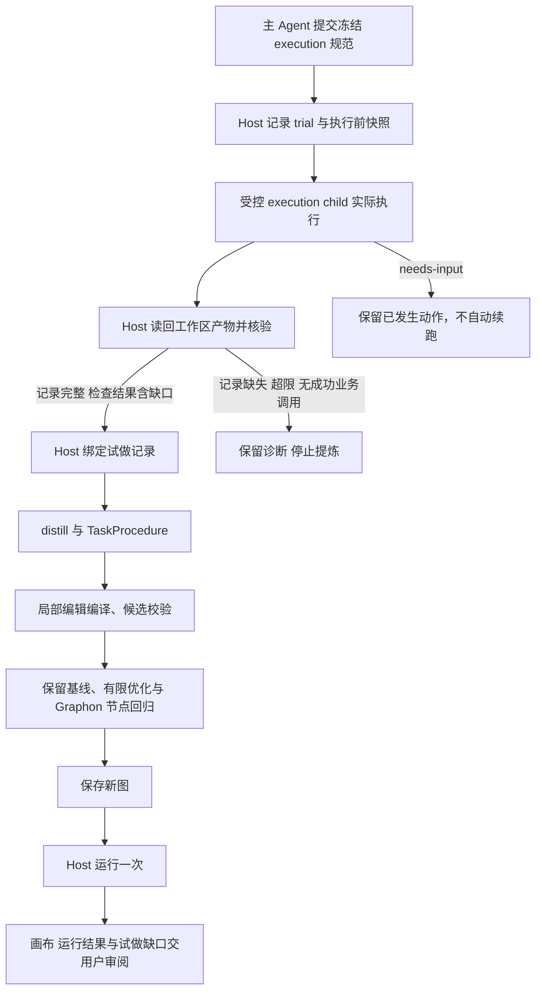

# 先执行验证再生成工作流

> 2026-10-25 更新：试做改为自我演练，取消中途复核、检查缺口不阻断生成、新图保存后自动运行一次再审阅。现行规则见[文档 24](设计/24-试做改为自我演练.md)；下文历史验证记录保留原版本归属。

> 2026-10-21 说明：工作流预算系统已于 2026-10-20 移除（见 [S12](设计/tasks-规划提速与上下文复用.md)）。本文涉及预算问答、额度、增额或费用的内容仅为历史记录，不再执行；Token 用量只作性能计量保留。

日期：2026-10-18。**状态：R7 已冻结并本地安装；真实试做及 Host 核验已完成，提炼修复按用户要求暂停，完整闭环尚未通过。** 计划先于实现提交于 `b0591e1`；冻结源码为 `021c293954bc4e17cec5aa589d271c2e0676443c`。先完成后端工具算法优化再恢复，见[阶段说明](19-R7自动闭环阶段说明与暂停交接.md)和[待处理清单](20-后端工具优化与闭环恢复待办.md)。产品与引擎版本仍为 `0.0.2`，Workflow 仍仅支持 `formatVersion:2`，Graphon 协议不变。R7 是内部修订标识，不是新的 JSON 格式。

[规划引擎索引](README.md) · [总方案第 22 节](../../../docs/Agent辅助生成工作流后端引擎执行方案.md#22-v002-r7先执行验证再反推优化) · [当前对话提炼](12-当前对话任务提炼与预览.md) · [确定性优化](16-v0.0.2证据驱动优化执行方案.md) · [局部编辑](17-局部编辑意图与宿主编译.md)

## 1. 入口分流

| 用户意图与环境 | 当前代码路径 |
| --- | --- |
| 新建可复用任务，原任务尚未完成 | 主 Agent 在同一次 `visible_workflow_plan` 调用中提供 `execution.mode:"execute-first"` 及冻结的任务、工具和验收规范；Host 执行、核验，再自动提炼和规划 |
| 关键输入、许可或验收标准缺失 | 主 Agent 先原生询问；可写的无来源 create 缺 execution 时返回 `EXECUTION_SPEC_REQUIRED`，不猜测或偷偷退回纯设计 |
| 用户明确仅设计 | `execution:{mode:"design-only"}`；不能因试做失败自动采用该例外 |
| Plan Mode 或只读权限 | 无执行规范的 create 自动保持设计预览；显式 execute-first 也降为 design-only，规范仅作设计资料，不执行试做、业务验收或证据驱动优化 |
| 当前对话任务已完成 | `visible_workflow_from_conversation` 继续提炼历史，不强制再做一次 |
| 修改已有 workflow 或节点 | 继续原 revise、局部编辑及提案路径，不重复业务动作 |

这条路径会实际执行用户任务，仍受已有任务授权和宿主权限约束。生成 workflow 的请求不自动扩大为任意发送、购买、部署或第三方修改授权。演练结束后生成并保存新图，由 Host 运行一次后报告；试做未跑通步骤须保留，详见文档 24。

## 2. 数据流与职责

`WorkflowTrialService` 管执行前冻结、一次执行、验证、回执及恢复；`WorkflowPlanningService` 继续管提炼、author/repair、优化、候选与发布。执行 child 具有本次明确允许的业务工具；规划 child 仍只有结构化输出与两个只读目录工具。两者不共用宽松的工具权限。

### 2.1. 受理前核对会话工具

2026-10-24 Desktop r23（`trial-e77fa7b2…`）曾将 `native:web_fetch`、`builtin:html.select` 等节点工具 ID 写入 `execution.tools`，受理后才以 `TRIAL_TOOL_UNAVAILABLE` 失败，执行步数为 0。入口现于创建 trial、后台受理及模型调用之前核对每个名称：父会话目录中须恰有一个同名 schema，且 `ctx.tools.get(name, parent)` 可解析；同时复用执行器的禁用工具集合与模式。

不合法时返回可修正的 `TRIAL_TOOLS_INVALID`，列出全部无效名称及排序后的可用会话工具名（最多 40 个，附截断标记），不自动改写、不创建试做记录。试做由 Agent 用当前会话工具真实执行；`native:`／`builtin:` 是工作流节点工具 ID，不能写进 `execution.tools`；生成后的工作流节点由规划另行选择。骨架以 `['read','write']` 举例，实际须按当前会话目录填写。只读／计划模式仍仅将规范用作设计预览资料，不启动试做，不执行本校验；执行期冻结、权限复核及限额保持不变。

## 3. 执行前冻结的实际合同

`execution` 除 `mode` 外由 [planningTrialSpecSchema](../../../src/shared/planning-trial.ts) 严格解析。它是内部试做合同，不进入可移植 Workflow。

| 字段 | 实际约束 |
| --- | --- |
| `task` | 原业务任务文本，非空、最多 12,000 字符；期望标准来自用户要求或可复核规则，不能完成后倒填 |
| `tools` | 1–30 个不重复的工具名称；执行前核对父会话真实目录，并冻结定义摘要 |
| `inputs` | 工作区内已有输入文件的相对路径，默认空；执行前必须可读，执行后内容摘要必须不变 |
| `artifacts` | 1–30 项 `{path,format,checks,requireChanged}`；format 仅 `json` 或 `text`，每项必须有检查；requireChanged 默认 false |
| `reviewItems` | 不能机械判断的质量条件，默认空；最多 30 项，交真人确认，不能由模型代答 |

检查白名单只有 `json-equals`、`json-type`、`json-length` 和 `text-includes`。JSON 检查使用受限 JSON Pointer；text 产物只接受 text-includes。没有任意 JavaScript、shell、表达式或 verifier 脚本执行入口。输入与产物路径必须互不重复，合计最多 30 项；每文件最多 4 MiB，读回总量最多 16 MiB，规范最多 64 KB。

路径检查拒绝绝对路径、上级跳转、敏感目录/凭据文件、符号链接、非普通文件及读取中漂移。这个检查保护 Host 的取证读回；业务工具的完整参数权限仍来自父会话及宿主沙箱，不能将它说成通用于所有工具的 OS 文件隔离。JSON 数值相等、类型、长度和文本片段只证明所写的具体断言，不能保证断言本身完整覆盖需求。

## 4. 执行 child 与独立验收

[trial-agent.ts](../../../src/host/planning/trial-agent.ts) 使用官方 `startActivation`、预留 childId 和 caller delivery，继承当前实际请求模型及宿主权限。首次工具呈现与真实调用均检查身份、白名单、定义漂移、取消状态和根权限；禁止工作流工具、再委派、`run_code` 和 child 自行询问。原生 approval 为 `never`：需要新增授权时停止，不能在后台等待另一种宽松授权路径。

每次执行最多 32 步、20 分钟总期限，驱动有 5 分钟无进展保护，并共享模型并发准入。20 分钟只覆盖执行与核验：真人复核卡片的等待不计时，确认后的生成按规划自身的 20 分钟保护另行计时（2026-10-24 用户确认“分段计时”；此前复核等待会挤占生成时间，Desktop r21 实测确认后仅余约 7 分钟即超时）。这些是生命周期保护，不是估算 Token 预算。结果、取消、异常均等待 activation 清理；清理失败保留 `TRIAL_CLEANUP_FAILED`，不能由 completed 声明覆盖。

Host 根据执行前冻结路径自行读回产物，验证输入未变化、产物变化要求和具体内容断言。模型的 completed、工具成功或文件存在都不足以自动通过。完整配对且已闭合的业务工具调用/结果才可形成执行证据；结构化输出工具、自述、委派转述或丢失事件不能替代它。

公开摘录被截断只说明内容没有完整保留，不说明结果未知（2026-10-24 用户确认“区分截断与未知”）。执行门槛看结果：调用与结果成对、轮次正常结束、不是子 Agent 调用、`isError=false`，且可见部分没有 unknown/interrupted 标记，就计为一次成功执行。截断的调用在提炼证据中仍标为 `unknown`；如果门槛只靠截断调用通过，Host 会追加警告，提示不得把摘录当作完整参数或返回内容。此前的规则会把网页抓取、大文件写入这类调用全部判为未知：Desktop r22 试做的文件验收已经通过，仍以 `TRIAL_FAILED` 失败。

这项执行证据检查放在真人复核卡片之前。证据过不了门槛时，试做直接失败，不再弹出复核卡片。

2026-10-24 用户决定“显示试做说明”。据 Desktop r25 验收反馈，试做 Agent 的 summary 已说明未能取得 10 个仓库，但原生复核卡片只显示冻结的 reviewItems，真人看不到这项限制。卡片现在在待复核要求上方显示“试做说明”，内容取 `trial.execution.summary`，复用公开证据脱敏后最多显示 600 个字符，超出显示 `…（已截断）`；没有说明时明确提示结合实际产物复核。说明是执行方自述，不能替代文件与证据验收，也不会改写冻结条件。

显示继续使用宿主问题卡片的 Markdown `detail`，沿用 [DESIGN.md §31](../../../DESIGN.md#31-宿主问题卡片补充说明的左右间距2026-10-24) 与 `host-question-style.ts` 的补充说明左右间距；按钮仍为“确认，继续生成”／“暂不继续”，不新增样式或自动确认。r25 确认后另遇规划存储容量失败，本轮按用户决定补充终态自动淘汰，细则见[持久化恢复与取消](09-持久化恢复与取消.md#2-写入及容量边界)。此处记录验收输入与源码修复，不表示已重新完成 Desktop 真实模型验收。

2026-10-25 Desktop r26 用户决定“顺便修”复核卡：待复核要求改为 Markdown 编号列表，每条单独一行；试做说明中的裸 HTTP(S) URL 两侧补空格，避免 `r.jina.ai（https://r.jina.ai/https://github.com/trending）取得` 的全角括号及正文被自动链接吞入。显式 Markdown 链接、尖括号链接与行内代码保留。仍先执行原公开证据脱敏和 600 个 Unicode 字符截断，再加展示空格，截断标记及冻结 reviewItems 的内容不变。沿用 §31 间距，不新增 CSS；测试以 GFM AST 检查独立列表项和 URL 终点，未进行 Desktop UI 复验。r26 写入失败及后续编译修复见[模块片段记录](设计/22-可组合模块片段.md#18r26-参数路径与规划写入检查2026-10-25)。

公开证据的条数和大小上限（100 条、24 KB）也在复核卡片之前，按完整证据检查（2026-10-24 用户确认“提前检查+限制试探”，24 KB 上限不变）。超限时以 `TRIAL_EVIDENCE_TOO_LARGE` 失败，并写明实际条数和大小，不静默裁掉步骤。

2026-10-25 起，超限不再失败。Desktop r28 后，用户问“能不能让超了也能做？”，因此改为公开压缩（见[试做改为自我演练](设计/24-试做改为自我演练.md#超限记录的公开压缩2026-10-25)）。上限本身仍是 100 条、24 KB。

Desktop r24 实测的起因是：会话 `web_fetch` 抓 GitHub Trending 时，页面在仓库列表之前就被截断。试做 Agent 随后依次尝试了约 30 个镜像和代理，公开记录达 74 条、约 52 KB。用户点了确认之后，生成时才报错。

执行提示因此补充三条规则：
- 网页抓取先用任务给定的地址；
- 抓取失败或内容不完整时，最多再换两个公开镜像或替代地址，并在 summary 中写明实际采用的地址（用户确认允许换镜像）；
- 抓取未跑通也结束演练并记录缺口，仍生成流程；不能保证生成图能取得完整原文。网页类步骤优先使用与工作流节点同源的抓取／HTML 工具（如可用），记录实际地址、选择器和字段。

| 结果 | 后续行为 |
| --- | --- |
| 文件核验 passed／failed／needs-review，执行记录完整 | 绑定试做记录，保留检查报告与警告，直接提炼生成；不代表工作流已验证 |
| 执行事件缺失、超限或无成功业务工具调用 | failed，保留诊断，不用人工确认替代完整记录 |
| 执行 needs_input | 业务 child 已停止，只转达必要信息／授权问题，不自动续跑或重放 |

执行中缺信息/权限时，主 Agent 先通过原生询问澄清，并说明哪些动作已经发生。用户明确选择后，可以在正常对话只完成剩余动作，再调用当前对话提炼；不能把规划器的 `plan_answer` 当成执行 child 的续跑 API。本版没有通用的任意步骤恢复或自动修复重试。

## 5. 最终审阅与运行时审核

原生“试做结果复核”卡片和重新复核工具已移除。reviewItems 兼容保留为最终报告备注，不再强制映射 human；机械条件生成自动检查，定性问题在保存并首次运行后向用户报告。只有原始用户请求明确要求运行时审核，才设置 requiresReview 并继续执行 REVIEW_REQUIRED、T20 与 reviewed-file-write 规则。旧 needs_review 恢复为 interrupted，不自动续做。完整开关与兼容说明见[文档 24 §5—7](设计/24-试做改为自我演练.md)。

## 6. verified-trial 与 trialTask

公开来源只接受 `{kind:"verified-trial",trialId}`。Host 从自己的持久化 journal 解析根会话、workspace、child、规范/证据/验证摘要及回执；调用者不能上传 passed、events、sessionId 或自造可信回执。

`trialReport` 携带完整冻结检查报告及标明 agent-claim 的试做 summary；失败／无法核验项不会被改为通过。`trialTask` 独立携带执行前冻结的 `task/inputs/artifacts/reviewItems`，随可信上下文交给 distill 和 author，并参与来源检查与 provenance 摘要。它和生成/优化用的 `instruction` 分开，避免将业务验收条件漏掉或误删成“图外设计指令”。本次样本值、文件名和固定答案不能直接冒充可复用算法。

`current-conversation` 仍只读取当前根的已闭合历史并排除转换轮次，不扩大为任意子会话读取。verified-trial 使用自己真实受控 child 的公开事件与 Host 验收回执，不伪造根会话事件。两种来源最终复用现有 TaskProcedure、局部编辑、唯一 JSON、语义词典、范围/固定节点/Secret 保护、候选校验及 Graphon 回归。

## 7. 分层结果、预算和查询身份

| 层次 | 可以证明 | 不能扩大为 |
| --- | --- | --- |
| 原任务验收 | 本次指定文件满足冻结机械检查；人工结论单列 | 所有语义正确、所有输入通用或生成图已实际运行 |
| Graphon 节点回归 | 合格完整历史样本在受限节点变换中输出一致 | 整图网络、文件副作用、所有分支与性能通过 |
| 模型建议 | 方法、候选、替换理由和需补充的信息 | 独立验证通过、实际费用或性能收益 |

优化最多沿用两轮；目标超出保留合法候选并继续优化，缺样本、无收益或优化结束保留基线与原因。只有符合完整历史输出合同的替换才进入 Graphon，不能以试做 passed 代替每个替换的回归证据。无模型节点时直接记录 already_deterministic，不制造替换或节约数字。

试做 `usage.scope:trial` 与规划 `usage.scope:planning` 分开；未知 Token 仍为未知。执行前不会询问“未来生成图”的预算，也不把试做实耗算进 optimizationTarget；用户明确的宿主权限、供应商及执行保护仍有效。新 execute-first 图保存后使用现有运行服务自动运行一次，缺输入或遇 human 停在 waiting，不询问 Token 预算。

plan 返回 `taskId:trial-…`、`trialState`、execution、verification；产生规划任务后附 `planningTaskId` 和 planning。顶层 state 优先反映 planning.state，因此 trialState=ready 不保证候选一定 ready。`plan_get/plan_cancel` 可使用 trial 身份；后续规划澄清和发布须使用 planningTaskId 及 planning 内的 revision/candidateDigest。

## 8. 持久化、取消与冷恢复

试做在启动前写入 `trials/planning/tasks.json`，保存规范、身份、公开事件、前后快照、验证及回执；其 verified-trial 规划任务（含历史预览）也保存到 `planning/tasks.json`。这是执行恢复所需日志，**不等于发布工作流**。普通 current-conversation 预览依然只在内存，不能据此宣称所有预览都落盘。日志不保存私有思考，文件快照保留指纹/检查结果而非完整文件正文；公开事件仍有脱敏和长度限制。

同一工作区、根会话和 requestId 的相同请求复用原 trial；不同内容返回 REQUEST_ID_CONFLICT；同一工作区同一时间只允许一个试做在跑业务步骤，或一个新图在首跑；生成阶段不占工作区（T30.2）。重复成功、needs_input 或取消请求都不会再次启动业务。输入内容变更不让同一 requestId 自动重做。

重启只校验并恢复记录：请求摘要、完整来源绑定、回执、候选及优化报告一致性不成立时拒绝恢复；活动试做转 interrupted，不自动续跑 child 或模型。运行中途停止（步数上限、无进展、结果格式无效、模型服务出错、没提交结果）时，Host 新开一个试做子会话、带上前一段的调用接着做一次，不恢复原 child（T30.1）。原生驱动对已知持久化 child 安装 cold-resume guard，阻止旧 child 再启动；合法 ready 候选可恢复读取。旧 needs_review 记录恢复为 interrupted 并说明旧复核已结束；不再提供复核工具。首次运行未确定受理时不补跑；有 runId 时可查看实际记录。不承诺跨崩溃副作用恰好一次，见文档 24。

## 9. 实现位置与当前验证

| 模块 | 已接入职责 |
| --- | --- |
| [planning-trial.ts](../../../src/shared/planning-trial.ts) | 规范、文件指纹、验证报告、公开事件和绑定合同 |
| [trial-agent.ts](../../../src/host/planning/trial-agent.ts) | 受控执行、原生工具 guard、公开事件、取消/清理和冷恢复 |
| [trial-verification.ts](../../../src/host/planning/trial-verification.ts) | 有界文件读取、冻结断言、输入漂移和产物核验 |
| [trial-evidence.ts](../../../src/host/planning/trial-evidence.ts) | 完整事件配对、试做记录绑定、检查警告与脱敏 |
| [trial-service.ts](../../../src/host/planning/trial-service.ts) | 请求去重、durable journal、单次演练、检查报告与自动提炼 |
| [Host](../../../src/host/index.ts)、[规划服务](../../../src/host/planning/service.ts) | 入口分流、trialTask／trialReport、来源鉴权、发布和首次运行 |
| [store.ts](../../../src/host/planning/store.ts) | 必要试做／规划日志的显式持久化策略，普通预览默认不变 |

首轮定向执行记录：2026-10-18，trial-agent/verification/evidence 三文件 63 项通过；新 trial-host 加 planning-host/entry/model-source/retrospective-host 五文件 5 项通过。Host 夹具实际读写临时文件、使用生产 Host 注册工具/验证器/存储，模型与 execution driver 为明确离线替身；不是原生工具或真实模型验收。集成测试复现了 trial 来源同内容字段顺序不同导致的摘要误判，修复后通过。以上保留早期定向归属；最终冻结为 152 文件/1781 项通过，元数据事务另有 17 项，双端类型及 52 个 Remote schema 通过，详见[冻结证据](../../../docs/evidence/v002-execute-first-r7-20261018/verification.json)。

测试来源：[试做驱动](../../../tests/trial-agent.test.ts)、[文件核验](../../../tests/planning-trial-verification.test.ts)、[证据](../../../tests/planning-trial-evidence.test.ts)、[Host 集成](../../../tests/trial-host.test.ts)及[夹具](../../../tests/fixtures/trial-host-fixture.ts)。它们分别覆盖权限/清理/冷恢复、错误产物/路径/漂移、伪造或不完整证据、超目标保留、真人复核、取消及日志恢复；完整替换回归沿用 [planning-regression](../../../tests/planning-regression.test.ts)。R1—R6 记录保留原版本归属。

## 10. 原验收计划与当前暂停位置

下列第 1—4 项已完成；第 5 项的真实试做及 Host 核验已完成，提炼引用错误后的修复被用户取消；第 6 项中的候选、优化对比和生成图回归尚未完成。当前不继续执行此清单。

1. 冻结本轮源码提交、README 和源文件 manifest，完成全量回归、Host/Client 类型、Remote schema、构建和文档链接检查；不要把首轮定向数字当冻结结果。
2. 包版本保持 0.0.2，为 R7 使用独立 stage、artifact、安装与元数据 journal。生成包后再记录真实文件数、大小和 SHA；R6 包保留用于回退。
3. 复用原子插件安装器和两文件 profile 事务，仅更新本插件 file 来源及 integrity，核对 dependencies/peers/SDK 不变；前序来源为 R6，不能沿用 R5 常量。保存画布并正常退出 Desktop 后安装。
4. 重启检查对话、工作流入口和实际过程展示，核对安装树/四个 bundle、用户工作流 revision/定义、提案/草稿/历史及配置保留；结束后恢复实际模型选择和配置摘要。
5. 真实验收使用独立临时工作区的五条合成订单：paid book 1200、book 2500、food 300，refunded food 900，cancelled book 700。冻结期望 paidCount=3、totalCents=4000、book=3700、food=300，真实模型调用工具生成 summary.json/report.md，由 Host 读回核验，再自动提炼与规划优化。另一输入检查硬编码，样本来源单列。
6. 分开记录原任务真实执行、业务核验、候选生成、替换采用/拒绝、Graphon 实际回放与 UI。若没有合格替换或样本，记录保留候选及限制；不能手改模型输出制造通过。生成图的完整运行如另行验证，使用隔离副本，不能扩大节点回归结论。

R7 的冻结、安装、实际试做和暂停结果已分别记录于[验收目录](../../../docs/evidence/v002-execute-first-r7-20261018/README.md)。R6 的 147/1682 及 R5 的两项实测保留历史归属；不得据 R7 试做成功宣称生成图完整闭环通过。

原生事件起点来自受控 agent/created 时的新建会话 seq：允许官方发布前配置前缀，之后要求事件连续；不能接受模型或首条公开事件自报起点。工具目录摘要冻结模型可见的输入契约，不代表冻结工具实现代码。
