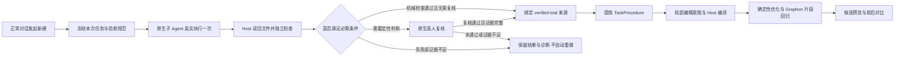

# R7 自动闭环阶段说明与暂停交接

> 2026-10-21 说明：工作流预算系统已于 2026-10-20 移除（见 [S12](设计/tasks-规划提速与上下文复用.md)）。本文涉及预算问答、额度、增额或费用的内容仅为历史记录，不再执行；Token 用量只作性能计量保留。

> 2026-10-19 状态更新：用户已明确授权安装新编译工具并恢复验收；原试做未重复，生成图局部修复后两组样本完成。见[第 21 篇](21-编译工具安装与R7闭环验收.md)。下文保留 2026-10-18 暂停时的历史状态。

## 1、当前决定

2026-10-18，用户要求**暂停当前规划和真实验收，先优化后端工具算法，再回来完善完整闭环**。本轮按此停止模型与子任务，只整理说明、待处理清单和证据，不继续改业务代码、调用模型、安装或自动恢复。

当前 Desktop 已安装 `v0.0.2 R7`，未回退。版本 `0.0.2`、Workflow `formatVersion:2`、Graphon 均保持。R7 的代码和安装已完成，**真实完整闭环尚未验收通过，不属于完成交付的功能**。

- 方案先行提交：`b0591e1`。
- 实现冻结提交：`021c293954bc4e17cec5aa589d271c2e0676443c`。
- 当前分支：`codex/v0.0.2-execute-first`；R6 基线分支：`codex/v0.0.2-r6-baseline`（`2ecf15d`）。
- 安装包、安装树、回退副本及配置核对见[安装证据](../../../docs/evidence/v002-execute-first-r7-20261018/README.md)。另一对话的工具算法工作不并入这次暂停交接提交。

## 2、已经接入的流程

试做验收与生成图验收分开。前者证明这次任务的产物满足冻结条件；后者仍需检查算法是否可复用、换输入是否正确。原生复核不能提前证明尚未生成的图正确。

已有完成任务继续从当前对话提炼；已有图/节点修改继续局部规划，不强制重新执行业务。用户明确只设计或当前只有只读/计划权限时保留设计预览。试做预览不自动发布工作流；保存后运行图仍是另一个动作。

预算目标是优化目标，目标超出不直接丢弃合法候选；沿用已有 v0.0.2 的候选保留与有界优化。实际宿主权限、供应商限制、取消和资源保护仍有效。不能把所有失败统一说成预算不足，也不能用未知 Token 估计金额。

## 3、实现与验证状态

表 1  R7 暂停时各层状态

| 层次 | 暂停时已确认的事实 | 尚未确认的部分 |
| --- | --- | --- |
| 接口及原生驱动 | execute-first、design-only、verified-trial、原生进度、试做日志与去重已接入 | 泛化任务/模型的稳定性 |
| 独立验收 | 工作区 JSON/文本有界读回，输入不变、固定断言、路径与完整事件检查 | 复杂语义或任意外部系统的自动验收 |
| 原生复核 | 原生真人问题、重新复核、问答期间文件指纹复查已接入 | 本次模型把未来图要求混入试做复核，应在后续算法中明确分层 |
| 防重复执行 | 相同请求复用，重启/取消不自动重放；正常关闭待复核可恢复 | 不承诺跨崩溃副作用恰好一次 |
| 自动化验证 | 152 个文件、1781 项通过；元数据事务另计 17 项；双端类型和 52 个 Remote schema 通过 | 不能替代真实模型闭环 |
| 安装及数据 | R7 安装、重启、原生入口正常；原 17 个图和 15 个规划任务保留 | 新版模型入口的完整真实验收 |
| 真实试做 | GLM-5.3-Flash Max，6 步，原生 UI 约 46 秒；实际 read/write 交付两个文件 | 不是生成图的完整运行 |
| 实际产物 | summary 为 3 笔/4000 分，book 3700/food 300；11 项机械检查通过，另有原生复核记录 | 单次样本不证明所有输入 |
| 提炼 | 已自动从可信试做进入提炼；首次返回 5 个业务步骤 | 引用契约失败，修复阶段被用户暂停 |
| 图生成/优化/Graphon | 代码已接入原管线，自动化测试有覆盖 | 本次无候选、无发布、无整图运行、无真实替换回归结果 |

## 4、本次变慢的确切复现点

以下时间为北京时间（UTC+8）。第一次提炼在 `22:32:39` 开始，`22:37:50` 返回，约 5 分 11 秒；随后进入整份提炼结果修正。用户要求暂停后，`22:41:30` 后端记录取消。

模型的 `structured_output` 参数为 **9951 字节**。校验发现 **11 个非法 evidenceRefs**：10 个为 `trialTask.task / inputs[0] / artifacts[0..1] / reviewItems[0..3]` 等规范路径，另 1 个为 `requirement.R1`。当前 `evidenceRefs` 只接受冻结执行记录中的 `e数字` ID。

5 个业务步骤都已有合法事件引用，没有仅靠规范路径捏造业务步骤。实际问题是**执行证据、任务规范和设计控制在提炼输出中混用了同一引用字段**，造成 `INVALID_PROCEDURE` 并触发整份重新生成。仅从内存副本移除非法注释可通过结构检查，但这不等于完整来源覆盖或业务语义已通过；后续不能简单静默删掉引用来伪造正确性。

此次诊断码为 `INVALID_PROCEDURE`，最后为用户主动 `CANCELLED`；**没有 BUDGET_EXHAUSTED**。慢的已知组成包括当前 Max 模型单次提炼时长与协议纠错。尚未做不同算法/模型强度的对照，不能据此认定 JSON 数据体积是唯一原因，也不能声称已经提升性能。

- 首次提炼子会话：`76f6605f-2c44-45f6-9216-9d8a2075f517`。
- 公开工具记录：`structured_output`，`seq=15`，`call_d863f5ee67cc4971b28fb638`；仅分析公开工具参数，未把私有思考写入证据。目前归档的是诊断摘要，9951 字节失败参数本体尚未导出为回归样例。
- 用量：试做已报告 41184 Token；规划已报告 24790 Token，另有 1 次用量未知。不能合成完整账单或把未知当零。

## 5、暂停位置与保留资料

表 2  恢复所需定位信息

| 项目 | 值 |
| --- | --- |
| 原生对话 | 创建R7订单汇总验收工作流 |
| 根会话 | `session-ebfe6768-ad6a-438f-864e-f3ecf6f8c1a8` |
| 工作区 | `/private/tmp/dsh-workflow-r7-acceptance-20261018` |
| 试做 ID | `trial-71128754-f3a1-483e-b5e2-a8eb3dd3ddf9` |
| 规划 ID | `20fc4b82-b782-45f8-a98e-e5fa38f5f135` |
| 暂停后的状态 | planner 为 cancelled，无候选/发布；外层 trial.ready 仅表示已移交并记录规划结果，不能解读为候选成功 |
| 原始文件 | `orders.json`、`orders-holdout.json`、`summary.json`、`report.md` |
| 试做恢复记录 | `~/.dsh/visible-dynamic-workflows/trials/planning/tasks.json` |
| 规划恢复记录 | `~/.dsh/visible-dynamic-workflows/planning/tasks.json` |
| 冻结构建 | `.cache/planning-entry-20261018-v002merge7` |

合成输入、真实试做输出和有限运行证据已复制到[验收目录](../../../docs/evidence/v002-execute-first-r7-20261018/README.md)，不能只依赖 `/private/tmp` 长期保存。持久化日志只在原主会话/工作区授权下使用；不要改写身份或伪造 receipt。

界面已显示[已停止](../../../docs/evidence/v002-execute-first-r7-20261018/desktop-paused.png)，未设置后台定时重试或自动恢复。

## 6、恢复顺序

先按[待处理清单](20-后端工具优化与闭环恢复待办.md)完成工具算法与提炼输出契约优化，再由用户明确要求继续。先用留存的公开失败样例做无模型回归，确认只修引用和必要字段，不全量重生成。

恢复时优先在上述原生对话，用已有 verified-trial 回执发起**新的规划任务**，跳过已经完成的业务试做。同一旧 requestId 只会返回已取消记录，不能把更换 requestId 当成重做原任务的理由。当前接口允许 `operation:create, preview:true, source:{kind:verified-trial,trialId:上述ID}`；新 requestId 只标识新的提炼/规划，不带 execute-first。调用前核对来源和实际权限，工具契约若已由后端算法任务更新，以当时实现为准。

候选通过后，再检查参数化和优化报告，用保留样本及独立样本运行生成图；最后更新真实验收结论、版本与安装记录。不以旧 R7 的测试数证明后续算法改动已经测试。

## 7、参考来源

- [原执行方案第 22 节](../../../docs/Agent辅助生成工作流后端引擎执行方案.md)、[原子文档 18](18-先执行验证再生成工作流.md)。
- [试做服务](../../../src/host/planning/trial-service.ts)、[驱动](../../../src/host/planning/trial-agent.ts)、[文件核验](../../../src/host/planning/trial-verification.ts)、[证据绑定](../../../src/host/planning/trial-evidence.ts)。
- [提炼与规划服务](../../../src/host/planning/service.ts)、[TaskProcedure 来源校验](../../../src/shared/retrospective.ts)、[局部编辑意图](17-局部编辑意图与宿主编译.md)。
- [实际试做证据](../../../docs/evidence/v002-execute-first-r7-20261018/real-trial.json)、[暂停快照与诊断](../../../docs/evidence/v002-execute-first-r7-20261018/pause-status.json)、[安装验证](../../../docs/evidence/v002-execute-first-r7-20261018/verification.json)。
