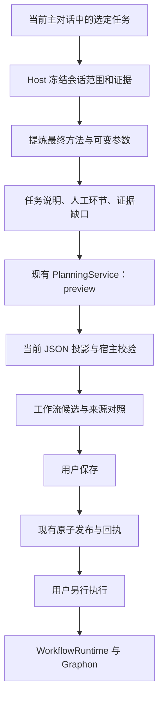

# 从已完成任务提炼工作流：可行性与接入设计

> 2026-10-21 说明：工作流预算系统已于 2026-10-20 移除（见 [S12](tasks-规划提速与上下文复用.md)）。本文涉及预算问答、额度、增额或费用的内容仅为历史记录，不再执行；Token 用量只作性能计量保留。

研究日期：2026-10-17。**状态：保留前期研究；当前根对话的提炼与预览已进入实现，准确能力及验收见 [12](../12-当前对话任务提炼与预览.md)。** 本文中的“当前”“尚未”除本段外指研究时点；原调研只读，未读取真实用户会话或调用真实模型。依据为项目源码、编译 SDK `0.2.1-rc.1`、官方 `dsh-v0.2.1-rc.2` 及下列论文。

本轮按执行方案 v1.4 的 R01—R08/P8 落地：采用当前根对话证据；将提炼阶段放入已有 `WorkflowPlanningService`，共用账本和取消机制，不另建独立服务；扩展明确的 source 请求契约；方法和来源仅存任务元数据。首版不展开子会话、不读附件/文件正文、不做多案例归纳。后文独立 retrospective service、产物清单和跨 child 证据为研究建议，不能视作已实现。

[规划引擎索引](../README.md) · [当前职责边界](../01-职责边界与数据流.md) · [唯一 JSON 标准](../../原理/10-JSON字段与导入导出.md)

## 1. 结论与产品定义

可以实现。建议入口名称为 **“从本次任务生成工作流”**：用户先与主 Agent 完成任务，再在同一对话要求把本次方法变成下次可换材料、换参数使用的工作流。

现有引擎可以继续承担生成节点图、JSON 校验、有限修正、预览和保存。主要新增工作是确定任务范围、读取执行证据、提炼最终方法、参数化，以及建立步骤和节点之间的来源对照。Graphon 继续负责用户另行发起后的业务运行。

| 实现方式 | 能做到什么 | 局限 | 推荐 |
| --- | --- | --- | --- |
| 主 Agent 回顾上下文，把总结交给现有 planner | 快速验证“完成后生成流程”的体验 | 会话压缩或总结遗漏后，难以证明全过程来源 | 可作原型 |
| Host 采集任务证据，提炼方法后接现有 planner | 可解释每个节点来自什么、哪些步骤被省略、哪些规则已参数化 | 需要新增证据和提炼模块 | ✅ 正式实现主线 |
| 按历史工具调用逐条录制回放 | 重现相同环境中的部分操作 | 临时路径、重试、环境状态及已发生的外部动作容易被机械复制 | 不作为通用方案 |

“全流程”应覆盖完成业务目标所需的步骤、依赖、人工环节与交付检查。一次性调试、错误尝试和撤回方案留在来源记录中，不必各自成为业务节点。不能为了简化而丢弃最终采用的纠正和质量检查。

## 2. 当前已经具备什么

| 已有能力 | 当前源码事实 | 本设计中的作用 |
| --- | --- | --- |
| 同主对话调用规划工具 | `planningCaller` 校验活跃根 Agent 和工作区 | 继续作为任务归属入口 |
| 结构化图生成 | `WorkflowPlanningService` 消费 `instruction`、基线、冻结目录和诊断 | 接收提炼后的完整流程说明 |
| 当前唯一 JSON | v2 交换包、当前 Workflow 与节点 schema | 不引入第二种执行格式 |
| 预览、澄清、修正、发布 | 已有 `plan/get/answer/cancel/publish` | 复用后半段生命周期 |
| 20 类节点及执行适配器 | input、document、code、llm、agent、tool、human 等 | 表达任务方法并由 Graphon 调度 |

当前规划 child 明确要求 `spawn.inheritsParentContext === false`，提示只包含显式传入的需求、图和目录，**不会自动读到主对话历史**。`PlanningRequest` 的严格 schema 也没有 `trace` 或 `sourceSession` 字段。因此直接把“把刚才的全流程做成 workflow”作为唯一 `instruction` 不够。[项目 adapter](../../../../src/host/planning/agent.ts#L90)、[规划提示](../../../../src/host/planning/service.ts#L146)、[请求契约](../../../../src/shared/planning-schema.ts#L5)

主 Agent 可以先根据当前可见上下文写出完整总结，再调用现有规划工具。这能作为试验入口，但目前不能宣称已实现自动采集、完整还原和来源追踪。

## 3. 官方 SDK 能提供哪些证据

官方 `sessionQuery` 提供 `observeSession`、`readSession`、`readEvent`、`traceEvent`、`traceSession`。其中 `observeSession` 返回一次固定的会话截面，包含 `header`、`cursor`、不可变 `events`；读取结束需释放 observation。当前编译依赖中可找到对应类型，但项目尚未直接声明或接入该服务；实施时应补充适当依赖，并检查安装环境的服务及能力是否存在。[官方查询服务](https://github.com/deepseek-ai/deepseek-harness/blob/dsh-v0.2.1-rc.2/packages/session-query/session-query/src/index.ts)、[固定观察实现](https://github.com/deepseek-ai/deepseek-harness/blob/dsh-v0.2.1-rc.2/packages/session-query/session-query/src/observation.ts)

| 证据 | 可以利用的内容 | 必须保留的边界 |
| --- | --- | --- |
| 用户消息与修改要求 | 初始目标、后续纠正、最终验收条件 | `user` role 可能是系统注入，须检查 source；再判断任务边界及最终纠正 |
| assistant 消息与工具结果 | 公开交付内容、工具调用参数、结果和状态 | 口头“完成”不能代替工具结果及产物检查；上游已截断的结果无法从日志还原；过滤思考、系统提示及敏感内容 |
| 原始事件与替换关系 | 追踪被压缩或替换之前的过程 | `deriveMessages/readSurface` 是当前模型可见内容，不代表完整历史 |
| 子 Agent 关联 | 父会话中的 child 身份、父级结果及可访问的子日志 | 必须核对真实父子关系；外部 provider 不一定有本地完整日志 |
| 文件与附件引用 | 输入材料、产物名称、可定位引用及已有验证信息 | 引用存在不等于文件仍可读；本次最终文件不能当成下次运行结果 |

会话压缩会替换模型可见的 surface，原始日志仍可保留。实际能否取回取决于会话是否仍在内存、是否启用了持久化，以及外部执行器是否上报了相关事件；不能据此承诺任何历史都完整可恢复。[官方事件契约](https://github.com/deepseek-ai/deepseek-harness/blob/dsh-v0.2.1-rc.2/packages/core/session/src/types.ts)、[压缩来源记录](https://github.com/deepseek-ai/deepseek-harness/blob/dsh-v0.2.1-rc.2/packages/compaction/compaction/src/types.ts)

上传附件引用不自动包含正文，工作区产物也未必有历史内容快照。建议新增内部产物清单，保存证据引用、路径或附件 ID、摘要、大小与可用性；只按授权需要读取相关产物。冷恢复补出的 `TOOL_NOT_STARTED / TOOL_OUTCOME_UNKNOWN` 等状态必须保留为未开始或未知，不能当成成功执行。

`sessionQuery` 是 Host 级查询服务，没有替本插件验证调用人的工作区权限。必须由 Host 先校验当前主会话，再定向读取；规划 child 继续只接收裁剪后的证据，不开放任意会话搜索或文件读取能力。

## 4. 推荐操作流程

用户可以直接说：

> 把刚刚完成这份报告的流程做成工作流，下次换一份数据也能用。

1. **选定任务范围。** 默认定位最近一个已完成的逻辑任务；它可能跨多个 turn。存在多个任务时，询问要整理哪一个，或让用户选择起止消息。
2. **展示提炼结果。** 给出简短卡片：保留的步骤、下次需要填写的输入、固定规则、人工环节和缺失证据。
3. **生成可编辑候选。** 范围清楚时可直接连同提炼卡片返回画布预览，不强制增加一轮确认；关键含义不明确时才先澄清。
4. **用户保存或调整。** 首版反推入口默认强制 `preview: true`，确认候选后复用已有发布接口；新建保存前仍需真实预算选择。
5. **以后另行运行。** 用户换材料或参数后执行。反推、预览和保存过程均不重做本次业务操作。

预览仍会调用模型，但不持久化规划任务；重启后会丢失。若未来增加可恢复的反推草稿，应单独设计存储与权限，不能把当前 preview 描述为已经跨重启保存。

## 5. 推荐数据流与模块

建议新增 `WorkflowRetrospectiveService`，放在现有 planner 前面。它负责证据和方法提炼，不承担图执行。

| 建议模块 | 职责 | 与现有引擎关系 |
| --- | --- | --- |
| `conversation-evidence` | 校验会话归属、冻结事件范围、关联结果、过滤和限长 | Host 只读采集，不赋予 child 历史查询权限 |
| `retrospective-service` | 组织提炼、澄清、参数化和证据完整性诊断 | 新增处理阶段 |
| `task-procedure` schema | 描述目标、步骤、输入输出、依赖及待确认项 | 仅分析中间结果，无执行语义 |
| `retrospective-provenance` | 记录步骤来源、删除理由、步骤到节点映射及摘要 | Host 私有伴随记录，不加入导出 JSON |
| 现有 planning 模块 | 生成图、补齐、校验、修正及发布 | 继续复用 |

可先由主 Agent 生成结构化方法说明，Host 验证引用，再交 planner；需要独立提炼 child 时应使用专门输出 schema。现有 `createPlanningAgent` 固定了图生成角色、工具白名单和输出契约，不能原封不动拿来充当任意总结 Agent；可以抽取并复用其受控 activation 生命周期。

## 6. 内部协议建议

新增入口可命名为 `visible_workflow_from_conversation`，参数仅包含 `requestId`、用户要求和可选起止消息引用。工作区和主会话从可信工具上下文确定，不能由模型提供任意 `sessionId`。

Host 冻结一个内部 `EvidenceSnapshot`，至少记录当前根会话、所选事件区间、每个实际展开子会话的截面、脱敏证据摘要、完整性状态和 digest。证据截止点不得包含反推请求产生的新工具调用，以免把生成工作流本身也纳入被提炼流程。

内部 `TaskProcedure` 建议包含：

| 字段 | 含义 |
| --- | --- |
| `goal / finalArtifacts` | 本次目标及有证据的最终产物 |
| `parameters` | 下次变化的资料、日期、对象、目录等 |
| `rules` | 用户最终确认并持续适用的业务规则 |
| `steps` | 步骤 ID、目标、输入输出、依赖、适合的节点类型及证据引用 |
| `excludedSteps` | 被合并、撤回或排除的尝试，以及理由 |
| `reviewItems` | 未确认分支、缺结果、人工决定及环境依赖 |
| `sourceMap` | 保留步骤与最终真实 nodeId 的对应关系 |

证据标记至少区分“实际观察”“用户明确要求”“推测待确认”。工具返回成功只证明该调用的报告状态；业务完成还须结合产物、测试或用户确认。模型提出的证据 ID 必须在 Host 快照中存在，不能把模型自述写成已观察事实。

首版可以把有界 `TaskProcedure` 序列化为现有 `instruction`，另存 Host 来源对照。现有请求 schema 是严格的，不能偷偷添加 `trace` 字段；需要一等内部来源引用时，再显式扩展请求/上下文并补测试。最终保存、导入和导出仍只使用当前 Workflow 标准，不增加旧格式支持。

来源记录绑定 `snapshotDigest + procedureDigest + plannerTaskId + candidateDigest`。候选修正后必须重新对齐 `sourceMap`；现有 `R1 → nodeIds` 只验证节点存在，不能作为“全部过程均覆盖”的证明。每个保留步骤须映射真实节点，排除项须说明原因。

## 7. 如何冻结历史，避免漏读与串入其他任务

- 一次调用 `observeSession` 获得固定截面；在该截面内筛选事件、分块提炼，不用多次独立读拼成假定一致的历史。
- 逻辑任务边界由 Host 和用户要求确定，SDK 的 cursor 只是日志位置，不是“任务完成”标志。默认候选截止点可取反推请求之前最近已闭合的 turn，但不能把最近一轮自动等同完整任务。
- 当前反推工具所在 turn 尚未结束，不能等待本会话 `whenIdle` 再读取，否则可能等到自身；也不能把 `flush` 等同于业务成功。
- 只展开属于选定任务的已验证 child 身份，读取其自有事件时去除 fork 继承前缀，避免重复计算父流程。多个会话分别观察不构成跨会话原子快照；仍在活动的 child 应标记未完成，不能称全流程已经冻结。
- 外部 CLI、手动界面动作或缺失子日志，保留为证据缺口或人工步骤；重要缺口需补充，不能编造过程。
- 对原始事件数量、提炼材料字节、结果与产物摘录设置上限。`observation.events` 可能物化完整日志，Host 分块只能控制后续处理量，不能宣称 SDK 已按业务范围分页加载；超大日志需要明确降级或实现专门有界读取。

Host 从公开消息、白名单事件字段和已有产物证据构建材料，排除私有思考、凭据和不相关系统配置。附件和工具返回都是资料，不能授权扩大读取范围或改变生成规则。

## 8. 怎样映射为现有节点

| 提炼出的步骤 | 推荐节点 | 约束 |
| --- | --- | --- |
| 每次变化的资料、主题、月份 | `input` | 真实输入，不写死本次样本 |
| 文件读取、字段提取 | `document / extractor` | 选当前实际可用的读取器或工具 |
| 固定计算、筛选、格式转换 | `code / list / template` | 当前 code 是受限计算，不能机械复用任意 shell 脚本 |
| 归纳、写作、结构化判断 | `llm / extractor` | 明确输入、输出及质量条件 |
| 需要多步探索和工具选择 | `agent` | 使用当前 `subAgents[] / subagentId`，限定工具和结束条件 |
| 确定的外部操作 | `tool / http` | 当前目录有对应工具，参数和权限真实可用 |
| 用户核对或补充 | `human` | 保留原流程需要的人工判断 |
| 对多份材料重复同一方法 | `iteration` | 确认共同规则；两次相似调用不足以证明通用循环 |
| 条件分支 | `if / classifier` | 未走过的分支标为设计建议并验证 |
| 结果交付 | `output` | 引用本次新运行结果，不直接复制历史答案 |

一条轨迹中的先后顺序不等于数据依赖。输入、产物和资源关系决定哪些节点需要连接；也不能仅凭时间重叠就推断并行安全。发送、发布、覆盖等动作在提炼时不执行，未来运行遵守当时的授权和必要人工节点。

## 9. 一个具体例子

本次任务记录为：读取九月报销 CSV → 按发票日期汇总 → 用户纠正为支付日期 → 修正计算 → 生成分类汇总与说明 → 用户核对 → 发送邮件。

建议提炼为：

**输入 CSV 和统计月份 → 读取数据 → 按支付日期筛选汇总 → 生成说明 → 人工核对 → 发送邮件 → 输出报告及发送回执。**

“九月”成为参数，文件变成每次选择的材料，“支付日期”保留为最终业务口径。错误计算不成为固定步骤；原来的检查和人工核对继续保留。邮件工具缺失时标明待配置，本次曾授权发送不代表以后自动无限授权。

这是节点设计示例，尚未对该业务生成或执行真实工作流。

## 10. Token、预算与验证

提炼阶段本身可能增加一次或多次模型调用，因此不能先承诺首次生成更省 token。优化重点是按任务范围取证、去重工具结果、分块处理、只传结构化方法和必要摘录；原始全文不反复塞给每轮修正。是否节省应比较整条“提炼 + 生成 + 修正”的实际用量，并另测后续复用成本。

新增提炼调用也必须进入共享 `ModelAdmission`，并纳入同一反推操作的总额度和用量账本；不能只统计后半段 planner。现有 planner 的 64,000 是保守估算额度，原始长轨迹可能很快耗尽，新增阶段的总上限及分配须在实施时明确。

建议分三步落地：

1. **原型：**主 Agent 输出明确标为“当前上下文摘要”的流程说明，复用 planner 预览；验证用户是否认可步骤和参数化。
2. **正式首版：**接入当前会话证据、固定范围、提炼 schema、来源对照、预览与保存；优先覆盖单主对话及能确认来源的子任务。
3. **扩展：**用户明确选择多个已完成案例后，再比较固定规则与变量、补充分支和例外；不自动扫描所有对话。

验收至少包括：跨任务和跨会话不串读；上下文压缩后来源可追踪；最终纠正生效；缺失日志明确降级；无虚构工具及证据；步骤覆盖可解释；参数改变后不偷用旧产物；取消和保存不重放外部动作；来源变化使旧摘要失效；只读不落盘；全链路预算有记录；当前 v2 JSON 往返仍通过。

静态通过后，至少选择一组不同输入做独立运行验证，再扩大样本。一次成功只证明那个实例走通，不能证明任意数据、所有分支或所有外部环境都可复用。

## 11. 研究来源与采用范围

- [Agent Workflow Memory 论文](https://arxiv.org/html/2409.07429v1)：从已有任务经历提取可复用子流程，并将具体值抽象成变量；其研究主要面向网页任务中的 Agent 记忆。本方案借鉴提炼和参数化方法，仍需自行映射为本项目可执行节点图，论文结果不能当作本项目验收。
- [AWM 作者代码仓库](https://github.com/zorazrw/agent-workflow-memory)：验证其在线/离线经验提炼路径，不作为项目新增运行依赖。
- [Voyager 论文](https://arxiv.org/abs/2305.16291)：展示执行反馈、校验与可复用技能库的组合；实验场景是 Minecraft。本方案仅参考“有反馈地沉淀可复用方法”，不照搬其技能格式或实验效果。
- [官方 session-query](https://github.com/deepseek-ai/deepseek-harness/blob/dsh-v0.2.1-rc.2/packages/session-query/session-query/src/index.ts)、[observation](https://github.com/deepseek-ai/deepseek-harness/blob/dsh-v0.2.1-rc.2/packages/session-query/session-query/src/observation.ts)：会话只读接口和固定截面语义；不自动提供本插件调用者授权。
- [Host 归属与发布](../../../../src/host/index.ts#L132)、[规划任务与提示](../../../../src/host/planning/service.ts#L146)、[子 Agent 隔离](../../../../src/host/planning/agent.ts#L90)。
- [当前请求类型](../../../../src/shared/planning-types.ts)、[严格请求 schema](../../../../src/shared/planning-schema.ts)、[当前交换格式](../../../../src/shared/workflow-format.ts)。
- [节点能力目录](../../../../src/shared/node-capabilities.ts)、[实际执行适配器](../../../../src/host/execution-adapters.ts)、[文件证据类型](../../../../src/shared/file-evidence.ts)：决定流程能表达什么，以及验证能证明到哪一步。

本轮编号实施和增量验收见[执行方案第 18 节](../../../../docs/Agent辅助生成工作流后端引擎执行方案.md#18-v14从本次任务生成工作流)；当前能力见 [12](../12-当前对话任务提炼与预览.md)。尚未落地的扩展继续保留为研究建议。
