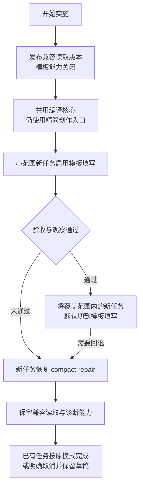
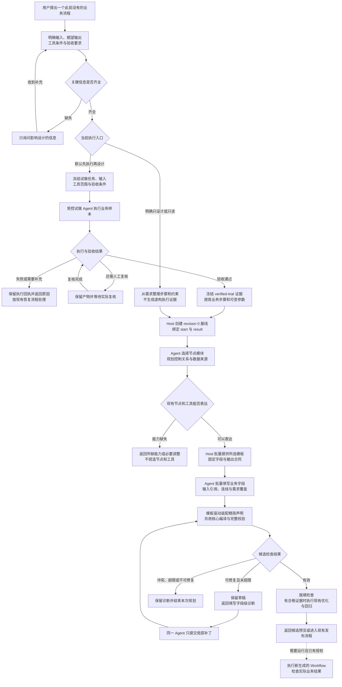
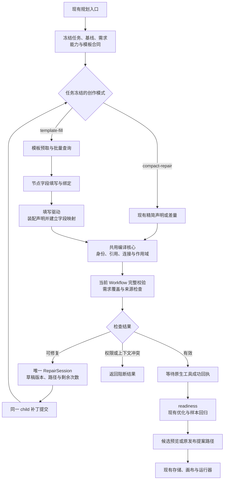

# 节点模板填写驱动与后端渐进替换方案

> 2026-10-21 说明：工作流预算系统已于 2026-10-20 移除（见 [S12](tasks-规划提速与上下文复用.md)）。本文涉及预算问答、额度、增额或费用的内容仅为历史记录，不再执行；Token 用量只作性能计量保留。

日期：2026-10-19。状态：执行方案；首个可用版本 P0—P4 已实现并完成本地验收，详见[第 05 篇实现与验收](05-节点模板填写驱动实现与验收.md)。下文保留原方案及后续阶段门槛。适用范围：新建工作流、已有工作流局部修改，以及现有 R7 试做结果进入规划后的创作阶段。

采用“**Agent 选择节点模块并填写业务字段 → 驱动生成精简声明 → 现有后端编译、校验与局部修复 → 返回标准 Workflow**”。新建提交完整目标图，修改提交差量，失败修补字段。逐步替换模型面对的创作协议与配置组装代码，复用现有发布、存储、画布和 Graphon 执行链路。

首次设计此前不存在的业务工作流，不要求已有完整工作流模板。后端预先提供的是节点填写模板；Agent 按需求组合节点。当前默认“先试做、验证后生成”入口继续保留，明确只设计或只读模式使用设计入口。

## 1、实施基线与改造范围

### 1.1、当前状态

表 1-1 当前实现与新增工作

| 项目 | 已有实现或记录 | 本方案的增量 |
| --- | --- | --- |
| 新建精简声明 | `nodes`、`chains`、`links`，Host 分配稳定身份 | 在声明前增加节点模板填写层 |
| 局部修改与修复 | 差量更新、失败草稿、字段诊断、同一子 Agent 内补丁 | 将诊断映射回填写字段，保留同一个修复状态机 |
| 节点配置 | 提交层 `config` 为通用对象，编译时按节点类型校验 | 按所选节点和工具生成具体字段约束 |
| 工具能力 | 当前 `ToolChoice` 提供输入 schema；语义词典说明部分输出路径 | 建立规划专用的输出合同快照，区分已知结构、样本观察和未知结构 |
| 新建入口 | 默认 `execute-first`；明确只设计或只读模式进入 `design-only` | 两种入口在创作阶段汇合到模板驱动 |
| 运行与发布 | 标准 Workflow、JSON v2、现有发布提案与 Graphon | 沿用现有合同 |

源码核对基于 `be0394c39a8036402d7fc6115430931eee6c3210` 加当前工作区修改。该 HEAD 单独不足以代表当前编译器实现；实施前必须冻结相关源码和证据清单。

根据[编译工具安装与 R7 闭环验收](../21-编译工具安装与R7闭环验收.md)，2026-10-19 已安装精简编译器并完成两组修复后生成图验收；首次运行失败于读取结果包装解析。已有[受控对照](../../../../docs/evidence/workflow-compiler-20261018/REPORT.md)验证的是精简声明与局部修复组合，其提速数据不能作为本次新增模板驱动的效果。

### 1.2、方案选择

表 1-2 推荐的改造边界

| 决策项 | 选择 | 理由 |
| --- | --- | --- |
| 新建提交粒度 | ✅ 完整精简目标图 | 省去模型编写完整构建操作序列 |
| 修改提交粒度 | ✅ 节点与字段差量 | 控制修改范围，保留未修改配置 |
| 节点填写 | ✅ 按类型生成模板，批量填写 | 提前提供必填项、类型与合法引用 |
| 顺序连线 | ✅ 复用 `chains` | 当前已经支持，避免再维护一套自动连线逻辑 |
| 分支与容器 | ✅ 显式端口、连接和 `scope` | 保留分支、汇合及容器的执行语义 |
| 编译与修复 | ✅ 共用编译核心，每阶段一个 `RepairSession` | 统一校验、身份分配、修复次数与诊断 |
| 运行格式 | ✅ 保留 Workflow 与 JSON v2 | 历史工作流无需转换格式 |
| 全量原始 JSON 直写 | 保留既有导入能力，不作为新创作默认入口 | 模型无需承担全部运行结构的填写 |

模板填写减少结构和字段错误。网址、提示词、表达式、自定义代码和任务理解仍需要业务验证。模板目录的名称与现有 `WorkflowTemplateLibrary` 区分：前者描述单节点填写合同，后者保存完整工作流模板。

## 2、目标接口与数据责任

### 2.1、节点模板合同

表 2-1 节点模板最小内容

| 内容 | 来源与处理规则 |
| --- | --- |
| 模板短名、节点类型、版本 | 由 Host 注册与冻结；Agent 从给出的目录选择 |
| 固定字段 | 节点类型、已选工具 ID 等由驱动装配，Agent 不重复填写 |
| 填写字段 | 从 `workflowNodeConfigSchema` 与工具输入 schema 派生，补充简短语义说明 |
| 必填项与默认值 | 采用节点已有的合法默认值；网址、业务路径、目标语言等不得随意补造 |
| 数据绑定 | 将常量、节点输出引用与可选表达式明确区分；只在支持绑定的位置转换 |
| 输出合同 | 提供字段、类型、包装层及来源；没有可信结构时明确为未知 |
| 连接能力 | 合法输出端口、容器约束及作用域规则 |
| 字段映射 | 保存填写字段与精简声明、最终节点字段的对应关系，用于修复和诊断 |

模板的 JSON 字段规则直接来自现有 schema；语义说明、填写顺序和少量便利变体可以单独维护。最终仍经过当前节点 schema 检查，避免模板规则与运行规则分叉。

工具输出合同分三种来源：运行适配器明确规定的包装结构、工具提供的可信输出 schema、当前任务中已验证的实际返回样本。样本只说明本次观察，不能被提升为任意输入都成立的结构保证。当前工具没有输出 schema 时，不得自动假定存在 `result`、`json` 或 `text` 等业务字段。

首版将这些补充信息放在规划专用快照中，避免为了模板填写改写全部公共 `ToolChoice`、存量工作流或工具执行结果。实际节点引用遵循当前运行适配器，例如原生工具的结构化返回值通常经 `value` 访问；只读工具结果包装的解析应有独立回归样本。

### 2.2、批量选择与填写

1. Host 冻结工作流基线、可用工具、模型、需求 ID 和模板版本，预填相关模板。
2. Agent 已拿到所需模板时，直接填写并提交；缺少模板时，使用拟新增的只读 `planner_node_templates` 一次查询多种节点和工具。
3. Agent 一批提交节点字段、节点关系和真实需求覆盖。新增节点使用短标识，已有节点沿用冻结标识。
4. 驱动将填写结果确定性转换为现有精简声明，保留字段映射。
5. 共用编译核心展开编号、引用、连线和容器结构，产生标准 Workflow。

不强制每次多一次“选择模板”模型调用，也不规定每个节点单独查询或提交。目录查询、模板装配和编译都不执行业务工具。

表 2-2 首次创建一个新业务图的填写示意

| 节点短名 | 已有节点模板 | Agent 填写内容 | 数据来源 |
| --- | --- | --- | --- |
| `start` | 文本输入 | 输入字段名、说明、是否必填 | 用户输入 |
| `translate` | LLM 文本处理 | 目标语言、处理要求、输入映射 | `start` 的文本字段 |
| `result` | 文本输出 | 输出名称、输出映射 | `translate.text` |

连接为 `chains: [start, translate, result]`，表格中的连接表示是概念示意，实际继续使用当前带 `key` 和 `nodes` 的链声明。无需预存“某一种翻译业务”的完整工作流。

复杂流程继续显式填写分支端口和容器归属。执行先后与数据来源分别表达；不能仅凭“上一节点”推断输入字段。首版不增加 `after`。后续如增加，应作为同一连接表示的简写，并拒绝互相矛盾的重复关系。

### 2.3、提交与修复状态

首版保留 `structured_output` 作为提交入口。拟新增的 `TemplateFillingCompiler` 实现已有 `SubmissionCompiler` 接口，向 service 返回相同的 `CompiledAuthoring`。

原生终止工具使用冻结的外层合同；模型可见 schema 根据本次模板集合收窄，Host 再执行模板字段及完整图校验。复用已有 `nextSchema` 机制，验证所用 SDK 对嵌套联合、严格字段和修复分支的支持，不在 activation 中依赖重新绑定原生终止工具。

修复文档拟规范化为 `formsByKey`。例如某节点网址错误，反馈定位到 `/formsByKey/fetch/values/url`。Agent 提交字段补丁，驱动重新装配完整声明并校验。自动生成的身份、固定字段和权限信息不暴露为可修改路径。

**每个 author 阶段只有一个草稿 revision、提交次数和接受状态。** 新驱动不能外包一层 `RepairSession`，再调用旧编译器的有状态 `submit()`，否则会产生两套修复次数与不同格式的草稿。应先抽出可重复调用的编译核心，身份预留由任务绑定对象持有，两个创作入口各自复用同一套修复基础设施。

## 3、后端代码逐步替换清单

下表新增名称均为拟议文件，不代表已经实现。

表 3-1 文件与责任迁移

| 现有位置 | 渐进改造 | 最终保留或替换的责任 |
| --- | --- | --- |
| `src/shared/workflow-validation.ts` | 复用 `workflowNodeConfigSchema`，提供模板派生入口 | 保留节点配置的权威校验 |
| `src/shared/workflow-semantics.ts` | 复用字段、输出和端口说明，补充模板所需元数据 | 语义说明与模板共用来源 |
| 拟新增 `src/shared/planning-node-templates.ts` | 定义模板合同、版本、字段与输出说明 | 提供节点填写目录，区别于完整图模板库 |
| 拟新增 `src/host/planning/template-catalog.ts` | 将节点定义、真实工具输入和可证实输出合同绑定到当前任务 | 形成只读模板快照，控制查询体积 |
| `src/shared/planning-authoring.ts` | 将身份映射、精简声明物化与通用诊断提取到拟新增 `planning-authoring-core.ts` | 原精简入口继续可用，与模板入口共用编译核心 |
| 拟新增 `src/shared/planning-template-compiler.ts` | 填写校验、模板装配、字段映射、差量生成 | 逐步替代模型自由编写节点 `config` |
| `src/shared/planning-repair.ts` | 复用原子补丁和次数限制；按必要性增加诊断映射扩展点 | 保持单一修复状态机，不重写补丁算法 |
| `src/shared/planning-authoring-context.ts` | 从固定少量类型预取，扩展为任务相关模板及输出合同预取 | 降低重复查目录；大图仍按需取配置 |
| `src/host/planning/agent.ts` | 模板模式注册只读批量模板工具、设置对应说明与 schema | 复用受控 child、预算、取消、工具回执和清理 |
| `src/host/planning/service.ts` | 加入编译器工厂、模式冻结、模板快照和新草稿格式读取 | 新任务按模式选择入口；旧任务不改写协议 |
| `src/host/index.ts` | 扩展 Host 配置；准备模板快照；发布前核对合同变化 | 保留新建、修改、试做、授权与发布入口 |
| `src/shared/planning-procedure-compiler.ts`、`planning-optimization-compiler.ts` | 首期复用原实现 | 提炼与优化仍按现有协议、预算和证据规则工作 |
| `src/shared/planning-edits.ts` | 保留内部编辑物化和校验 | 继续服务内部编译及已有编辑功能，不因模型入口变化而删除 |
| `src/shared/workflow-compiler.ts`、`src/host/planning/compiler-cli.ts` | 完成 Host 接入后，追加新编译入口导出和可信绑定选项 | 旧 CLI 输入与库调用继续可用 |
| `src/host/runtime.ts`、Graphon 桥、存量 Workflow 文件 | 不做创作协议迁移 | 继续运行同一标准图 |

先只覆盖 `input`、`output`、`template`、`llm`、`http`、`tool`，覆盖直线处理、网页抓取和工具参数绑定。随后覆盖代码、条件分支、循环、人工介入与已有图编辑。代码模板只约束代码节点结构；代码正文仍按现有执行限制和业务样本检查。

已有图修改必须保留模板未展示的合法配置。模板无法无损表达某个节点时，在选择创作入口阶段使用当前精简协议，或保留该节点并限制可编辑字段，不通过整图重新生成丢弃配置。

## 4、分阶段执行方案

每个阶段形成可单独审阅、验证和回退的改动。新增模板能力默认关闭，直到达到对应验收条件。

表 4-1 实施顺序与验收条件

| 阶段 | 实施内容 | 阶段产物 | 进入下一阶段的条件 |
| --- | --- | --- | --- |
| P0 基线冻结 | 记录源码、配置和相关未提交文件；保存历史公开失败对象、业务要求与既有测试结果 | 基线清单、错误回放集、对照任务集 | 可重现字段错层、引用错误及工具输出包装错误；不改写原始证据 |
| P1 兼容版本 | 扩展配置和持久化读取，支持新模式标记与模板草稿；新功能保持关闭 | 可读取新旧任务的兼容构建、回退说明 | 旧记录读取一致；未知协议安全停止；无业务重放 |
| P2 共享编译核心 | 从 `WorkflowAuthoringCompiler` 抽出绑定与物化逻辑，现有入口先切到共享核心 | 共用编译核心、原入口等价性回归 | 同一冻结输入产生相同业务图、身份关系、诊断类别和提交计数 |
| P3 模板与离线驱动 | 建目录、字段约束、输出合同、批量填写、装配和诊断映射 | 首批节点模板、模板编译器、离线用例 | 填写结果可编译为现有 Workflow；多错误可一批修复；无第二套修复循环 |
| P4 首次新建接入 | 给新建 author 接入模板模式；保留两种执行入口；优先开放预览 | 从空白业务需求到候选图的完整链路 | 直接设计与新试做来源均可创建；缺信息进入原澄清流程；编译成功后无额外确认模型轮次 |
| P5 编辑与复杂图 | 加入已有节点差量、复杂端口、容器与代码模板；沿用来源和优化阶段 | 创建、修改、提炼后创作的统一入口 | 未修改配置、固定节点、作用域和人工复核条件完整保留；历史图无需迁移 |
| P6 对照和小范围启用 | 对固定任务做模型配对实验；在独立验收工作区验证原生 Host 链路 | 模型报告、Host 验收、失败样本与回退演练 | 正确率和权限边界通过，时间与修复成本达到预先冻结的启用门槛 |
| P7 默认入口切换 | 将已覆盖任务的新建模式切为模板填写；保留精简回退与旧记录读取 | 默认配置调整、运维说明 | 观察期内无数据丢失、重复发布或无法读取旧记录；性能无持续退化 |

P0—P3 以离线实现和回放为主。真实模型调用、Desktop 安装和业务运行分别安排在其验收阶段，不用源码测试结果替代这些环节。

首个可用版本的范围为 P0—P4。复杂图和默认入口切换放在后续阶段，避免将所有节点、运行器和持久化重构集中到一次提交。

## 5、模式切换与数据兼容

### 5.1、配置和任务记录

拟扩展现有 Host 配置 `planningCompiler`，增加 `template-fill`，保留 `legacy` 和 `compact-repair`。该字段控制创作管线选择，模板模式内部仍调用共用编译核心。

表 5-1 模式与数据解释

| 数据或配置 | 解释规则 |
| --- | --- |
| 旧任务缺少 `compilerMode` | 保留历史 legacy 语义 |
| 任务标记 `compact-repair` | 保留当前精简声明及修复合同 |
| 新任务标记 `template-fill` | 使用冻结的模板填写协议与模板快照 |
| Host 切换默认模式 | 仅影响之后创建的任务，不改变正在执行或等待澄清的任务 |
| 新增 `templateBinding` | Host 保存协议版本、目录摘要和可复现的模板快照；不接受模型赋值 |
| 新增草稿格式标记 | 区分精简声明、模板填写、提炼和优化草稿；旧记录缺标记时按原阶段解释 |
| 不支持的未来协议 | 保留记录并返回明确错误，不按旧格式强行解析 |

`template-fill` 首期只替换 author 阶段；distill 和 optimize 继续使用现有编译器。现有阶段提交次数、模型步数和总时限保持原规则，模板查询计入同一任务，不能借切换协议重置额度。

模板、工具合同和基线的摘要都由 Host 生成。发布前重新检查任务归属、基线版本、工具可用状态和本任务用到的合同是否变化。合同变化返回冲突，不能静默改用新模板解释旧草稿。

### 5.2、回退路径

回退首选切换配置，并保留兼容读取代码。当前旧二进制的任务解析器严格限制字段和模式，不能假设它能读取未来的模板任务记录；二进制回退只能回到 P1 及之后经过验收的兼容构建。

已有任务不在执行中自动切换协议。模板能力缺失导致的入口回退应在 author 调用前完成并记录原因；权限拒绝、基线冲突、最终工具回执拒绝和发布结果未知，不得通过换协议重试。业务试做已经发生时，后续恢复优先引用有效的原试做证据，不自动重做业务。

Host 重启继续遵守原有中断规则。模板草稿用于读取、诊断和明确恢复，不因新增持久化字段而自动续跑模型或业务操作。

### 5.3、旧代码退役顺序

1. 先切换新建任务的模型创作入口，保留精简协议作为回退。
2. 再覆盖修改、分支与容器等剩余场景，核对旧入口真实调用情况。
3. 覆盖和观察达标后，停止为新任务选择 legacy 模型协议；保留历史任务解析。
4. 仅在调用关系检查和回归证明无依赖后，删除旧模型提示、重生成分支等孤立代码。
5. `compilePlanningEdits` 等共用物化、校验功能继续保留；它们同时服务新驱动，不属于可直接删除的旧入口。

## 6、首次设计此前不存在的工作流

### 6.1、两种入口

首次创建没有现成 Workflow、历史执行或业务配方时，后端仍可使用内置节点模板组合新图。`makeWorkflow()` 提供 revision 0 的最小输入、输出基线；模板驱动绑定 `start` 与 `result`，其余节点按需求创建。

当前入口的模式选择见 `src/host/index.ts` 的 `planningEntry()`：普通新建默认要求冻结试做任务和验收条件；只有明确只设计或当前只读模式才进入设计预览。试做失败不能自动改为仅设计并报告成功。

图 6-1 首次新建工作流完整流程

仅设计路径能够生成候选，但结构通过不等于业务已成功运行。先试做路径中的成功是原试做任务的成功；生成图仍可能因节点配置或输出包装处理不同而失败，因此生成图运行单独记录结果。

“当前缺少完整业务模板”不会导致失败；“当前缺少可执行该步骤的节点或工具”才需要补充能力。可以使用已有通用工具、代码或 Agent 节点表达受支持的步骤，但不能把不存在的能力写进 JSON。

### 6.2、首次新建的最小验收案例

表 6-1 新建路径验收

| 案例 | 输入条件 | 应有结果 |
| --- | --- | --- |
| 直接设计新业务 | 无历史图、无试做记录，明确只设计 | 创建合法候选；记录设计状态，不伪造来源 |
| 首次试做后生成 | 无历史图，提供受控业务样本与验收条件 | 先完成试做及必要复核，再提炼并生成候选 |
| 业务模板不存在 | 节点和工具能力齐全 | 通过组合节点成功设计，无须先创建完整业务模板 |
| 必需工具不可用 | 冻结目录缺少关键能力 | 明确返回缺失能力，不绕过工具约束 |
| 单节点填写错误 | 某字段类型或位置错误 | 同一草稿补丁修复，其余节点及身份保持 |
| 试做失败 | 业务执行产生失败或部分结果 | 保留回执，按恢复流程处理，不自动换设计模式重试 |

## 7、改造后的后端内部流程

图 7-1 创作阶段的数据流

图中的模式分支在任务开始后固定；修复回到同一分支、同一绑定和同一草稿，不重新选择协议或启动完整生成。优化所需证据不足时按现有规则处理，不为完成流程图而额外执行业务。

## 8、测试与启用标准

### 8.1、必要回归

表 8-1 回归范围

| 层次 | 必测内容 |
| --- | --- |
| 模板与填写 | 必填项、错误类型、未知字段、模板版本、动态工具参数、未知输出合同 |
| 装配 | 常量与引用区分、默认值、重复 key、稳定身份、链式连接、分支端口、容器作用域 |
| 修复 | 多错误一批修复、过期 revision、补丁整批回滚、无变化补丁、错误路径反向映射、次数不重复累计 |
| 图等价与修改 | 当前案例在两个入口得到等价业务图；非目标节点、固定字段和未展示合法配置保持 |
| 原生 Host | 工具 schema、同轮非终止错误、成功终止、权限回执拒绝、取消及清理失败优先级 |
| 持久化与回退 | 旧任务缺字段、新草稿、未知协议、重启中断、切换默认模式、兼容构建回退 |
| 首次创建 | 图 6-1 的直接设计、试做、澄清、缺能力和失败分支 |
| 业务合同 | 原生 read 返回包装、内置工具输出、HTTP 字段、LLM 结构化结果与独立样本 |
| 发布与存储 | 预览不写入、保存幂等、修改提案、基线冲突、发布结果未知不重复提交 |

新增测试建议集中到 `tests/planning-template-compiler.test.ts`、`tests/planning-template-catalog.test.ts`，并在已有 `planning-compiler`、`planning-native-compiler`、`planning-entry-host`、`planning-service` 和 `planning-publication` 测试中补集成用例。

每个阶段先执行相关测试；共享接口变更完成后再运行既有全量回归、类型检查和构建。使用仓库既有 pnpm 运行方式，例如 `pnpm --config.verify-deps-before-run=false exec vitest run`。本方案文档本身不触发模型基准、安装或业务运行。

### 8.2、性能对照

主对照采用“当前 compact-repair”与“新增 template-fill”，固定模型、推理强度、输出上限、需求、工具快照、节点能力、验证器和预算。分别统计无来源直接设计与试做后创作，不将试做时间混入一组、从另一组剔除。

首轮建议至少包含 8 类任务：简单直线、网页处理、工具输出包装、结构化 LLM 输出、条件分支、容器、局部修改、大图定点修改；每类两组各重复 3 次，共 48 次创作尝试。保留全部失败。这是探索性对照，不能据此证明生产 P95 或严格的成功率非劣界限。

表 8-2 统计口径

| 指标 | 口径 |
| --- | --- |
| 有效候选耗时 | 从规划请求进入到 ready；单列模型、准入等待、目录、装配、编译和持久化 |
| 用户端到端耗时 | 包括该模式实际包含的试做、复核、规划及后续验收，人工等待单列 |
| 首次通过率 | 首次提交通过完整候选检查的次数除以全部尝试 |
| 最终成功率 | 在相同额度内生成并通过对应业务样本的次数除以全部尝试 |
| 修复成本 | 修复提交数、模型请求数、子任务数、完整重生成次数 |
| 用量 | 供应商实际报告用量与未知调用数分别列出；字节数不当作 Token |
| 失败消耗 | 总消耗时间除以成功任务数，并单列超时和失败分布 |

P0 时冻结建议启用门槛：强制业务与兼容性用例全部通过；探索性对照中最终成功数不低于当前方案，同任务双方成功的配对耗时中位比不高于 0.90，且计入失败的每成功任务总耗时不恶化。0.90 是拟定的工程目标，不是已测得的效果，也不构成统计显著性结论。

若只改善字段错误而耗时未改善，保留为可选模式，继续检查模板体积和查询轮数。若出现越范围修改、重复业务动作、数据丢失或无法回读任务，停止扩大启用范围并执行兼容回退。

## 9、建议的提交拆分与实施起点

表 9-1 建议提交顺序

| 顺序 | 提交主题 | 范围 |
| --- | --- | --- |
| 1 | 基线与持久化兼容 | 模式、读取、草稿版本和迁移测试；默认行为保持 |
| 2 | 共用创作编译核心 | 提取核心，原入口等价性验收 |
| 3 | 节点模板目录与装配 | 首批模板、工具合同、离线编译及字段映射 |
| 4 | 新建模板驱动入口 | 批量查询、同轮修复、两条首次新建路径 |
| 5 | 编辑与复杂图扩展 | 差量、分支、容器和高级节点 |
| 6 | 对照验收与默认切换 | 性能证据、Host 验收、配置切换和回退演练 |

实际实施从 P0 开始，先交付兼容版本与共享核心。新模式达到 P4 后再评估首次新建质量，达到 P6 的对照门槛后再切换默认入口。

## 10、源码与证据入口

- [精简创作与编译](../../../../src/shared/planning-authoring.ts)、[修复状态机](../../../../src/shared/planning-repair.ts)、[节点权威配置校验](../../../../src/shared/workflow-validation.ts)。
- [规划服务与持久化 schema](../../../../src/host/planning/service.ts)、[受控规划 Agent](../../../../src/host/planning/agent.ts)、[规划入口与首次创建基线](../../../../src/host/index.ts)。
- [节点语义词典](../../../../src/shared/workflow-semantics.ts)、[工具目录](../../../../src/host/tool-catalog.ts)、[最小工作流与工具类型](../../../../src/shared/types.ts)。
- [当前编译器实现说明](03-工作流编译工具实现与R7接入.md)、[安装与 R7 验收](../21-编译工具安装与R7闭环验收.md)。
- [两次历史会话对比](../../../../docs/evidence/planning-session-comparison-20261019/comparison.json)、[公开失败对象离线回放](../../../../docs/evidence/planning-session-comparison-20261019/offline-replay.json)。

