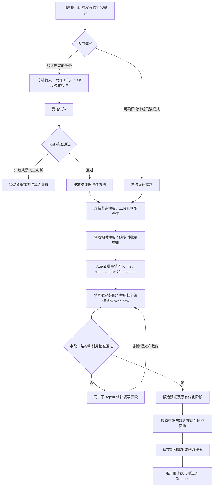

# 节点模板填写驱动实现与验收

> 2026-10-21 说明：工作流预算系统已于 2026-10-20 移除（见 [S12](tasks-规划提速与上下文复用.md)）。本文涉及预算问答、额度、增额或费用的内容仅为历史记录，不再执行；Token 用量只作性能计量保留。

日期：2026-10-19。本篇记录首次实现时的状态：首个可用版本已实现并完成本地验收；当时默认仍为 `compact-repair`，尚未安装到 Desktop，未进行模板模式的真实模型配对实验。后续第三构建已安装并完成五节点核心功能验收，最新状态见[第 07 篇](07-后端阻断修复与桌面验收.md)；本篇测试数量保留历史归属。

对应[第 04 篇执行方案](04-节点模板填写驱动与后端渐进替换方案.md)。本次完成 P0—P4 的本地交付，并接入了 P5 的差量修改与复杂节点结构。P6 的真实模型效果和独立 Desktop 验收、P7 的默认切换仍待完成。

## 1、已经落地的改动

表 1-1 改动与代码入口

| 模块 | 已实现行为 | 代码 |
| --- | --- | --- |
| 共用编译核心 | 从旧精简编译器提取身份预留、节点物化、连线、引用和诊断；旧接口继续使用该核心 | `src/shared/planning-authoring-core.ts`、`planning-authoring.ts` |
| 节点填写模板 | 从权威节点 schema 派生 19 种非工具节点模板；每个当前可用工具生成固定工具身份的专属模板 | `src/shared/planning-node-templates.ts` |
| 字段合同 | 已预取模板的字段类型放在提交工具 schema；提示词提供语义、输出合同和目录；缺少模板可批量查询 | `src/host/planning/template-catalog.ts` |
| 填写驱动 | 新建 `forms`，修改 `updates`，新增 `addForms`；转换到共用编译核心，返回标准 Workflow | `src/shared/planning-template-compiler.ts` |
| 原子修复 | 失败保留 `formsByKey` 草稿；补丁定位到 `values` 字段；每阶段仅一个修复 revision 和提交计数 | 同上，复用 `planning-repair.ts` |
| 原生工具 | 新增只读 `planner_node_templates`；每次最多 12 个模板，单阶段最多展开 64 个；沿用子 Agent 权限、预算与取消规则 | `src/host/planning/agent.ts` |
| 新旧任务读取 | 保存模式、版本化模板快照及草稿格式；模式按任务冻结，改变默认值不改写已有任务 | `src/host/planning/service.ts` |
| Host 接入 | 配置可选 `template-fill`；发布前重新核对本图使用的模板与工具合同 | `src/host/index.ts` |
| 独立编译入口 | 库导出 `TemplateFillingCompiler`；NDJSON CLI 支持模板绑定、查询、填写与修复 | `workflow-compiler.ts`、`compiler-cli.ts` |

模板声明、只读目录查询和图编译均不执行业务工具。最终存储、JSON v2、画布、发布回执及 Graphon 运行合同沿用现有实现。

### 1.1、三项想法的实现结果

表 1-2 设计想法与实际选择

| 设计想法 | 实际实现 | 判断 |
| --- | --- | --- |
| 整图提交优于逐个增删指令 | 新建一批提交完整目标图的模块填写；修改继续提交差量 | ✅ 按新建与修改分别选择 |
| JSON 模块化、自动连线 | 节点平铺，容器用 `scope`；普通顺序由 `chains` 展开；分支明确填写 `links.port` | ✅ 保留复杂流程的明确语义 |
| 先取固定模板、再填写 | Host 提供固定字段、类型与输出合同，Agent 填业务值；不强制每个节点单独查询 | ✅ 已可在模板模式使用 |

控制连线不等于数据绑定。`chains` 能确定节点先后，具体输入仍填写 `{{节点短名.输出字段}}`。不会根据“上一节点”猜测业务字段。

### 1.2、实现中解决的额外开销

初版同时在提示词和工具 schema 中发送完整字段规则，六个离线样例的输入表示增加约 6%—32%。已将预取字段规则集中到工具 schema，提示词保留说明；按需查询仍返回完整模板。同时缓存进程内不变的节点模板，只对当前工具合同生成任务快照。

原生 SDK 仅支持有限 JSON Schema 子集。模型可见字段规则经过投影；完整节点及工具参数仍由 Host 的现有校验器检查。`maxLength`、正则等不能透过该 SDK 表达的限制仍会产生可修复的字段诊断，不宣称模型侧已经强制满足所有限制。

## 2、首次创建新业务工作流

图 2-1 已实现的新建流程



不需要预先保存这种业务的完整工作流。预存的是节点填写合同，Agent 根据当前任务组合节点。试做失败继续保留失败状态，不能自动换成只设计，也不能换请求 ID 重做业务。

## 3、启用、使用与回退

### 3.1、Host 配置

在独立验收环境的本插件配置中设置：

```yaml
planningCompiler: template-fill
```

字段名是插件配置，不是 `visible_workflow_plan` 的模型输入。三个可选值为 `legacy`、`compact-repair`、`template-fill`；本次保留默认 `compact-repair`。

切换默认只影响新规划任务。已有 `template-fill` 任务保留自己的模式和冻结快照；旧工作流 JSON 无需迁移，旧任务缺少新字段仍按历史协议读取。

### 3.2、离线编译示例

完整填写示例：[template-fill-request.json](../../../../docs/examples/template-fill-request.json)。可执行的可信绑定与填写输入：[template-fill-standalone.ndjson](../../../../docs/examples/template-fill-standalone.ndjson)。

```sh
pnpm --config.verify-deps-before-run=false workflow:compile < docs/examples/template-fill-standalone.ndjson
```

构建后也可使用：

```sh
node lib/workflow-compile.js < docs/examples/template-fill-standalone.ndjson
```

示例依次返回 `bound`、`templates`、`accepted`。首行是可信 Host 上下文，随后支持 `{query:{ids:["code"]}}` 和 `{submission:{...}}`；查询不消耗提交次数。CLI 编译成功仅产出图及 JSON v2 包，不保存到业务库、不运行图。

示例编译产物：[template-fill-workflow.json](../../../../docs/examples/template-fill-workflow.json)。其身份及工作区属于离线示例，不能直接视为当前用户环境中已保存的工作流。

### 3.3、回退步骤

1. 保留本次兼容构建，把插件配置恢复为 `planningCompiler: compact-repair`。
2. 检查新请求使用精简模式；已存在的模板任务仍按模板协议读取。
3. 检查已发布任务回执，禁止重放业务试做或重复发布；中断任务不会在重启后自动执行。
4. 如确需回滚到实施前二进制，先隔离并备份新增模板任务记录，再使用对应的数据备份。实施前代码不认识新模式和草稿字段，不能把切回配置等同于直接降级二进制。

未知协议版本和摘要不符会被明确拒绝，本次没有实现自动降级或删除记录。兼容读取不能保证任意未来版本可读。

## 4、验收结果与证据边界

表 4-1 本地验收

| 检查 | 结果 | 能证明的范围 |
| --- | --- | --- |
| 实施前相关基线 | 5 文件、126 项通过 | 保存当前工作区源文件摘要及原有测试结果 |
| 最终相关回归 | 8 文件、149 项通过 | 新旧编译器、字段修复、原生终止工具、任务服务、Host 两条创建入口 |
| 全量回归 | 156 文件、1833 项覆盖；首轮 1830 通过，3 项失败经定向复验通过 | 首轮 2 项因沙箱禁止本机端口监听，1 项为新增测试取错字段；复验 3 文件、12 项全部通过 |
| 构建与类型检查 | 通过 | Host、Client 与 CLI 可构建；52 个远程方法的 Host/Client schema 一致 |
| 真实 SDK 终止工具 | 通过 | 错误不会结束当前 child，修复通过后才接受；Host 最终拒绝仍可阻止提交 |
| 首次试做后生成 | 通过 | 实际 Host 入口、临时文件独立核验、证据提炼、模板生成、重复请求不重做试跑 |
| 原生工具包装回放 | 两个输入通过 | 实际 Host 包装层返回 `text/value`，Graphon 执行生成图并解析 `value.text` 内的 JSON |
| 合同变化与发布 | 通过 | 工具定义变化阻止旧预览发布；新合同生成的预览可走现有创建回执 |
| CLI 构建产物 | 通过 | 示例从可信绑定、模板查询到接受图，导出 JSON v2 |

Host 与 Graphon 是实际生产代码；上述测试中的规划模型、业务原生读取工具和真人回答是明确的离线替身。没有调用真实外部模型，没有读取用户业务文件，没有进行当前 Desktop 安装验收。

模板工具输出说明区分已知、部分已知与未知：原生工具仅保证 Host 的 `text/value` 包装，内部字段保持未知。本次包装回放使用明确提供的原生读取返回合同，不能据此把所有工具都假定为 `value.text`。

### 4.1、离线输入体积

表 4-2 新协议与现有精简协议的离线比较

| 固定任务 | 精简协议字节 | 模板协议字节 | 模板协议减少 |
| --- | ---: | ---: | ---: |
| 问候新建 | 16,148 | 13,915 | 13.8% |
| 数组求和 | 18,141 | 16,457 | 9.3% |
| 条件分支 | 18,142 | 16,458 | 9.3% |
| 分类汇总 | 18,245 | 16,561 | 9.2% |
| 局部修改 | 17,794 | 15,495 | 12.9% |
| 大图局部修改 | 23,388 | 21,201 | 9.4% |

统计对象仅为提示词及 `structured_output` schema 的 UTF-8 字节，不含通用系统提示词、目录工具定义、后续查询或历史；配对体积比中位数为 0.9068，即减少约 9.3%。这是输入表示测量，不是 Token、账单或端到端设计耗时。模板准备的热态中位耗时约 2.5—3.4 ms，现有精简方式约 0.1—0.5 ms；减少模型输入的同时仍增加了本地准备工作。

复现命令：

```sh
node --import tsx scripts/benchmarks/template-fill-offline.ts
```

原始日志、基线清单、实现摘要和体积数据见 [template-fill-20261019](../../../../docs/evidence/template-fill-20261019/README.md)。

## 5、后续替换门槛

表 5-1 阶段完成度

| 阶段 | 本次状态 | 继续条件 |
| --- | --- | --- |
| P0—P4 首个可用版本 | 已完成本地实现与验收 | 可以在独立环境选择模板模式 |
| P5 编辑与复杂图 | 差量更新、类型替换、固定节点保护、分支、容器及 Secret 声明已接入和部分验收 | 补齐复杂多工具、人工介入及多层容器的模板业务样例 |
| P6 对照和小范围启用 | 离线输入测量、生产 Host 代码集成测试完成；真实模型和 Desktop 验收未做 | 按第 04 篇冻结任务进行配对测试并安装到独立验收环境 |
| P7 默认切换 | 未执行 | 满足性能与正确率门槛、完成观察和回退演练后再切默认 |

默认切换门槛仍为：真实模型配对中位耗时比不高于 0.90、成功数不低于精简方案、所有必验场景通过。离线体积变小不算达到该门槛，也不使用之前精简编译器的提速数据替代本次模板驱动结果。
