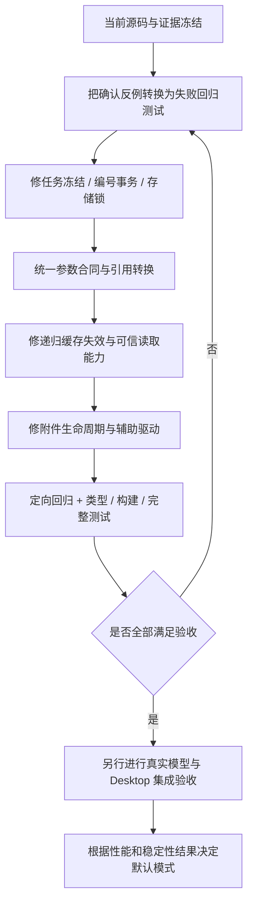

# 后端全量审计与清理建议

> 2026-10-21 说明：工作流预算系统已于 2026-10-20 移除（见 [S12](tasks-规划提速与上下文复用.md)）。本文涉及预算问答、额度、增额或费用的内容仅为历史记录，不再执行；Token 用量只作性能计量保留。

后续修复与 Desktop 验收记录见 [07-后端阻断修复与桌面验收](07-后端阻断修复与桌面验收.md)。本文保留审计发生时的缺陷与基线，不覆盖为修复后的状态。

审计日期：2026-10-19。对象：当前工作区代码，包含既有未提交变更；基线提交 `be0394c39a8036402d7fc6115430931eee6c3210`。最终复核使用 GPT-6.1-sol high 分工，并由主审核对源码、复现关键反例。

## 1、审计结论

当前后端已有较完整的校验、权限和恢复框架，但尚不能认定为“代码表达一致、旧代码清理完成、所有指定功能均正确”。本轮确认 **11 项问题：P1 1 项、P2 9 项、P3 1 项**。其中既有新模板驱动的状态与 schema 问题，也有原运行恢复、存储、辅助驱动的缺口。

最先处理的是：模板冻结失败写入无法恢复的任务、失效存储锁并发恢复时出现两个有效写入者、失败草稿永久占用编号池。随后统一工具参数与动态引用合同、修复子流程缓存失效传播、补齐文件读取回执能力。

现有全量测试 **156 个测试文件、1,833 项通过**；构建、Host/Client 类型检查通过。这些结果不能覆盖本轮新增反例。脚本专项类型检查另有 3 个错误；现存 Graphon 审计脚本因过期 Agent 夹具启动失败，后续检查未执行。

本轮只新增审计报告、可复现探针和日志；**没有修复或删除生产源码，没有切换默认规划模式，没有提交或发布**。审计前后 140 个源码文件的 SHA-256 保持一致。

## 2、范围与证据边界

### 2.1、全量范围

表 2-1 后端源码范围

| 目录 | 文件数 | 行数 | 审计重点 |
|---|---:|---:|---|
| `src/host` | 52 | 8,051 | Host 入口、规划/试做、原生 Agent、执行器、预算、恢复、存储、工具目录、Secret 边界 |
| `src/shared` | 39 | 3,773 | Workflow 合同、模板/编译器、局部修复、引用、验证、导入导出、语义词典 |
| `runtime` | 1 | 405 | Python Graphon 桥接、协议与生命周期 |
| `native` | 21 | 1,792 | Swift、C#、PowerShell、原生 broker 构建及验证驱动 |
| `scripts` | 27 | 2,300 | 构建、预览、审计、基准、证据采集与验证工具 |
| 合计 | **140** | **16,321** | 包含未提交的新模块 |

文件清单、摘要、入口引用及大函数统计见 [inventory.json](~/AI-Project/DeepSeekHarness/dsh-visible-dynamic-workflows/docs/evidence/backend-audit-20261019/inventory.json)。排除依赖、产物、缓存目录；本轮不是前端界面全面审计，也不重新审计第三方包内部实现。

采用全量文件盘点、类型/语法检查、引用与重复片段扫描、核心数据路径语义复核、现有全量测试和新增反例。覆盖全部后端源码目录不等于穷尽每一条运行路径或形成形式化正确性证明。

### 2.2、验证结果

表 2-2 实际验证与边界

| 检查 | 结果 | 能证明的范围 |
|---|---|---|
| 现有 Vitest 全量测试 | 156 文件 / 1,833 测试通过 | 当前自动化断言通过；不含新增反例作为产品回归用例 |
| Host + Client 类型检查 | 通过 | 标准 tsconfig 覆盖的源码类型合同 |
| 完整构建 | 通过；52 个 Remote 方法，Host/Client schema 一致 | 构建及生成接口一致；不等于业务行为一致 |
| 已打包编译 CLI | `bound → templates → accepted` | 模板填写示例经打包后的 CLI 编译通过；没有发布或执行工作流 |
| 脚本专项类型检查 | **3 个错误** | preview 过期方法调用；两个 benchmark 联合类型未正确收窄 |
| 严格 unused 检查 | **1 个未使用局部变量** | `numbering.ts:52`；不是大量死模块的证据 |
| Python/MJS 语法 | 20 文件通过 | 只检查语法；不调用模型供应商或证据采集业务 |
| Swift 纯协议编译/执行 | **74 个断言通过** | 协议、值与授权结构的纯逻辑；未触发认证、Keychain、网络或 UI |
| 原 Graphon 审计脚本 | **失败** | 旧夹具未满足当前 Agent 合同，不能沿用旧报告声称本次通过 |
| 新增针对性探针 | 确认 F1、F3–F5、F8–F12 | 反例断言通过表示缺陷已复现，并非功能验收通过 |
| Windows 原生代码 | 静态审查；未编译/实机执行 | 当前环境没有 dotnet；默认 Windows acceptance gate 关闭 |

没有调用真实模型、真实外部业务 API 或原生凭据操作，没有干扰当前 Desktop 对话。模拟 HTTP 仅记录内存中的合成参数。F12 使用临时目录中的两个真实子进程，以文件操作屏障控制交错顺序，未访问现有运行数据。

## 3、确认问题

P1：应优先修复的服务可用性问题。P2：需要修复的功能、状态一致性或验证缺口。P3：影响局部辅助工具的问题。编号沿用审计过程；F2 已排除为运行缺陷，单列于第 5 节。

表 3-1 问题总表

| 编号 | 优先级 | 问题 | 触发范围 | 主要影响 |
|---|---|---|---|---|
| F1 | **P1** | 模板冻结失败后持久化不完整任务 | 启用 template-fill 且任务落盘 | 重启规划服务可能失败，连带插件无法初始化 |
| F12 | P2 | 失效 Host 锁的并发恢复不是互斥操作 | 崩溃遗留锁 + 两个 Host 同时恢复 | 两个写入者同时成功，存在覆盖持久化数据风险 |
| F11 | P2 | 失败草稿预留的身份不释放 | 编号池已用满，repair 替换节点 key | 最终节点数未增加仍报致命 `COMPILER_ID_POOL` |
| F3 | P2 | Swagger 执行参数校验弱于规划合同 | 动态输入解析后违反 const/联合/额外字段约束 | 违约参数仍能送入 HTTP 请求 |
| F8 | P2 | 模型可见 schema 排除合法动态引用 | 字符串枚举、无 type 的联合字段 | 模型/CLI 消费者与实际编译器对可填写内容认识不同 |
| F4 | P2 | 当前时间工具的缓存失效名单不完整 | timestamp 或无 datetime 的 weekday + 显式 reuse | 恢复时复用旧时间 |
| F9 | P2 | 子流程动态依赖不传递给缓存调用方 | 父 workflow 节点显式 reuse | 子流程时间、资料和文件验证被旧父结果掩盖 |
| F5 | P2 | Host 未绑定可信文件读取工具能力 | native Agent 声明 requiredReadFiles | 即使真实读取发生，也无法通过当前回执验证 |
| F10 | P2 | 淘汰运行历史时不清理其附件 | 超过 200 条完成运行 | 附件不可用但继续占盘，上传内容无限累积 |
| F7 | P2 | Graphon 审计驱动夹具过期 | 执行现有边界审计命令 | 首块失败，整份后续审计不执行 |
| F6 | P3 | 预览驱动调用已不存在的方法 | 使用 preview 的 stopNode 接口 | 该调用路径失败，标准类型检查没有覆盖 |

### 3.1、F1：冻结失败产生无法重新加载的任务

**源码**：[service.ts:500](~/AI-Project/DeepSeekHarness/dsh-visible-dynamic-workflows/src/host/planning/service.ts:500)、[service.ts:160](~/AI-Project/DeepSeekHarness/dsh-visible-dynamic-workflows/src/host/planning/service.ts:160)、[store.ts:18](~/AI-Project/DeepSeekHarness/dsh-visible-dynamic-workflows/src/host/planning/store.ts:18)、[index.ts:123](~/AI-Project/DeepSeekHarness/dsh-visible-dynamic-workflows/src/host/index.ts:123)。

`generate` 先赋值 `task.context`，随后生成 `templateBinding`。后者抛错时，失败处理将已有 context、缺少 binding 的任务持久化。恢复校验不区分这种失败状态，直接抛出“模板任务缺少冻结快照”；任务存储又整批验证，因此一条记录会阻止整个规划服务构造。

反例使用实际 `parseSwagger` 接受的 OpenAPI 请求体 schema，其普通属性名为 `constructor`；模板冻结的 `compilerJson` 拒绝该键。任务变为 failed，模型调用数为 0；关闭并重建服务即出现上述恢复错误。没有手工篡改持久化文件。

**限制**：默认仍是 compact-repair；此问题只影响 template-fill 路径，并且需要该失败任务被落盘。普通不落盘预览没有这一重启后果。

**建议**：在局部变量中完整校验 context 和 binding，再一次性提交任务状态。定义并兼容已有“冻结未完成的失败任务”恢复格式；单条坏记录可隔离并明确展示，但不得因此放宽发布/执行校验。不要以删除危险键检查代替状态原子性修复。

### 3.2、F12：两个恢复进程能同时取得存储所有权

**源码**：[storage.ts:50](~/AI-Project/DeepSeekHarness/dsh-visible-dynamic-workflows/src/host/storage.ts:50)。

两个进程都可以先读取同一个已退出 PID，确认其失效；A 删除旧锁并创建自己的活锁，随后 B 按先前结果执行 `rmSync`，删除 A 新建的锁，再成功创建 B 的锁。`wx` 只保护最后创建的一瞬，无法保护“读取旧锁—确认失效—删除”这段过程。

确定性交错测试中，A、B 均成功构造 `WorkflowStorage` 且同时存活，磁盘锁只记录 B。测试钩子只控制文件操作调度，不改变系统调用返回值，不伪造所有权结果。

**建议**：为失效锁恢复增加串行化，锁内重新核对旧锁身份并安全接管；核对进程、token 与实际文件身份。可借鉴 [graphon-environment.ts:328](~/AI-Project/DeepSeekHarness/dsh-visible-dynamic-workflows/src/host/graphon-environment.ts:328) 已有恢复锁思想，但需独立测试正常竞争、进程退出和恢复者再次崩溃。双写者已经复现，具体文件覆盖未在用户数据上执行。

### 3.3、F11：合法局部修复会被先前失败草稿耗尽编号池

**源码**：[planning-authoring-core.ts:97](~/AI-Project/DeepSeekHarness/dsh-visible-dynamic-workflows/src/shared/planning-authoring-core.ts:97)、[planning-authoring-core.ts:147](~/AI-Project/DeepSeekHarness/dsh-visible-dynamic-workflows/src/shared/planning-authoring-core.ts:147)、[planning-authoring-core.ts:191](~/AI-Project/DeepSeekHarness/dsh-visible-dynamic-workflows/src/shared/planning-authoring-core.ts:191)、[index.ts:335](~/AI-Project/DeepSeekHarness/dsh-visible-dynamic-workflows/src/host/index.ts:335)。

节点 key 到 Host ID 的 reservation 会在后续连线/图检查之前写入编译器实例。初稿失败后，repair 删除旧 key 并增加新 key，旧 reservation 仍占用编号。编号池满时，最终图没有变大也会报致命 `COMPILER_ID_POOL`。

最小 1 个新 ID、生产 Host 提供 60 个新 ID 两种规模均已复现；template-fill 与 compact-repair 两种模式均受影响。初次故意产生 `BRANCH_PORT`，修复后图仍使用原数量的新增节点：新建编译器接受同一最终声明，同一会话 repair 却失败。

**建议**：对草稿身份采用事务式预留或回收不再存在的未提交别名，保持仍在使用的节点 ID 稳定；失败提交不得消耗不可恢复的容量。不要只扩大 ID 池掩盖问题。

### 3.4、F3：执行时没有按完整工具合同验证参数

**源码**：[tool-catalog.ts:26](~/AI-Project/DeepSeekHarness/dsh-visible-dynamic-workflows/src/host/tool-catalog.ts:26)、[tool-catalog.ts:131](~/AI-Project/DeepSeekHarness/dsh-visible-dynamic-workflows/src/host/tool-catalog.ts:131)。

自写 `validateArguments` 检查基础 type、required、enum，但不检查 const、oneOf、additionalProperties。实际 Swagger 导入会保留这些合同。用 `{mode:{type:'string',const:'safe'}}` 与 `additionalProperties:false` 作为请求体 schema，输入 `{mode:'other',extra:true}`：项目原生 validator 报两项错误，`ToolCatalog.execute` 仍调用 HTTP stub 并发出该 body。

**限制**：不是全部工具路径都有此问题；原生 Agent bridge 另外使用完整 validator。重点是直接 Swagger 工具及依赖这段薄校验的执行路径，尤其规划时无法确定、运行后才解析的动态参数。

**建议**：统一支持的 JSON Schema 校验实现，并在引用解析完成后、外部动作之前执行。对不支持的 schema 明确拒绝/报告；不能仅依赖规划期校验。补充 const、oneOf、额外字段、嵌套数组和动态引用的正反例。

### 3.5、F8：模板模型 schema 与最终编译合同不一致

**源码**：[planning-template-compiler.ts:79](~/AI-Project/DeepSeekHarness/dsh-visible-dynamic-workflows/src/shared/planning-template-compiler.ts:79)、[planning-projection.ts:199](~/AI-Project/DeepSeekHarness/dsh-visible-dynamic-workflows/src/shared/planning-projection.ts:199)、[agent.ts:236](~/AI-Project/DeepSeekHarness/dsh-visible-dynamic-workflows/src/host/planning/agent.ts:236)、[compiler-cli.ts:32](~/AI-Project/DeepSeekHarness/dsh-visible-dynamic-workflows/src/host/planning/compiler-cli.ts:32)。

`fields()` 只为部分有 type 的非字符串字段增加引用表达式通道；string enum/const 原样保留，无 type 的 oneOf 也原样保留。最终编译器却支持在这些位置写 `{{input.name}}`，把相应值约束留到实际执行时检查。

两个离线反例分别使用 string enum 和 oneOf(integer, boolean)：`validateJsonSchemaValue(compiler.nextSchema, wire)` 均报告不匹配，`compiler.submit(wire)` 均接受。模型可见 schema 和 CLI 输出确实使用 `nextSchema`。

**限制**：当前 native terminal 另用宽 schema，所以不能宣称所有模型供应商或工具调用都会直接拒绝。确认的是生成约束与实际可接受合同不同，可能迫使模型填写固定值或放弃合法引用。

**建议**：共享“参数静态合同 → 规划期允许引用的合同 → 运行期解析后合同”的转换，正确处理枚举、const、组合 schema。引用通道只接受合法表达式，不要为了兼容把普通错误字符串一并放行。

### 3.6、F4 与 F9：缓存失效规则存在两层遗漏

**源码**：[recovery-plan.ts:85](~/AI-Project/DeepSeekHarness/dsh-visible-dynamic-workflows/src/host/recovery-plan.ts:85)、[recovery-plan.ts:94](~/AI-Project/DeepSeekHarness/dsh-visible-dynamic-workflows/src/host/recovery-plan.ts:94)、[recovery-plan.ts:132](~/AI-Project/DeepSeekHarness/dsh-visible-dynamic-workflows/src/host/recovery-plan.ts:132)、[tool-catalog.ts:42](~/AI-Project/DeepSeekHarness/dsh-visible-dynamic-workflows/src/host/tool-catalog.ts:42)、[runtime.ts:729](~/AI-Project/DeepSeekHarness/dsh-visible-dynamic-workflows/src/host/runtime.ts:729)。

F4 是工具层遗漏：当前时间正则覆盖 now/today/current，实际存在的 `time.timestamp` 与未提供 datetime 的 `time.weekday` 仍能在显式 `cache:'reuse'` 下复用。对照中 now 被阻止，而另外两个复用历史值。传固定 datetime 的 weekday 可以是确定性计算，不能一刀切禁用。

F9 是子流程传播遗漏：递归保护只处理凭据操作。父 `workflow:child` 节点的定义未变且允许缓存时，child 内的当前时间、知识检索或 requiredFiles 不会使父节点失效。恢复复制父节点成功记录，运行器直接使用旧 data，不进入子流程。

反例覆盖三类直接/子流程对照、孙流程传递；还验证了凭据递归保护、确定性计算、子流程定义变化三个正常对照。因此问题是动态依赖传播不完整，不是完全缺少子图签名检查。

**建议**：工具目录提供明确的动态性/可复用元数据；统一分析节点、容器、引用子流程的失效理由并递归传播。失效后仍遵守原有外部动作重放确认，不能直接把已完成的外部操作自动重跑。仅补两个工具名不能解决 F9。

### 3.7、F5：必读文件验证的可信能力没有接入 Host

**源码**：[index.ts:99](~/AI-Project/DeepSeekHarness/dsh-visible-dynamic-workflows/src/host/index.ts:99)、[native-agent.ts:43](~/AI-Project/DeepSeekHarness/dsh-visible-dynamic-workflows/src/host/native-agent.ts:43)、[native-agent.ts:199](~/AI-Project/DeepSeekHarness/dsh-visible-dynamic-workflows/src/host/native-agent.ts:199)、[file-evidence.ts:130](~/AI-Project/DeepSeekHarness/dsh-visible-dynamic-workflows/src/host/file-evidence.ts:130)、[execution-adapters.ts:250](~/AI-Project/DeepSeekHarness/dsh-visible-dynamic-workflows/src/host/execution-adapters.ts:250)。

Host 创建 native Agent executor 时没有传 `trustedFileReadTools`。读取收集器只有在 Host 核对工具提供者/合同后才接受回执，因此生产组合拿不到可信读取证据。存在 requiredReadFiles 的节点可能在模型已经工作后，才因 unverified 被判失败。

AST 验证确认生产入口未绑定该能力；相同合成成功读取回执在无绑定时 unverified，在提供验证过的合同标识时 passed。这不是“模型没有读文件”的证据，而是读取证明无法建立。未做真实 Desktop 模型执行。

**建议**：接入经过提供者身份、版本和 schema 核验的读取合同；若当前原生工具无法提供，readiness 在执行前明确阻止该需求。不要只凭工具名为 read 就信任，也不要把未验证结果改为通过。

### 3.8、F10：运行保留策略没有覆盖附件生命周期

**源码**：[storage.ts:258](~/AI-Project/DeepSeekHarness/dsh-visible-dynamic-workflows/src/host/storage.ts:258)、[storage.ts:283](~/AI-Project/DeepSeekHarness/dsh-visible-dynamic-workflows/src/host/storage.ts:283)。

存储只保留最新 200 条完成运行，淘汰时删除 `.json` 和 `.events.jsonl`，没有删除对应 `attachments/<runId>`。`readAttachment` 又先要求运行存在，留下的附件无法经正常接口使用。

临时存储中创建 201 条完成运行，首条含 5 字节合成附件：运行列表为 200 条，首条快照已删除，附件仍在，正常读取报“运行记录不存在”。持续上传会累积无法访问的原始文件。

**建议**：将附件纳入运行生命周期，明确保留/清理规则；删除前核对仍被保留的引用，沿用目录身份和符号链接防护。恢复启动可报告或清理确认无主的附件。不要直接对用户存储做无清单的全目录删除。

### 3.9、F6 与 F7：辅助驱动已经出现版本漂移

**源码**：[preview-server.ts:39](~/AI-Project/DeepSeekHarness/dsh-visible-dynamic-workflows/scripts/preview-server.ts:39)、[index.ts:658](~/AI-Project/DeepSeekHarness/dsh-visible-dynamic-workflows/src/host/index.ts:658)、[audit-graphon-boundaries.ts:43](~/AI-Project/DeepSeekHarness/dsh-visible-dynamic-workflows/scripts/audit-graphon-boundaries.ts:43)。

F6：preview 调用不存在的 `WorkflowRuntime.stopNode`，真实 Host 则通过 nativeAgent 停止任务。该脚本没纳入标准类型检查；独立检查报 TS2339。未运行 preview 服务去修改其既有 `.cache` 状态，结论来自明确的方法缺失与类型错误。

F7：边界审计脚本的首个 Agent 节点没有当前合同要求的 subagentId / subAgents 绑定，实际执行抛出“请选择或创建此节点的子 Agent”，后续探针和结果文件没有产生。旧脚本仍被验证手册引用。

**建议**：预览与真实 Host 共用带类型的能力接口，不支持的能力明确返回不可用；审计夹具复用当前有效的 workflow/subagent 工厂。将 scripts 纳入类型检查并增加无模型的审计驱动冒烟。另两条 benchmark 的 `feedback` 联合类型错误一并处理，不能因 tsx 能运行就忽略。

## 4、代码冗余与过期代码判断

表 4-1 清理与保留建议

| 对象 | 当前判断 | 推荐处理 |
|---|---|---|
| `numbering.ts:52` 未使用局部变量 | 确认的冗余 | ✅ 直接删局部变量，保留原编号算法 |
| preview 过期停止调用、Graphon 审计旧夹具 | 确认的版本漂移 | ✅ 修复或显式禁用失效入口，补脚本检查 |
| 工具参数校验、模型 schema 引用转换 | 重复合同已导致 F3/F8 分歧 | ✅ 共用底层合同规则，保留规划期与执行期不同职责 |
| 节点/子流程缓存动态性判断 | 部分规则分散、递归不完整 | ✅ 提取可递归的失效分析，覆盖 F4/F9 |
| `legacy-task.ts` | 仍用于历史预留用量恢复；不是死代码 | ✅ 保留只读兼容，先制定归档/迁移期限 |
| `planningCompiler:'legacy'` 主动生成路径 | 当前配置和路由仍支持 | 先做配置迁移、默认值与兼容决定，再单独退出；不能直接删整个分支 |
| `native-agent` 旧 SDK start 兼容 | 仍有版本兼容和测试用途 | 在最低 SDK 版本明确后收敛，不因名字旧就删除 |
| `host/index`、compiler CLI、package compiler 导出 | 静态 src 引用扫描显示无入边，但都是真实入口 | ✅ 保留；“无 import”不等于“无调用” |
| `host/secret-boundary.ts` | 被 preview/测试使用，非主生产调用路径 | 明确归入开发验证边界；先处理调用方后再考虑迁移 |
| Windows broker | 默认关闭且缺实机验收，是未完成能力 | 保留状态标识和 fail-closed；不能当作已验收或无用代码删除 |
| 多处 JSON canonical/hash/atomic write | 有相似实现，调用方持久化/权限语义不全相同 | 只抽取一致的纯原语，避免统一后丢失 fsync、锁、摘要或链接检查 |
| native Agent 与 document 内部模型循环 | 都是活跃路径，有生命周期处理重复 | 分离共同计量/取消原语，保留不同权限和工具边界 |

静态扫描没有发现满足“跨文件连续 5 个非空行且至少 180 字符完全相同”的重复块。这个结果只反映精确文本重复，不证明不存在语义冗余。当前最有价值的简化是消除重复合同，收益高于单纯减少文件数。

`createNativeAgentExecutor` 约 381 行，规划 Agent 工厂约 237 行；Host 入口 783 行但约 104 KB，多个职责被压在长行内。建议按组装、状态转换、目录/权限、错误收尾拆分，并恢复可读的多行表达。函数长度和压缩风格本身不是功能错误，不据此重写整个运行器。

## 5、排除项与待验证边界

- **F2，topK 与超时上限**：schema 允许 topK 50，执行器上限 20；code 超时也存在平台上限。这些已在 [workflow-semantics.ts:139](~/AI-Project/DeepSeekHarness/dsh-visible-dynamic-workflows/src/shared/workflow-semantics.ts:139) 和 [workflow-semantics.ts:177](~/AI-Project/DeepSeekHarness/dsh-visible-dynamic-workflows/src/shared/workflow-semantics.ts:177) 明确说明，不能列为未说明的运行 bug。建议从同一元数据生成限制并显示 effective 值，以降低理解成本。
- **Graphon 超大回调影响同行运行**：直接桥接探针能复现共享引擎报错，但正常 WorkflowRuntime 先限制节点结果大小，尚未证明生产路径可达。本轮仅记为桥接层隔离加固项，不计入 11 项。
- **父 Agent 占用并发槽再调用子流程的死锁**：自定义 adapter 可以构造，生产 nativeAgent 明确禁止 workflow 委派，已排除为当前生产缺陷。
- **坏运行快照导致整个存储加载失败**：当前确实是 fail-closed 的整批加载策略；可以改进为隔离损坏记录并保留诊断，不能在缺少恢复合同的情况下直接吞错。
- **rename 后未 fsync 父目录**：属于突然掉电持久性进一步加固；不等于一般原子替换已失效。
- **ZIP/工作流包导入与 Secret 导出**：现有路径、链接、重复项、体积、CRC/hash 和声明检查未发现本轮可确认的漏洞；这不等于对所有恶意输入或第三方库的安全证明。
- **SDK 冷恢复、真实模型 schema 行为、系统认证、Windows 实机**：本轮未取得真实端到端证据，不用测试替身补充证明。

## 6、建议实施顺序与验收

表 6-1 分批修复计划

| 批次 | 内容 | 最小验收 |
|---|---|---|
| 1：状态与持久化 | F1 冻结原子性；F12 锁恢复互斥；F11 草稿身份事务 | 冻结失败仍可重启；双恢复进程只有一个有效 owner；满池修复与新编译器结果一致 |
| 2：合同与运行语义 | F3/F8 统一参数与引用合同；F4/F9 递归缓存失效；F5 接入可信读取能力或前置不可用诊断 | 违约参数不发请求；合法引用两端一致；多层子流程动态依赖阻止复用；必读文件成功/失败回执与 readiness 一致 |
| 3：生命周期与驱动 | F10 附件清理；F6/F7 预览/审计；benchmark 类型；unused 局部变量 | 201 条运行后旧附件按策略处理；scripts typecheck 全绿；审计驱动完整产出全部探针 |
| 4：结构收敛 | 分拆大函数、兼容模式迁移、能力元数据归一 | 行为保持、无额外真实模型调用、历史任务/回执能恢复、再评估 legacy 退出 |

每批先将对应反例转为真正的产品回归测试，再修源码；新增反例脚本目前断言的是“错误仍存在”，不能原样当作验收通过标准。前两批完成前，不建议把 template-fill 扩大为默认入口。

图 6-1 修复与验收流程

这次审计支持继续采用“模板填写 + 统一 AuthoringCore + 最终 Workflow/Graphon 合同”的方向。需要先修复状态与合同分歧；本轮没有新的真实设计耗时对照，不能据此宣称已经降低设计耗时。

## 7、证据索引

- [证据说明与复现命令](~/AI-Project/DeepSeekHarness/dsh-visible-dynamic-workflows/docs/evidence/backend-audit-20261019/README.md)
- [机器可读问题清单](~/AI-Project/DeepSeekHarness/dsh-visible-dynamic-workflows/docs/evidence/backend-audit-20261019/findings.json)
- [原有测试结果](~/AI-Project/DeepSeekHarness/dsh-visible-dynamic-workflows/docs/evidence/backend-audit-20261019/full-tests.log)
- [F1/F3/F4/F5 与 F2 对照](~/AI-Project/DeepSeekHarness/dsh-visible-dynamic-workflows/docs/evidence/backend-audit-20261019/probe-results.json)
- [F8/F11 模板及修复反例](~/AI-Project/DeepSeekHarness/dsh-visible-dynamic-workflows/docs/evidence/backend-audit-20261019/planning-high-results.json)
- [F9 子流程缓存对照](~/AI-Project/DeepSeekHarness/dsh-visible-dynamic-workflows/docs/evidence/backend-audit-20261019/recovery-high-results.json)
- [F10 附件保留反例](~/AI-Project/DeepSeekHarness/dsh-visible-dynamic-workflows/docs/evidence/backend-audit-20261019/storage-retention-results.json)
- [F12 并发存储锁反例](~/AI-Project/DeepSeekHarness/dsh-visible-dynamic-workflows/docs/evidence/backend-audit-20261019/storage-lock-results.json)
- [源码未变更核验](~/AI-Project/DeepSeekHarness/dsh-visible-dynamic-workflows/docs/evidence/backend-audit-20261019/final-checks.json)
