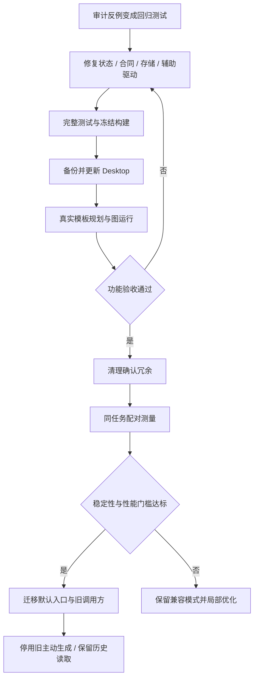

# 后端阻断修复与桌面验收

> 2026-10-21 说明：工作流预算系统已于 2026-10-20 移除（见 [S12](tasks-规划提速与上下文复用.md)）。本文涉及预算问答、额度、增额或费用的内容仅为历史记录，不再执行；Token 用量只作性能计量保留。

日期：2026-10-19。本轮遵循“先修影响新驱动和后端运行的问题，再完成 Desktop 验收，随后分批替换旧代码”。审计原始证据保留在第 06 篇；本篇记录修复后的状态，不把旧反例探针的成功当作功能通过。

**第三构建验收结论（历史记录）：五节点新驱动的核心功能验收已完成。** 新图生成、不同输入、非法输入拦截、局部修改和冻结旧版本恢复均有实际执行证据。当时恢复决定使用单选项；最终确认通过键盘完成，鼠标自动化激活未生效的原因未确定。旧代码批量替换及配对性能比较当时未开始。

**后续状态：当前安装 template5，Host bundle 与第三构建相同。** 恢复决定已改回可用的原生下拉，空说明有中文提示，核验状态、按钮边框与阴影已通过界面验收；本篇下方的单选项和原始错误文案保留为历史观察。template5 没有实际提交新的恢复运行，最终鼠标确认仍待复测。最新进度与替换顺序见 [Tasks](tasks.md)，界面证据见[恢复预览与运行详情样式验收](../../../../docs/恢复预览与运行详情样式验收.md)。

## 1、修复范围

表 1-1 审计问题处理

| 问题 | 本轮处理 | 边界 |
|---|---|---|
| F1 冻结失败阻断启动 | context 与模板绑定全部校验后一起提交；恢复没有子任务和派生产物的旧失败半成品 | 有候选、提交、回执或实际子任务的记录仍严格要求完整绑定 |
| F11 草稿耗尽身份池 | 回收已删除别名，保留现存别名身份，三类身份池一起事务提交 | 不以扩大池子替代修复；覆盖 1/60 个 ID 两种规模 |
| F3 工具参数合同分歧 | Swagger 导入与执行使用 SDK 合同；解析动态值后、HTTP 动作前校验 | 不支持的 schema 显式拒绝，不静默丢约束；原生工具继续使用宿主校验 |
| F8 合法引用被 schema 拒绝 | 模型 schema 提供 SDK 能表达的可接受上界；最终编译器验证静态值与引用 | 模型 schema 不是完整验证器；空、未闭合插值与非法静态 const/enum 由最终编译拒绝 |
| F4/F9 缓存动态依赖遗漏 | 识别当前时间、默认当前日期的 weekday，递归检查子图、孙图和容器；恢复摘要包含身份保留决定 | 有副作用的重做仍需核对；不能自动重放外部动作 |
| F5 必读文件证据未接入 | readiness 和原生 Agent 执行前检查能力；缺少可信回执时在模型调用前拒绝 | 当前 Desktop SDK 不提供工具来源证明，可信读取能力仍未开放；同名 read 不能作为证明 |
| F12 失效锁双写 | 对整个取锁过程加恢复互斥，锁内核对旧文件身份 | 恢复门锁自身异常时明确阻止，保留人工诊断，不冒险自动删除活锁 |
| F10 历史附件遗留 | 运行淘汰同时清理对应附件，检查链接边界 | 不扫描删除用户历史孤儿目录 |
| F6/F7 辅助驱动漂移 | preview 明确报告不支持的原生停止能力；更新 Graphon Agent 夹具；修正 benchmark 类型 | 标准 typecheck 现在包含 scripts，防止仅 tsx 可运行掩盖错误 |

## 2、本地验证与安装

表 2-1 安装前检查

| 检查 | 结果 |
|---|---|
| Vitest 全量 | 首构建 162 文件、1,890 项通过；第二构建 163 文件、1,897 项通过；第三构建 163 文件、1,900 项通过，见下方环境重跑说明 |
| Host、Client、scripts 类型检查 | 全部通过 |
| 完整构建 | 通过；52 个 Remote 方法，Host/Client schema 一致 |
| 打包编译 CLI | `bound → templates → accepted` |
| 安装器、元数据事务 | 原有安装器测试通过；本轮配置/事务 26 项通过 |
| 原数据保护 | 安装前备份 2,704 文件；安装后原文件哈希全部一致 |

Desktop 已安装本地 0.0.2 第三构建，归档 SHA-256 为 `70853df552a708e6ad126bebd011a3d398fd92f1faa27bbe588a3c600975c1a6`。第二构建归档为 `d4fc7e5dcbd0effda2a0823fb4e2fd9f53d33deb5c964b40751209fd6a95df53`；各次安装均保留可恢复备份。仅此 Desktop profile 使用 `planningCompiler: template-fill`，仓库默认仍为 `compact-repair`。第三构建只替换客户端恢复决定控件，Host bundle 与第二构建逐字一致；profile 仅更新本插件本地归档路径和锁文件完整性，SDK、依赖与两份 Cordis 配置保持不变。

第三构建首次全量检查 1,898 项通过，另 2 项因沙箱禁止监听 `127.0.0.1` 报 `listen EPERM`。允许本机端口后定向重跑这两个文件的 11 项，全部通过；合并后的 1,900 个断言全部通过，未为通过测试修改产品逻辑。`validation-v3.json` 保留两份原始报告的归属；不是把两次测试数量相加。恢复弹窗专项 23 项通过，完整构建与 Host/Client/scripts 类型检查通过。

原 R7 画布导出后核对：节点、连线与已保存版本一致，仅视图位置不同；返回主页正常保存视图，工作流仍为 revision 2。首次安装后核查的原 2,704 个文件哈希一致。最终验收后再次核对，原 18 个工作流、60 个旧运行文件、18 个旧规划任务及 1 个旧试做任务均未变。13 个新增文件全部按精确身份归因至本次验收：6 个运行快照、6 个事件日志和 1 个预算记录。聚合文件新增验收条目、编辑器视图发生正常变化；历史对话没有基线，不声称其逐字未变。证据为 `original-state-final.json` 和 `original-state-final-attribution.json`。

## 3、Desktop 实际验收

独立工作区：`/private/tmp/dsh-template-fill-acceptance-20261019`。测试只使用合成库存数据。规划沿用 Desktop 原选中的 GLM-5.3-Flash / Max；本轮源码审核代理为 GPT-6.1-sol / high。不能把这两者的模型性能混为一谈。

表 3-1 实际验收项目

| 项目 | 要求 | 状态 |
|---|---|---|
| 冷启动与历史兼容 | 新包加载、旧库可见、原记录不变 | 已完成 |
| 首次新图 | 真实模型调用 template-fill，模板填写经统一编译器形成合法预览 | 第二轮通过并发布，revision 1；真实任务记录 compilerMode 为 template-fill |
| 不同输入运行 | 同一生成图运行有补货、零补货，写入结果独立核对 | 两组通过；五节点真实执行，业务模型调用为 0 |
| 非法输入 | 负库存使计算失败，不得继续写文件 | 通过；code 失败，下游 skipped，目标文件不存在 |
| 局部修改 | 经模板驱动修改指定节点，其他节点与编号保留 | 通过；提案只改模板第一行，接受为 v2，第三组数据实际运行通过 |
| 失败恢复 | 让 v1 写入失败，接受 v2 后恢复冻结 v1 | 第三构建通过；input 复用，后四节点实际执行，生成 v1 旧标题，当前库仍为 v2 |

普通预览不收集执行预算；发布前宿主要求真人选择是否设置上限。本轮用户明确回答“不设置上限”，已保存至新测试工作流并供后续同图验收复用。真实模板规划和结果质量以本节最终记录为准，离线替身不补齐缺失的 Desktop 证据。

### 3.1、首轮失败与第二构建

首轮请求 `template-desktop-20261019-create-01` 实际失败，主会话显示的“已完成，用时 11分8秒”表示对话轮次结束，不表示工作流通过。模型修正表单结构后仍使用保留字 `input` 作为节点 key；后端只报告泛化错误，并把补丁限制在旧 key 内，导致下一次显式重命名为 `intake` 被 `PATCH_SCOPE` 拒绝，最终耗尽修复次数。未保存或执行工作流。

第二构建补齐三点：按需求精确预取少量明确提到的工具模板；在模型合同中解释合法 key、保留字和入口别名；仅对非法 record key 提供其父路径用于删除旧 key 并新增正确 key，最终编译和范围检查仍完整执行。真实失败反馈的离线重放已通过，但不能替代第二次 Desktop 验收。

首轮公开工具证据保存在 `attempt-1-public-events.json`，离线重放保存在 `key-contract-offline-regression.json`。第二轮使用新请求 `template-desktop-20261019-create-02`，保留首轮历史，不覆盖失败记录。

第二轮规划子会话约 4 分 41 秒，主对话端到端约 5 分 47 秒。第一次提交只缺少工作流标题，局部补齐后成功；未再出现保留 key 或重命名补丁阻塞。该次成功不等于配对性能基准，不能由单个样本宣布整体提速比例。

保存的新图为 `d6b44612-439a-43f8-94a4-dc0d9b801226`，规划任务为 `80ed3fd4-e630-4b48-8163-65f25bbae3aa`。发布回执 `kind=created`、revision 1。预览为保留基线展示编号而出现非顺序编号；保存后重新编号为 input a-1 → code a-2 → template a-3 → write a-4 → output a-5，稳定 ID 和连线未改变。

### 3.2、实际运行与恢复现场

表 3-2 实际运行归属

| 样例 | runId | 结果 |
|---|---|---|
| 有补货，v1 | `7a3f3be5-5691-41da-b154-424db7a46970` | 通过；A 补货 8 |
| 零补货，v1 | `747ce52e-961e-4a46-bee2-5c76962eea5a` | 通过；“无需补货” |
| 负库存，v1 | `f26eda5f-4294-4e81-b547-71c80a02ac6a` | 预期失败；code 拒绝，下游未执行，无产物 |
| 写入目录冲突，v1 | `6e7ee29e-9d3c-4436-83ff-32b3b3ffa881` | 预期失败；input/code/template 成功，write 失败，output 跳过 |
| 修订标题，v2 | `26e1aafe-e3cd-42a9-a7d1-6b425e2093e9` | 通过；新标题、ink 补货 3、pad 补货 2 |
| 冻结 v1 恢复 | `d2ddfce5-5aa0-4665-893d-9d484c408b48` | 通过；来源为上述写入失败记录，旧标题、recover 补货 2 |

修订任务 `2a7c2bd6-c192-45c6-ba6d-4b8061eac9c2`，提案 `7a430243-c234-41a6-ae04-b1843538ff47`，已在画布核对并接受。`revise-accepted-verification.json` 证明唯一业务差异是模板正文第一行，节点 ID、连线和预算决定不变。

恢复源运行在修订接受前冻结为 v1。故障来自独立临时工作区的普通文件 `recovery-obstacle` 占用了父目录位置；已将此文件可逆移动为 `recovery-obstacle.before-recovery.txt`，并建立同名目录。正式恢复前再次确认目标 `result.md` 不存在。恢复预览正确要求对 write 显式核验：input 可复用，code 未声明 cache=reuse，故 code/template 重算，output 重新执行。

此前阻塞为恢复弹窗的“核验决定”下拉菜单无法展开。局部修复将有限决定直接显示为单选项，保留核验说明、检查决定和正式恢复时的 Host 再次核验。第三构建中，单选项真实点击成功；空核验说明被 Host 拒绝，填写实际证据后才允许确认。源码证据不足以将旧下拉故障归因于 SDK 的 inert 或 focus trap，共享 Select 保持不变。

新恢复运行于北京时间 14:01:44 启动，约 1.11 秒完成，Graphon 0.7.0/protocol 1，业务模型调用和 Token 均为 0。`recovery-verification.json` 共 33 项通过：源运行实体与恢复前基线一致、冻结图/输入/约束/依赖正确、input 有真实复用回执、后四节点有新执行事件，write 回执为 `create` 且 `before=null`。产物为 61 字节，SHA-256 `7c378271ddf4ebbcf2d5826394a4faf7c483b8a387c871064a556f9ba3491897`。原恢复基线不含事件文件，因此“源历史未变”在该检查中只证明运行实体完整性，不扩展为事件日志逐字保全。

保留的交互限制：确认按钮在本次 AX/坐标鼠标激活下未触发；通过 Tab、Shift+Tab 定位按钮后 Return 成功创建运行。实际 SDK Button 直接转发原生 onClick，静态检查未发现仅屏蔽鼠标的门控，不能把原因确定为产品或 CUA。此项记为鼠标自动化复测待办，不影响已核实的恢复执行结果，也不宣称所有鼠标交互已通过。空核验说明目前显示原始 schema 错误，文案可在后续小批次改善。

## 4、旧代码分批替换

表 4-1 替换顺序

| 阶段 | 处理 | 进入下一阶段的条件 |
|---|---|---|
| 1 | ✅ 替换薄参数校验、修复失效驱动调用、集中动态依赖判断 | 新回归与完整测试通过，本轮已完成 |
| 2 | ✅ 单个 Desktop profile 已启用新驱动并保留回滚包；核心功能验收通过 | 首次新图、局部修改、不同输入及失败恢复通过；鼠标自动化复测另行保留 |
| 3 | 清理已确认无行为影响的未用局部变量；保留兼容读取 | 进入下一小批次；本轮交付保持已验收的源码与安装包一致，尚未清理 |
| 4 | 对相同任务、模型、强度做 compact-repair/template-fill 配对比较 | 成功率不下降；设计耗时中位数比例达到既定 ≤0.90 门槛，再考虑全局默认切换 |
| 5 | 停止新建 legacy 任务，逐个迁移调用方，再移除主动旧生成分支 | 所有配置和入口完成迁移；仍能读取历史任务及预算结算记录 |

`legacy-task.ts` 仍有历史用量结算职责，不能删除。旧 SDK 生命周期兼容、Secret 开发验证入口、Windows broker 都不是本轮可证明的死代码。当前不批量格式化或重写大函数，以免把行为修复与结构迁移混在一起。

图 4-1 修复、验收与替换

## 5、暂停与恢复记录

用户先要求修复后暂停，暂停时仅完成 `src/client/recovery-preview.tsx` 的单选项修改和静态检查，没有测试、构建或安装。用户随后明确“继续，开始测试验收”，才进行本篇记录的第三构建验证与 Desktop 恢复执行。

暂停时 Desktop 为第二构建，恢复决定尚未选择；恢复后已更新为第三构建，保留原 v1 失败记录和新成功恢复记录，库中工作流仍为 v2。本轮没有再次调用规划模型，没有重做此前已通过的新图生成和局部修改。

以下恢复步骤已完成：

1. 完成单选项专项、全量断言、类型检查、构建和打包，固定第三构建归档。
2. 备份并正常退出 Desktop，安装新包，事务同步本插件元数据，核对包与配置后重启。
3. 通过 Desktop 原生恢复预览，填写真实核验说明、检查决定，再确认创建恢复运行；保留 UI 操作和执行证据边界。
4. 依据恢复前基线和真实产物完成 33 项恢复核对，并对原工作流和旧运行数据作最终复核。

下一阶段按表 4-1 逐项清理。可信文件读取能力仍未开放，全局默认仍为 compact-repair；复杂节点的所有组合、Windows 实机和新旧驱动配对性能均不属于这次五节点 Desktop 样例的通过范围。

证据目录：[template-fill-desktop-20261019](../../../../docs/evidence/template-fill-desktop-20261019/)。备份与含完整本机配置的候选只留在忽略目录 `.cache/planning-entry-20261019-template/`，不进入公开证据。
