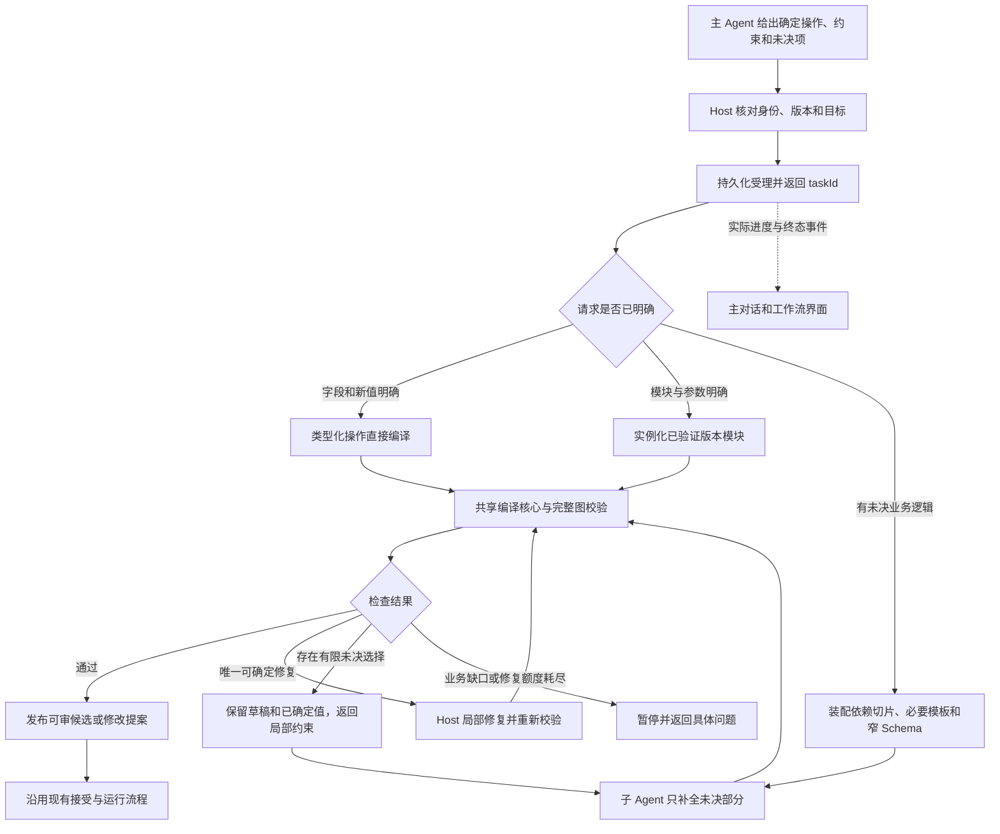

# 子 Agent 长响应优化研究与实施建议

> 2026-10-21 说明：工作流预算系统已于 2026-10-20 移除（见 [S12](tasks-规划提速与上下文复用.md)）。本文涉及预算问答、额度、增额或费用的内容仅为历史记录，不再执行；Token 用量只作性能计量保留。

研究日期：2026-10-19（Asia/Shanghai）。依据冻结实测、当前源码及原始论文／作者资料。本文是研究与实施建议，未实现新功能、未启动模型实验；旧 T05 保持暂停。落实到[规划提速与上下文复用 Tasks](tasks-规划提速与上下文复用.md)，不另建一套任务编号。

**推荐采用：确定修改直接编译、已验证模块按参数实例化、真正未决的业务逻辑才交给子 Agent 局部补全。** 让后端承担固定结构、依赖装配和可确定修复；子 Agent 取得已确定的决定及必要合同，不重新设计整项任务。异步受理解决主对话悬停，缓存辅助减少输入处理，二者分别验收。

## 1、根据实测确定优化对象

### 1.1、证据与结论

表 1-1 耗时事实与针对性措施

| 已核实的事实 | 对优化的含义 | 首要措施 |
| --- | --- | --- |
| 7 个规划／提炼子会话累计 2,392.644 秒，其中模型响应区间 2,390.953 秒，占 99.93%；全部 14 个子会话的 23 次工具调用累计 0.718 秒 | 本批重点在模型调用及其上下文／输出，优先优化本地工具速度难以解释分钟级差距；两组统计范围不同，不能直接相除 | 减少额外模型轮次、待生成内容和修复选择 |
| 31 节点图只修改一个 text，模型响应 35.801 秒，最终工具参数 379 字节 | 已确定节点、字段和值时仍启动规划子 Agent，存在可消除的调用 | 主 Agent 直接提交类型化字段变更 |
| 读写分支修改响应 570.767 秒，估计输入 265,512 字节；只新增 5 项、更新 7 个原节点 | 局部输出不等于输入与决策空间已缩小 | 依赖切片、按操作提供 Schema、复用业务模块 |
| 两条 port 补丁响应 293.887 秒，工具参数 512 字节；同一子会话且报告缓存读取 34,560 Token | 同会话、局部补丁和缓存命中都不足以保证快；不能将所有慢响应归为大量节点重写 | 给出精确类型和有限合法候选；唯一确定修复交给编译器 |
| 两次模板／目录查询之前的模型响应分别 306.512 秒、223.432 秒；四次查询工具共 67 毫秒 | 慢发生在产生查询的响应区间，查询执行本身很短 | Host 按已确定任务预取必要合同，减少为取资料而增加的模型往返 |
| 最长父工具 visible_workflow_plan 用时 18 分 11.696 秒，包含下游等待 | 主对话工具时长不是工具本地计算时长 | 持久化受理后返回 taskId，推送实际阶段和终态 |

数据与可复算脚本：[耗时统计](../../../../docs/evidence/subagent-timing-20261019/REPORT.md)、[公开提交核验](../../../../docs/evidence/subagent-timing-20261019/template-submission-audit.md)、[逐次指标](../../../../docs/evidence/subagent-timing-20261019/timing-summary.json)。

这里的模型响应区间包含服务等待、输入处理、生成和宿主观察开销，不能进一步拆成“理解任务”“内部推理”“写 JSON”。输入字节不是 Token；回执输出 Token 也未拆分可见内容与推理用量。14 个子会话的累计时间包含重叠，不等于用户等待的墙钟时间。

### 1.2、当前模板已经做了什么

4 个图规划子会话的 6 次结构化提交都采用 forms、addForms／updates 或 patches，原始 graphJson／nodes／addNodes 提交为 0。模型没有重写模板完整定义，但新建成功的 14 节点候选仍包含 3 个完整业务函数，共 1,519 字符，以及输出合同、分支、引用和人工复核说明。

因此，需要补的是“保存好可复用的业务实现”，而不是再要求模型逐字复制字段模板。当前普通节点模板的 fixed 为空，工具模板主要固定 toolId；业务代码仍是 values 中待填写的值。详见[模板定义](../../../../src/shared/planning-node-templates.ts)与[模板编译器](../../../../src/shared/planning-template-compiler.ts)。

这批 5 个规划任务的 contextProjection 记录模型为 zai-coding-cn / glm-5.3-flash、effort=max。它证明宿主记录的设置，不能证明供应商实际采用的推理策略或耗时原因。架构实验冻结模型及设置；如需比较供应商或强度，另设实验，不能混入架构收益。开发辅助 Agent 仍按用户要求使用 GPT-6.1-sol、至少 high。

## 2、可借鉴的方法与选择

表 2-1 原始研究、适用位置与推荐程度

| 方法与权威来源 | 可借鉴的核心 | 在本项目中的用途 | 建议与限制 |
| --- | --- | --- | --- |
| Mark Weiser，Program Slicing，IEEE TSE 1984；[原论文](https://faculty.cc.gatech.edu/~harrold/6340/cs6340_fall2009/Readings/Weiser.Slicing.TSE.pdf) | 从指定位置／变量出发，按数据与控制依赖提取相关程序部分 | 按目标节点和字段装配上下文，保留必要输出、分支和容器合同 | ✅ P0。借鉴依赖切片；不是简单截断前 N 个节点 |
| Armando Solar-Lezama 等，Sketch，ASPLOS 2006；[原论文](https://people.csail.mit.edu/asolar/papers/Solar-LezamaTBSS06.pdf)、[作者 CEGIS 课程](https://people.csail.mit.edu/asolar/SynthesisCourse2020/Lecture10.htm) | 固定程序骨架，只补空位；检查器反馈反例，排除不满足约束的候选 | 固定模块只填参数，失败只修特定空位，有限候选由 Host 筛选 | ✅ P0／P1。复用现有 RepairSession；不为任意 JS 引入全量求解器 |
| Nadia Polikarpova、Ivan Kuraj、Armando Solar-Lezama，Synquid，PLDI 2016；[论文](https://arxiv.org/abs/1510.08419)、[会议页](https://pldi16.sigplan.org/details/pldi-2016-papers/10/Program-Synthesis-from-Polymorphic-Refinement-Types) | 用类型及更精确的约束提前排除不合适的程序片段 | 根据节点类型、输出合同、scope 和合法端口生成窄 Schema／候选集合 | ✅ P0。借鉴类型引导剪枝；JSON Schema 不等于完整精化类型系统 |
| Guanzhi Wang 等，Voyager，2023；Jim Fan、Anima Anandkumar 共同指导；[作者项目页](https://voyager.minedojo.org/)、[论文](https://voyager.minedojo.org/assets/documents/voyager.pdf) | 保存可执行技能，经反馈改进，按需求检索和组合 | 建立版本化业务模块，Host 复制固定代码和子图，模型只选模块与参数 | ✅ P1，紧接直接修改与切片。人工审核首批模块，不能把检索命中当执行正确 |
| Binfeng Xu 等，ReWOO，2023；[论文](https://arxiv.org/abs/2305.18323)；Sehoon Kim 等，LLMCompiler，ICML 2024；[会议论文](https://proceedings.mlr.press/v235/kim24y.html) | 显式计划、结果引用和依赖调度，把可机械执行的组织工作移出反复模型推理 | 主 Agent 交付确定操作；Host 批量取资料、代入引用，只将未决处交给子 Agent | ✅ 采纳机制。无需另设 Planner／Worker／Solver 三个模型；本批并行本地工具的直接收益很小 |
| Lianmin Zheng 等，SGLang / RadixAttention，NeurIPS 2024；[会议页](https://proceedings.neurips.cc/paper_files/paper/2024/hash/724be4472168f31ba1c9ac630f15dec8-Abstract-Conference.html)、[论文](https://arxiv.org/html/2312.07104v2) | 推理服务复用共享前缀的 KV 缓存，避免重复输入计算 | 稳定提示和工具前缀；在供应商确实支持时核对实际缓存回执 | ✅ 辅助措施。RadixAttention 需要推理服务配合，不是插件自行传递模型“理解”；长输出仍要生成 |
| Kevin Ellis、Joshua B. Tenenbaum、Armando Solar-Lezama 等，DreamCoder，PLDI 2021；[论文](https://people.csail.mit.edu/asolar/papers/EllisWNSMHCST21.pdf)、[出版记录](https://doi.org/10.1145/3453483.3454080) | 从已解决程序中学习可复用抽象，逐步扩充库 | 以后分析已验收工作流中的重复子图，辅助提出模块候选 | P2。先手工建立少量可靠模块；当前不引入训练循环或自动推广未验证代码 |

这些研究支持的是机制选择，不证明本项目能复现论文中的加速倍数。Voyager 与 ReWOO 此处按 2023 年论文／作者资料引用，不额外赋予未经核对的会议归属。

Anthropic 的[有效 Agent 工程建议](https://www.anthropic.com/engineering/building-effective-agents)也强调按任务选择简单、可组合的工作流；其[上下文工程说明](https://www.anthropic.com/engineering/effective-context-engineering-for-ai-agents)支持保留高信号状态、按需检索，并指出额外检索会增加运行等待。对本项目而言，这意味着：已知目标采用有限预取，未知部分再按需查询。

## 3、推荐的后端处理流程

### 3.1、明确决定如何交接

“继承主 Agent 的理解”应落实为可检查的决定与状态：目标、操作、新值、约束、依据、未决项。历史消息 fork 只能带来历史内容；不等于复制模型内部计算状态，也不保证命中服务端缓存。

建议在现有规划服务增加版本化交接合同，语义示例如下。字段名仅为设计示例，不是已存在的可调用 API：

```json
{
  "contractVersion": 1,
  "workflowId": "<Host 返回的工作流 ID>",
  "expectedRevision": 12,
  "requestId": "<本次请求身份>",
  "resolvedChanges": [
    {
      "op": "set-node-field",
      "nodeId": "<Host 返回的稳定节点 ID>",
      "field": "text",
      "value": "新的正文"
    }
  ],
  "constraints": {
    "preserveOtherFields": true,
    "preserveHumanReview": true
  },
  "evidenceRefs": ["<已有任务或合同引用>"],
  "unresolved": []
}
```

主 Agent 在已有响应中产生这份决定，不再启动模型生成“交接摘要”。Host 对照当前版本和可编辑范围解释合同；不能把主 Agent 的声明当成权限或执行证据。节点展示编号须先在对应版本绑定到稳定 ID。

- 全部决定明确且操作受支持：直接编译，新增规划模型调用为 0。
- 已知模块、参数齐全且适用条件成立：Host 实例化，新增规划模型调用为 0。
- 存在新业务逻辑：只把未决项、固定约束、相关片段和输出合同交给子 Agent。
- 目标歧义、版本冲突或业务规则缺失：返回具体缺口；不猜测、不静默重建全图。

这里的“0”指后端接收已确定操作之后的额外规划调用，不代表主对话无需理解需求，也不表示从用户说话到完成只需毫秒。

### 3.2、总体流程图

图 3-1 从请求到候选提案的建议流程



这是目标流程，不代表当前已实现异步入口。后台任务必须接入宿主的取消、超时、重启和幂等生命周期，不能仅删除 await。各路径沿用现有权威校验和提案规则；流程中的运行步骤仍由现有授权与人工门禁决定。

## 4、针对慢响应的具体算法改造

### 4.1、依赖切片与操作级 Schema

借鉴程序切片，将“输入什么”从模型检索习惯转成后端计算。

1. 根据稳定节点 ID、待改字段和操作种类确定修改集合。
2. 若只改展示文本，提供该字段与节点身份；若改执行配置，补入实际用到的上游输出合同、相关控制分支和容器约束。
3. 若输出类型或拓扑变化，补入受影响下游的输入／引用合同。跨容器、循环、子流程按实际作用域扩展；不能仅取前后各一个节点。
4. 读依赖与改动权限分开。模型知道某个上游节点，不代表可以修改它。
5. 只下发本轮操作可用的字段 Schema。修改 text 不展开每个节点可能切换的全部类型模板；缺少信息时按节点集合一次读取。
6. 用原完整图做最终校验，检查切片之外的引用和影响。

实现上可建立按节点 ID 的索引以及数据、控制、容器邻接表，从目标集合沿必要依赖遍历。缓存切片时绑定图／草稿版本、目标字段、合同版本和可见范围；依赖变化要失效。无法判断的动态依赖保守扩展，不能为了输入小而静默遗漏。

当前 authoringContext 已按显式 targetNodeIds 隐去其他配置，但仍提供全图索引和连线；无明确目标时提供全部配置。Schema 的节点编辑分支仍存在重复模板展开。因此改造应扩展现有投影，不能宣称“目标节点聚焦”尚未存在。落点：[上下文](../../../../src/shared/planning-authoring-context.ts)、[Schema 生成](../../../../src/shared/planning-template-compiler.ts)。对应 S04、S08。

### 4.2、由后端复制固定业务实现

借鉴 Voyager 的可执行技能库、Sketch 的固定骨架，模块应保存：

- 不可变模块 ID、版本、固定节点、业务函数、连线与参数槽位。
- 输入输出类型、适用条件、文件／工具操作前置条件。
- 工具合同版本、需要保留的人工复核、验证样本与结果。
- 实例与来源映射；参数更新不重新生成固定代码，也不默默升级旧实例。

首批可以从现有需求中选择“带存在性处理的文件写入与回读核对”“结构化结果渲染”等少量候选；**这些名称只是候选，不代表旧 T05 修后图已验收**。固定实现通过针对性运行验证后，才能发布为已验证版本。

Agent 后续只提交模块身份、版本、参数和必要连接。Host 在内存中复制实现、填参数、分配新节点身份并展开为现有 Workflow 节点图。修改某个实例参数只更新该实例的受控差异；自定义业务超出参数能力时返回未决项。

不把程序搬进提示词后要求模型再照抄。新业务确实没有对应模块时，允许局部新代码；经验证后再提议进入库。DreamCoder 的自动抽象可在以后数据足够时辅助发现重复结构，目前手工整理更易控制成本与正确性。对应 S06，建议紧接 S03／S04，先于大规模缓存和向量检索。

### 4.3、把修复从自由写补丁改为有限约束补全

现有 RepairSession 已保留失败草稿、版本、allowedPaths、片段、提交额度与停滞检查，修复继续使用同一子会话。缺口是模型侧修复合同仍允许通用 path 字符串及任意 value。应在此基础上收窄，而非增加一个修复 Agent。

借鉴 Sketch／CEGIS 与 Synquid：

1. 校验器一次收集本轮相关错误，标出错误来源、实际类型、预期类型和允许修复的具体字段。
2. Host 根据节点类型、容器、输出合同、已定决定计算合法候选。例如分支端口必须来自该分支节点的端口合同，而非任意字符串。
3. 对“已知业务意图＋唯一合法修复”的情况，Host 提交确定补丁后重新校验；唯一通过结构检查并不自动等于业务意图唯一。
4. 有多个业务上不同的选择时，下发有限候选 ID 与必要说明；仍未知的代码空位才允许生成代码。可以收窄 Schema，但不假定所有供应商都支持受约束解码；Host 校验始终保留。
5. 新一轮保留已经满足的约束，只处理新增错误；重复失败不重新生成整份文档，也不换 requestId 重启逃过额度。
6. 对代码语义，通过实际输入／预期输出或已有验证用例反馈失败案例；不能把一个 Schema 报错称为已经实施了形式化 CEGIS。

特别针对历史端口错误：当前 AuthoringCore 已能指出 chain 在 if／classifier 之后生成隐式 default 边，并要求拆开 chain、保留显式字符串端口。因此后续应在已改善的诊断上生成合法修复候选，不能仍按旧现象简单将布尔值与字符串互转。如果需要删除／拆分顺序段，必须核对所有原边和明确分支意图，避免顺手丢掉正常连接。

落点：[RepairSession 与修复 Schema](../../../../src/shared/planning-repair.ts)、[分支与作用域诊断](../../../../src/shared/planning-authoring-core.ts)。对应 S03、S04、S07；需同步检查模板层字段路径与编译层路径映射。

### 4.4、预取、任务状态与缓存分别处理

表 4-1 四种复用方式的职责

| 方式 | 可以复用什么 | 不能替代什么 |
| --- | --- | --- |
| Host 预取 | 主 Agent 已明确需要的模板、工具合同和节点片段；批量准备 | 不能无条件把全部目录塞入首轮，也不能保证历史查询前的全部响应时间消失 |
| 已确定状态与 delta | 版本化决定、草稿、已加载合同、未决项及依据 | 不能凭旧状态跳过当前版本与权限检查 |
| Host 内容／依赖缓存 | 模板、Schema 和图切片的构建结果 | 本地毫秒级节省不等于模型分钟级提速 |
| 供应商前缀缓存 | 支持时复用相同输入前缀的计算 | 不会让新输出自动产生；历史 fork 不保证 KV 复用 |

ReWOO／LLMCompiler 最值得借鉴的是“明确依赖与结果引用由执行层处理”。对当前已知任务，不需要模型先思考数分钟决定读取哪个已经可确定的模板。Host 可以按交接合同预取；需要动态信息再追加查询。

为前缀缓存整理稳定的系统合同、工具顺序和序列化，把频繁变化的任务 delta 放在后面；同时保留供应商／SDK 要求的合法会话结构，不擅自拼接推理字段。模块、工具合同和权限变化进入缓存键或触发失效。

SGLang 的 RadixAttention 位于推理服务端；当前调用外部模型 API，插件不能自行移植服务端 KV 状态。若未来拥有推理服务，再评估相应引擎。当前只记录实际可见缓存回执；命中率提升与总耗时改善必须同时观察。对应 S02、S04、S07。

## 5、执行顺序与源码落点

表 5-1 对现有 Tasks 的实施细化

| 批次 | 对应任务 | 先做什么 | 可核验结果 |
| --- | --- | --- | --- |
| 1 | S01 | 冻结当前构建、案例、模型设置；补首个有效内容、调用数、输入／Schema 体积、修复数与可见用量 | 能区分响应等待、输出、工具、修复、用户等待；不可观测内部阶段标未知 |
| 2 | S02、S03 | 类型化交接；支持明确文本／参数字段直接走共享编译与提案 | 收到完整确定操作后新增规划模型和子 Agent 均为 0 |
| 3 | S04、S08 的必要基础 | 依赖索引、字段级切片、操作级 Schema、有限模板预取 | 同案例发送内容减少，目标和依赖仍正确；不丢人工复核和完整图检查 |
| 3 同期 | S05 | 持久化受理后返回 taskId，连接宿主生命周期及事件 | 主对话能继续，取消／重启／重复请求有明确结果；受理快与完成快分列 |
| 4 | S06、S03／S04 修复细化 | 少量已验证业务模块；局部修复带类型／候选约束 | 固定代码无需模型重写；唯一修复可确定处理，未决逻辑不越界 |
| 5 | S07、S08 | 增量状态、内容失效缓存、供应商缓存核验、完整定位查询集 | 冷／热缓存分列，跨版本不误用；精确 ID 不经语义猜测 |
| 6 | S09、S10 | 有证据再引入向量召回，完成配对验收 | 正确性与端到端收益都达门槛后，返回旧 T05.7.3 |

建议不变更现有任务编号和完成标记；把 S06 作为直接修改、切片之后的重要批次，不等向量检索成熟后再做。

主要改造边界：

- [planning-types.ts](../../../../src/shared/planning-types.ts)、[service.ts](../../../../src/host/planning/service.ts)、[Host 工具入口](../../../../src/host/index.ts)：交接合同、路由、幂等受理、任务状态。
- [template compiler](../../../../src/shared/planning-template-compiler.ts)、[AuthoringCore](../../../../src/shared/planning-authoring-core.ts)：直接编译、模块展开和统一最终校验；运行时仍采用 Workflow JSON／Graphon。
- [authoring context](../../../../src/shared/planning-authoring-context.ts)、[template catalog](../../../../src/host/planning/template-catalog.ts)：切片、合同选择及有限预取。
- [repair](../../../../src/shared/planning-repair.ts)、[planning agent](../../../../src/host/planning/agent.ts)：窄修复合同、已确定状态复用、模型分段观测；不再叠加一个同职责 Agent。

## 6、怎样证明真正提速

### 6.1、配对实验

本文不启动实验；执行时按 S01 预先冻结方案，再按 S10 运行。

表 6-1 建议最小实验矩阵

| 固定案例 | 对照方式 | 核心检查 |
| --- | --- | --- |
| 31 节点图改一个已知 text | 当前入口 vs 类型化直接修改 | 新增规划模型调用为 0；差异只有目标字段 |
| 同图结构修改 | 当前上下文 vs 依赖切片＋窄 Schema | 输入减少量、生成时长、正确率；成功与失败都保留 |
| 现有慢修复的等价隔离夹具 | 当前修复 vs 类型／有限候选修复 | 不重复犯端口／scope 错误；无关边保留；当前已改善诊断纳入共同基线 |
| 已验证模块换参数 | 重新填写节点 vs 后端模块实例化 | 固定实现和来源一致，参数变化有效，必要人审保留 |
| 真正新业务代码空位 | 全任务规划 vs 只补局部逻辑 | 编译与运行输出均正确；未决范围外无变更 |
| 大图、同名节点、深层容器 | 原读取方式 vs 精确检索＋必要依赖批量读取 | 定位正确率、读取轮数、上下文体积；没有证据则不引入向量 |
| 相同任务的冷／热缓存 | 同一请求内容的可比配置 | 实际缓存回执、总延时、模型用量；不能只比较首包或缓存命中率 |

先做单变量对照，再组合；模型、思考设置、用例、工具合同和成功标准保持一致。按 AB／BA 顺序交错测试，记录服务错误和时间窗口，减少供应商负载变化造成的误判。探索阶段可每个条件重复 3—5 次，报告中位数与范围；需要更可靠结论再增加样本，不能用小样本宣布生产 P95。

### 6.2、指标与验收边界

必须同时记录：

- 从需求提交到可审候选的端到端时间，包含主 Agent 新增交接成本；真人等待单列。
- 受理时间、模型请求数、子 Agent 数、修复轮数、失败／取消／超时比例。
- 模型输入与工具 Schema 字节；供应商确认的输入、输出、推理和缓存用量，缺失为未知。
- 首个有效文本／工具参数及结束时间；first-observed-delta 不是有效首 Token，不能混用。
- 候选质量、目标命中、最终业务结果、无关字段保留、预算和人工门禁保留。
- 失败样本的时间与费用；不能只汇报最终成功的一次。

确定修改和参数已齐的已验证模块，硬目标是后端新增规划调用为 0。需要模型的新业务，目标是减少不必要轮次、输入和修复，同时保持成功率；具体时间门槛在实验前登记，不能根据结果倒推。当前尚无这些改造后的实测数字，不能承诺将 9 分钟缩到某个秒数。

## 7、暂不作为主方案的做法

表 7-1 需要克制使用的方案

| 做法 | 本批不优先的原因 | 何时再考虑 |
| --- | --- | --- |
| 全量 fork 主对话作为子 Agent | 复制更多历史可能增加上下文；同会话修复已有长响应，无法证明历史继承是主因 | 确实依赖集中历史、可隔离工具，并与结构化交接配对比较时 |
| 给所有节点增加向量检索 | 目前没有检索服务耗时证据；语义相似不能证明节点身份、依赖或权限 | 精确／结构检索在固定查询集出现明确不足时 |
| 并行启动更多规划／修复 Agent | 小修改已有确定答案；新增模型响应与结果合并可能增加成本和分歧 | 可独立处理、收益能覆盖调度和合并成本的大任务 |
| 单纯优化模板读取／编译毫秒数 | 本批实际工具共不足一秒；主要响应在模型区间 | 新测量显示工具本身成为瓶颈时 |
| 截断输出或削低思考设置 | 可能增加格式失败、业务遗漏和修复，不能冒充结构改造 | 独立质量与成本实验，并明确标注模型配置变化 |
| 立即部署 DreamCoder 式自动库学习、服务端解码优化 | 数据、验证和基础设施成本高；当前主要问题可先用受控编译和少量模块处理 | 模块使用数据充分，或拥有可控推理服务后 |

对用户原想法的取舍：保留“模块化填写”和“后端复制固定模板”的方向，把模板从字段说明提升为经过验证的业务实现；把“继承主 Agent 理解”落实为明确决定与未决项；向量检索和完整 fork 保留为有证据再做的比较项。

本轮交付为研究文档及任务入口关联。未修改产品代码、未安装构建、未运行真实模型、未继续旧 T05。论文机制属于借鉴，当前效果以既有统计为基线，改造效果等待配对验收。

