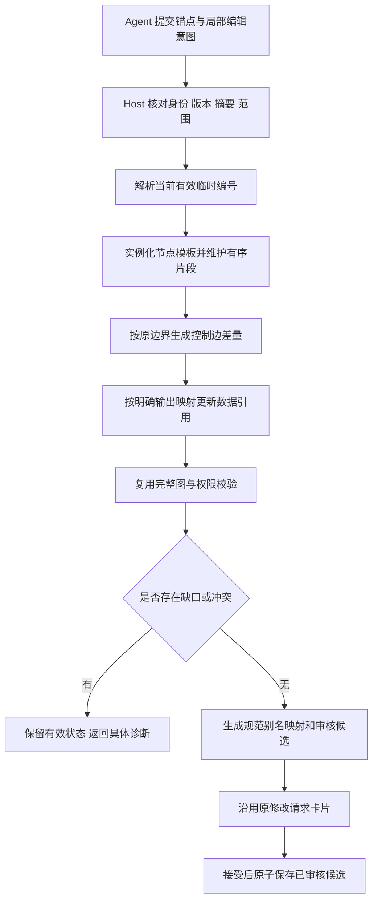

# 稳定 ID 与临时层次编号的局部结构编辑

> 2026-10-21 说明：工作流预算系统已于 2026-10-20 移除（见 [S12](tasks-规划提速与上下文复用.md)）。本文涉及预算问答、额度、增额或费用的内容仅为历史记录，不再执行；Token 用量只作性能计量保留。

制定日期：2026-10-20（Asia/Shanghai）。来源：用户提供的《节点临时层次编号与统一重编号算法》，以及本轮对稳定 ID、分支边界和输出映射的讨论。用户已确认方案并授权实施。本文规定设计与验收要求；实现、安装和实际运行状态分别记入 [规划提速与上下文复用 Tasks](tasks-规划提速与上下文复用.md) 的 S11，不因本文存在而视为完成。

## 1、目标与当前实现

当前 Workflow 使用 `node.id` 标识节点，边使用 `source`、`target` 和可选 `port`；`node.number` 是显示标签。Graphon 根据真实 ID 和边执行，不根据显示编号排序。Agent 编辑协议已有短别名、模板填写、局部增删边及完整图校验；新建图的 `chains` 可以生成顺序边，已有图结构修改仍主要要求提交显式增删连线。

本改造增加局部结构意图：Agent 提交插入、替换、删除及必要的节点填写值，Host 读取原连接边界、维护临时顺序并机械生成差量。复用现有 Workflow、模板目录、共享编译核心、版本检查、提案审核与 Graphon，不建立第二套运行图或直接保存入口。

主要预期收益是减少模型生成连线、重复解释结构和错误修复的工作。后端编号、排序、编译耗时与完整 Agent 耗时分开测量，不能把本地算法节省直接称为分钟级提速。

源码入口：[节点与边](../../../../src/shared/types.ts)、[编号](../../../../src/shared/numbering.ts)、[创作编译核心](../../../../src/shared/planning-authoring-core.ts)、[差量编译](../../../../src/shared/planning-edits.ts)、[候选还原](../../../../src/shared/planning-projection.ts)。

## 2、三类身份与版本

表 2-1 身份职责

| 身份 | 示例 | 规则 |
| --- | --- | --- |
| 稳定节点 ID | UUID | 保留的节点不换 ID；新节点由 Host 分配；被真正替换或删除的节点退出图，不把旧 ID 偷换给另一个节点 |
| 临时编辑编号 | `a-2#3#1` | 仅在指定 workflow revision、基线摘要和草稿 revision 内有效，指向 Host 已绑定的节点或本轮新节点 key |
| 正式编号 | 连续片段别名、画布 `node.number` | Host 统一产生并返回对应表；不能把片段内别名和已有画布标签混为一谈 |

草稿至少绑定工作流 ID、保存版本、基线摘要、所属 scope、请求 ID、草稿版本及节点身份映射。重复请求复用同一身份；同请求 ID 携带不同内容必须拒绝。chain 基线摘要额外绑定按稳定 ID 排序的显示编号，防止普通保存只重编号但未升 revision 时误用旧链；纯导航不改变该摘要。旧版本编号不直接用于新版本定位。

原有画布编号属于受保护宿主元数据。首版保持未受影响节点的画布编号，通过对应表提供连续片段别名、稳定 ID 和实际画布编号；不得为了全图看起来连续而破坏已有固定节点和范围保护。确需改变既有显示编号时，必须将 Host 计算出的编号差异纳入同一审核候选，不能审核后另行重排。

## 3、临时层次编号算法

### 3.1、有效叶节点与数值顺序

每个原位置对应一个可展开的编辑位置。原节点被替换为三个节点时，`a-2` 退出有效序列，产生 `a-2#1`、`a-2#2`、`a-2#3`。继续替换第三个节点可产生 `a-2#3#1`、`a-2#3#2`，原父编号仍保留为失效记录，不参加执行或最终编号。

数字逐段比较，`#2` 先于 `#10`，不能按普通字符串排序。层级只表示同一顺序位置的展开，不表示业务分支。Host 可维护有序叶序列，避免每次编辑都重新排列完整图；最终规范化只处理有效叶节点。

### 3.2、编辑语义

表 3-1 局部操作

| 操作 | 临时编号与身份 | 连接处理 |
| --- | --- | --- |
| 只改内容 | 保留节点 ID 和当前编号，走已有字段编辑入口 | 不改连线 |
| 前插／后插 | 原节点与新节点组成有序子序列；原节点 ID 保留 | 拆分明确的入口边或出口边，插入新片段 |
| 替换 | 原位置展开，新节点分配新 ID；原父编号失效 | 原入口接新片段入口，片段出口接原下游；输出引用另按映射处理 |
| 删除／空替换 | 移除有效节点，留下编号空缺；本轮不复用已退休编号 | 仅在明确、合法的线性边界下旁路连接，否则返回缺口 |
| 递归编辑 | 使用当前草稿版本和仍有效的临时编号 | 不重建无关节点或边 |

每步必须检查重复 key、失效父编号、草稿版本、作用域、固定节点、资源上限和输入格式。失败步骤不能留下半段变更；后续步骤只能基于已成功的草稿状态。

### 3.3、示例

```text
原始：a-1 → a-2 → a-3
替换：a-1 → a-2#1 → a-2#2 → a-2#3 → a-3
继续：a-1 → a-2#1 → a-2#3#1 → a-2#3#2 → a-3
规范：a-1 → a-2 → a-3 → a-4 → a-5
```

最后一行是片段规范别名。返回对应表同时保留稳定 ID 和实际画布编号，不能用规范别名替换运行时 ID。全部子节点被删除后，父位置保持为空，不恢复原节点。

## 4、自动接边与分支边界

### 4.1、顺序片段

Host 从稳定锚点和已有图推导安全顺序段，不要求 Agent 重新列出整图节点。必要时允许 Agent 指定局部边界，但仍由 Host 验证。

将 `A → B → C` 中的 B 替换为 `B1、B2、B3`，可机械生成 `A → B1 → B2 → B3 → C`。保留片段外节点和边；未变化的边保留 ID，新增边由 Host 分配。不能根据 `nodes` 数组位置、画布坐标或显示编号猜测原连接。

### 4.2、分支中的插入

对 `判断.true → A` 指定该边后，在 A 前插入 X、Y，生成 `判断.true → X → Y → A`，false 分支不变。端口名来自真实节点合同，按字符串保留，不将 `"true"` 改为布尔值。

若一个出口连到多个目标，必须进一步确定目标或边 ID。临时编号只排列选定分支内的片段，不对所有分支节点做一条全局顺序链。

### 4.3、复杂边界

多入口、多出口节点的替换、分支节点本身替换、合流策略变化及跨容器连接不能套用简单旁路规则。由显式入口／出口映射确定合法重接；当前快捷操作无法表达时，返回具体诊断，沿用已有显式拓扑合同。不生成上游×下游的笛卡尔连线，不静默选择某个分支。

## 5、数据引用与对外输出映射

控制边说明执行依赖，数据引用说明读取哪个输出，两者分别处理。B 被替换后，C 原先读取的 `B.text` 不能自动改成“最后一个新节点的同名字段”。

允许替换意图声明：

```text
原 B.text  → 新 B3.result
原 B.count → 新 B2.count
```

Host 负责查找消费者并更新已知语法中的引用。复用现有引用解析规则，区分模板表达式、变量选择器、局部变量和字面量，不对任意代码或所有字符串全局替换。

更新前检查：目标字段存在；输出类型兼容；生产者在消费者作用域及相应执行路径可用；消费者修改在本次授权范围内且没有触碰固定节点。仅同名、同类型不足以证明业务等价，映射应来自明确意图或已验证模块合同。

无映射而存在消费者时，返回原字段、引用消费者和需要补充的映射。删除未被引用的普通节点不要求无意义的输出映射。动态表达式无法安全分析时明确拒绝该快捷操作，不删除引用、填空值或猜一个输出。

## 6、编译、审核与提交

图 6-1 局部结构编辑流程



明确操作的编译不启动规划子 Agent。新业务逻辑尚未确定时，仍由原 partial 路径先补齐必要字段；不能让结构驱动猜业务代码。校验成功只表示候选成立，不表示已保存、已接受或业务执行成功。

发布、接受、预算和业务运行沿用现有机制。候选基线变化时拒绝过期接受；不能重新计算一份不同的图后静默保存。重启后的草稿恢复必须重新核对版本与身份，不能自动重放已完成操作。

审核接受的 Host 内部入口与普通保存共用权限、固定节点、范围、CAS 和原子事务。接受前重新核对旧节点编号；新增编号已在候选形成前由共享规则分配，不在接受后重新编号。业务定义摘要会规范化显示编号，因而不能单靠摘要判断编号未漂移，必须另作逐节点检查。

接受后仅修改 `viewport/scopePath` 的自动保存，只有导航实际变化、业务定义相同且编号未被夹带修改时才保留已保存编号及 revision／updatedAt。无导航变化的普通保存、真实业务修改和导入继续使用原有编号规则。临时编号映射仅对绑定的基线有效，不能跨版本当作永久节点地址。

### 6.1、已实现的工具合同

- `visible_workflow_chain(workflow_id, expected_revision, anchor_node_id, entry_edge_id?, exit_edge_id?, template_ids?)`：复用现有授权读取与缓存，返回 `version/baseDigest/baseRevision/chainKey/anchorNodeId/scope/boundary` 和有效别名。`template_ids` 最多 5 项，可用节点种类或真实工具 ID；只取需要填写的合同。
- `visible_workflow_splice(request_id, workflow_id, expected_revision, instruction, chain_json, preview?, target_node_ids?)`：`chain_json` 复制上项身份字段，增加 `operations` 与可选 `exports`，不回传读取结果的 `nodes`、`rules` 或顶层 `draftRevision`。每个操作分别填写从 0 递增的 `draftRevision`。
- 已有 `visible_workflow_plan` 同样支持 `handoff:{version:3,mode:"chain",chain:…}`；两入口进入同一个服务及共享编译核心。`visible_workflow_plan_get` 返回 `chain` 对应表；显式 `include_metrics:true` 才附安全计时和合同摘要。

下面是已读回链中 `a-2` 被替换的操作部分；身份字段必须来自当前真实读回，不能照抄示例值：

```json
{
  "operations": [
    {
      "op": "replace",
      "draftRevision": 0,
      "target": "a-2",
      "nodes": [
        {"key": "greeting", "template": "template", "values": {"text": "Hello {{input.name}}"}}
      ]
    }
  ],
  "exports": [
    {"from": {"nodeId": "旧节点稳定ID", "field": "text"}, "to": {"key": "greeting", "field": "text"}}
  ]
}
```

首版自动映射只接受可证明类型的顶层输出；嵌套／动态路径保守拒绝。LLM、Agent、document 及工具的真实包装字段优先于自报声明，不能把 LLM 的 `text` 声明为 number 来获得错误类型通行。不存在的工具输出字段不能因同类工具提供而被推断存在。

实现：[顺序草稿](../../../../src/shared/planning-chain-draft.ts)、[合同](../../../../src/shared/planning-chain-contract.ts)、[局部编译](../../../../src/shared/planning-chain.ts)、[Host 工具](../../../../src/host/index.ts)。编译包 `./compiler` 导出同源纯程序 API，不另建运行时协议。

## 7、实施与验收

实施归入新任务 S11，复用 S03 的确定编译、S04 的上下文与合同、S05 的生命周期、S07 的版本失效、S08 的精确定位。S10 统一归档，避免每项重复运行相同用例。

表 7-1 必需验证

| 类别 | 检查内容 |
| --- | --- |
| 临时编号 | 原文例子、`#2/#10`、递归替换、空替换、失效父、删除不复活、保留节点插入、资源上限 |
| 身份与并发 | 旧稳定 ID 不变、新 ID 唯一、重复请求、旧 revision／digest／草稿版本、失败不产生半更新 |
| 拓扑 | 线性前插后插、替换、删除、明确分支边、无关分支守恒、歧义及跨 scope 拒绝、固定节点保护 |
| 数据引用 | 明确字段映射、缺失映射、类型不兼容、消费者范围、模板局部变量、动态不可判定引用 |
| 审核与运行 | 与原提案卡片衔接、候选与接受后保存一致、导航自动保存不改编号、旧编号漂移冲突拒绝、普通保存兼容、接受／拒绝不串任务、合成结果与预期一致 |
| 成本 | Agent 提交量、规划调用数、后端编译／编号成本、实际端到端耗时分别报告 |

局部算法用 31／150／500 节点规模检查增长；生产候选仍遵守每层及全图节点限制，不能为跑大样本绕过限制。确定的结构操作新增规划调用要求为 0，合法预期结果及无关内容不得退化。旧 S10 的冻结性能门槛、失败记录和 v4 结果不因新增算法改写。

验收复用现有 S10 工作区，允许新建对话，使用独立用例前缀；不新增工作区。先完成本清单，再按已有约定恢复旧 T05.7.3。

## 8、原理补充：用“顺序决定连线”消除新建图和容器内的连线错误

补充日期：2026-10-21。来源：T09／T10 实测失败的复盘，以及用户确认的改造方向。本节解释原理，便于理解和积累；实现与实测结果另行记录。

### 8.1、问题从哪里来

第 3、4 节的临时层次编号只用于**修改已有工作流**中同一层的顺序片段：Agent 只说“把 a-2 换成这三个节点”，编号和连线都由 Host 机械生成，Agent 不画线。

**新建工作流**走另一条路。模型一次写出整张图，需要同时给出三类信息：

表 8-1 新建图时模型要自己写的结构信息

| 信息 | 写在哪里 | 容易出的错 |
| --- | --- | --- |
| 节点在哪一层 | 每个节点的 `scope` | 与连线声明的层不一致 |
| 节点之间怎么连 | 顺序链 `chainsByKey` 和自由连线 `linksByKey` | 从外层直接连到容器内部 |
| 容器内部从哪里开始 | 容器内手写一个空 `input` 入口节点 | 漏写入口，或从外层连进来代替入口 |

“容器”指 iteration／loop 这类节点：外层负责“逐个取出列表元素”，内层子图负责“处理这一个元素”。内外是两层，**连线两端必须在同一层**。

T10 复验中，模板组最后一次失败的过程如下：

1. 模型把外层的 `start` 直接连到容器内部的 `fmt`（连线 `inner-entry`），想用这条线充当容器入口。
2. Host 报“缺少容器入口”，模型照提示补了内层入口节点和内层链。
3. 那条跨层连线仍然存在。旧报错只说“连线端点必须在相同 scope”，没有指出是哪条线，并且这条线也不在允许修改的范围内。模型找不到、删不掉，用满 3 次提交后失败。

### 8.2、两种修法：事后指出错误，或让错误写不出来

**第一种：事后指出（已做，提交 `82f5cb2`）。** 跨层连线与容器入口问题在同一轮报告，报错写明是哪条线、两端各在哪一层，并开放这条线的修改路径。这样模型能改对，但它仍然可能先画错，然后多花一轮修复。

**第二种：让错误写不出来（本节方案）。** 这是程序设计中“让非法状态无法表达”的原则。表 8-1 的三类信息互相约束：层写在节点上，连线又隐含层，入口还要另写。每多一处需要模型手工保持一致的地方，就多一处出错机会。如果结构只用“每层一张有序清单”表达，其余信息全部由程序推出，模型就没有机会写出矛盾。

这与临时层次编号算法是同一个思想：**Agent 只负责说明顺序和内容，编号、接线这类机械工作由程序统一完成。**

### 8.3、具体做法

1. **每层一条顺序链，顺序本身就是连线。**
   - 外层写 `start → iter → json_text → result`，容器 `iter` 在外层只当作一个普通节点。
   - 容器内部单独写一条链，标明属于哪个容器，例如 `{container: "iter", nodes: ["fmt"]}`。内层链只有一个节点也合法。
   - 链只能连接同一层的节点，因此跨层连线无法表达。
2. **自由连线只留给分支出口。** `if`、`classifier` 的 `true／false`、类别出口必须写明 `port`，仍用 links。普通的先后关系、并行分叉和汇合都可以用多条链表达，不再需要无出口名的自由连线。
3. **容器入口由程序自动补。** 容器内没有 `input` 时，Host 自动生成一个空入口节点，并接到该层所有没有上游的节点。模型不再手写 T09、T10 中反复出错的 `repairNode1`。
4. **节点所在层由它所在的链推出。** 节点出现在哪个容器的链里，就属于哪一层，模型不再逐个填写 `scope`。兼容旧写法：节点仍写了 `scope` 时，必须与推出的结果一致，不一致就指明具体位置报错。

以 T10 失败的容器任务为例，改造前后模型需要写的结构如下：

```text
改造前：forms 里给 fmt 写 scope:["iter"]
        手写入口 repairNode1（scope:["iter"]）
        chainsByKey: main-flow [start, iter, json_text, result]
                     repair1   [repairNode1, fmt]
        linksByKey:  inner-entry start → fmt   ← 跨层，错误

改造后：chainsByKey: main  [start, iter, json_text, result]
                     body  {container: iter, nodes: [fmt]}
        （入口、fmt 的层、入口到 fmt 的连线都由 Host 生成）
```

图 8-1 程序从顺序链推出完整结构


### 8.4、边界与代价

- **分支仍需显式写出口。** 走 `true` 还是 `false` 是业务决定，程序不能猜。顺序链里如果出现分支节点后接普通节点，仍按现有规则报错，要求改用带 `port` 的 links。
- **修改已有容器内部的局部编辑暂不在此列。** 第 3、4 节的 splice 仍只处理同一层、不含容器和分支的顺序片段。把容器内部当作独立的链来使用临时编号，是后续可做的扩展。
- **这改变了两组新建图的写法。** 精简组和模板组共用同一个创作核心，改造后两组的输出格式都变了。T09 的 48 次配对结果不能和改造后的数据拼接，需要按原冻结条件整组重跑后再比较。
- **衡量效果要看实测。** 预期收益是减少连线和入口相关的修复轮次。模型往返占设计耗时的 99.9% 左右，少一轮修复就能省下约一次模型请求的时间；是否达到门槛以重跑结果为准。

### 8.5、实测结果与经验

改造后按原冻结条件重跑 48 次，详见[分层顺序链配对证据](../../../../docs/evidence/layered-chain-paired-20261021/README.md)。

- **效果最明显的是 container。** 模板组的设计耗时中位数从 131 s 降到 68 s，精简组从 138 s 降到 97 s。模型不再手写容器入口，少了一整轮修复。
- **模板组整体更省，但配对中位比仍差一点。** 修复下文的编辑反馈缺陷并重跑后，两组均为 24/24。模板组请求少 24%、修复减半、Token 少 27%，每个成功任务分摊耗时更短。双方配对耗时中位比为 0.920，离 0.90 的目标只差约一对样本。每类只有 3 次，单对比值从 0.04 到 2.24 不等，中位数受噪声影响很大。
- **耗时主要花在模型思考上，而不是阅读或书写。** 两组的输出速度都约 44 Token/s，耗时几乎完全由输出 Token 决定，其中约八成是思考 Token。输入变大对耗时影响很小。因此，优化思路应是减少模型需要权衡的选择和约束，而不只是缩短它要写的内容。“让错误写不出来”之所以有效，正是因为它同时减少了思考和修复轮次。
- **剩下的问题出在别处，且都与分层链无关。**
  - 编辑路径中“字段放错层级”的修复反馈不可执行，模板组因此失败 2 次。这与本节同一原理：报错只让删除放错的键，没有告诉模型该移到哪里，也不允许它写到正确位置。修复后指明 `values` 下的目标路径，重跑 12 次全部成功。
  - 新建图默认别名冲突。新建时，预留的入口和出口节点各有两个名字：`start` 同时叫 `n1`，`result` 同时叫 `n2`。模型习惯把新节点编为 n1、n2、n3，一写 `n1` 就被当成 `start` 的另一个名字，报“多个 key 绑定同一节点”。历史上共发生 3 次，全在精简组：T09 的一次失败（629 s）、本轮一次连续 5 次耗尽输出上限的尝试（1,040 s），以及一次 105 s 的尝试。修复后，新建时预留节点只叫 `start`／`result`，`n1`、`n2` 一律是新节点，碰撞无从发生。按原日志回放，这 3 次的首次提交都能直接通过判定。这同样是“让错误写不出来”：与其报错让模型改名，不如去掉产生歧义的第二个名字。

### 8.6、延伸：收窄模型面前的选择

第 8.5 节的经验是：耗时主要花在模型思考上。沿着这个方向，对模板组做了第二项改造：让模型面前只出现这次任务需要的模板。

- **原来的问题**：程序按关键词预选模板，但不识别否定句。
  - 指令里写着“不使用模型、代码”，也会预选 `llm`、`code`，选进来的往往用不上。
  - 真正需要的 `if`（分支）、`iteration`（容器）反而没有预选，模型只好先花一整轮去查模板。上一轮有 9 次尝试的第一轮只用来查询。
- **怎么改的**：
  - 按“正向需要”加模板，识别中英文否定句。
  - 通用的格式化模板 `template` 默认保留。真实用户很少点名“模板节点”，漏掉它要多花一整轮查询，而它占的字节几乎不影响耗时。
  - Schema 里重复的描述只保留第一处。
  - 查询模板时一并返回运行语法，漏选的模板能在同一轮补齐。
- **实测**（80 次，详见[收窄配对证据](../../../../docs/evidence/template-narrowing-paired-20261022/README.md)）：
  - 模板组每次尝试的平均请求数从 1.54 降到 1.02，查询轮次从 9 次降为 0。
  - 配对耗时中位比 0.824，每成功分摊耗时 42.8 s 对 48.6 s，两项速度门槛都通过。
  - 唯一一次失败是模型偶发漏写代码节点的输入映射，与收窄无关。随后增加编译期检查：代码读取了 `inputs.X` 却没有映射 X，就在同一轮指出具体路径。这仍是“让错误尽早暴露、就地可修”。web-process 重跑 10 次全部成功。
  - 最终合并 80 次：两组均为 40/40，配对中位比 0.899（贴线通过），每成功分摊耗时快 10%，请求少 35%，Token 少 28%。
  - **但补测没有复现。** 8 类各补 5 次，补测 80 次中位比 0.953，合并 160 次 0.942（详见[稳定性补测](../../../../docs/evidence/replication-r5-20261022/README.md)）。0.899 是样本波动。
- **为什么中位比会来回摆动**：把配对按“谁需要多轮请求”分开看，两组都一次成功的配对比值约 1.0，只有精简组需要修复的配对约 0.77，两类各占一半。
  - 分布是双峰的，中位数正好落在两峰之间，两类比例稍有变化，中位数就在 0.82 与 0.95 之间跳动。
  - 这说明模板组的单次请求并不更快：耗时由输出（主要是思考）Token 决定，模板组的单次输出并不更少。它的优势全部来自“少修复”。
  - 由此得到一个统计上的经验：**中位数对极端值不敏感，但对“两类情况的比例”非常敏感。** 双峰分布下，40 对样本的中位数不足以判断贴线的门槛；要先看分布形状，再决定用什么统计量和多大样本。
  - 也意味着：修好模板组剩余的反馈缺陷能降低极端耗时和分摊耗时，但不会把中位比推到 0.90 以下。要改变中位比，只能让单次请求的思考更少。
- **取舍原则**：精简要看代价是否对称。多给一个常用选项只多几 KB 输入，漏给一个必需选项要多一整轮请求。所以收窄应去掉“明确不需要”的选项，而不是只保留“明确提到”的选项。

### 8.7、意图明确时直接归位，不让模型再走一轮

补测中模板组少数尝试多花了 200—300 秒，原因都在修复反馈上（`3babceb` 修复）。

- **反馈给错了方向**：模型在节点表单上写了 `container`。原来的反馈一律建议“把未知字段挪进 values”，可 `values` 也不接受它，下一轮又被拒。
  - 教训：修复建议本身必须正确。只有字段确实是该模板的配置字段时，才能建议挪进 `values`；否则应建议删除，或指向它真正所属的位置（`chains[].container`）。
- **形式不对、意图明确**：编辑时把 `text` 写在 `updates.n30` 这一层，或在表单上重复写了与链一致的 `container`。字段名本身唯一确定了正确位置，现在由编译器直接归位或删除冗余，不再回给模型。
  - 只有存在歧义时才报告：例如外层和 `values` 里同名字段的值不同，就只报一个问题，让模型二选一。
- **可以安全补全的缺失**：新建时漏写标题，用描述或摘要生成确定的默认标题；工具参数 JSON 结尾缺 1—3 个闭括号，在不处于字符串中间、补完能通过原有解析和校验时补上。多出的逗号等其他语法错误仍然拒绝。
- **原理**：这与第 8.3 节“让非法状态无法表达”是同一条线的两端。能从结构上消除的错误就消除；消除不了但意图唯一的，由程序归位；真正有歧义的，才交给模型，并且一次给出正确的修法。
- **边界**：按第 8.6 节的分析，这些修复降低的是极端耗时和分摊耗时，不会改变配对中位比。历史 347 次成功提交回放，新增拒绝 0、最终输出变化 0。
