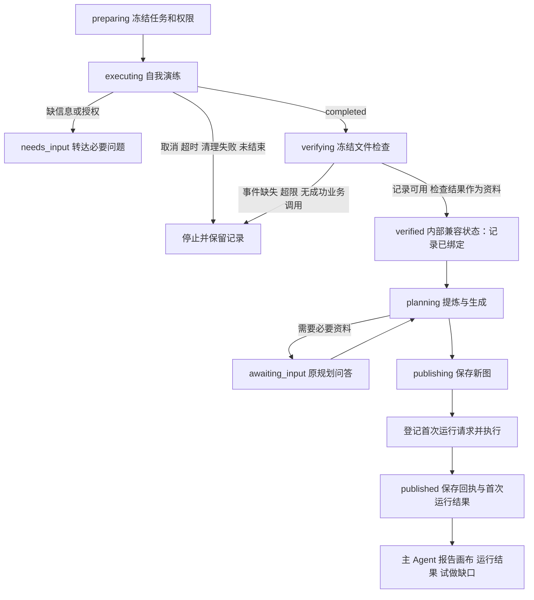

# 24、试做改为自我演练

日期：2026-10-25。任务：T24.5。状态：实现及离线回归完成，未进行真实模型或 Desktop 验收。本文覆盖[文档 18](../18-先执行验证再生成工作流.md)中试做复核、发布及首次运行的旧行为。

## 1、背景与用户决定

GitHub Trending Top 10 → Markdown 的 Desktop r26 曾保存带多余 human 节点的图；r27 因 `reviewItems → requiresReview → REVIEW_REQUIRED` 被迫加入人工节点，随后触发 T20 `REVIEW_BEFORE_EFFECT`，最终 `PLANNING_REPAIR_LIMIT`。这是本次任务提供的历史证据，不是本轮重新运行的结论。r26 的写入前读取问题另见[文档 22 §18](22-可组合模块片段.md#18r26-参数路径与规划写入检查2026-10-25)。不改历史 evidence 原件。

用户原话：

> 试做应该就只是agent自己尝试能不能跑通整个工作流，如果跑通了就直接做workflow不就行了吗，做完了再让人进行审核。而不是做一步审一步，agent试做的目的是为了让自己熟悉跑通这一套流程之后，再方便自己拆解工作流的步骤，以减少在创建工作流过程中不断试错的时间成本

用户确定的两项选择：

- 试做未完全跑通（例如网页截断、没有取得榜单）也生成工作流，最终清楚报告未跑通的步骤。
- 保存之后由 Agent 跑一次工作流，再把画布和运行结果交用户审核。采用 Host 确定性发起，避免依赖主 Agent 记得调用 run。

## 2、前后行为

| 情形 | 旧行为 | 新行为 |
| --- | --- | --- |
| 完整记录、冻结检查通过 | 生成预览 | 生成并保存新图，运行一次 |
| 完整记录、检查失败／无法核验 | 停止或要求复核 | 保留原报告和警告，继续生成 |
| 只有定性 reviewItems | 原生“试做结果复核”卡片 | 最终报告备注，不中途提问 |
| reviewItems 进入提炼 | 强制 requiresReview、人节点 | 原样保留备注；机械条件自动检查 |
| 用户要求每次运行人工审核 | human 与 T20 门禁 | 保持 human、REVIEW_REQUIRED、T20 |
| 缺少必要用户信息／授权 | needs_input | 保持提问；不自动续跑执行 child |
| 记录完整性失败 | 有时停在 needs_review | failed，清楚诊断，不用人审补证据 |
| 已有图提案 | 不执行 | 保持不执行 |

`execution.outcome=completed` 表示演练已结束，不表示所有业务步骤成功。驱动未正常结束、取消、超时、清理失败仍停止。输入不存在、启动前目标不安全仍拒绝启动，不能把授权或路径问题当成一般业务检查缺口。

## 3、状态机与完整性边界



保留事件数、字节数、业务调用配对、根／子身份、摘要和已成功业务工具调用要求。`TRIAL_EVIDENCE_INCOMPLETE` 或仅模型自报而无成功业务调用均停止；记录超限改为公开压缩，见下文。原因：这些情况缺少可可靠学习的记录，人工确认也不能补回丢失事件。成功调用的公开摘录被截断与丢失事件不同：若调用结果确实报告成功，仍可使用记录，但正文标记 unknown，不能假装看过完整内容。

冻结检查失败和无法核验只记录 `TRIAL_CHECK_WARNINGS`，不改检查结果、不降低检查标准、不增加修复次数。输入被改变也如实记录失败，而不是称试做符合只读约束。

## 4、试做记录与警告

保留内部 `verified-trial`、`verified`、`verification.verdict=needs-review` 名称和版本以兼容已有持久化数据；用户文案统一说明是“试做记录”。内部命名不构成验证通过声明。

- `conversation`：完整性通过的有界公开事件；工具结果仅是 reported-success，截断仍为 unknown。
- `trialTask`：冻结的 task、inputs、artifacts、reviewItems。
- `trialReport.verification`：原始 Host 检查报告，保留逐文件、逐项检查的 passed／failed／unverified、原因和限制。
- `trialReport.summary` 与 `summarySource=agent-claim`：试做 Agent 的逐步说明，明确不视为证明。
- `warnings`：说明报告存在缺口，并指出失败／无法核验的文件。完整检查明细仍在 verification，不能用一个总警告代替。

新 trial 的 `receiptVersion=2` 将 execution（含 summary）纳入回执摘要；旧版摘要算法保留。规划 context 校验报告摘要和 spec 摘要；provenance 额外绑定 trialReport。Host 继续核对来源当前记录，调用者不能上传或伪造验证状态。

## 5、reviewItems 与人工审核的开关

`reviewItems` 保留兼容字段，意义改为最终报告备注，主 Agent 无需为填这个字段询问用户。

开关在 `createProcedureCompiler(..., trialTask)` 与 `parseTaskProcedure(..., rehearsal)`：有 Host 绑定的 trialTask 时启用演练语义；未知或失败证据可以由最终备注解释，不再强制 requiresReview。提炼器仍检查冻结备注原样保留，但删除“至少一个 requiresReview”要求。legacy 输出路径与 typed compiler 使用同一规则。

`requiresReview` 本身不废弃：试做来源中只用于用户原始请求明确要求的运行时人工审核。`WorkflowPlanningService.coverageIssues` 继续对该标记执行 `REVIEW_REQUIRED`，必须映射到真实 human 节点。主 Agent、distill 与 author 提示一致，不能从 reviewItems 自动推断运行时审核要求。

- 数量、格式、回读相等、标题／链接存在等机械条件，由规划器设计 code／if 自动检查，失败时明确报错。
- 语气、内容质量等定性问题在最终报告提出，不创建运行时 human。
- 用户明确要求运行时审核，继续使用 human、T20 draft→review→commit 与 reviewed-file-write；不改其检查规则和固定行为。
- 非试做来源（包括 from_conversation）的未知证据／自身过程要求审核，保留原 requiresReview 与人审门禁。

节点仍只做标签所描述的动作；本任务不增加隐藏抓取模式或新 HTTP／HTML 会话工具。网页提示仅建议优先使用与工作流节点同源的抓取／HTML 工具（如可用），记录实际地址、选择器和字段。

## 6、保存后的首次运行

新 execute-first 规划请求使用 `preview:false`。current-conversation 仍仅允许 create 预览；design-only 和 revise 行为不变。规划缺少必要资料时仍使用现有问答，补齐后延续原任务发布。

`publishTask` 获得原子 `receipt.kind=created` 后，且来源为 verified-trial，调用 `runCreatedOnce`。先持久化 `firstRun={requestId:trial-first-规划ID,status:starting}`，再由 Host 复用运行服务：

1. 检查当前根会话、工作区、权限、保存版本、工具／模型一致性及资源就绪情况。
2. 使用空显式 inputs，让工作流声明的默认值生效；不猜必填值。
3. runtime.start 使用稳定 requestId；记录 runId 后等待 runtime.settle。沿用原运行归属、工具冻结和执行授权。
4. 成功、失败、waiting、暂停等真实运行状态从运行存储读取。不会回答 human、不补造输入、不额外重跑。取消／Host 关闭通过原信号取消在途首次运行。
5. 不论运行失败还是准入失败，已保存回执保留；失败不伪装成保存失败。准入失败存 FIRST_RUN_FAILED，不能自动重试。

规划／试做视图和回合收尾通知包含 `firstRun`：runId、运行状态、输出、每个节点状态／错误、缺失输入、human 提示和选项。最终报告同时包含画布摘要、首次运行结果和试做缺口。复用现有画布、运行详情与进度文案，不新建样式。

published 只有首次运行已结束或停在 waiting 等可报告状态后才正常发出。重复 start／publish／get 不再派发。proposed、普通 create、未保存预览均不触发。进程在登记与运行间崩溃时标 interrupted；即便保存成功但尚无首次运行记录，恢复也不补跑。已有 runId 可继续查看实际运行记录。这是保守的防重复策略，不宣称跨崩溃必定执行恰好一次。

## 7、旧记录与删除项

删除 trial-review.ts、options.review 接线与 visible_workflow_trial_review 工具。旧 schema 仍识别 needs_review 和 humanReview，不篡改历史人工回答。

旧 needs_review 恢复为 interrupted，附 `TRIAL_LEGACY_REVIEW_ENDED`，保留事件和检查报告。选择结束而非一键继续，是因为旧授权语义为“等人工确认后再继续”，重启不应把旧停车点自动升级为新生成／执行动作。用户可基于已有资料另行要求设计；不会重放原执行 child。其他旧 published/ready、摘要和来源继续可读，首次运行不追补。

## 8、测试与验证边界

离线测试使用临时目录和明确的模型／驱动替身；没有真实模型、Desktop 或实际 GitHub 网络验收。

覆盖：检查 failed／unverified 后生成并带警告；完整性／超限／无业务调用阻断；summary 来源及摘要绑定；reviewItems 无 human；明确运行时审核仍执行 REVIEW_REQUIRED；非试做来源审核保持；创建后运行一次、运行失败、等待输入／人工、重复请求／发布／重启防重；proposed 不运行；旧 needs_review 恢复。

本轮验证记录：

- `npm run -s typecheck`：最终通过。
- `npx vitest run … --maxWorkers=2` 扩展批次：30 文件，29 通过／1 失败，588／589 项通过。唯一失败为命令简报达到 8231 字节，超过原 8000 字节上限；压缩说明后修复，未提高上限。其余文件包含 T20、from_conversation、发布防重、历史恢复及 T24 回放。
- 最终定向复跑：6 文件／81 项全部通过；其中生产 Host 夹具创建并执行 10 次离线工作流，覆盖成功、失败、必填输入等待和显式 human 等待，实际模型调用为 0。重复请求和重启均未增加这些运行。
- `git diff --check`：通过。没有运行完整测试全集，没有遇到沙箱／权限拒绝。

最终定向命令：

```sh
npx vitest run tests/planning-command-brief.test.ts tests/trial-service.test.ts tests/planning-trial-evidence.test.ts tests/planning-host.test.ts tests/planning-entry-host.test.ts tests/trial-host.test.ts --maxWorkers=2
```

扩展批次另含：trial-audit-regressions、planning-procedure-review、planning-compiler、planning-service、trial-agent、planning-trial-verification、planning-ui-state、planning-task-join-adversarial、planning-task-join-host、planning-reviewed-file-module、planning-review、planning-stored-contracts、planning-background、planning-continuation、retrospective、retrospective-host、planning-agent、planning-ui、planning-host-preview-authorization、planning-host-audit-regressions、planning-host-updates、planning-host-output-contracts、planning-publication、t24-fragment-replay（均为 tests 下同名 .test.ts 文件）。

不能用离线替身宣称真实网页流程已经验证。冻结 manifest、基准配置、历史 evidence、tests/probes、cordis.patch.yml 均不修改。


## 9、修改文件

- Host 入口与视图：`src/host/index.ts`。
- 试做记录与提示：`src/host/planning/trial-service.ts`、`trial-evidence.ts`、`trial-agent.ts`；删除 `trial-review.ts`。
- 提炼、发布、运行与最终通知：`src/host/planning/service.ts`、`agent.ts`、`command-brief.ts`、`task-join.ts`、`ui-state.ts`。
- 共享合同：`src/shared/planning-types.ts`、`planning-trial.ts`、`planning-schema.ts`、`planning-procedure-compiler.ts`、`retrospective.ts`。
- 回归：`tests/trial-service.test.ts`、`trial-audit-regressions.test.ts`、`planning-trial-evidence.test.ts`、`planning-procedure-review.test.ts`、`planning-compiler.test.ts`、`planning-service.test.ts`、`planning-task-join-adversarial.test.ts`、`trial-host.test.ts`、`tests/fixtures/trial-host-fixture.ts`；删除 `tests/trial-review.test.ts`。
- 文档：本文、`doc/workflow-manual/规划引擎/18-先执行验证再生成工作流.md`、同设计目录 `tasks.md`。

未实现或注册 HTTP／HTML 会话工具；`validateTrialEntryTools`、`forbiddenTrialTool` 和原生工具目录过滤均未修改。Host 主指南与 trial ROLE 的网页提示仅使用通用能力描述，便于与独立工具工作树合并。


## 超限记录的公开压缩（2026-10-25）

Desktop r28 的试做本身已经跑通：文件写入成功，冻结检查也通过。但模型把缓存引用写错，走了一大段弯路，公开记录达到 58 条、约 38 KB，超过 100 条或 24 KB 的上限，整个任务因此失败，没有进入生成，约 7.5 分钟、88 万 token 白白耗掉。用户问：“为什么会超，超了为什么就做不了了？能不能让超了也能做？”

上限本身不变。这份记录会原样交给生成步骤的模型，并绑定摘要；生成出的每个步骤都要引用其中的记录，也要覆盖全部记录。记录过大会挤占生成提示，所以上限仍然保留。变化在于：演练的目的是学会能跑通的那条路，超限时就按这个目的公开压缩，而不是让整个任务失败。

`compactTrialEvidence` 只在超限时启用；未超限的记录逐字节不变，摘要也不变。

- **跑通的路径**：每个工具最后一次非失败的调用及其结果，整体完整保留。
- **其余记录**：较早的尝试、失败的调用和助手说明，统称“尝试”。
- **压缩顺序**：
  1. 先把尝试缩短，最低保留 120 个字符，并标注“已缩短”，状态改为 unknown；
  2. 仍超限时，从最早的尝试开始逐条折叠（不再逐条提供）；
  3. 再缩短跑通的路径，最低保留 300 个字符；
  4. 最后才从最早的记录开始折叠。
- **公开说明**：warnings 写明原有条数和大小、压缩方式，以及被折叠记录的编号范围和各工具调用次数，并注明“不代表这些步骤未发生”。
- **兜底**：压缩后仍放不下（例如没有任何记录）时，仍以 `TRIAL_EVIDENCE_TOO_LARGE` 停止。

用 r28 的真实记录离线回放：压缩后为 58 条中的 44 条、约 24 KB。最早 14 条尝试被折叠；最终的 `workflow_html_select`、`write`、`read` 和 `structured_output` 都保持原有摘录长度。试做提示中“最多再换两个公开镜像”的规则保留，用来控制试做耗时。


## 试做自行声明路径并提交方法（2026-10-25）

### 背景与决定

本节修正上一节把“最后一次非失败调用”称为跑通路径的口径。按本次提供的 Desktop r28 观察，报告成功的 `html.select` 实际使用了 Agent 从 Range 片段手工拼装的 HTML；另一次重试在提取失败后复制了旧报告。文件检查通过和工具返回成功均不能证明完整业务路径跑通。另一次独立 distill 调用约耗时 150–250 秒、输出约 14K Token；这些数字是本次提供的背景，不是本工作树重新实测。

用户决定：“试做记录最后交给生成工作流的应该是成功的路径，而不应该包括这些错误的信息”。具体采用由试做 Agent 声明、Host 核验的路径；失败和绕路原始事件仍保存在 trial 供历史审计，生成只收到路径以及一行排除计数。未跑通时保留卡住步骤最后失败调用，不能通过删去失败伪装完成。

速度决定：“merge the separate distillation model call into the end of the trial”。试做在最终 `structured_output` 同时提交方法，Host 直接复用 `createProcedureCompiler`，通过后不再启动独立提炼模型。

### 声明与引用

- `path`、`procedure` 均为可选字段，兼容旧 trial。最终提交总量仍为 20 KB，不改变提交/修复次数、推理强度及运行保护。path 最多 60 项，标签最多 200 字、原因最多 600 字；procedure 沿用现有字段数量、字符串、64 KB 及来源校验，总提交更小的 20 KB 限制仍优先。
- 路径项为 `{call,tool,label,status,workaround?,reason?}`。status 为 `success` 或 `failed`；手工拼装、复制输入、旧产物替代必须声明 `workaround:true` 和原因，最终报告计为“未跑通”。不得复制旧产物替代失败步骤。
- 调用编号由试做 Agent 自己计数：call N 指它本次试做发起的第 N 次工具调用，从 1 起按发起顺序计数，同一条消息中的并行调用按列出顺序，不含 structured_output。每项还须写明 `tool`；Host 按同一顺序（`trialCallIndex`）把编号唯一映射回 provider callId，工具名不符就判定路径无效。procedure 的 evidenceRefs 用 `cN` 引用路径调用，Host 在 `resolveEvidence` 中把它映射成该调用及其结果的 `e序号`；已有的 `e序号` 引用原样保留。
- 起初的实现在每轮 `system-prompt/assemble` 中追加 Host 调用索引。合并前复核发现，这会让系统提示每一步都变化，使模型请求的前缀缓存在每个试做步骤都失效，与提速目标相悖，因此改为自计数加工具名核对。工具结果正文、JSON 契约和持久事件都不改写；数错时由 Host 核对失败并回退，不会误用记录。
- 成功路径引用必须严格递增、无重复，属于本 trial，且调用与结果完整、闭合、非错误、非未知。末尾可有一个 `failed` 项，只接受对应工具最后一次完整失败调用。Host 不推断自然语言标签是否语义等价；由 Agent 说明哪个业务步骤卡住，Host 核验其实际引用。

### 证据、校验与回退

路径有效时只保留选中调用/结果的完整公开摘录，不带助手绕路说明和结构化输出；例如 `另有 16 次尝试已排除（workflow_http_request×9、workflow_html_select×7）`。既有公开脱敏、100 条/24 KB 限制不变；路径仍超限时使用 `compactTrialEvidence`，缩短内容仍标为 unknown，不声称保持完整证据。压缩可能移除 procedure 所引用的记录，随后同一编译器会拒绝该方法，回退以实际压缩后的路径证据提炼。

路径无效时记录带原因的 `TRIAL_PATH_INVALID`，按原逻辑对全体公开事件构建和压缩证据，再执行既有提炼；旧 trial 没有 path 时同样走原逻辑。路径有效但 procedure 无效或缺失时，仅基于路径证据执行既有提炼，绝不重新执行业务。无效 procedure 诊断为 `TRIAL_PROCEDURE_INVALID`。整个试做记录不完整等原有门禁继续生效，不因声明路径而忽略。

直接提交的方法也必须通过同一个 procedure compiler：evidenceRefs 只能引用实际传入的路径证据，每条记录归入步骤或 excluded；步骤依赖、规范引用、未知证据复核规则和冻结 reviewItems 原样保留要求均不变。方法通过后沿用原 procedure、sourceMap 和 provenanceDigest 生成及恢复校验；标记 `distillationSource: submitted-by-trial`。`distillationAttempts` 继续统计独立提炼阶段的实际提交，直接提交成功为 0，试做末尾的确定性校验不计入它；回退仍最多两次实际提炼提交，不增加修复次数。原始提交由试做 execution 回执摘要绑定，恢复时再次核验路径与方法来源。

`TRIAL_CHECK_WARNINGS`、firstRun、保留策略和旧记录行为保持原语义。绕行/失败缺口同时出现在路径 warnings、生成上下文和 trialReport 的路径摘要，主 Agent 最终应结合这些信息及首次运行真实状态报告。

### 离线验证

新增 `tests/trial-path.test.ts`，覆盖有效路径不调用 distill、完整路径证据和原 procedure 传递、来源映射与恢复、错误/逆序/失败调用回退、错误 procedure 使用路径证据回退、排除计数、绕行、失败尾步、旧记录和超限路径。`trial-agent.test.ts` 检查各步系统提示保持不变（保护前缀缓存），且 path/procedure 与原始结果都原样传递；`trial-path.test.ts` 另覆盖编号与工具不符的回退和 `cN` 映射。其余指定回归及类型检查的实际执行结果以本次交付报告为准；不进行真实模型或网络调用。
