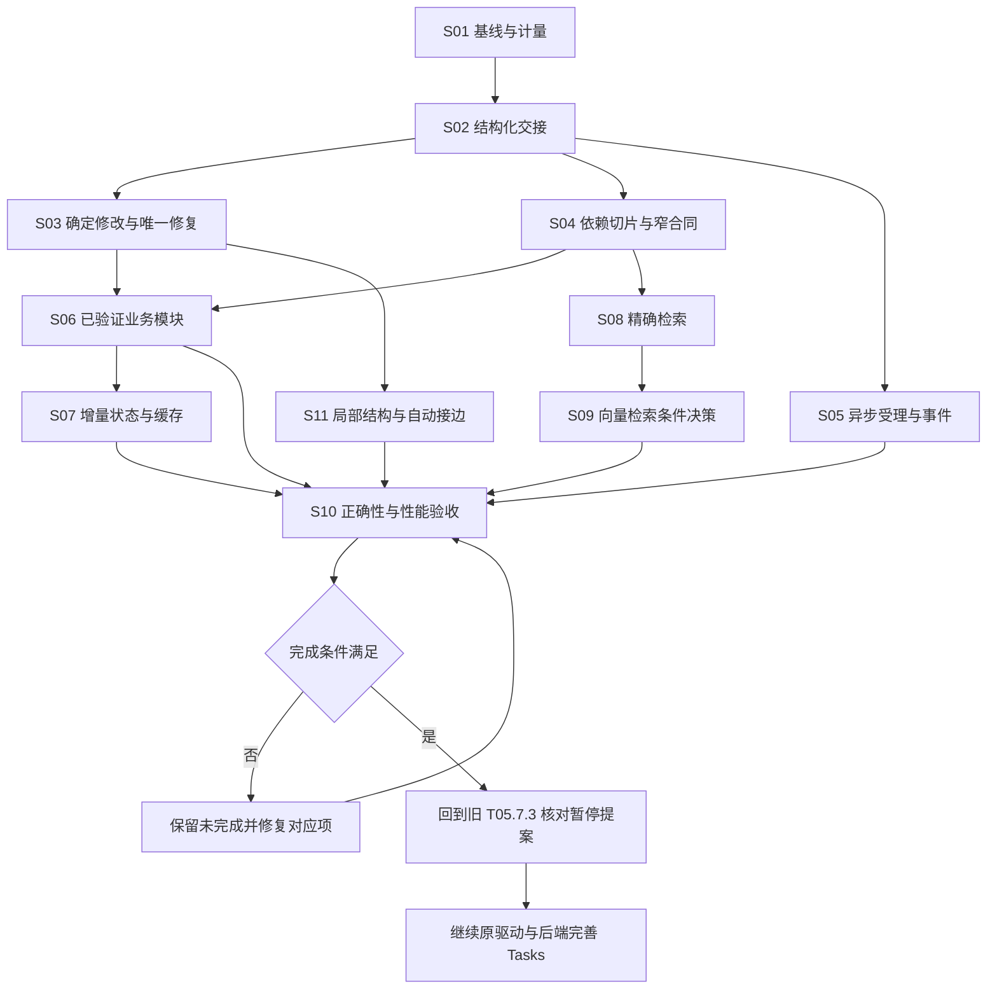

# 规划提速与上下文复用 Tasks

制定与合并日期：2026-10-19；最后核对：2026-10-20（Asia/Shanghai）。Desktop 启动认证故障已修复，原数据保留，speed10（0.0.2）已安装并正常重启。最终 Main 五对十回合已完成并归档：全十回合描述性减幅中位17.5660%，原20%目标未达到；B5额外一次字段格式修正，且裸姓名引用造成两条业务用例失败。原提案全部拒绝，保存基线不变。真实九节点读写与 code 域 SDK 验收已通过；单层字段别名、模板输入裸引用、单 node_id+fields 未返回字段三处问题已修复，新版唯一一次 Desktop 定向回归已通过，S04 与 S10.2 功能差集已补齐。本批实施、功能验收与旧任务入口移交已完成。按用户最新要求减少重复核验和过度门禁，不因单次格式错误重跑整批；旧失败与性能未达标状态保留，原 T05 可从已核对的待接受提案继续。

**2026-10-20 执行方式调整：减少过度门禁。** 依用户最新要求，已通过的功能与必要回归直接复用，不为单个修正重复全批模型测试。原“配对中位提速 20%”继续作为性能目标，十回合原结果仍为未达标；取消“必须先凑到该百分比才可移交旧 Tasks”的额外流程阻断。S10.4 记录测量完成、失败和后续优化，不能写成性能达标。权限、版本冲突、明确的人工作业复核与数据保留要求不受影响。

**2026-10-20 最新用户决定：移除预算系统。** 本条覆盖本文件之前关于预算选择、额度、增额及新对话重复询问的现行要求；此前预算授权与验收记录作为历史证据保留。新增 S12，按实现／兼容回归、保全更新 Desktop、实际验收的顺序完成；旧 T05 暂停顺序不变。实际 Token 用量统计保留，取消、超时、并发、步数、有限修复和工具权限不变。

**执行优先级：先完成本清单，再继续[驱动与后端完善 Tasks](tasks.md)。** 用户已指定这个先后顺序；原 T05 在本清单完成前保持暂停，完成后从 T05.7.3 的待接受提案核对继续，不重新试做。原任务的已完成标记、失败记录、预算选择和每次运行的真人复核分别保留。

本清单统一规划**确定操作直接编译、已验证模块实例化、未决业务逻辑局部补全**，以及所需的上下文、修复、异步与缓存能力。目标是减少重复模型工作和实际完成时间；工具立即返回、缓存建立、离线通过分别计量。

2026-10-20 用户确认增加[稳定 ID 与临时层次编号的局部结构编辑](11-稳定ID与临时层次编号的局部结构编辑.md)，并授权继续完成全部剩余项。新增 S11 负责结构操作、自动接边及输出映射；既有 S03 的字段操作不重复建设。S11 与 S04／S05／S07 并行推进，S10 统一集成验收，旧 T05 在本清单完成前继续暂停。验收可在现有工作区新建对话，不新增工作区。

已将[子 Agent 长响应优化研究](10-子Agent长响应优化研究与实施建议.md)的具体实施要求并入下列任务，不再另列“继承理解”“复制模板”“局部补全”等同义任务。研究文档保留原始论文和推导，本文件作为统一执行清单；完成标记只随实现和验收证据更新。

## 0、当前执行记录

### 0.1、最新进度与执行方式（2026-10-20）

用户已明确恢复执行，并要求减少过度防御和过度门禁。后续复用已通过的结果，只对实际改动及未覆盖功能做必要验证，不增加重复独立审核、冻结流程或整批模型重跑。数据保护、明确权限和真实结果记录继续保留。

- Desktop认证修复、保全安装与实际启动已完成；[暂停记录](../../../../docs/evidence/planning-completion-20261020/pause-after-b4-20261020.md)及[恢复读回](../../../../docs/evidence/planning-completion-20261020/lifecycle/resume-environment-20261020/resume-environment-readback-2026-10-20T05-57-35-958Z.json)作为历史证据保留。
- [最终Main批次](../../../../docs/evidence/planning-completion-20261020/performance/main-direct-vs-delegated/ACTUAL-main-batch-final-report-v3.md)：10个主回合已结束，原卡全部拒绝；全5对描述性减幅中位17.5660%，原冻结结果FAIL。B5首传config.text、随后改text；最终裸name导致Ada/Grace错误，不把格式修正或局部通过当成全批通过。
- 三处改进已完成并安装：[edit 单层字段别名](../../../../docs/evidence/planning-completion-20261020/context/edit-field-alias-source-handoff.md)、[未映射输入裸引用检查](../../../../docs/evidence/planning-completion-20261020/lifecycle/b5-input-alias-fix-summary.json)、[单节点字段读取与必要语义合同](../../../../docs/evidence/planning-completion-20261020/context/nodes-field-read-handoff.md)。相应定向检查及完整类型检查通过；[speed10 更新](../../../../docs/evidence/planning-completion-20261020/speed10/install-handoff.md)保留数据与版本。只补一次实际定向回归，不替换旧样本。
- [九节点真实读写](../../../../docs/evidence/planning-completion-20261020/lifecycle/read-write-focused/README.md)已完成：原提案接受为 v2，真实运行 success，仅 process.code 变化，native read/write/readback 与文件一致，不变分支保持；[code 域 SDK](../../../../docs/evidence/planning-completion-20261020/context/read-write-code-sdk-acceptance.md)为 1 child／1 request／0 查询／0 修复。S04 差集已补齐，旧 T05 未参与本批验收。

- [speed10 Desktop 定向回归](../../../../docs/evidence/planning-completion-20261020/speed10/desktop-focused/README.md)完成：nodes → edit → wait → get，单字段读取与单层 config 别名首传通过，0 词典／0 child，实际候选仅 text 改变且四例 4/4；原审核卡已拒绝，原图仍显示 v1。主回合 171.750 秒、5 步，工具往返合计 0.398 秒。
- **本批实现、功能验收及 S10.5 移交已完成；性能目标仍未达标。** 原 20% 目标、实际 17.5660% 与失败记录继续保留；当前瓶颈定位为主模型串行轮次与响应。按用户减少门禁的要求，性能欠项不再阻塞功能移交，不追加整批重复试验来凑指标。[S10.5 当前入口核对](../../../../docs/evidence/planning-completion-20261020/lifecycle/t05-speed10-handoff.md)确认原图 rev1、提案 pending、候选摘要和四个文件不变，speed10 生产校验 issues=[]。可从原 T05.7.3 继续；接受／运行仍记在原清单，本次未接受或运行旧提案。

### 0.2、历史执行记录（保留各时点边界）

以下speed6b等早期快照保留原始状态；当前状态以0.1及下方任务勾选为准。

本轮使用 GPT-6.1-sol / high 分工，保留原工作区改动和[修改前源码基线](../../../../docs/evidence/planning-speed-20261019/source-baseline.json)。上一轮安装为speed6b，前驱speed5b，版本仍0.0.2；speed5及speed6均保留为superseded、从未安装。S01、S02、S03、S06、S08的组件范围已完成，S09评估后暂不引入向量；S12完成；S11已补齐本轮组件证据；S05.3因本轮实际问答路由缺口重新打开，S04、S07、S10按各自实机边界保持未完成。组件、功能和部署完成不代替冻结的整体性能门槛。

| 任务 | 已具备证据 | 剩余边界 |
| --- | --- | --- |
| S01 | 分段计量、预登记和 v3 initial／combined、v4 单批回执均已归档；GLM-5.3-Flash / Max 设置固定 | 供应商实际生效 effort、queue／prefill 与完整 Main 端到端 unknown |
| S02 / S03 | 版本化 edit／partial／module 与直接编译；initial typed B 5/5、零新增规划调用；确定编辑已有 Desktop 提案接受和业务运行 | v1 业务实例与新 v2 completion 分开；v2 已有 ready／严格差异／本地三组 oracle，未发布接受或执行真实业务 |
| S04 / S08 | 切片、focused／换型合同、授权批读及固定查询集；speed4b 原生 nodes 三调用及一个自然语言标题修改路由已完成 | 跨容器输出变化／150 节点联合检索等实机范围未覆盖；单例自然路由不代表全部画布入口，字节缩减不等于提速 |
| S05 | 后台受理、事件长轮询；实机重复请求、queued／生成中取消；M3同task澄清至发布／接受／业务结果；S11原卡拒绝／接受 | 当轮plan_wait已实际等待published及child结束后Main才收尾；turn-stopping兜底有独立离线覆盖；活动Quit旧miss保留 |
| S06 | 结构化表格模块 v1 及参数更新 v2 各两组实际运行；首次业务代码 v1 四组实际 case 通过 | 模块范围限已验证目录，不提前关闭原 T18 通用合同 |
| S07 | checkpoint／累计步数与有限修复计数、本地失效检查；真实端点 cachedPromptTokens；恢复同 ID／interrupted／null usage、未观察到重放 | 恢复身份不证明活动中断或 delta 语义续接；完整冷／热、换模型、失效端到端矩阵待补 |
| S09 | 本批评估完成，暂不引入向量；精确／结构查询保留 | 语义改写未命中的限制明确；有真实标注查询证据后再评估 |
| S10 | speed6b最终全量2,298/2,298、类型／构建与独立包审查；已安装／重启，四bundle／树／metadata、七项及166/166文件保全 | 新预算移除／Main等待实机通过，未自动接受／运行候选；活动Quit及其他差集待补；V5 FAIL、Main E2E unknown，T05不恢复 |
| S11 | native chain→nodes→splice零规划child；原卡拒绝／接受、编号、90%显式保存及S11 Ada真实运行已独立核对 | 结构／运行通过，整体strict因旧预算时间戳差异仍false；speed6b新发布路径已严格通过，旧失败不回写 |
| S12 | 预算工具／问答／额度执行及界面移除，实际用量保留；2,298/2,298，安装保全及新对话规划／原卡拒绝／确定性运行通过 | 完成；旧字段和文件仅兼容保留，供应商余额错误仍如实返回；未扩大到所有通用DSH子Agent |

2026-10-20 早期增量：speed5 已构建打包，版本仍 0.0.2；Host／client／scripts 类型检查和编译包 smoke 通过。新增安全 SDK payload 摘要、Host 初始合同去重、真实 socket 丢响应重连测试。S11 确定结构编译不启动规划子 Agent，沿用审核提案；独立审查修复了 LLM 包装字段类型被声明覆盖、工具不存在输出被同类合同误放行两项反例。[本地 S11 量化](../../../../docs/evidence/planning-chain-20261020/chain-splice-local.json)显示合法 31／150／500 节点候选编译中位约 6.31／22.56／78.39ms；层次草稿减少编号写入，但 CPU 慢于合成 eager 对照，不能宣称本地加速。[合同去重与 SDK 观测](../../../../docs/evidence/planning-speed-20261019/context-contract-observability-20261020/README.md)、[联合重连证据](../../../../docs/evidence/planning-speed-20261019/lifecycle-offline-20261020/README.md)均为离线证据。该阶段曾因锁屏等待；随后已解锁并完成下述 speed5b 安装／重启。原卡片和输入区样式未再改动。

2026-10-20 接受路径复核：真实 Storage／Editor 栈发现 candidate 的原 output `a-3` 在 accept 后变为 `a-5`；补内部审核保存入口后，纯视口自动保存仍会重编号且 revision／updatedAt 不变。S11.5 据此重新打开；正在共享原存储事务修复审核保存和严格导航保存边界。speed5 构建包保留为 superseded、从未安装，下一包为独立 speed5b，前驱仍为 speed4b。旧性能测试曾把当前已升级安装目录当历史基线，修正为读取冻结的旧基线后，[本次全量回归 2,271/2,271](../../../../docs/evidence/planning-speed-20261019/speed5-full-tests-final.json)通过；该次回归启动早于本次接受／导航修复，未按 speed5b 最终冻结源码执行，不代替 speed5b 回归。

独立 [V5 合同去重配对批次](../../../../docs/evidence/planning-speed-20261019/s10-dedup-v5-20261020/review-and-run.md)已按冻结计划完成唯一批次，结果见[最终分析](../../../../docs/evidence/planning-speed-20261019/s10-dedup-v5-20261020/analysis.md)。唯一处理是 Host 已验证初始 prompt 的两段重复合同改用精确引用，两臂保留相同完整系统规则／Schema／语法；隔离快照不随当前编号修复改变。保留旧 v3／v4 结果与 20% 门槛；完整五对门槛未通过；局部 provider 测量不等于 Desktop／Main 端到端。

2026-10-20 最终代码复核：S11.5 接受／导航修复和独立 chain 编号摘要已完成，重新勾选实现项。新增 chain 摘要绑定稳定 ID→显示编号，纯导航不改摘要，同 revision 重新编号仍拒绝旧请求。[实现方 128/128](../../../../docs/evidence/planning-chain-20261020/acceptance-numbering/verification-observed.json)与[独立实际存储复核](../../../../docs/evidence/planning-chain-20261020/acceptance-numbering-independent/README.md)分列；最终冻结源码全量 [2,282/2,282](../../../../docs/evidence/planning-speed-20261019/speed5b-full-tests.json)、完整类型检查、构建通过，不覆盖旧报告。speed5b 包 SHA256 `a25561f434b6b2e6952ea1d5afa4de3bff14e40ed76d5be2ef945a4ddaef53d4`，source manifest SHA256 `ed140afb92beb61b796d1e59efffb5d37932bc0963a25771a75834715f3ed1bd`；该最终包现已安装，正常重启及保全见下段。最后一次 [S11 本地成本复核](../../../../docs/evidence/planning-chain-20261020/chain-splice-final-local.json)的合法 31／150／500 节点编译中位 7.18／23.54／81.96ms；这是独立本地观察，不以两报告差值推断修复成本。

2026-10-20 实际安装与 M3 进度：[speed5b 安装后独立核对](../../../../docs/evidence/planning-speed-20261019/desktop-speed5b/independent-post-install-review.md)确认四 bundle／完整树／metadata 与安装 journal 一致，七项保全及固定158/158文件均通过；[主任务 GUI 记录](../../../../docs/evidence/planning-speed-20261019/desktop-speed5b/gui-readiness-observation.json)确认正常退出安装后已正常重启。M3 在同一既有工作区新 root `session-84101755-4740-42a4-9840-fe4fd9397e2c` 已按 nodes→plan 受理 request `m3-depth-clarify-speed5b-20261020`、task `9fde4206-a032-4f7e-b7bb-0132c8b28e86`；[公开调用独立核对](../../../../docs/evidence/planning-speed-20261019/desktop-incremental-20261020/20261020T002050959Z-84e82b/independent-review.json)只证明初次 queued 受理与绑定，随后主任务已确认真实原生问题卡到达，尚待真人回答。该早期公开快照未采到问题／答案，不回写其 false／null；同 task 回答、delta、最终 SDK metrics、候选／发布／运行仍待。此为初次受理时点；后续 M3 ready 与 S11 原生执行见下述增量，活动 Quit 待，V5 FAIL／Main E2E unknown／旧 T05 暂停保持。

2026-10-20 后续增量：M3 真人已在本任务选择「差额 item − threshold，预期 [0,4]」；[真实 get 独立核对](../../../../docs/evidence/planning-speed-20261019/desktop-incremental-20261020/20261020T003015220Z-6f1a9e/independent-m3-get-analysis.md)确认原 task ready、revision21、两次 child／两步、26,359 reported Token，以及严格三处授权变化。Desktop 原生问题卡的具体提交来源未被完整记录，不能从模型 summary 宣称真人直接点击；首轮至第二 child 的间隔不等于精确真人等待。第二次 SDK 初始上下文仍带重复合同，此问题已修复但尚未安装。S11 已完成[原 UI 操作记录](../../../../docs/evidence/planning-speed-20261019/desktop-final-acceptance-20261020/s11-ui-observations.json)：拒绝标题提案使定义严格不变，结构提案接受为 rev3、实际编号 a-1/a-2/a-5/a-4/a-3 保留；显式保存只改视口。原 UI 无 name 的输出 `S11 ` 单列，带 name=` Ada ` 的实际 run `31794bb6-3725-4554-a839-316d07e9df8a` 输出 `S11 Ada`，独立记录核对收尾中。任务候选与提案存在相同预算选择时间戳重写，保留严格差异，修复待安装。S05.3 新增主 Agent 等待真实结果的边界，历史受理后结束的合成测试指令不再作为产品默认。

2026-10-20 本轮收尾增量：[M3独立发布与运行](../../../../docs/evidence/planning-speed-20261019/desktop-final-acceptance-20261020/m3-observed/independent-report.md)确认proposal `e64676d4-dddf-4994-bd2d-f9aa555cef43`原卡接受为rev3，run `b3c280b8-52f3-4924-ade3-54621c8d7d35`与保存图严格一致，Graphon success、JSON文本`[0,4]`，34 success／4正常分支skipped。Main两次run请求中首次数值类型被schema拒绝、第二次字符串类型创建唯一实际run，不能声称零请求修正。[S11独立结果](../../../../docs/evidence/planning-speed-20261019/desktop-final-acceptance-20261020/s11-observed/final-verification/independent-report.md)确认结构、编号与Ada运行通过，但旧task candidate→proposal仅预算时间戳差异使整体strict仍false。以下早期增量保留其原观察时点，不代表当前仍待回答或未执行。

剩余 Desktop 检查已合并为[最小增量执行安排](../../../../docs/evidence/planning-speed-20261019/desktop-final-acceptance-20261020/plan.md)：深层输出合同＋同任务真人澄清、S11 递归操作＋原卡片审核／拒绝与结果、活动 Quit 时序。复用已有 socket／权限与业务证据，不重新建工作区或重复整套运行。

表 0-1 原始证据及判定边界

| 证据组 | 当前结论与入口 |
| --- | --- |
| 源码、回归与历史交付 | [首轮 2,097/2,101](../../../../docs/evidence/planning-speed-20261019/integration-vitest.json)、[第二轮 2,149/2,150](../../../../docs/evidence/planning-speed-20261019/integration-second-vitest.json)、[原最终 2,179/2,181](../../../../docs/evidence/planning-speed-20261019/integration-final-vitest.json)不改写为全量通过。两项旧预期分别修正为“查询不扩大 focused 合同”和“越工作区授权拒绝、零 driver／零新增状态”，定向 3 文件 21/21；[v3 冻结离线 56/56](../../../../docs/evidence/planning-speed-20261019/s10-v3-offline-regression.json)。[speed1 交付／保全](../../../../docs/evidence/planning-speed-20261019/desktop-install/installed-bundles.json)、[speed2 展示清理](../../../../docs/evidence/planning-speed-20261019/desktop-ui-cleanup/README.md)、[speed3 交付](../../../../docs/evidence/planning-speed-20261019/desktop-speed3/README.md)保留历史时点，不当作当前安装。 |
| 历史 speed5b 安装与入口指引 | [speed5b 安装记录](../../../../docs/evidence/planning-speed-20261019/desktop-speed5b/README.md)：从已安装 speed4b 正常退出、固定158文件停机备份、安装／metadata apply并正常重启；[独立实际核对](../../../../docs/evidence/planning-speed-20261019/desktop-speed5b/independent-installed-verification.json)确认四 bundle／tree／metadata／journal，[七项保全](../../../../docs/evidence/planning-speed-20261019/desktop-speed5b/independent-preservation-after-install.json)及[158/158文件](../../../../docs/evidence/planning-speed-20261019/desktop-speed5b/independent-fixed-158-after-install.json)通过。speed5 superseded且从未安装；speed4b既有安装／实机记录继续作为历史证据。安装包括 chain／splice与安全SDK摘要入口，不代表其真实业务已验收。 |
| 已安装原生读取 | [nodes 预检](../../../../docs/evidence/planning-speed-20261019/desktop-live/20261019T153715264Z-47d4c1/native-read-preflight-result.md)：精确 stable ID 唯一定位、三节点 fields=[code] 批读成功，identity 同为 revision2；第三次 expected_revision=1 返回 REVISION_CONFLICT，无重试。工具 32／37／12ms，主回合 39.958s、reported total 已知和 79,914；无规划 child 不等于主模型零用量。这是明确指定工具的合同检查，不证明自然路由或复杂检索。 |
| 取消与重复请求 | [生命周期回执](../../../../docs/evidence/planning-speed-20261019/desktop-lifecycle-live/20261019T154436071Z-b94ad7/lifecycle-report.md)：相同 ACTIVE request 返回原 ID／acceptedAt；QUEUED 未启动 child 即取消，ACTIVE 在真实模型步骤开始后取消，child aborted 早于 cancel 返回。两任务随后 get 仍 cancelled，无候选／发布；这些 get 在重启前，不包装成恢复后状态。ACTIVE 子 usage=null、unknownUsageCalls=1，spentTokens=0 不等于模型零消耗。 |
| Quit 时序与恢复 | 同份[生命周期回执](../../../../docs/evidence/planning-speed-20261019/desktop-lifecycle-live/20261019T154436071Z-b94ad7/lifecycle-report.md)：restart child 于正常 Quit 前 **8.256s 已 completed**，活动中断验收为 miss。恢复真实 get 与同请求重提均返回原 ID／requestId／acceptedAt、revision1、interrupted／PREVIEW_EXPIRED；recoveredWithoutUsage=true，用量／steps／childAttempts 等均 null，不补 0。Quit 后两份快照的 child 集合、压缩 session SHA、公开 events／max seq 相同，未观察到重放；Quit 前已有 usage 不回填恢复 Host。目标 flow／proposal／budget／run 哈希守恒。取消／提交／恢复 Main 回合 98.543／19.018／31.290s，reported total 已知和 303,761，与子调用及毫秒工具成本分列。 |
| 已接受业务实例与模块 | [六组实际运行](../../../../docs/evidence/planning-speed-20261019/desktop-live/20261019T141458794Z-7d103d/six-runtime-actuals.md)：31／deep 两份提案 actual accepted、保存 v2，四组修改后运行及模块 v1 两组均 Graphon success、运行图与保存图一致。[模块参数更新](../../../../docs/evidence/planning-speed-20261019/desktop-live/20261019T143139969Z-ab98a0/module-update-accepted-runtime.json)另有 v2 两组 success；仅 specification、revision／updatedAt 和对应 provenance 参数摘要变化，固定实现／版本／稳定身份／预算保持。模块新增规划调用零不等于 Main 模型零。 |
| strict 与业务守恒 | [原 strict passed=false](../../../../docs/evidence/planning-speed-20261019/desktop-live/20261019T141458794Z-7d103d/accepted-runtime-oracles.json)保留；[两层核对](../../../../docs/evidence/planning-speed-20261019/desktop-live/20261019T141458794Z-7d103d/definition-conservation-two-layer.json)确认 31／module 仅在 editor 原缺失处补精确默认 viewport／scopePath，业务定义守恒通过；deep 原 strict 通过。不得一般忽略 editor／布局，不将业务 pass 回写为原 strict true，实际写入时点未观察。 |
| 首次业务代码 v1 | [真实 ready](../../../../docs/evidence/planning-speed-20261019/desktop-live/20261019T143139969Z-ab98a0/first-code-real-ready-receipt.json)、[严格候选守恒](../../../../docs/evidence/planning-speed-20261019/desktop-live/20261019T143139969Z-ab98a0/first-code-candidate-conservation.json)及[四组隔离 oracle](../../../../docs/evidence/planning-speed-20261019/desktop-live/20261019T143139969Z-ab98a0/first-code-isolated-runtime-oracles.json)：44.752s、1 子调用、8,987 reported Token、输入 29,061 bytes；仅已确定 title 与未决 code 变化。[发布预算核对](../../../../docs/evidence/planning-speed-20261019/desktop-live/20261019T144600686Z-910132/first-code-publish-budget-review.json)单列真人 unlimited／executionPolicy 新增；[接受及 UI 无输入](../../../../docs/evidence/planning-speed-20261019/desktop-live/20261019T144804905Z-e9a61a/first-code-accepted-missing-runtime.json)与[另三组实际输入](../../../../docs/evidence/planning-speed-20261019/desktop-live/20261019T145348026Z-6e395d/first-code-four-real-runtime-oracles.json)合计四组 actual Graphon success。无输入由 UI 规范为空串，不冒称 JS undefined；后续 Main 回合 52.928s。该证据限 v1，不覆盖新 v2 completion。 |
| 独立 v2 changed 候选 | [真实 task 回执](../../../../docs/evidence/planning-speed-20261019/desktop-live/20261019T155500719Z-87729d/completion-v2-task.json)为 Host ready，completion／handoff issues 空；[独立核对](../../../../docs/evidence/planning-speed-20261019/desktop-live/20261019T155500719Z-87729d/completion-v2-result.md)严格仅 `/nodes/2/config/code` 变化，生产 QuickJS 的 Ada／全空白／缺失三组本地 oracle 3/3。受理至 ready 23.914s，1 child／1 step、9,265 reported Token、输入 33,645 bytes，unknown／pending=0；ready 后 300.114s 才取回结果是协调等待，不归入模型生成。不是配对提速证据，未发布／接受、未执行真实 Graphon 业务，也不证明原生澄清续接。与 v1 实际业务及重启 interrupted 分开。 |
| 自然语言确定标题修改 | [终态与路由核对](../../../../docs/evidence/planning-speed-20261019/desktop-live/20261019T160506136Z-56d7d7/natural-title-final-result.md)：界面可见请求与登记自然语言一致，给定已保存 revision2、稳定 ID 和完整新标题，没有指定工具；原生 Agent 选择 `visible_workflow_edit`，仅一条 `set-title`，没有先读整图或启动规划 child。工具公开往返 84ms，受理至 ready 89ms；严格差异仅 `/nodes/2/title`，前一未保存的小写代码未混入。Main 提交回合 24.914s、查询回合 30.229s，ready 后 134.293s 才 get 的协调／查询间隔分列；两回合均已 completed。仅此自然路由单例，未覆盖画布批注 serializer，不将 89ms 写成完整任务耗时。未发布、接受或运行。 |
| v3 initial／combined | [initial](../../../../docs/evidence/planning-speed-20261019/s10-initial-v3-analysis.md)：typed B 5/5／0 planner；context-only 两臂各 3/5，四个失败完整保留；输入减少 17.86%、Schema 0%，双方成功配对仅 n=1。[combined](../../../../docs/evidence/planning-speed-20261019/s10-combined-v3-analysis.md)：各 5/5、请求 6/6，A 一次 repair、B 一次 query，累计相等不代表逐对无增加；输入／Schema 减少 71.90%／81.75%，达到原 30% 门槛，但五对 B 均慢，配对局部耗时中位增加 75.50%，未达减时 20%。首 pair 23.457s 公开窗口重叠保留，不删样本或归因为服务器争用。 |
| v4 语法单变量 | [冻结与运行](../../../../docs/evidence/planning-speed-20261019/s10-syntax-v4-20261019/review-and-run.md)、[分析／原始哈希](../../../../docs/evidence/planning-speed-20261019/s10-syntax-v4-20261019/analysis.md)：唯一批次 A／B 各 5/5、oracle 各 20/20，请求 9/5、repair 1/0、query 2/0、逐对请求未增加；配对局部减时中位 **17.93% 未达冻结 20%**，组中位数比 22.58% 不替代。provider round-trip 各占 wall >99.96%，compiler 累计 178.270／128.551ms。两臂同窄 Schema、仅同源 syntax 有无不同、B 首轮输入增加；共同合法 v1 prompt 交接，未启 v2 completion，也非真实 service partial。供应商 error=0，全部额外请求保留；调度错开仅有主任务 attestation，服务端并发 unknown。局部 proxy 不等于 Main 端到端，旧 v3 阈值／失败不变，不续批凑指标。 |
| v5 初始合同去重 | [最终分析](../../../../docs/evidence/planning-speed-20261019/s10-dedup-v5-20261020/analysis.md)：258/258 冻结文件匹配；10 请求无重试，A／B 各 4/5，仅 3/5 完整成功配对。第 3 对 A 编译接受但 oracle 2/4，最后 B HTTP 500／usage 未知，均保留；三个成功配对的描述性减幅中位 −22.83%，不能替代完整五对，20% gate false。query／repair 均 0，B 整臂 Token 总量未知；Node 紧凑 body 22,600→20,734 bytes 是本地序列化估量，HTTP wire 未捕获。provider round-trip 占尝试 wall >99.9%；该局部实验未证明整体提速，不覆盖当前 speed5b 的接受／编号修复、native SDK 或 Main E2E。 |

**speed6b阶段的限制与后续（历史）：** 当时交付见[speed6b安装与166文件保全](../../../../docs/evidence/planning-speed-20261019/desktop-speed6b/README.md)。输入区独立规划展示继续删除，保留原右侧审核卡。M3与S11真实发布／接受／运行及拒绝已覆盖，原始strict差异和M3请求类型修正保留。S12取消预算门禁，权限、提案审核、真人业务复核保留。运行Token为0不表示主模型为0；完整Main对照端到端、活动Quit及未覆盖矩阵继续开放，不接受或运行旧T05提案来补本批验收。

S02.4 继续保留受控 spawn：当前适配要求 provider 明确 inheritsParentContext=false 及独立工具／输出／深度合同；seed／fork 历史、withInitiator 归属不等同该合同，未发现必须带完整主历史的验收案例，不额外引入 fork 实验。S09.2—S09.3 本批不适用：固定集精确／结构查询满足，语义改写限制明示，暂无向量总体收益证据。[计量回归](../../../../docs/evidence/planning-speed-20261019/metrics-regression.json)、[固定查询集](../../../../docs/evidence/planning-speed-20261019/node-search-results.json)、[旧编译器本地字节对照](../../../../docs/evidence/planning-speed-20261019/context-schema-bytes.md)继续复用，本地字节不是实际提速证明。

2026-10-20 本轮收口证据见[独立验收目录](../../../../docs/evidence/planning-completion-20261020/README.md)。模板局部变量修复先经独立审查发现未闭合括号、空循环输入、重复 else 三类保守性缺口，再修正验证；初次反例和沙箱监听失败均保留。新协议只适用于一个明确授权的未决字段，业务值仍由模型生成，不能绕过 changed completion、范围及整图校验。性能实验固定原模型／Max、同业务与 oracle，五对 AB／BA 交错，独立于完整 Main 回合测量；不降低原 20% 门槛。
## 1、目标与任务映射

### 1.1、用户要求与落地位置

表 1-1 改造范围与优先级

| 优先级 | 改造 | 主要收益 | 对应任务 | 建议 |
| --- | --- | --- | --- | --- |
| P0 | 统一分段计量与配对实验设计 | 明确模型、工具、修复和等待的成本 | S01 | ✅ 先做 |
| P0 | 交接已确定操作、约束和未决项，由 Host 路由 | 减少主子 Agent 重复规划与无效往返 | S02 | ✅ 优先 |
| P0 | 类型化修改和语义唯一的局部修复直接编译 | 消除确定操作的额外规划调用 | S03 | ✅ 优先 |
| P0 | 稳定 ID＋临时层次编号，Host 执行局部结构操作 | 减少节点插入／替换／删除时的手工接边与引用重写 | S11 | ✅ 本轮新增 |
| P0 | 依赖切片、必要合同预取、生成与修复的窄 Schema | 减少模型输入、选择范围与错误往返 | S04 | ✅ 优先 |
| P0 | 规划立即返回任务 ID，事件唤醒长轮询更新进度 | 主对话不再长期悬停 | S05 | ✅ 同批 |
| P1 | 后端实例化已验证业务模块，只填写参数 | 复用固定代码与子图，减少重复生成 | S06 | ✅ 紧接 S03／S04 |
| P1 | 增量状态与分层缓存 | 复用已确定决定、合同和输入前缀 | S07 | ✅ 基础稳定后 |
| P1 | 精确节点检索，接入共用切片与批量读取 | 提高定位准确度，减少整图读取 | S08 | ✅ 推荐 |
| P2 | 在模糊定位场景增加向量混合检索 | 改善语义召回 | S09 | 按实测引入 |
| 收口 | 共用实验矩阵完成正确性、性能与 Desktop 验收 | 证明整体收益，再恢复旧 Tasks | S10 | ✅ 统一验收 |

### 1.2、设计约束

1. 主 Agent 已明确给出的决定转换为可校验操作；仅转述用户需求不算已完成方案设计。不为生成交接摘要额外启动一个模型。
2. 明确字段修改和已验证模块参数填写由驱动完成；确有未决业务逻辑才使用子 Agent。“新增规划调用为 0”从 Host 收到完整确定操作起计，不排除主对话理解成本。
3. 主 Agent 的交接内容是修改意图和依据，不是运行成功证明或授权。Host 仍负责版本、范围、固定节点、引用、工具合同和最终图校验。
4. 保留当前 Workflow JSON、Graphon、共享编译核心和正常提案接受机制。新增直接修改入口不等于允许直接写存储或绕过规划服务。
5. 当前已有同一子 Agent 局部修复、RepairSession、targetNodeIds 聚焦及 BRANCH_PORT 专项诊断；在其上补窄合同和有限候选，不重复建设。结构上唯一合法的修复不一定符合业务意图，自动应用必须同时满足已确定业务约束。
6. DSH 会话层有 fork，但当前受控规划器明确要求不继承主历史的 spawn。完整 fork 仅作有条件的比较项；历史复制不等于继承模型内部计算状态或保证缓存命中。
7. 开发辅助 Agent 如需使用，按用户要求采用 GPT-6.1-sol，思考程度至少 high。被测规划模型与思考强度单独冻结，不通过偷偷降低强度宣称架构提速。

### 1.3、合并后的职责边界

表 1-2 同义要求的唯一归属

| 合并的要求 | 负责事项 | 复用关系 |
| --- | --- | --- |
| 继承主 Agent 理解、避免重复规划、明确任务路由 | S02 定义决定／未决项合同与路由 | S07 只负责该合同的持久化和增量续接 |
| 简单修改、直接字段操作、无需模型的唯一修复 | S03 执行确定操作并统一编译 | 多解修复转 S04 的有限候选，仍需业务选择时交给子 Agent |
| 临时编号、片段插入／替换／删除、自动接边与输出映射 | S11 维护版本绑定的局部结构意图 | 复用 S03 编译与提案、S04 合同、S07 失效、S08 身份定位，不另建运行图 |
| 上下文裁剪、Schema 去重、模板预取、限制修复范围 | S04 装配必要输入和窄输出合同 | S08 返回目标身份，S07 缓存同一套装配结果 |
| 复制模板、模块化填写、复用固定业务代码 | S06 保存并实例化版本化业务模块 | 复用现有基础节点模板及共享编译核心 |
| 各方案的计量、性能比较和最终验收 | S01 定义计量与实验规则，S10 执行和归档 | 各实现项的局部检查结果共用，不重复跑同一实机用例 |

程序切片用于 S04；Sketch／CEGIS 的约束补全及 Synquid 的类型剪枝用于 S03／S04；Voyager 的可执行技能库用于 S06；ReWOO／LLMCompiler 的显式依赖与机械调度用于 S02／S04；前缀缓存用于 S07。以上是机制借鉴，不新增并行框架。DreamCoder 自动库学习、服务端 KV 引擎迁移不作为本批交付项。

## 2、已知基线与证据边界

表 2-1 制定清单时的已有证据

| 项目 | 已知事实 | 不能据此得出的结论 |
| --- | --- | --- |
| 安装 | 最近核查为 Desktop v0.0.2 / template10，实际任务使用 template-fill | 不代表其他 profile 已启用，也不代表本清单已实现 |
| 单字段修改 | 31 节点样例规划约 42 秒，模型响应约 35.8 秒，编译约 35 毫秒 | 不能用单次记录代表稳定性能 |
| 结构修复 | 最近问候修复约 9 分 32 秒；模型响应约 9 分 30.8 秒；记录的序列化输入体积 265,512 字节 | 输入体积不是 Token；不能全部归因于模板；模型响应时间不是纯思考时间 |
| 等待方式 | start / answer 等待本轮生成结束；同 requestId 的活动任务也等待原结果 | 仅删 await 不构成正确的后台任务实现 |
| 上下文 | 已支持显式 targetNodeIds 聚焦；未限定时仍提供全图配置；编辑 Schema 为节点重复展开模板替换分支 | 已有差量输出不代表输入已经精简 |
| 原任务暂停点 | T05.7.2 静态与纯编译核查通过；提案未接受，修后业务未运行 | 不得勾选 T05 或把静态结果当实机运行通过 |

依据：[分段耗时对比](../../../../docs/evidence/backend-batch2-20261019/t05-planning-comparison.json)、[最新历史快照](../../../../docs/evidence/backend-batch2-20261019/live/20261019T093233100Z-e979b0/planning.json)、[T05 暂停快照](../../../../docs/evidence/backend-batch2-20261019/t05-pause-state.json)。这些是制定清单时读取的历史证据；执行 S01 时重新核对当前构建和状态，不覆盖原始记录。

补充基线：[子 Agent 耗时统计与排序](../../../../docs/evidence/subagent-timing-20261019/REPORT.md)已对冻结记录中的 14 个子会话分别统计任务、模型响应阶段及实际工具执行时间，提供离线复算脚本。7 个规划／提炼子会话约 99.93% 的时间落在模型响应区间；全部 23 次子会话工具执行合计 718 毫秒。此项仅完成既有记录分析，不能据此勾选 S01 的计量补齐或配对实验，也不恢复原 T05。

[模板填写行为核验](../../../../docs/evidence/subagent-timing-20261019/template-submission-audit.md)进一步对齐 4 个规划子会话的 8 次响应与公开工具参数：新建使用 forms，编辑使用 addForms/updates，修复使用 patches；没有原始整图提交。新建仍需生成业务代码与配置；两条端口补丁则在同一子会话、已有 34,560 缓存读取 Token 的情况下响应 293.887 秒。两次模板查询前的响应分别为 306.512 秒、223.432 秒，四次查询工具共 67 毫秒。因此 S03 消除确定调用，S04 收窄决定范围并预取必要合同，S06 复用业务实现；不能把所有长响应归为复制模板或把缓存命中当作提速证明。

## 3、分层执行任务

### 3.1、P0：减少重复模型工作并改造等待方式

- [x] **S01 · 冻结基线、补齐分段计量和比较规则。**
  - [x] **S01.1** 核对源码、安装包、有效编译模式、供应商、模型、思考设置和任务归属；区分宿主配置与供应商确认的生效信息，后者不可见则标未知。保存本批基线与旧 T05 暂停状态，复用原 T08 配对驱动和公共回执。
  - [x] **S01.2** 按同一调用身份记录主 Agent 交接、受理、Host 排队、上下文装配、模型请求／重试、首个有效内容、模型结束、工具、编译和发布时间。区分首个有效正文与工具参数；first-observed-delta 不当作首个有效 Token。供应商内部排队／prefill 不可观测时写未知，嵌套阶段不重复累计。
  - [x] **S01.3** 按调用记录可确认的输入、输出、推理与缓存 Token，缺项为未知；分别计量消息和工具 Schema 字节，以及模型请求数、子 Agent 数、目录读取数、修复数和重复内容比例。失败／取消／超时保留耗时、用量及归属，不只保留成功运行。
  - [x] **S01.4** 按第 4.2 节共用实验矩阵冻结案例、配对顺序、重复次数、正确性检查及性能门槛。端到端时间计入主 Agent 交接，真人等待单列；受理时间单独报告。硬门槛：完整确定修改及参数齐全的已验证模块新增规划调用为 0，受理不等待模型，无关内容和成功率不得退化；其他输入／时间改善门槛在实验前登记。

  **验收与产物：** 无模型夹具证明时序、用量去重、失败 / 取消留存正确；形成实验清单和分段报告格式。小样本结果不宣称生产 P95；后续不能根据结果回调预登记门槛。

- [x] **S02 · 增加主 Agent 到后端的结构化交接合同。**
  - [x] **S02.1** 定义带版本的交接结构：workflowId、expectedRevision、requestId、稳定节点身份、确定操作、新值、约束、依据引用、必要输出合同和未决项。保留用户要求的来源；主 Agent 在当前响应中给出决定，不另启摘要 Agent。展示编号先绑定到对应图版本的稳定 ID。
  - [x] **S02.2** Host 根据合同路由到 S03 确定编辑、S06 模块填写或子 Agent 未决逻辑；不为明确路由再调用规划模型。按 ReWOO／LLMCompiler 的思路让 Host 组织可确定依赖与结果引用；S04 准备必要合同，子 Agent 只补未决部分，真正开放的新任务才进入完整规划。
  - [x] **S02.3** 缺字段、版本漂移、目标歧义或决定冲突返回明确诊断；保留有效草稿和已确定内容。不得自动扩大目标范围、重建全图或以新 requestId 反复重做。对业务约束的必要核对仍保留。
  - [x] **S02.4** 核对 fork 的可用接入合同、切点和工具隔离。只在依赖集中历史的案例中评估是否值得比较完整 fork；若没有接入条件或没有收益，记录原因并保留受控 spawn。不得只更换 provider 字符串，不把 fork 作为完成本清单的强制能力。

  **验收与产物：** 版本化合同、入口指引及路由检查；支持且完整的确定请求直接进入编译路径，未决请求保留固定约束。不丢人工环节、输出合同或明确目标；合同不足返回缺口，不隐式扩展任务。

- [x] **S03 · 确定修改与语义唯一的局部修复直接编译。**
  - [x] **S03.1** 为主 Agent 提供类型化修改操作，冻结首批支持的标题、文本和已知参数字段；统一经过现有 AuthoringCore、版本／范围与完整图校验、提案发布，返回差异、摘要和检查结果。直接操作不暴露任意存储路径，也不自动接受提案。
  - [x] **S03.2** 定义嵌套对象、数组及字段删除的精确语义，保留未提交值；绑定 Host 节点身份与图版本，重复 requestId 返回同一结果。明确操作以差量提交，不要求模型重写完整图。
  - [x] **S03.3** 复用 RepairSession 增加有限的确定修复规则：只有已知业务意图、合法合同和修复语义共同确定唯一结果时，Host 才生成局部补丁并重新校验。沿用草稿版本、allowedPaths、提交额度和停滞检测；多解交给 S04 窄修复合同，业务缺口明确返回。当前 chain／BRANCH_PORT 诊断作为起点，不做盲目的布尔值与字符串互转。
  - [x] **S03.4** 覆盖单／多字段、多个明确节点、非法类型、固定节点、越范围、过期版本、重复提交，以及唯一修复、多解拒绝和修后仍失败。分支修复核对正常边、容器及已定业务约束；直接路径不满足条件时返回缺口，不静默升级规划或重建全图。

  **验收与产物：** 支持场景的后端新增模型调用和规划子 Agent 启动均为 0；差异精确，无关节点 / 连线 / 宿主字段保持不变；Desktop 能正常查看和接受合成提案。

- [x] **S04 · 统一依赖切片、合同预取及生成／修复的窄 Schema。**
  - [x] **S04.1** 按程序切片思路扩展现有 targetNodeIds 聚焦：用稳定 ID 建立数据、控制和容器依赖索引，根据目标字段装配必要上下游合同。输出／拓扑变化包含受影响下游；动态依赖不明时保守扩展。只读依赖与修改权限分开，完整图保留在 Host 做最终校验，片段按集合批量读取。
  - [x] **S04.2** 为改字段、换型、新建、模块填写及局部修复分别生成必要合同。借鉴 Sketch／CEGIS 与 Synquid，将修复限定为具体路径、预期／实际类型、合法端口或引用候选；核对模板层与编译层路径映射。多个候选仍需选择时只开放对应空位，新业务代码只开放必要逻辑；不把 Schema 报错当作形式化语义反例，也不依赖供应商一定支持约束解码。
  - [x] **S04.3** 统一提示正文、工具 Schema、目录与历史中的合同来源，按模板 ID／版本共享定义；同类型字段修改不展开所有换型分支。检查 SDK 实际发送结果，若 $ref 被展开或不支持则改合同形状；减少的是模型收到的重复内容，不能只在本地源码去重。
  - [x] **S04.4** 根据 S02 已确定节点／操作，限量批量预取必要模板、工具合同和片段；只有未知资料才追加查询。覆盖大图、跨容器、分支、输出变化及局部修复，比较首轮输入增加与模型往返减少；检查端口候选、错误定位和依赖完整性，避免以裁剪牺牲正确性。

  **当前实现证据：** [切片与缓存回归](../../../../tests/planning-context-slice.test.ts)、[focused 合同与换型兼容回归](../../../../tests/planning-template-focused.test.ts)、[嵌套 handoff 回归](../../../../tests/planning-handoff.test.ts)覆盖固定祖先、稳定 ID、嵌套 loop 输出向下游传播、动态依赖保守扩展及查询模板不扩大字段任务。显式换型退出 focused 后可删除旧类型的多个字段，SDK 子集校验与完整编译结果一致。主／子读工具复用共用切片，命中仍核对授权；[生产 Host 预览授权测试](../../../../tests/planning-host-preview-authorization.test.ts)覆盖删除、工作区迁移、revision／同版本摘要变化拒绝，保留只读预览和历史非预览回执可读。S04.3／S04.4 已有 initial 和 combined 的局部配对观察：combined 实际请求字节及 Schema 缩减通过本批门槛，但 context-only 初始失败保留、combined 局部等待退化，speed8实际SDK每轮task prompt／compiler rules／template access各1份，Schema 5718B、refs0，S04.3差集已补齐，见[逐项关闭映射](../../../../docs/evidence/planning-completion-20261020/context/s04-s07-closeout-map.md)。复杂正确性复用与输入、往返、修复负结果分别列明；完整端到端性能仍归S10，不因输入缩减关闭整体性能验收。

  **验收与产物：** 一套共用切片／批量读取实现及操作级 Schema；报告消息／Schema 字节、模型往返、修复轮数与正确性差异，达到 S01 预登记门槛。合法范围以外的补丁被拒绝，修改 text 不再展开无关模板，完整图约束仍生效。

- [x] **S05 · 将规划改为立即受理、后台执行和事件唤醒长轮询。**
  - [x] **S05.1** 拆分受理与完成结果，持久化任务身份后返回 taskId、状态和版本；重复提交返回同一活动任务身份。旧入口和新返回合同明确版本，主 Agent 不因误判未完成而重试新请求。
  - [x] **S05.2** 使用宿主支持的任务生命周期管理后台工作；覆盖调用返回后的存活、用户取消、权限变化、超时、关闭和重启 interrupted 状态。不能通过取消父信号关联来留下无主任务。
  - [x] **S05.3** 用事件更新排队、提炼、生成、修复、检查和完成状态；需要用户输入时暂停到相应状态，终态通知可去重。主对话不靠高频模型轮询维持进度，状态查询默认返回紧凑结果。按 2026-10-20 新增要求，主 Agent 收到 taskId 后须等待本轮规划子任务结束，读取真实结果并核验后才结束对话；任务级事件等待与宿主支持的回合结束保护配合，不能仅依赖提示词。原生问题交给真人，失败／取消／中断明确报告，不能补写成功。保留工具快速受理，不将后台存活等同于主回合可以提前收尾。
  - [x] **S05.4** 校验受理后立即取消、排队取消、生成中取消、重复请求、重启、通知断开重连及权限撤销；增加主 Agent 提前停止时仍等待任务终态、同任务真人问答、等待取消／权限撤销及无重复终态汇报。主对话不得在收到 taskId 时声称候选已生成或发布成功，也不得在仍有本轮子任务执行时把任务交回用户。

  **本轮追加修复与验收：** speed7的cap=5实机出现Main复制Host问题、正确revision仍收到误导性变化诊断，以及第二child误读答案来源；[原失败](../../../../docs/evidence/planning-completion-20261020/context/native-question-routing-bug.md)完整保留。speed8公开 `native-pending`／`manual`／`settling`，原生待答明确拒绝手动重试，同任务问题／答案批次由Host校验绑定。[speed8真实续接](../../../../docs/evidence/planning-completion-20261020/context/speed8-cap-final-analysis.md)确认：原卡答5，同task到ready/rev21；Main未复制问卡、未调用plan_answer、未猜revision；第一回合在人审暂停且child已结束时交接，后续回合在第二child结束、读取最终回执后结束。严格候选守恒及三组Graphon离线核验通过。结合原活动取消／重启、等待保护和故障回归，S05.3与父项关闭。

  **历史新增范围：** S05.3原有UI事件传递的实现与证据保留；此前因新增主回合等待／结束保护要求而重新打开，随后由上述回归及实机证据补齐。此前若干受理验收指令明确要求主回合提前结束，这属于受理生命周期测试，不能作为普通协作默认行为。活动 Quit 测试另记录正常关闭的取消边界，不要求正常任务提前结束来迁就测试。

  **当前实现及实机证据：** [后台服务夹具](../../../../tests/planning-speed-service.test.ts)及[生命周期回归](../../../../tests/planning-service.test.ts)覆盖受理／幂等、取消、原生问答、关闭、权限变化及恢复；[受理事务故障](../../../../tests/planning-admission-faults.test.ts)覆盖写入失败不 dispatch、已持久化身份改 interrupted、续接受理失败恢复可答状态；[Host 后台归属](../../../../tests/planning-background.test.ts)覆盖受理前取消、精确父身份、deadline 及关闭等待清理；[journal 等待](../../../../tests/planning-ui-state.test.ts)、[客户端续接](../../../../tests/planning-ui.test.ts)、[原提案审核回归](../../../../tests/proposal-review-client.test.tsx)及[生产 Host 等待后授权](../../../../tests/planning-host-updates.test.ts)已有局部通过记录。实现复用同一 epoch／cursor journal，以同 workspace／session 事件唤醒最多 20 秒的长轮询；全局最多 128、同 owner 最多 4 个等待，dispose 清理。客户端单请求在途，成功后短延迟续接、错误退避，旧适配保留 3 秒查询；不发送模型轮询。此项是事件驱动长轮询，不是 WebSocket push。输入区的独立进度组件及其旧展示测试已删除；无可见 renderer 时，ready／published 仍消费，提案回执仍刷新原审核卡片，新建回执仍通知，不自动接受或切换画布。S05.1—S05.2 保留已完成的实现及列明的局部证据；S05.3 原 UI 传递证据保留，新增主回合等待已随speed6b部署并完成同task实机终态时序核对；[speed4b 生命周期实测](../../../../docs/evidence/planning-speed-20261019/desktop-lifecycle-live/20261019T154436071Z-b94ad7/lifecycle-report.md)已验证重复请求、queued／生成中取消，以及preview恢复原 ID／interrupted／全 null usage和未观察到重放。旧活动Quit前child已结束8.256秒、A工具拒绝未退出、B实际Quit晚于child9.744秒的miss全部保留。[C活动正常退出及speed7重启独立报告](../../../../docs/evidence/planning-completion-20261020/lifecycle/c-post-restart-report.md)补齐真实child活动中正常GUI确认关闭，Host持久cancelled/rev9；重启后原root真实get／原request完整重复／get均为同ID、原acceptedAt和cancelled，保留steps1／child1／38923bytes／unknownUsageCalls1，未观察到新task／child或原child事件增量，168/168保存文件hash不变。正常关闭取消与异常重启interrupted分别成立，不能混写。原生问答同task续接和原卡拒绝已有M3／S11／S12实机证据；受理立即取消、通知真实loopback断连／去重、等待取消／权限撤销及无重复终态由本轮隔离生产边界回归补齐，见[逐项证据矩阵](../../../../docs/evidence/planning-completion-20261020/lifecycle/traceability.md)。这些生命周期边界验收通过；S05.3原生问答新缺口随后由speed8实机补齐，见上述最终续接报告。未把离线边界称为额外 Desktop 权限操作、OS 强杀或跨平台实机通过。

  **验收与产物：** 延迟 / 挂起模型夹具证明工具先返回且无重复执行；Desktop 能看到实际进度并取消。分别报告受理耗时和完整规划耗时，不将前者替代提速结论。

### 3.2、P1：模块复用、缓存与准确定位

- [x] **S06 · 后端复制并实例化已验证的版本化业务模块。**
  - [x] **S06.1** 在现有字段模板之上保存可执行业务模块，借鉴 Voyager 技能库与固定骨架补全：不可变 ID／版本、固定节点／代码／连线、参数槽位、输入输出、适用条件、工具合同版本、必要人审及验证证据。Agent 只提供模块身份、参数和必要连接，Host 复制实现并生成实例身份。
  - [x] **S06.2** 人工选定少量需求明确的首批模块候选，例如文件写入与回读核对、结构化结果渲染；补全已有目标先读、不存在时首建等前置条件，保留每次必要人审。候选通过独立运行验证后才能进入已验证目录；不把旧 T05 静态通过的修后图当成已验收模块，不提前关闭原 T18 通用合同任务。
  - [x] **S06.3** 通过共享编译核心展开模块，并记录实例到模块版本的来源映射；参数修改只产生对应受控差异，不要求模型重写固定实现或默默升级旧实例。超出参数能力的新业务返回未决项，由 S02／S04 路由局部补全；新实现经验证后再考虑纳入模块库。
  - [x] **S06.4** 验证同模块不同参数、固定实现一致性、实例身份隔离、重复执行、参数错误、合同漂移及旧版本读取。记录模块适用范围和真实运行证据，编译通过不单独授予已验证状态；自动学习抽取公共子图留待后续，不纳入本批阻塞条件。

  **当前实机证据：** 结构化表格 `structured-result-table@1.0.0` 已有 v1 两组与参数更新 v2 两组真实运行；v2 提案 actual accepted，严格核对仅 specification 参数及接受后的 revision／updatedAt 变化，provenance 参数摘要相应变化，implementationDigest／版本／节点身份和原预算不变，详见上方模块更新回执。额外规划调用为零只描述模块路径；首次新业务代码用了 1 次真实子调用，已有 ready／严格守恒／四组隔离 oracle，后已实际发布、接受及 UI 无输入运行，后续新对话三组输入也已通过，合计首次代码四组实际业务 case。S06 的首批模块目录与参数实例化范围完成；原 T18 通用合同不提前关闭，不扩展为自动学习模块已实现。

  **验收与产物：** 模块目录和编译入口；已支持参数填写不启动额外规划模型；固定实现保持版本一致。完整输出和每次必要人审不因模块化丢失。

- [x] **S07 · 建立增量任务状态及分层缓存。**
  - [x] **S07.1** 持久化 S02 已确定决定、草稿版本、已加载合同、已满足约束和未决项；续接只发送 delta 与本轮局部诊断，不另造交接协议。复用 RepairSession，版本／归属变化时重新核对，不跨任务复用旧权限或未核实业务结果。
  - [x] **S07.2** 对 S04 共用装配结果做内容哈希与依赖失效缓存；键覆盖工作区／可见范围、图／草稿版本、目标字段、模块及工具合同版本。更新、删除、换型、权限和容器变化触发相应失效，命中仍经过当前授权核对。
  - [x] **S07.3** 稳定公共提示、工具顺序及序列化，将任务 delta 放在后面，同时保留 SDK／供应商要求的会话结构。核对实际端点的前缀缓存能力和命中回执，分别计量本地构建缓存与供应商输入缓存；不把历史 fork、模板哈希或 RadixAttention 论文能力当作当前服务的 KV 复用证明。
  - [x] **S07.4** 按共用矩阵检查冷／热缓存、同任务续接、独立任务、模型切换和失效场景，记录命中与端到端耗时。缓存只优化对应构建或输入阶段，未生成的输出仍需计算；不以本地毫秒级节省替代候选生成收益。

  **当前覆盖边界：** [本地缓存检查](../../../../tests/planning-context-slice.test.ts)覆盖冷读／命中、容量／体积、返回副本、独立 reader 隔离、命中仍授权，以及内容／移动／删除／权限范围／revision／合同变化失效；[checkpoint 续接](../../../../tests/planning-continuation.test.ts)和[服务续接夹具](../../../../tests/planning-speed-service.test.ts)覆盖同任务草稿、合同、累计额度／停滞、native-answer 与 restart-then-manual-answer 只发送 delta，以及模型／图／工具／归属变化拒绝复用。[请求计量](../../../../tests/planning-agent.test.ts)、[用量计量](../../../../tests/planning-metrics.test.ts)保留有效模型历史与未知缓存用量。既有 [combined 实际缓存回执复用核对](../../../../docs/evidence/planning-speed-20261019/desktop-live/20261019T144600686Z-910132/combined-cache-observation-reuse.json)已记录真实端点 cachedPromptTokens：各臂首见请求均0，后续每轮首请求 A=11328／B=3008，12条 call-end 与 report 一致，可复用为首见零／后续 reported-hit 观察，无须为此重复调用。该值来自实际 usage，不来自提示哈希；未主动 flush，不能据此称完整冷缓存／KV内部机制、稳定公共前缀／工具顺序已验收或命中导致提速。真实 Desktop 重启后的同 ID／interrupted／null usage 与未观察到重放已有 §0 生命周期回执；它不证明原生问答或草稿 delta 的语义续接。speed8同task原生问答续接已通过，两轮shared contract／实际prefix均14532B且摘要、工具顺序、Schema稳定；本次cache仍unknown，不作KV因果推断。S07.3差集已补齐并关闭；[GLM-5.3独立任务实机](../../../../docs/evidence/planning-completion-20261020/context/speed8-alternate-final-analysis.json)已补齐：新root／task／child，真实descriptor为glm-5.3/max，严格仅改code；三组生产Graphon离线候选结果[0,10]、[12,6]、[0,3,15,18]，未带入cap=5，保存实体不变。Main99.448s、child34.610s分别记录，不跨模型作配对提速归因。受控冷flush及内部KV不可观测的限制保留，S07.4与父项在上述可控矩阵范围关闭；本案另外发现多余llm预取1605B，归S04.4的speed9修复，不混写为隔离失败。

  **验收与产物：** 缓存合同、失效测试和实际命中报告；无串工作区、旧版本或失效工具内容误用。供应商无可观测命中时保留未知，不能宣称 KV 复用成功。

- [x] **S08 · 精确定位节点并接入共用上下文读取。**
  - [x] **S08.1** 画布选中、批注、节点 ID 优先；无精确 ID 时按名称、类型、工具 ID、字段和容器检索，返回精简候选及匹配依据。
  - [x] **S08.2** 将查到的稳定 ID 接入 S04 已有的切片／批量读取接口，不再实现第二套依赖遍历。先按当前可见图版本读取，S07 就绪后复用其失效机制；缓存不作为精确定位的前置条件，展示编号不能脱离版本当稳定 ID 使用。
  - [x] **S08.3** 覆盖重名、深层容器、节点移动 / 删除、旧版本、中文描述及目标歧义；歧义不能默选一个节点修改。
  - [x] **S08.4** 用固定查询集记录定位正确率、读取轮数、返回体积和检索耗时，为 S09 是否有必要提供基线。

  **当前实机覆盖：** [speed4b 原生 nodes 预检](../../../../docs/evidence/planning-speed-20261019/desktop-live/20261019T153715264Z-47d4c1/native-read-preflight-result.md)已通过精确 ID 定位、必要 code 字段三节点批读及旧 revision 拒绝，无工具重试。工具合计 81ms 与 Main 39.958s 分列。结合固定查询集、歧义拒绝、150 节点离线图和身份／依赖批读回归，S08 原定工具与查询集范围完成；自然标题修改又验证已知 ID 可直接编辑，但不证明语义查询或画布批注 serializer。跨容器输出变化／150 节点联合实机矩阵继续归 S04／S10，不将其缺口隐去，也不为关闭 S08 重跑同一固定集。

  **验收与产物：** 精确检索工具和查询集；明确 ID 查询不经模型猜测；模糊结果最终绑定经版本核对的稳定节点 ID。

### 3.3、P2：按证据决定向量检索

- [x] **S09 · 评估并按需引入向量混合检索。**
  - [x] **S09.1** 分析 S08 的失败与耗时，确认是否存在关键词 / 结构检索不能满足的模糊语义定位。记录是否实施的决定及证据；没有必要可关闭本项为“评估完成、暂不引入”，不能写成向量能力已实现。
  - **S09.2 · 条件实施（本批不适用）** S09.1评估未触发引入条件；以下为以后必要时的约束，不表示已实现向量能力：将关键词与向量候选合并排序；先按工作流、版本和可见范围过滤，精确 ID 不走近似匹配。索引只含所需节点说明和字段摘要，内容变化增量更新，不无条件发送真实业务数据到外部服务。
  - **S09.3 · 条件验收（本批不适用）** 本批未启用向量索引；若以后实施，须与同一 S08 查询集比较召回、误选、耗时和索引维护成本。未提升正确率或整体收益不足时保留精确检索，并明确撤回 / 不启用原因。

  **关闭规则：** 必须完成 S09.1 的决定。只有决定引入时 S09.2—S09.3 才为必做；决定不引入时明确标注“不适用及原因”，不勾选为已实现。本项不得无限阻塞回到原 Tasks。

### 3.4、补充 P0：局部结构编辑

- [x] **S11 · 稳定 ID 与临时层次编号驱动局部结构编辑。**
  - [x] **S11.1** 将用户算法与已确认适配方案写入[设计文档](11-稳定ID与临时层次编号的局部结构编辑.md)：区分稳定 ID、草稿编号与实际画布编号，明确分支和数据引用边界，不将编号当运行拓扑。
  - [x] **S11.2** 建立带基线摘要、工作流／草稿版本的有效编号与退休编号映射；支持数值分段比较、前插／后插、替换、删除、递归展开及一次规范化。原节点保留时 ID 不变，新 ID 由 Host 分配；失败步骤无半更新，旧父编号和旧版本拒绝。
  - [x] **S11.3** 从稳定锚点／明确边 ID 读取局部顺序段，复用节点模板填写与共享编译核心，机械生成局部连线差量。支持明确分支边的片段插入；歧义、多入口多出口、跨 scope 或固定节点不得猜测或笛卡尔重接。Agent 不回传整图或完整旧链。
  - [x] **S11.4** 支持明确的旧输出→新输出映射，由后端按既有引用语法统一更新消费者，并检查类型、可达性、scope 和允许修改范围。无映射的存量引用、不可安全分析的动态引用给具体诊断；不全字符串替换、不自动选最后节点或同名字段。
  - [x] **S11.5** 接入原规划任务、幂等、候选与修改请求卡片；保留发布／接受门禁，预算按S12移除。返回临时编号、连续片段别名、稳定 ID 和实际画布编号对应表；候选形成后不在接受阶段另改编号或图。新增确定结构操作不启动规划子 Agent。
  - [x] **S11.6** 覆盖设计表 7-1、31／150／500 算法规模及合法生产图限制，记录本地成本、Agent 提交量和新增规划调用；在既有工作区完成合成提案及结果核对，与 S10 共用证据。新处理对照单独预登记，旧 v3／v4 结果及 20% 门槛保持。

  **组件验收判定：** [S11.6独立结论](../../../../docs/evidence/planning-completion-20261020/lifecycle/s11-component-conclusion.md)及[设计表7-1逐项矩阵](../../../../docs/evidence/planning-completion-20261020/lifecycle/traceability.md)确认组件完成：全功能／安全边界有离线生产覆盖，新增local-shadow误拒绝及不可靠模板遮罩修复后本组98/98、独立84/84和typecheck通过，最终代码已随speed7安装并核对675文件／四bundle／metadata与保全；既有speed5b真实chain提案、原卡拒绝／接受、编号、显式保存和Ada结果可复用。31／150／500历史本地成本不标为新增scan耗时；确定结构操作新增规划调用0与Main成本未知分列。旧task→proposal的budget时间戳strict false、旧首次90%未落盘观察及历史性能FAIL原样保留，actual pending proposal→accepted saved严格一致单列。S11组件完成不等于S10完整Main端到端或20%性能门槛通过，不因此恢复／接受／运行旧T05。

  **验收与产物：** 可调用的结构编辑合同及驱动，版本与引用安全检查，候选映射／差异，独立功能结果和成本记录。只有明确、完整且支持的操作才能零规划调用直接编译；复杂业务缺口不得伪装为成功。S11 不重做 S03 字段编辑，也不借此改动全局图格式、引入向量或自动模块学习。

### 3.5、新增 P0：移除预算系统

- [x] **S12 · 移除工作流预算选择与额度执行机制。**
  - [x] **S12.1** 删除新建／修改／发布预算问答、prepare／budget 工具、增额 Remote 与指引；主对话归属、工作区权限、候选摘要、审核提案、人工业务复核保留。新建不生成 budgetDecision；旧图相同字段保留为历史，不再参与授权。
  - [x] **S12.2** 运行与规划不再注入 Token 总额／每任务额度，取消 Token 预留与超预算暂停、累计任务配额。保留实际用量及未知回执，不将旧估算充当实际消耗；保留取消、超时、并发、步数、循环与有限修复保护。
  - [x] **S12.3** 删除预算选择、额度编辑、调额按钮、调度账本和失效文案；保留简洁实际用量显示与有效执行策略，不留下无效设置。旧 budget_waiting 显示兼容暂停并允许正常继续／停止。
  - [x] **S12.4** 旧 JSON、历史 run／proposal／预算文件可读且不批量改写。旧额度字段不影响运行或恢复语义；真正活动任务重启中断与权限检查仍生效。删除只服务于已移除预算系统的源码和过期测试，用兼容与无门禁回归替换。
  - [x] **S12.5** 完成集成类型／功能检查、构建和保全安装；在现有 S10 工作区验证无重复预算问答、原审核卡可用、用量仍可读，并与 S05.3 的主 Agent 等待共用实机证据。新会话可用，不新增工作区、不改历史性能门槛。

  **实现证据：** [预算移除说明](../../../../docs/evidence/budget-removal-20261020/implementation.md)及[最终全量 2,298/2,298](../../../../docs/evidence/budget-removal-20261020/full-tests-final.json)。首轮 2,294/2,298 的四项旧预算测试预期保留在独立报告中；修正后最终全量、完整类型检查与构建通过。兼容验证包括旧低额度不限制调用、真实／未知／待回执用量、恢复不重放、原权限与业务复核。S12.1—S12.4为实现及组件验收完成；S12.5由下述安装与Desktop证据关闭。

  **实际交付与验收：** [speed6b独立安装后核对](../../../../docs/evidence/planning-speed-20261019/desktop-speed6b/independent-postinstall/review.md)确认完整树／四bundle／metadata以及166/166旧文件和七项保全通过。[实际Desktop独立报告](../../../../docs/evidence/budget-removal-20261020/desktop-observed/desktop-final-report-v3.md)确认既有S10新对话的一次规划无预算问答，1child／1step；Main实际wait 47.508秒，child完成、published回执及完整候选get均先于Main终态。候选→实际提案严格全等，未再改写旧预算时间戳；原卡拒绝后deep严格等于M3原rev3。新包额外执行现有五节点图，GUI未提供可选name，实际输出`S11 `（保留尾空格），不计Ada用例。UI执行策略与用量面板由root实际观察，历史budget_waiting兼容仍为离线证据；保留所有旧严格失败及性能未达标记录，不将本例用于关闭整体提速门槛。

  **历史进展（speed5b时点）：** 当时仅完成源码删除、尚待集成旧数据兼容与恢复反例，Desktop仍含原预算系统。随后speed6b完成预算移除的保全安装与真实入口验收；当前speed8继续保留无预算门禁、实际用量和历史兼容，此早期记录不代表当前部署状态。

### 3.6、收口：真实验收与回到原清单

- [x] **S10 · 完成正确性、实际耗时及 Desktop 验收，再交回旧 Tasks。**
  - [x] **S10.1** 先完成受影响的合同 / 路由 / 生命周期 / 缓存失效检查、类型检查和构建；保持旧编译模式和旧任务可读，覆盖新入口与原入口相同的最终校验。不在本批顺带退出 legacy 或切换全局默认。
  - [x] **S10.2** 按第 4.2 节共用矩阵完成独立合成场景的 Desktop 验收，复用各实现项已有证据，仅对新变更或未覆盖行为补测。安装前后核对历史数据；不接受或运行旧 T05 提案来凑本批验收。按 S12 验证预算系统已移除，不再为新工作流或新对话询问执行预算；业务语义澄清与真人质量复核保留。
  - [x] **S10.3** 执行 S01 预登记的单变量对照后再测组合方案；模型、思考设置、案例、工具合同和成功标准一致，按 AB／BA 顺序交错，记录供应商错误及时间窗口。保留失败／取消／超时和主 Agent 成本；冷／热缓存分列，报告探索样本中位数与范围。fork 仅在 S02.4 决定比较时加入，不能用受理变快代替生成变快。
  - [x] **S10.4** 完成正确性与性能实测，归档原始回执、指标、失败和限制，定位实际瓶颈；新修复经必要回归后记录当前功能结论。原 20% 性能目标仍未达标，单列持续优化；依用户减少门禁的要求，不再把该数字作为已通过功能移交的阻断条件。S09 已有明确不实施决定。此勾选表示实施与测量工作完成，不表示性能目标通过。
  - [x] **S10.5** 本清单完成后按用户已给定顺序返回旧 T05.7.3：重新读取工作流、提案、候选摘要和文件状态，检查新后端合同兼容及用户期间的修改；无冲突才继续原接受、运行与人审步骤。有冲突先核对差异，不覆盖或重跑原试做。

  **当前收口：** speed10 已安装并正常重启，版本仍 0.0.2。Desktop 认证故障、真实九节点文件链及 code 域 SDK 差集均已完成；新版单节点字段读取＋直接编辑的 [Desktop 定向回归](../../../../docs/evidence/planning-completion-20261020/speed10/desktop-focused/README.md)已通过：0 词典／0 child、config.text 一次成功、四种姓名输入 4/4，原卡拒绝后仍显示保存 v1。speed9 的 2355/2355 全量结果继续复用，本次只对三处实际修改运行定向检查和完整类型检查，不重跑全部模型对照。正式 Main 十回合已经完成，描述性配对减幅中位 17.5660%，原 20% 目标未达到；旧失败保留，S10.4 以“测量完成、性能未达标”收口。

  **逐项证据复核：** [S10.2九行矩阵](../../../../docs/evidence/planning-completion-20261020/context/s10-2-common-matrix-draft.md)原两项比较欠项现已补齐：同图文件读写分支完成真实运行，同一诊断的通用修复／类型化有限候选修复完成离线对照。深层数值分支或零repair成功案例不能代替；最终Main文本五对也不自动覆盖。[旧库存映射](../../../../docs/evidence/planning-completion-20261020/lifecycle/read-write-evidence-map.md)确认缺native read及对应局部修改，不能拼接关闭；[同诊断离线对照](../../../../docs/evidence/planning-completion-20261020/context/repair-paired-ambiguous-v2/matrix-row3-final.md)已补齐共同可表达多解5对，并复用原三类各5对及8个控制。旧夹具FAIL保留；typed多解Schema从7151增到89065B，模型成本仍未知。[最小读写夹具](../../../../docs/evidence/planning-completion-20261020/lifecycle/read-write-focused/README.md)已完成真实 native/Graphon 文件链、单字段守恒和不变分支校验，不触碰暂停的旧 T05。

  **旧任务移交：** [speed10 只读恢复核对](../../../../docs/evidence/planning-completion-20261020/lifecycle/t05-speed10-handoff.md)已通过，同一图／提案／候选及四个合成文件无变化，新版语义校验通过。S10.5 完成；原 T05.7.3 的接受动作及后续执行尚未进行，继续在旧清单记录，不从头试做。

  **完成条件（按最新用户要求调整）：** S01—S08、S11、S12 及 S10.1—S10.4 有对应实现和验证证据，S09 已实施验收或有明确不实施决定。性能目标可记录为未达到，须保留原数据和具体优化方向，不能伪造通过，也不额外阻塞已验收功能移交。S10.5 只负责恢复入口核对和移交，不要求先完成整个 T05；T05 后续结果继续记在旧清单，避免循环依赖。真人质量复核继续逐次等待真人，不因本清单结束代答。

## 4、执行顺序和旧任务衔接

### 4.1、执行顺序

先做 S01 计量与实验方案、S02 交接和路由，再做 S03 直接编译与 S04 切片／窄合同；二者一起完成确定修复和未决修复的分流。S05 在任务合同冻结后同批推进。S06 紧接 S03／S04，先落地少量可靠业务模块，随后补齐 S07 增量复用与缓存；S08 可在 S04 完成后独立推进，S09 根据定位证据决定。2026-10-20 新增 S11 复用已完成组件，与 S04／S05／S07 剩余项并行，S10 统一验收。用户已授权按本顺序实施。各项完成标记仍以实际证据为准；旧 T05 保持暂停至本清单完成。

### 4.1.1、验收工作区复用约定

用户已明确：本任务后续验收复用现有验收工作区，不新增工作区。各批次使用独立测试目录及明确的用例／工作流／输出前缀区分，并在证据中记录准确 workspaceId、路径和对象归属；保留旧批次数据、预算及回执，不覆盖旧产物。 **工作区复用不等于对话复用：可按用例或批次在既有工作区新建验收对话，避免旧主对话上下文累积；用户限制的是新增工作区，并未限制新建对话。** 每个新对话单独记录 sessionId 与归属，既有数据不迁移、不删除。

本轮使用已存在的 S10 验收工作区，准确身份见[实机采集说明](../../../../docs/evidence/planning-speed-20261019/desktop-live/README.md)。配置／权限隔离优先用现有合成对象范围或离线夹具验证，不能据此自行新增工作区；只有用户后续明确更改要求才调整。既有工作区不因本约定被删除、迁移或重置；回到原 Tasks 后继续沿用该约定。

图 4-1 新 Tasks 优先执行与恢复顺序

### 4.2、共用验收矩阵

表 4-1 一次定义、按需复用的对照用例

| 用例 | 对照或检查内容 | 关联任务 |
| --- | --- | --- |
| 31 节点图改单个已知 text | 当前入口与直接操作；新增规划调用为 0，只有目标字段变化 | S02、S03 |
| 同图修改读写分支 | 完整上下文与依赖切片／窄 Schema；比较输入、调用数和正确性 | S04 |
| 历史慢修复的等价隔离夹具 | 在当前已有诊断上比较通用修复与类型／有限候选修复；区分唯一修复与多解，保留正常边和 scope | S03、S04 |
| 已验证模块替换参数 | 重填节点与 Host 实例化；固定实现、来源、运行结果与必要人审一致 | S06 |
| 首次出现的新业务逻辑 | 全任务规划与只补未决代码；检查新逻辑及固定部分，未决范围外无变更 | S02、S04、S06 |
| 临时编号与局部结构变更 | 插入／替换／删除、明确分支边、输出映射、失效草稿、守恒及零新增规划调用 | S11；S03／S04／S07／S08 共用 |
| 大图、同名节点、深层容器 | 原读取方式与精确定位＋共用批量读取；记录命中、读取轮数和体积 | S04、S08；S09 按条件复用 |
| 同任务续接与冷／热缓存 | 增量状态、缓存实际回执及版本／权限／合同失效；同时记录总耗时 | S07 |
| 异步受理、取消与重启 | 挂起模型夹具先验证受理顺序，再核对 Desktop 进度、重复请求、断线重连和终态 | S05 |

S01 冻结重复次数和门槛，S10 执行与汇总。探索阶段可从每条件 3—5 次开始，以预登记方案为准；样本不足只报告观察结果，不宣称稳定 P95。局部合同／纯编译检查用于定位实现问题，端到端实验用于验证实际收益；同一构建、输入和检查目标已有充分证据时直接复用，不因任务涉及多个编号而重跑。

### 4.2.1、性能目标的持续跟踪（不阻塞已验收功能移交）

原目标为配对中位提速至少 20%；正式十回合五对描述性结果为 17.5660%，并含 B5 两条业务失败，因此原批次仍判未达标。字段格式与裸输入引用错误已修复，speed10 单次实际候选四例 4/4，不能将其替换回原样本。后续优化集中到主模型首次读取后的理解／生成时间，以及等待、读取结果和最终说明的串行轮次；本次 171.750 秒中，四次工具往返合计仅 0.398 秒。复用现有计量，只在新改动有明确收益假设时安排适当比较，不改变旧阈值、不反复重跑以筛选更好结果。

### 4.3、避免与旧 Tasks 重复建设和循环依赖

表 4-2 与原 Tasks 的关系

| 原任务 | 新清单如何复用 | 回到旧清单后如何处理 |
| --- | --- | --- |
| T05 | 只引用暂停点与历史证据；新验收使用独立场景 | 从 T05.7.3 核对继续，随后 T05.7.4—T05.7.8、T05.2.4 与 T05.12 |
| T04 / T06 | 复用输出合同和原生生命周期能力，对本次变更补必要回归 | 保留原已完成范围；本批新增证据单列 |
| T08 | 共用配对驱动与计量，S01 / S10 形成增量成果 | 逐项核对可复用证据，剩余持久化 / 中断续跑 / 来源层等继续做 |
| T09 / T10 | 新清单做改造相关比较，不等待旧完整配对实验 | 原 8 类 × 2 模式 × 3 次探索计划单独核对；不能把本批少量比较当作整体完成 |
| T18 | S06 补首批模块必要的操作前置条件 | 通用工具合同、来源与重复执行边界仍在 T18 收口，避免相互等待 |
| T11—T17 | 保持兼容入口与历史证据 | 默认切换、旧代码退役、平台和维护工作仍按旧门槛推进 |

用户已经授权“完成新 Tasks 后返回原 Tasks”的顺序，恢复时不再重复询问是否按这个顺序继续。这个顺序不覆盖具体工作流的真人质量复核；预算系统已由 S12 移除，不再追加预算问答。

## 5、源码与参考入口

- 当前交接与规划入口：[请求类型](../../../../src/shared/planning-types.ts)、[Host 工具](../../../../src/host/index.ts)、[规划服务](../../../../src/host/planning/service.ts)、[受控子 Agent](../../../../src/host/planning/agent.ts)。
- 模板与上下文：[模板编译器](../../../../src/shared/planning-template-compiler.ts)、[共享编译核心](../../../../src/shared/planning-authoring-core.ts)、[上下文投影](../../../../src/shared/planning-authoring-context.ts)、[模板目录](../../../../src/host/planning/template-catalog.ts)。
- 受约束修复：[RepairSession 与修复 Schema](../../../../src/shared/planning-repair.ts)，沿用共享编译核心的字段、分支和作用域诊断。
- 计量与旧任务：[配对驱动](../../../../scripts/benchmarks/template-fill-paired-cli.ts)、[原 Tasks](tasks.md)、[第二批报告](09-驱动后端第二批完善与验收.md)。
- 算法机制与一手来源：[研究说明第 2 节及具体改造](10-子Agent长响应优化研究与实施建议.md)。各算法已映射到现有任务，不另设同义清单。
- 外部机制参考：[Z.AI 上下文缓存与用量字段](https://docs.z.ai/guides/capabilities/cache)、[vLLM 前缀缓存及其 prefill / decode 边界](https://docs.vllm.ai/en/latest/features/automatic_prefix_caching/)。供应商说明不能代替当前实际端点的命中证据。
