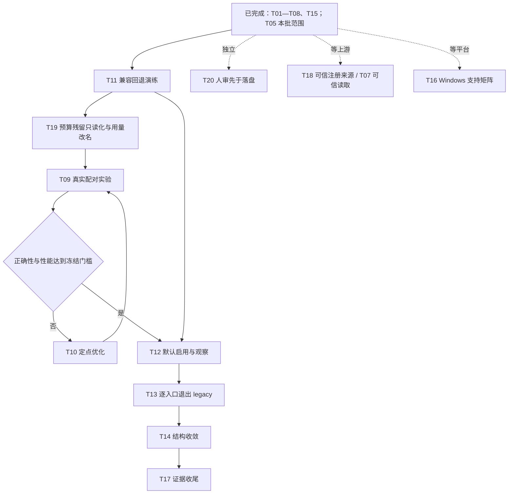

# 驱动与后端完善 Tasks

> **2026-10-27 当前入口（以本条为准）：** 当前安装 r47（源码 `f0abb5f`），全量回归 278 文件 / 3,842 项通过，基线见[表 1-2](#12当前可复核基线)。新任务默认 template-fill（T12），主动 legacy 入口已退出（T13）。T09—T14、T19—T27 已完成，T05.9.4 附件另存在 r47 实机通过。剩余未完成项：T16 等外部条件（T18 已于同日调整范围后完成）；T05 的扩展项（T05.3.4、T05.7.9 剩余、T05.10.4）不在已完成声明内；T23.9 留档不修，T26.3 跳过。下列 2026-10-21 及更早的引用块保留各历史时点的原文。
> **2026-10-21 当前入口（以本条为准）：** 预算、额度和费用已从剩余规划中清出。资源保护一律写作次数、步数或时间上限；Token 用量只作性能计量；旧数据中的预算字段保持只读兼容。T01—T08、T15 已完成，T05 本批范围完成，T18 部分完成。后续顺序见[第 4 节](#4执行顺序与下一批产物)：T11 已离线完成，T19 已在 r4 安装复核，T09 已完成（配对中位比未达门槛）；T10 已完成复验（两组均 24/24，中位比 1.072 与分摊耗时仍未达门槛，模板保持可选，T12 暂不进行）。以下引用块和第 1 节保留各历史时点的原文。
> 2026-10-21 T05 本批范围完成：r3 插件（`5a37d72`）在 Desktop 同一进程内依次通过 Ada 已有目标、Grace 不存在目标、无效输入、人审拒绝和 JSON null，T05.7.8 收口 24 项核对通过，T05.2.4 一并完成。r2 未生效的原因是 Desktop 的 `workspace-changes` 包装插在本插件与观测策略之间，已修复。扩展项仍未验证，见 T05.12.4。
> 2026-10-21 后端五路审计与三会话修复已完成本批联合离线验收，见[后端五路审计与修复验收](12-后端五路审计与修复验收.md)。审计基线 210 文件／2,369 项通过，修后 225 文件／2,565 项及 Host／Client／scripts 类型检查通过；主会话归并的 5 项 P1 已修复，未关闭项及旧 checkpoint 等兼容限制单列保留。本批 Desktop 未实测，未用真实模型重测 R7，切片体积下降不作为端到端提速证明。下一步跟踪 R7 真实耗时，并按既定顺序从 T05.7.3 核对原提案继续；本次未接受或运行，不勾选 T05，不追加性能门禁。
> 2026-10-20 恢复入口已就绪：[规划提速与上下文复用 Tasks](tasks-规划提速与上下文复用.md)已完成本批实现、功能验收和移交；原性能目标仍未达到，按用户减少门禁要求持续跟踪，不再阻塞旧任务恢复。[speed10 只读核对](../../../../docs/evidence/planning-completion-20261020/lifecycle/t05-speed10-handoff.md)确认原 v1、pending 提案、候选摘要及四个合成文件未变，生产校验通过。下一动作是 T05.7.3 接受原提案；本次未接受或运行，T05 尚未完成。以下暂停段落保留历史时点，当前入口以本条为准。
> 2026-10-20 用户决定移除预算系统。此文件中此前预算问答、额度、增额和预算验收项保留历史记录，现行实施改由[规划提速与上下文复用 S12](tasks-规划提速与上下文复用.md)统一替代；不将取消功能记成原预算能力验收通过。实际用量统计和运行安全保护继续保留。旧 T05 仍按原暂停／恢复顺序执行。

核查日期：2026-10-19。范围：模板填写驱动、规划后端、运行与恢复、存储、编译及辅助驱动、旧代码渐进替换。

**执行顺序更新（2026-10-19）：先完成[规划提速与上下文复用 Tasks](tasks-规划提速与上下文复用.md)，再继续本清单。** 新清单整合直接字段修改、上下文 / Schema 精简、异步规划、模板模块、精确检索、条件向量检索，并重点解决子 Agent 重复理解和重复加载。用户已指定完成后返回的顺序；本清单保持暂停，完成后从 T05.7.3 核对既有提案继续，真人复核要求保留。

**当前已安装并冷启动 template10，T04、T06 已完成本批范围；T05 按用户要求暂停。** 暂停前最后一项是姓名问候修复提案的静态及纯编译核查，已通过；提案未接受、未执行，不能据此勾选 T05。完整子任务与续测入口见 T05.1—T05.12。本批进展见[第二批报告](09-驱动后端第二批完善与验收.md)。初始清单来自只读核查；第一批结果见[第一批报告](08-驱动后端第一批完善与验收.md)。它接续[原执行方案](04-节点模板填写驱动与后端渐进替换方案.md)，历史审计和失败证据保留原貌。

**后续验收约定（2026-10-19）：** 默认复用现有验收工作区，以独立测试目录和用例／产物前缀区分批次；只有确有配置或权限隔离需求时才新建，并记录原因。具体执行见[新清单第 4.1.1 节](tasks-规划提速与上下文复用.md)。本清单下列 template10 安装字段保留暂停时的历史归属，speed1／speed2 的后续安装及验收状态以新清单和对应回执为准；T05 继续暂停。

## 1、当前做到哪里

### 1.1、实现与阶段状态

表 1-1 当前状态

| 模块或阶段 | 已完成 | 尚未完成或证据边界 |
| --- | --- | --- |
| P0—P4 首个可用版本 | 模板目录、批量填写、共享编译核心、字段修复、Host 与 CLI 接入、新旧任务读取 | T03 与 T04 已实现；结构保证、已观察样本及未知输出分别表达，可信读取来源仍未开放 |
| P5 编辑与复杂图 | 差量更新、显式换型及 unset、固定节点保护、分支端口、scope / 容器结构；深层子流程、31 节点局改及姓名问候闭环 Desktop 通过（r3，2026-10-21） | 真实 HTTP 服务、附件恢复、OS 强杀等扩展不在本批实机完成声明内 |
| P6 小范围启用 | Desktop profile 启用 template-fill；库存五节点创建、运行、修改与恢复通过；T09／T10 真实配对实验完成 | 配对中位比 1.016／1.072，未达 0.90 的性能门槛（T09、T10） |
| P7 默认切换 | 已执行（T12，2026-10-26 用户决定，`7ab6610`）：新任务默认 template-fill，compact-repair 保留为回退 | 切换依据是用户决定，不是性能门槛达标；T11 回退演练离线完成 |
| 规划提速与模块 | 审核写入模块（T22）、早交接（T23）、模块库与照试做生成草稿（T24）、Host 确定性修复与自动整理（T26／T27）均已 Desktop 验收；T28—T37（10-28—10-30）：试做方法、骨架草稿和作者阶段出错只改出错的一处，快速新建入口，修改先定位再回放，Desktop r53—r66 验收 | 附件另存同一需求生成耗时 16 → 2.4 分钟（r44 → r47，设计 26 §6.1）；C 网页抓取 16.6 → 6.6 分钟（r56 → r58），D 审核后写入走模块 45 秒（r59），E 已有工作流加列 9.6 → 2.8 分钟（r61 → r64，设计 28）。单个需求的耗时不代表整体提速；T30 局部续做只有离线验证 |
| 审计问题 | 原 11 项中，10 项已有修复或明确不可用处理及对应回归 | F5 以执行前拒绝缓解；可信文件读取证明能力仍未开放。F2 原本不属于确认缺陷 |
| 恢复界面 | template5 已完成外框、间距、下拉、核验反馈、中文输入提示和按钮阴影 | T02 单次鼠标提交已成功，只新增一个恢复运行；template6 冷启动后历史结果可读 |
| 旧代码清理 | 已修复 preview / 审计夹具漂移，scripts 纳入类型检查；T14 五批代码收敛（`7bac709`—`b4286a0`） | T01 未使用局部绑定已移除；T13 已退出主动 legacy 生成，历史读取、回执和用量兼容保留 |

三项设计想法已进入实际代码：新建批量提交完整目标图的填写内容，修改使用差量；节点平铺并通过 chains 展开顺序连接，分支和容器显式声明；Host 提供固定模板，Agent 填写业务值。控制顺序和数据绑定继续分别表达，不依据“上一节点”猜测输出字段。

### 1.2、当前可复核基线

表 1-2 安装与验证基线

| 项目 | 当前记录 |
| --- | --- |
| 安装构建 | v0.0.2 / audit-20261023-r66（2026-10-30 安装），源码 `0343c08`；r65 安装树保留为回退备份 |
| 归档 SHA-256 | `bf48a791ebc27229bb9b31c6a6cb819ee531941d0484297814a4f6c12f00baef` |
| 当前安装核查 | 归档 834 个条目；安装树 SHA-256 `638d7a26150a3357c4966fb33b41d083184f85041f90c94e250a03c280dfeb65`；安装、回退脚本与安装回执在 `.cache/audit-20261023-r66/` |
| 数据保留 | 安装前在用户数据副本上做启动探测，插件启动无错误；安装只改插件目录和 profile 的 package.json／pnpm-lock.yaml，改前改后的摘要都有记录 |
| 最近全量回归 | `0343c08`：283 文件 / 3,911 项全部通过，Host / Client / scripts 类型检查通过（上一次记录：`ad58c87`，278 文件 / 3,842 项） |
| 最新实机验证 | r66 Desktop E：用 E 的原话改「T18 CSV 统计 r53」，4.3 分钟、一个提案（见 T37.7；r65 同一需求 9.6 分钟、两个提案）；r61—r64 E 的逐轮耗时见设计 28 §7；C、D 见 T35、T36；r47 附件另存见设计 26 §6.1 |
| 历史基线 | r47（`f0abb5f`，2026-10-27，归档 `4ab7d22e…`，822 个条目，278 文件 / 3,842 项）；r3（`5a37d72`，233 文件 / 2,778 项，归档 `514869ec…`）及 template10（175 文件 / 1,996 项）的记录见[第二批报告](09-驱动后端第二批完善与验收.md)和本文件历史条目 |
| 实机范围 | 当前 macOS Desktop，规划模型以 glm-5.3-flash Max 为主（r44 A/B 用 DeepSeek-V4.1-Flash）；真实规划调用和业务模型调用分别计量 |
| 配置差异 | 源码默认与 Desktop profile 都是 template-fill；compact-repair 保留为回退 |

测试按构建归属保留且不重复累计。r3 及更早构建的记录：[template10 验证](../../../../docs/evidence/backend-batch2-20261019/validation-offline-template10.json)及[源码摘要](../../../../docs/evidence/backend-batch2-20261019/source-final-template10.json)记录当前基线；安装前后 129 份 JSON / JSONL hash 不变，原暂停运行在冷启动后手动恢复成功。template6、template7、template9 的通过、失败及安装回执均保留；template8 仅准备过，未安装。

### 1.3、已经完成的检查项

- [x] D01：节点填写目录从权威 schema 派生；固定工具 ID、模板版本与摘要由 Host 管理。
- [x] D02：forms / updates / addForms 经共享 AuthoringCore 编译；每个 author 阶段保持一个 RepairSession。
- [x] D03：修复冻结半成品、身份池耗尽、工具参数与引用合同、动态缓存传播、失效锁竞争及运行附件淘汰。
- [x] D04：修复辅助驱动漂移；preview 不支持的原生停止能力明确拒绝，Graphon 审计夹具与脚本类型检查已更新。
- [x] D05：当前 SDK 无可信读取来源时，在模型调用前拒绝 requiredReadFiles；此项仅完成前置保护。
- [x] D06：完成库存五节点实际创建、不同输入、非法输入阻断、单字段修改和冻结 v1 恢复。
- [x] D07：完成 template5 恢复界面与只读核验交互；该次 UI 验收没有创建新业务运行，后续 T02 的实际鼠标确认单独记账。
- [x] D08：复核源码 / 安装基线，并将历史进度与剩余任务分开登记。
- [x] D09：第一批 template6 已安装冷启动，历史数据 hash 保留；完成状态和剩余范围见下表各项。
- [x] D10：第二批 template10 已安装冷启动；T04、T06 完成本批范围，T05 具体进度已细分并按用户要求暂停，未接受的提案与原失败证据保留。

## 2、接下来执行的任务

以下 P1 / P2 / P3 表示任务优先级，区别于原执行方案 P0—P7 的阶段编号。勾选条件是对应产物和验收证据齐全；“代码已有”不等于“实机已通过”。

### 2.1、第一批：收口现有验收，补齐驱动合同

- [x] **T01 · P2 · 清理确认无行为影响的局部冗余。**

  已删除 `src/shared/numbering.ts:52` 未使用的 `node` 局部绑定，编号 5 项及类型检查通过。保留 Map、编号与遍历算法。检查本批触及文件的未使用项，不扩大为全库格式化。验收：差异仅涉及无用绑定，现有编号回归和类型检查通过。无前置依赖，可与只读任务准备并行。

- [x] **T02 · P1 · 补齐恢复运行最终鼠标确认验收。**

  **已完成：** template5 单次鼠标确认生成 `26402bf6-01bb-474f-8f75-e7c5964fae63`，冻结 v1、产物与数据保留均通过，template6 冷启动后可读。历史鼠标问题本次未复现，原因未确定。[证据](../../../../docs/evidence/backend-batch1-20261019/pointer-recovery-verification.json)。原验收要求：使用独立合成目标与可核对的运行基线，鼠标确认一次，检查只产生一个恢复运行、来源快照和产物正确。若未触发，分别核查按钮事件、请求和 Host 回执后定位。验收不能用键盘成功或只读 plan 成功替代。

- [x] **T03 · P1 · 补齐模板适用范围判定和入口回退合同。**

  **已完成：** 新任务保存请求模式，在上下文冻结前确定有效模式和原因；仅已验证的既有工具缺模板编辑回退 compact，旧任务不重选。相关 102 项通过，template6 已安装；真实模型回退尚未调用。[适用范围与限制](08-驱动后端第一批完善与验收.md)。原合同要求：列出能无损表示、应保留节点并限制编辑、应提前选择 compact-repair 的情形；适用性决策必须在新任务的有效模式冻结前完成，分别记录请求模式、有效模式和回退原因。已经冻结的任务不改写模式，修复留在同一协议与修复次数上限内；确需不同模式时明确结束原请求，再由新的设计请求承接有效来源，不重放业务。验收：支持场景继续走模板；受限编辑不丢未展示配置；必要回退发生在冻结和模型创作前且有可追溯原因；权限拒绝、合同冲突、未知发布结果不得触发换协议重试。未知未来协议仍明确拒绝。

- [x] **T04 · P2 · 补齐工具输出合同及样本来源。**

  **已完成：** 从当前调用者可见注册冻结工具输出 schema、来源、版本及摘要；完整成功试做样本单列观察证据，未知字段不推断。发布只核对已使用合同，漂移明确阻断；旧任务兼容和样本不升级为普遍保证均有回归。template10 已部署，当前有效试做已进入真实提炼。详见[第二批报告](09-驱动后端第二批完善与验收.md)。不改变 Workflow / 工具返回格式，不宣称开放可信文件读取。

### 2.2、第二批：完善新驱动的业务与生命周期验收

- [x] **T05 · P1 · 完成复杂模板场景的验收矩阵。**

  **状态：2026-10-21 本批范围完成。** 姓名问候闭环在 r3 插件上完成 Desktop 实测：已有目标、独立输入、失败分支、路径误命中、人审拒绝、JSON null，以及 T05.7.8 证据收口。期间发现并修复了跨运行观测泄漏，以及 Desktop 插件槽位顺序导致修复不生效的问题。`[ ] 扩展` 项仍未验证，见 T05.12.4。

  **历史状态（暂停期间）：** 前置为[规划提速与上下文复用 Tasks](tasks-规划提速与上下文复用.md)。最后完成的是 T05.7.2 的提案静态与纯编译核查；新清单完成前不启动后续接受或业务执行。用户已指定新清单完成后继续本清单，届时先核对 T05.7.3；逐次真人复核和各项扩展测试的既有边界仍适用。

  **标注规则：** `[x]` 只表示该条明示范围已经完成；“离线通过”“Desktop 通过”“负结果已归档”“明确不支持”分别表述。失败记录已归档不等于业务通过，静态候选通过不等于运行通过。`[ ] 扩展` 是未实测范围，不默认并入本批闭环或恢复后自动执行。

  表 2-1 T05 分层状态总览

  | 子任务 | 离线 / 静态 | Desktop | 当前状态 |
  | --- | --- | --- | --- |
  | T05.1 基线与授权 | 已冻结 | 独立工作区及真人授权已落实 | 完成 |
  | T05.2 多工具与包装 | 生产 Host 组合通过 | r3 上 glob → 条件 read → write → readback 两输入通过 | 完成 |
  | T05.3 HTTP / Swagger / 结构化 LLM | 替身边界内通过 | 真服务 / 供应商未实测 | 离线完成，外部扩展未做 |
  | T05.4 深层容器与子流程 | 主例、独立输入、失败、局改通过 | 父子三组运行通过 | 完成 |
  | T05.5 31 节点局改 | 保持性与越界拒绝通过 | 真实提案、接受、两输入通过 | 完成 |
  | T05.6 试做与提炼创作 | 来源、人审与发布合同通过 | 真实试做、人审、候选与 v1 保存完成 | 生成完成；修订后的生成图业务见 T05.7 |
  | T05.7 问候生成图复用 | 修复提案静态与纯编译通过 | r3 上已有目标、独立输入、失败分支、路径误命中、人审拒绝、JSON null 通过 | 完成；部分扩展负例未做 |
  | T05.8 动态子图失效 | 生产 Host 与 Graphon 通过 | r44 上导入父子包，两输入取消后恢复通过 | 完成 |
  | T05.9 附件恢复 | 两输入、归属与缺失阻断通过 | r44 上两份 Olist 附件恢复与缺失阻断通过 | 完成 |
  | T05.10 合同漂移 / interrupted | 合成冷重开与阻断通过 | T06 另有真实冷启动及生命周期证据 | 不混同 OS 强杀或同组合通过 |
  | T05.11 支持边界 | 拒绝用例通过 | 不开放相应能力 | 边界已确定 |
  | T05.12 证据收口与恢复入口 | 收口脚本 24 项核对通过 | 姓名闭环 r3 实测通过 | 完成 |

  - [x] **T05.1 · 测试基线、隔离与授权。**
    - [x] **T05.1.1** 固定本批安装 template10 / v0.0.2、当前 Desktop 的 template-fill；源码默认仍为 compact-repair。真实规划模型为 GLM-5.3-Flash / Max；GPT-6.1-sol / high 辅助代理只承担开发与复核，不混记为被测规划模型。
    - [x] **T05.1.2** 使用独立目录 `/private/tmp/dsh-backend-batch2-acceptance-20261019`，工作区 ID `b1cafa50-75a7-4960-a949-18df8b1954d8`，主会话 `session-e0a9d38e-85a3-46cb-a446-19e55d465a3d`；不操作其他业务工作区。
    - [x] **T05.1.3** （历史：预算系统已于 2026-10-20 移除，本项不再适用）真人已选择“本批合成验收工作流都不设上限”；后续同批测试复用授权。发布问候图时再次出现预算控件，已转送这份选择，不记作未出现门禁。[授权记录](../../../../docs/evidence/backend-batch2-20261019/human-budget-choice.json)。
    - [x] **T05.1.4** 保留真实失败、旧安装、独立源码和包摘要；不改写失败任务、不自动换请求重放业务。复用上批 6 项深容器离线证据，本批复杂组合最终 12 项通过；这些是相关子集，不额外累加到全量 1,996 项。[本批原始矩阵](../../../../docs/evidence/backend-batch2-20261019/t05/acceptance-matrix.md)、[12 项结果](../../../../docs/evidence/backend-batch2-20261019/t05/vitest-final.json)。

  - [x] **T05.2 · 多工具与输出包装。**
    - [x] **T05.2.1 · 离线通过：** native lookup → 按合同解析 `value.text` → native emit，主输入 count=3 与独立输入 count=8 均核对真实临时回执文件。
    - [x] **T05.2.2 · 离线通过：** 缺 text 明确失败；count 为字符串时，在 emit 动作函数执行前被官方参数校验拒绝；规划 / 发布阶段零业务动作。未知内部字段不由 SDK 外层 value 包装推断。
    - [x] **T05.2.3 · Desktop 负结果已归档：** 问候 v1 的 input read 成功，output write 因无有效目标读取被拒绝；文件未改变、human 和成功出口未执行。此项证明阻断生效，不代表多工具业务已成功。[失败证据](../../../../docs/evidence/backend-batch2-20261019/t05-greeting-first-run-failure.json)。
    - [x] **T05.2.4 · Desktop 通过：** 复用 T05.7 的 glob → 条件读取 → write → readback；核对真实参数、canonical 输出、顺序、仅一次写入、独立产物和业务账本，不另造重复场景。
      **2026-10-21 r3 通过**，复用 T05.7.8 收口：实际参数为 glob `{path:".",pattern:"t05-greeting.json"}`、write `{file_path:"t05-greeting.json",content:…}`。回执为 canonical 的 `{path,operation,before,after}`；顺序 glob → 条件 read → write → readback，各只一次。Ada / Grace 产物相互独立，业务模型账本为 0。[收口报告](../../../../docs/evidence/backend-audit-20261021/t05/t05-7-8-closeout-r3.json)。

  - [x] **T05.3 · HTTP / Swagger / 结构化 LLM 的离线合同矩阵。**
    - [x] **T05.3.1 · 离线通过：** 生产 Host 的 HTTP → 状态 / JSON 校验 → Swagger operation → SDK-shaped 结构化 LLM → output；A / a/b 两输入核对独立值 7 / 11，Swagger 路径斜杠正确编码，Set-Cookie 被过滤。
    - [x] **T05.3.2 · 离线通过：** HTTP 503 被显式校验节点拒绝且不进入模型；answer=42 不满足 string 合同、没有最终输出。不能声称 HTTP 适配器自动抛出所有非 2xx。
    - [x] **T05.3.3 · 计量边界已核对：** 传输和 SDK 模型流使用明确替身；3 次缺 usage 的调用保持 unknown，不记作免费或零消耗。
    - [ ] **T05.3.4 · 扩展未执行：** 真实 HTTP / Swagger 服务与真实供应商的同链路、独立输入、错误结构。须另定最小安全接口，当前不得称为 Desktop 已通过，也不随本次恢复自动请求外网。

  - [x] **T05.4 · 深层容器、分支与子工作流。**
    - [x] **T05.4.1 · 离线通过：** iteration → loop → if / 汇合 / assigner 的主样本、独立输入、非法数字、容器内局改及越界拒绝共 6 项；未改字段与身份保持。[上批证据](../../../../docs/evidence/backend-batch1-20261019/t05-complex-acceptance.md)。
    - [x] **T05.4.2 · 离线通过：** 父调用冻结子图，父子身份不同且共用根运行；4→8、9→18，-1 子图失败传播到父图；另将原深容器作为子工作流从生产 Host 调用。[深层子调用](../../../../docs/evidence/backend-batch2-20261019/t05/final/deep-subworkflow.json)。
    - [x] **T05.4.3 · Desktop 通过：** 一次导入父 3 节点 / 子 14 节点；`[3,-2,0,4]`、轮数 2、阈值 2 → `[6,0,0,8]`，父运行 `da559b10-f1a6-43a2-b78a-21fddd83fb08`。
    - [x] **T05.4.4 · Desktop 通过：** 独立输入 `[1,5,2]`、轮数 3、阈值 2 → `[0,15,0]`，父运行 `0bb9fdda-aebe-4c00-a920-f928d343f90e`。
    - [x] **T05.4.5 · Desktop 通过：** 输入 `[3,"bad"]` 时父子均失败、无成功输出，父运行 `c70adbe5-5408-4335-93a6-e4a36fb19dcd`；业务模型调用为 0。上述实机使用导入合成图，不称作模型设计同图成功。[主例](../../../../docs/evidence/backend-batch2-20261019/screenshots/t05-deep-primary.png)、[独立输入](../../../../docs/evidence/backend-batch2-20261019/screenshots/t05-deep-holdout.png)、[失败分支](../../../../docs/evidence/backend-batch2-20261019/screenshots/t05-deep-invalid.png)。

  - [x] **T05.5 · 31 节点大图定点修改。**
    - [x] **T05.5.1 · 离线通过：** 只改 target.text；回填原值后整图深相等，保留 notes / env / fixed / IDs / 边；未选 sibling 的修改被拒绝。
    - [x] **T05.5.2 · Desktop 通过：** 真实规划 `baea2728-febb-4ee4-8735-e54e486a125c` 首次候选成功，提案只改 `/nodes/29/config/text`：`原文 {{input.text}}` → `结果：{{input.text}}`；接受前原图不变。
    - [x] **T05.5.3 · Desktop 通过：** 接受后 v2，主输入甲输出“结果：甲”；运行 `fb455ca8-1051-4241-aea5-e03e392ee9c0`。随后 v3 的独立输入乙输出“结果：乙”；运行 `a91dc9eb-7875-475c-a9e4-3d2900659515`。
    - [x] **T05.5.4 · 30 项独立复核通过：** 31 个节点各执行一次、30 条边、业务配置与身份保留、账本零业务模型用量。v2→v3 另有 62 个坐标及 viewport / 版本变化，不能称最终存储仅改正文。[完整复核](../../../../docs/evidence/backend-batch2-20261019/t05-large-acceptance-summary.json)。

  - [x] **T05.6 · 真实试做、人工复核、提炼与候选保存（不含生成图业务成功）。**
    - [x] **T05.6.1 · Desktop 通过：** 真实试做 `trial-5e3228cd-3b61-41a1-9873-d3c0754dd77f` 从 Ada 输入生成 `{"text":"Hello Ada"}`；机械检查与实际文件核对一致。[原产物证据](../../../../docs/evidence/backend-batch2-20261019/t05-trial-artifact-primary.json)。
    - [x] **T05.6.2 · 真人确认完成：** 用户已答“确认，继续生成”，并要求生成工作流保留每次运行的人审。原机械报告的 needs-review 不篡改为自动 passed；该确认不代替未来每次运行的人审。
    - [x] **T05.6.3 · 负结果已归档：** 原任务 `86c8c26a-b469-4c25-afdc-ffbcd8af8dcf` 因 scope / chains / 端口类型修复失败；后续 `9d324b6a-79fa-431c-807c-53ed38aaef97` 因提炼证据与 PATCH_SCOPE 失败。保留诊断及用量，未重放原试做。
    - [x] **T05.6.4 · template10 生成通过：** 任务 `41a3a6b4-470a-4651-be0f-6fa72a2e63af` 提炼、创作各首次提交通过，14 节点、无业务模型节点；name 从文件读取，成功出口受 human.approve 控制。未把这项静态检查写成业务已通过。[候选审查](../../../../docs/evidence/backend-batch2-20261019/candidate-review.json)。
    - [x] **T05.6.5 · 发布通过：** 正常 plan_get → plan_publish，真实 receipt.kind=created；工作流 `e5532200-ea31-46c2-97d8-2286d51c02fc` 保存为 v1，原候选 digest 为 `e8b02e4432b14890504e559a2cb00c18dbe16132664a2df0ddeb8ee90a12820d`。
    - [x] **T05.6.6 · 统计已完成：** 三次设计分别耗时 16分38秒 / 3分13秒 / 9分55秒；真实后端被使用。仅描述各自阶段与失败，不作受控性能结论；T08 / T09 尚未完成。[分段记录](../../../../docs/evidence/backend-batch2-20261019/t05-planning-comparison.json)。

  - [x] **T05.7 · 生成图的文件复用、独立输入与每次人审。**
    - [x] **T05.7.1 · 首次实际失败已确认：** v1 运行 `0b230c3e-7bbb-4e2f-86cd-acee53d980d9` 在覆盖既有 t05-greeting.json 时被 SDK 先读后写保护拒绝；原文件 22B / SHA-256 `f263ecf740872db75eee2a28b76be7784b7ac709b1a7014f3b783a3471ef503e` 不变，human / output 跳过，模型账本 0。不是已通过的成功运行。
    - [x] **T05.7.2 · 暂停前当前测试已收尾：** 经正常规划器生成修复提案，任务 `384c0639-bb5d-4a04-bb92-db69eb577061`，proposal `6dde4ca4-f5d4-4a68-a2dd-57057fb4c5d9`，候选 digest `7c7bb387d54601f8a80efadfc7a92781fb784c9c306dbad41e6323ca0db24176`。保留 14 个旧 ID，新增 5 节点，显式 glob → 精确路径判断 → 存在时读取 / 不存在时直写；固定根目录产物路径并补 null 防护。4 段实际源码 QuickJS compileOnly 通过，未调用 main、未运行图。[静态报告](../../../../docs/evidence/backend-batch2-20261019/t05-greeting-revision-review.json)、[纯编译报告](../../../../docs/evidence/backend-batch2-20261019/t05-greeting-code-compile-review.json)。
    - [x] **T05.7.3 · 恢复后接受前核对：** 重新读取当前工作流 v1、提案与候选摘要，确认没有用户新修改。无冲突才在 Desktop 接受该已审提案，并记录新 revision；若有冲突先重查差异，不覆盖、不自动重建请求。当前提案尚未接受。

      **2026-10-21 按用户决定以导入代替接受：**
      - 新构建 audit-20261021-r1 已安装，接受前核对全部通过：v1 未变，提案仍为 pending，候选摘要 7c7bb387，四个文件未变，新校验器无图问题。
      - 原工作区 b1cafa50 已不在 Desktop 注册表中，重新添加后得到新 ID ed63b437，无法从原卡片接受提案。
      - 用户决定改用统一测试工作区 dsh-planning-speed-acceptance-20261019（cf969f16），以后的 Desktop 测试都在该工作区进行。
      - 已审候选原样导出为包并导入，得到新工作流 58d0d998 v1；四个合成文件同时复制到该工作区。
      - 只读核对：映射导入重建的节点 ID 后，节点与连线和候选完全一致。导入为新工作流按图序重编了 13 个节点号，这不属于“接受提案保留已审编号”的情形。
      - 未重规划，未调用模型，未改数据库伪造续接。
      - 证据：[导入包](../../../../docs/evidence/backend-audit-20261021/t05/t05-import-package.json)、[导入后回读](../../../../docs/evidence/backend-audit-20261021/t05/t05-imported-readback.json)。
    - [x] **T05.7.4 · 已有目标 / Ada 主样本：** 先记录现有目标 hash；同一运行显式 read 目标后只 write 一次，再回读核对精确 JSON 和本次姓名。确认 `glob.value.root="."`、根目录精确命中、分支合流没有导致重复写或跳过写；停在人审等待，没有批准前不得出现成功结果。由真人批准后再核对完成出口、版本、各节点实例与账本。

      **2026-10-21 通过：** 运行 984a7ba9（v1）。人审前核对结果：
      - glob：`root="."`，只精确命中 `./t05-greeting.json`，走存在分支。
      - 覆盖前显式读取了旧产物 `{"text": "Hello Ada"}`。
      - 写入节点只运行一次（pending→running→success），operation=update。产物变为紧凑 JSON，sha 由 f263ecf7… 变为 57fbd1f1…，inode 与 mtime 都已变化。
      - 回读验证通过；“问候结果”仍为 pending，没有成功结果。
      - 证据：[运行前](../../../../docs/evidence/backend-audit-20261021/t05/t05-7-4-pre-run.json)、[人审时](../../../../docs/evidence/backend-audit-20261021/t05/run-t05-7-4-at-review.json)。
      - 用户本人在 Desktop 点击“核对通过”（action approve）后，运行 success：
        - 问候结果为 Ada／Hello Ada。
        - 不通过分支 skipped。
        - 批准后产物 sha、inode、mtime 都未变，没有二次写入。
        - 证据：[完成后](../../../../docs/evidence/backend-audit-20261021/t05/run-t05-7-4-final.json)。
    - [x] **T05.7.5 · 不存在目标 / Grace 独立输入：** 已备好多行 `t05-holdout-input.json`，内容 name=Grace，尚未运行。恢复后先备份并可恢复地移开目标、保留摘要，再执行同一已接受图；预期直写首建、不会错误先读缺失目标；实际产物为 `{"text":"Hello Grace"}`，不是旧 Ada。独立核对每次真人门禁；未获本次批准不得代答。

      **2026-10-21 实测失败，发现缺陷：** 运行 500223d1（v1）。
      - 测试准备：
        - Desktop 没有单次运行输入入口，“执行”总是使用输入节点的默认值。为避免改动已审工作流，临时把 Grace 内容写入默认的 `t05-input.json`，原 Ada 输入已备份并在测试后恢复。
        - 根目标移到 `.t05-7-5-backup`，可恢复。
      - 运行结果：
        - glob 判定根目标不存在，走首建分支，未读取缺失目标。
        - `native:write` 被 SDK 拒绝：FS_STALE_VERSION，`file no longer exists — re-read the file, then retry`。
      - 根因：
        - `executeNative` 以工作区对话的 Agent 调用工具，SDK 观测策略按 `actor.agent.session` 记录 present/absent/version。
        - 同一对话下的各次工作流运行因此共用观测状态。上一轮 Ada 留下 present@V，本轮写入意图变为 replaceIfVersion(V)，而文件已被外部移走。
        - 属于跨运行观测状态泄漏，不是测试准备问题。
      - 已另立修复任务：观测状态按运行隔离。修复并安装后重跑本项。
      - 证据：[运行前](../../../../docs/evidence/backend-audit-20261021/t05/t05-7-5-pre-run.json)、[失败运行](../../../../docs/evidence/backend-audit-20261021/t05/run-t05-7-5-failed-stale-observation.json)。

      **2026-10-21 r2 仍失败：** 观测隔离已装入 r2，Ada 7ca39e82 通过后，Grace aee8b4a7 再报同样的 FS_STALE_VERSION。
      - 根因：Desktop 的 dsh-web-app bundle 在观测策略之后加载 `workspace-changes`，它在两个写入意图上 prepend 透传包装。真实槽位为 [本插件, workspace-changes, policy]，本插件只在策略紧随其后才接管，所以从未接管。单测里没有这个包装。
      - 修复 `5a37d72`：把本插件的判断移到策略正前方，包装仍包住判断；每次派发记录快照时的后继，重排不影响在途派发。Codex 三轮复核，前两轮问题已修并补测试；全量 233 文件／2,778 项及类型检查通过。
      - 证据：[r2 失败运行](../../../../docs/evidence/backend-audit-20261021/t05/run-r2-t05-7-5-failed.json)。

      **2026-10-21 r3 通过：** 同一 Desktop 进程（Host pid 59941）内依次运行。
      - Ada `5f589c9a`：已有目标，read → write（update）→ readback，人审核对通过。
      - 外部移走根目标，输入换为 Grace，不重启 Desktop。
      - Grace `38a7d9d8`：glob 判定不存在，“覆盖前回读”跳过，write 为 create（before=null），回读与人审通过，产物 `{"text":"Hello Grace"}`。没有 FS_STALE_VERSION。
      - 子目录诱饵 hash 不变。测试后根目标与输入恢复为 Ada，Grace 产物另存为 `t05-greeting.json.r3-grace-product`。
      - 证据：[Ada](../../../../docs/evidence/backend-audit-20261021/t05/run-r3-t05-7-5-ada.json)、[Grace](../../../../docs/evidence/backend-audit-20261021/t05/run-r3-t05-7-5-grace.json)。
    - [x] **T05.7.6 · 必要失败分支：** 已备好 `t05-invalid-input.json`（缺 name），尚未运行。预期 input_error，写入 / 回读 / human 均不执行，已有产物 hash 保持，成功 result 不存在。图级 status=success 可能只是错误出口正常结束，不能写成业务验收成功。

      **2026-10-21 通过：** 运行 db686c89（v1）。
      - 输入沿用 T05.7.5 的临时数据替换方式，测试后已恢复。
      - 运行走 `input_error` 出口，提示缺少非空 name。
      - 构造、写入、回读、人审、glob 均为 skipped，没有问候结果。
      - Ada 产物的 sha、inode、mtime 均不变。
      - 图级 status=success 只表示错误出口正常结束。
      - 证据：[运行前](../../../../docs/evidence/backend-audit-20261021/t05/t05-7-6-pre-run.json)、[运行](../../../../docs/evidence/backend-audit-20261021/t05/run-t05-7-6-invalid-input.json)。
      - **r3 复测通过：** 运行 `119264b6`，同一进程紧接 Grace 之后。走 input_error，只调用了一次输入 read；Grace 产物的 sha、inode、mtime 不变。[运行](../../../../docs/evidence/backend-audit-20261021/t05/run-r3-t05-7-6-invalid.json)。
    - [x] **T05.7.7 · 路径误命中反例：** 根目标不存在、只有子目录同名文件时，不能由 paths 非空判断存在；应仍走首建分支、不得读取或覆盖子目录同名文件。与 T05.7.5 合并实施，避免额外重放。

      **2026-10-21 通过（与 T05.7.5 同一运行 500223d1）：**
      - 字面 pattern `t05-greeting.json` 的 glob 实际返回 `./sub/t05-greeting.json`，说明按 paths 非空判断会误判。
      - 解析代码只接受根目录精确匹配，得出 exists=false，走首建分支；“覆盖前回读”未执行。
      - 子目录诱饵 `{"text":"Hello Decoy"}` 的 sha、inode 不变，未被读取或覆盖。
      - 首建写入本身因上述观测泄漏失败，不影响本项判定。
    - [x] **T05.7.8 · 统一证据收口：** 主例、独立输入、失败分支分别保存 runId / sourceRevision / 实际工具参数与回执 / 节点状态 / 产物 hash / 人审决定 / 模型账本。核对两次成功业务都真正写文件、只写一次、结果随 name 变化；业务模型调用 0 不能替代原生工具调用次数。

      **2026-10-21 r3 收口通过：** 只读脚本汇总 Ada `5f589c9a`、Grace `38a7d9d8`、无效输入 `119264b6`，24 项核对全部通过。
      - 三次运行均为 sourceRevision 1；每个已执行节点只启动一次。
      - 原生工具调用分别计数：Ada 5 次（read 输入 → glob → read 旧产物 → write → read 回读）；Grace 4 次（没有旧产物 read）；无效输入 1 次（只 read 输入）。
      - 两次成功各只写一次：Ada 为 update，Grace 为 create；两次人审都是 approve；结果随姓名变化，两份产物 hash 不同。
      - 三次模型账本均为 0 次调用、0 token。
      - 证据：[收口报告](../../../../docs/evidence/backend-audit-20261021/t05/t05-7-8-closeout-r3.json)、[脚本](../../../../docs/evidence/backend-audit-20261021/t05/closeout-t05-7-8.mts)。
    - [ ] **T05.7.9 · 扩展负例（部分已实测）：** 真人明确拒绝时只能到 review_rejected；畸形 glob 输出与 JSON null 分别到明确错误；读后外部变更、权限拒绝、目录与文件竞态继续受 SDK 原子保护。不得为填勾而伪造真人决定或暗中试写重试；同名工具的通用前置条件完善另列 T18。

      **2026-10-21 r3 已实测两项，均通过：**
      - **人审拒绝：** 运行 `255ad194`。拒绝由 6.1sol 按用户“测试环节自动审核”的授权点击“核对不通过”，备注注明测试，不是真人对内容的判断。只走到 `review_rejected` 出口，成功结果跳过。[运行](../../../../docs/evidence/backend-audit-20261021/t05/run-r3-t05-7-9-review-rejected.json)。
      - **设计发现：** 本图的人审在 write 之后，拒绝不会撤回已发生的写入。本次 Ada 内容相同，但文件被原子重写（inode 变化）。若要求“拒绝即不落盘”，须把人审移到写入前，或写到临时路径，审核通过后再提交。
      - **JSON null 输入：** 运行 `1089aaf6`，输入为字面量 `null`。走 `input_error`，只 read 输入；产物 inode、mtime 不变，模型调用 0。[运行](../../../../docs/evidence/backend-audit-20261021/t05/run-r3-t05-7-9-json-null.json)。
      - **仍未执行：** 畸形 glob 输出需要篡改工具回执；读后外部变更、权限拒绝、目录与文件竞态无法在当前 Desktop 中安全构造。保留为扩展。

  - [x] **T05.8 · 动态子图依赖的离线失效与恢复。**
    - [x] **T05.8.1 · 离线通过：** root → child → builtin 当前时间；即使 caller cache=reuse，冻结动态依赖仍阻断复用。主例与独立 marker 使用系统时间范围核对，不要求两次秒值必不同。
    - [x] **T05.8.2 · 离线通过：** 未批准不创建新 run，“已完成”回执不能绕过动态失效；明确 redo 才创建不同 childRunId，原历史保持。
    - [x] **T05.8.3 · Desktop 通过（2026-10-26，r44）：** 导入父子包（子流程读当前时间，父图 cache=reuse 调用后进入人审）。界面只对失败、中断、已取消的运行提供“创建恢复运行”，所以在人审处取消。
      - 两输入 A、B 均先取消，恢复预览阻止复用：“工具读取当前时间，不能复用旧运行的时间结果”。下拉框不提供“已完成”（宿主设 `reviewCanComplete=false`），伪造完成在界面层就不可选。
      - 选“允许重做”并写理由后，新运行产生新的子运行：A `de1cc208`→`bbb80da3`，秒数 1793015057→1793015359；B `4bc104a9`→`e2e6aeaa`，1793015418→1793015670。只复用用户输入，审核决定与理由写入 `recoveryReview`；原运行仍为已取消，记录不变。
      - 离线演练：`template-fill-complex-host.test.ts` 的 `desktop-recovery-rehearsal` 组；导入包由 `tests/fixtures/prepare-t05-recovery-desktop.ts` 从同一组表单生成。证据 `.test-data/t05-desktop/t05-8-3`。

  - [x] **T05.9 · 附件重新物化及归属的离线验收。**
    - [x] **T05.9.1 · 离线通过：** 主 Alpha / Beta 和独立中文输入，经 document→output 后显式 rerun；当前库已变 v2，恢复仍用冻结 v1。
    - [x] **T05.9.2 · 离线通过：** 新 run 的 workflowFileId 不同、字节相同；跨 run 读取旧 ID 拒绝；缺失源附件在新 run 创建前拒绝；原历史不变。
    - [x] **T05.9.3 · Desktop 通过（2026-10-26，r44）：** 附件取用户提供的公开 Olist 数据集小片段（卖家 20 行、品类 15 行、支付 5 行），未用私人附件。
      - 三次运行在人审处取消后，把库内流程改为 v2（输出文字换成 v2 标记）。恢复预览要求对“文档提取器”明确选择重做（文件没有内容指纹）。
      - 两次恢复都按 v1 快照输出 `v1:` 加附件文本，没有 v2 文字。附件换新编号（`246954a8`→`4de6039e`，`c78a34a5`→`c7885ab6`），字节与原片段一致，运行记录不含附件正文。品类文件开头的 BOM 被文档节点去掉，原运行与恢复一致。
      - 把第三次运行的附件移走后确认恢复，宿主报“附件不存在、超限或不属于本次运行”，运行总数保持 137，没有新建运行；之后附件已放回。证据 `.test-data/t05-desktop/t05-9-3`。
    - [x] **T05.9.4 · 附件另存为文件（2026-10-27 完成，r47）：** 用户要求顺带测“上传附件 → 写文件 → 回读核对”能否用节点实现。r44 安装、glm-5.3-flash Max 规划“T05 附件另存为文件”：试做 2 分钟写出 `saved.csv`，与卖家片段 SHA-256 相同；生成用了 16 分钟、做出 15 个节点，读附件用了不存在的 `{{input.attachment.path}}`，首跑停在等待上传。
      - 原因与修复见[设计 26 §6.1](26-照试做搭骨架.md)：骨架把读输入文件改为文档提取器节点，按需求设为上传附件或路径参数，原样写入时不加整理节点；节点目录写明附件对象结构，编译器拒绝 `.path` 一类引用。用这次试做记录重建，草稿为 5 个业务节点并直接编译通过。
      - r45（621313b）Desktop 复测：生成 6.3 分钟、8 个节点，一次编译通过；读附件改用文档节点 `input.attachment`，两次运行全部节点完成，运行详情顺序正确。卖家片段核对一致。品类片段（BOM + CRLF）写出的内容等于附件去掉 BOM 后的内容，但作者手写的核对代码没处理 `native:read` 去掉的 `\r`，报了假“不一致”。原因是主对话的生成说明点名了 native:write/read + code，作者换掉了骨架里的写入核对模块。详见设计 26 §6.1。
      - [x] r46（392317f）：草稿说明要求保留写入模块，节点目录写明 `native:read` 会去掉行尾 `\r`。Desktop 复测：生成 5.5 分钟，作者保留了写入模块；卖家片段通过；品类片段写入正确（模块核对 window-match），但 check 写死了试做输入里的文字，因此失败。
      - [x] r47（ad58c87）：草稿不再写死来自试做输入的检查文字。Desktop 复测：生成 2.4 分钟，作者原样提交草稿；卖家片段、品类片段两次运行全部完成，写入核对 window-match，品类文件写出的内容等于附件去掉 BOM 后的内容，CRLF 保留。

  - [x] **T05.10 · 合同变化与 interrupted 的离线冷重开。**
    - [x] **T05.10.1 · 离线通过：** 实际动作后构造明示的持久 in-flight 形状，关闭并重建生产 Storage / Runtime；加载为 interrupted、零自动动作，未核验恢复被拒绝。
    - [x] **T05.10.2 · 离线通过：** 明确 redo 后，工具 description 合同变化仍在动作前失败；恢复原合同后才成功一次，源历史不变。
    - [x] **T05.10.3 · 边界已记录：** 上述是合成崩溃形状冷重开，不是 OS 强杀；template10 安装冷启动、旧暂停 run 手动恢复及实际 native Agent 生命周期另有 T06 证据，不能拼成同一复杂图崩溃恢复通过。
    - [ ] **T05.10.4 · 扩展未执行：** 独立环境真实 OS 中断、供应商在途用量回执与相同复杂图恢复，待另行安排；不强杀当前用户 Desktop 充当验收。

  - [x] **T05.11 · 不支持能力与证据边界。**
    - [x] **T05.11.1** 含 human 的子工作流仍不可作为子调用执行，目录 unavailable 且拒绝断言通过；可独立运行，不为通过测试放宽限制。
    - [x] **T05.11.2** requiredReadFiles 可信读取证明仍按 T07 关闭；glob 不是 read observation，输出 schema 保证不是工具提供者可信证明。
    - [x] **T05.11.3** HTTP / Swagger 真服务、附件恢复、动态嵌套恢复及 OS 强杀没有本批对应 Desktop 证据；保留为扩展未验证项，Windows / Secret 另按 T16。

  - [x] **T05.12 · 完成条件与暂停交接。** 四个子项均已完成；扩展未验证项（T05.3.4、T05.7.9 剩余、T05.8.3、T05.9.3、T05.10.4）照旧单列，不代表全场景 Desktop 通过。
    - [x] **T05.12.1** 完整矩阵已分层登记，已有通过与失败均附证据；T04 / T06 完成范围不受本次暂停改变。
    - [x] **T05.12.2** 用户暂停前当前提案核查已完成。Desktop 仍为问候工作流 v1，待接受提案保留，未启动修后业务；两个 holdout / invalid 输入文件只准备未执行。原试做及失败历史不重做、不删除。[暂停快照](../../../../docs/evidence/backend-batch2-20261019/t05-pause-state.json)确认当前无活动规划或工作流运行、原产物 hash 未变。
    - [x] **T05.12.3** 新的规划提速 Tasks 完成后，按用户已给定顺序先执行 T05.7.3，再做 T05.7.4—T05.7.8，补齐 T05.2.4。每次实际问候人审仍等待真人。
    - [x] **T05.12.4** 代表性真实业务闭环通过后，更新矩阵、报告和总勾选；继续列明各扩展未验证范围，不以静态/离线证据宣称全场景 Desktop 通过。新清单完成前不启动旧清单后续业务或 T08 / T09 的真实模型实验；新清单自己的隔离验收按其 S01 / S10 管理。
      **2026-10-21 完成：** 矩阵与报告已更新。仍未验证的扩展有 T05.3.4、T05.7.9 剩余项、T05.8.3、T05.9.3、T05.10.4，全场景 Desktop 通过不成立。T05.7 测试的是导入的已审候选图（T05.7.3 按用户决定以导入代替接受提案），不是规划器在 Desktop 中直接接受同一提案。

- [x] **T06 · P1 · 验收真实 native Agent 的生命周期。**

  **已完成本批 macOS Desktop 范围：** 原写入只发生一次，失败修复后手动恢复未重放；修后空工具模型修复正例通过且需单独继续根运行；已启动任务的主动取消和 1.5 秒超时取得 SDK start/end、子任务释放和注册表无残留回执。原失败保留，缺少父任务回执及取消/超时未报告用量保持未知。清理失败等故障注入仅为离线证据，不虚称实机注入。详见[第二批报告](09-驱动后端第二批完善与验收.md)。

- [x] **T07 · P2 · 明确可信文件读取证明的支持边界；当前不开放。**

  **边界决策已完成：** 核查 Desktop ASAR 的 tools / fs / editor 均为 0.2.1-rc.2，现有公共接口不能证明实际执行的可信注册来源，继续在模型调用前拒绝 requiredReadFiles。[接口证据与后续接入条件](../../../../docs/evidence/backend-batch1-20261019/t07-trusted-read-capability.md)。此勾选只表示支持边界已确定，不表示读取证明功能已实现；未来开放须先补上游来源能力或 Host 自有收据设计，再完成以下验收。

  核对宿主能否证明工具提供者、版本、合同和执行回执来源；有可靠能力才接入 Host。验收包含真实读取成功、失败、截断 / 文件变化，以及同名或作用域覆盖工具的拒绝。当前 SDK 不能提供时保持能力未开放并记录依赖，不以工具名为 read 或模型自述代替证明。T07 未具备接入条件时，不阻挡不依赖 requiredReadFiles 的场景继续验收与小范围启用。

### 2.3、第三批：建立可重复的性能比较，再决定优化

- [x] **T08 · P1 · 补真实模板模式对照驱动与分段计量。**

  **离线合同完成（2026-10-21）：**
  - 已补齐以下能力：
    - 逐调用追加并 fsync，已完成结果直接复用。
    - 不可变实验清单：源码、模型设置、工具快照、需求、修复次数上限及 AB/BA 顺序任一变化即拒绝续跑。
    - 中断续跑：不重发已有回执，不重置修复次数。
    - 过期写锁回收用 O_EXCL 串行化。
    - 重放的冷续接不误记为新续接。
    - direct／verified-trial 分层统计，两组同等计入试做耗时与用量。
    - 失败、超时、中断、修复全部留存。
    - 不可观测项保持 unknown；包含失败的设计耗时与用量随试做分摊，未知时保持未知。
  - 复核发现的 3 个 P2 已修复，新增 4 条回归。
  - 无模型夹具验收：真实 SIGKILL 后续跑，夹具请求总数不变；离线自检通过。
  - 供应商调用 0 次，默认不启用提供者。
  - 真实模型配对实验与 Desktop 性能验收属 T09，不在此勾选。
  - 证据：[T08 证据](../../../../docs/evidence/t08-metrics-20261021/README.md)。

  **衔接：** 新的[规划提速 Tasks](tasks-规划提速与上下文复用.md)中 S01 / S10 优先复用并补充本项计量工具。返回本清单时按证据核对已完成子项，继续补齐本项剩余合同，不重复建设，也不凭新清单的局部比较整体勾选 T08 / T09。

  **部分完成：** 独立 `template-fill-paired` core / CLI / 无模型自检已落地，11 项定向通过；新增 `bench:template-paired` 入口，默认不启用提供者。覆盖已有 6 个确定性案例，未实调供应商。逐调用持久化、完整中断续跑、verified-trial 来源层及缺失分段计量仍待补，[边界证据](../../../../docs/evidence/backend-batch1-20261019/template-fill-paired-readability-final.json)。

  原合同：补 compact-repair / template-fill 配对路径、同一验证器与业务判定、不可变实验清单、失败留存和可中断输出。记录模型、准入等待、目录查询、装配、编译、持久化及人工等待；不可观测项写未知，不由工具总耗时推算 CPU 时间。验收先用无模型夹具核对配对、计数和失败统计，不自动触发供应商请求。

- [x] **T09 · P1 · 执行真实配对实验。**

  **2026-10-21 完成（门槛部分未达）：** 48 次真实尝试，`glm-5.3-flash`，思考强度 max。应用户提速要求，改为 4 个进程并行，每对 AB/BA 在同一进程内完成；这一偏差及 3 轮作废或部分轮次的用量均已记录。
  - 模板组 22/24 成功，精简组 21/24。
  - 模板组请求 39 次（精简组 51 次），修复 6 次（精简组 12 次），实际 Token 512,598（精简组 595,729）。
  - 计入失败后，每成功分摊总耗时 85.4 s，精简组 104.9 s。
  - 双方成功的 20 对中，设计耗时中位比为 **1.016**，未达 ≤ 0.90。
  - 门槛：成功数不低于精简组，通过；分摊耗时不恶化，通过；配对中位比，未通过。
  - 两组共同的主要失败是 container（各 1/3）：模板组的内层单节点链反馈互相矛盾，精简组手写 body 被拒但内部节点又不能寻址。
  - 只覆盖受控编译链路，Desktop 原生链路耗时另报。证据见 [T09 证据](../../../../docs/evidence/t09-paired-20261021/README.md)。

  依赖 T05、T06 的相关场景通过及 T08。固定源码、模型、思考强度、输出上限、工具快照、需求与修复次数上限；交错安排两组顺序，保留失败、超时及修复。沿用原方案的探索性规模：8 类任务 × 2 模式 × 3 次，共 48 次创作尝试。直接设计与试做后创作分层统计，不能只在一组剔除试做时间；需要扩展来源层时另列尝试数。受控编译实验与原生 Desktop 链路耗时分别报告。

  执行前冻结的建议门槛：强制业务 / 兼容用例全部通过；模板组最终成功数不低于精简组；双方成功的配对耗时中位比 ≤ 0.90；计入失败后，每个成功任务分摊的总耗时不恶化。0.90 是工程目标，尚无实测结果；48 次探索不用于宣称生产 P95 或统计显著性。实际 Token 与未知调用数分列，不把字节数当 Token；Token 只作性能计量，不换算金额，也不设预算门槛。

- [x] **T10 · P2 · 根据瓶颈证据做有限优化并复验。**

  **2026-10-21 真实复验完成，门槛未达，模板模式保持可选：** 重跑 container、web-process 各 2 组 × 3 次，其余 6 类沿用 T09。container 第一次重跑暴露模板组跨层连线报错无路径的缺陷，`82f5cb2` 修复后重跑 container。合并 48 次：两组均 24/24；请求 44 对 37，修复 7 对 4，Token 451,925 对 492,004；配对中位比 1.072，每成功分摊总耗时 64.4 s 对 68.2 s。成功数门槛通过，中位比与分摊耗时两项未通过，T12 暂不进行。模板组 container 仍每次多一轮容器入口修复；后续改造原理见[设计文档 11 第 8 节](11-稳定ID与临时层次编号的局部结构编辑.md#8原理补充用顺序决定连线消除新建图和容器内的连线错误)。详见 [T10 复验证据](../../../../docs/evidence/t10-rerun-20261021/README.md)。

  **2026-10-22 后续：** 分层顺序链、编辑反馈修复、新建图别名修复、模板选择收窄和代码输入检查之后，按冻结门槛重跑 80 次（每类 5 次）。两组均 40/40，配对中位比 0.899（贴线），每成功分摊总耗时 49.0 s 对 54.4 s。随后 8 类各补 5 次检验稳定性：补测 80 次中位比 0.953，合并 160 次 0.942，**中位比门槛未稳定满足，T12 暂不进行**；模板组仍是请求少约 33%、Token 少约 26%、每成功分摊耗时快约 6%。详见 [稳定性补测](../../../../docs/evidence/replication-r5-20261022/README.md)，原理见设计文档 11 第 8.6 节。补测发现的模板组反馈缺陷（错位字段建议错误、编辑字段写在 values 外、漏写标题、工具参数 JSON 缺闭括号）已在 `3babceb` 修复，原理见第 8.7 节；这些修复不改变中位比，尚未做真实复验。

  **2026-10-21 离线修复完成，配对复验待执行：** 修复 container 的 chain 删除路径、禁止 body 后无法声明 scope 内节点、空容器错误失去位置，以及 web-process 的别名碰撞反馈；原 journal 的 20 次提交已在修复前副本精确回放，纠正路径经两组生产编译器与原 oracle 验证。90 请求计量表明模型往返占设计耗时超过 99.89%，Part B 记录“无需额外优化”。最小待重跑集合为 container、web-process，各 2 组 × 3 次；本次无真实模型调用，保持可选模式。详见 [T10 离线报告](../../../../docs/evidence/t10-offline-20261021/README.md)。

  依赖 T09。只针对实际占比高的模板体积、查询轮数、必要字段缺失、修复范围或后端准备耗时调整；保留一个 RepairSession、同一修复次数上限和最终校验。若 T09 已达到门槛，记录“无需额外优化”关闭本项。若未达到，针对变更复验并重做受影响的配对，未通过前保持可选模式。

- [x] **T21 · P1 · 减少规划思考量：唯一写法与节点匹配。**
  2026-10-22 逐请求拆分 160 次配对实验：两组首 Token 等待与输出速度相同，耗时约等于输出 Token ÷ 51，其中 70%～85% 是思考；精简组多出的 52 个请求中 40 个是首轮查目录。18 次诊断请求的思考原文显示，多出的思考集中在规则冲突（默认出口 result 与多输出）和等价写法二选一（`input.x` / `start.x`、直接引用 / `inputs` 映射）。原理与改法见[设计文档 15](15-减少思考量-唯一写法与节点匹配.md)。
  - [x] T21.1 唯一写法（`5a13610`，边界回归修复 `2087301`）：引用、模板取值与出口命名各只教一种，消除提示词中的冲突与重复；编译器继续接受等价写法。两组共用。
  - [x] T21.2 匹配结果精简（`bcd6b02` 实施，A/B 显示思考反而增加，`53609e2` 回退）：模板组预取只附带本任务下的唯一用法与必要字段说明，完整目录仍可查询。
  - [x] T21.3 验证：每步用同样 18 次诊断请求对比思考 Token；完成后按冻结条件配对复测，分别报告两组绝对耗时与配对中位比。
  **2026-10-22 完成：** 第二轮 80 次配对（`2087301`）两组均 40/40；模板组每次一轮成功、0 次修复，Token 少 52%，每成功分摊总耗时 42.6 s 对 57.1 s，配对中位比 0.870（21/40 ≤ 0.90），四项冻结门槛全部满足。但中位比自助抽样区间 0.60—0.99，尚不稳定；编辑类和 structured-llm 的比值仍约为 1。模板组成功设计耗时中位数由 45.6 s 降到 27.1 s。第一轮发现的 output.text 过滤器退步已修复。是否据此推进 T12 由用户决定。详见 [T21 证据](../../../../docs/evidence/t21-thinking-20261022/README.md)，原理见设计文档 15 第 6 节。

- [x] **T22 · P1 · 审核写入模块与配方唯一写法。** 设计见[文档 17](17-审核写入模块与配方唯一写法.md)。2026-10-23 用户批准；约束：**不降低思考强度**，不改模型。
  - [x] T22.1 将 `reviewedFileWriteGraph` 登记为已验证模块 `reviewed-file-write@1.0.0`，模块注册表改为多模块；参数齐全时由 Host 实例化，新增规划调用为 0。
  - [x] T22.2 human 词典的 `reviewBeforeEffect` 不再下发含 `config.body` 的运行时整图，改为引用模块或给出新建协议写法。
  - [x] T22.3 主 Agent 经 handoff module 路由；模块外的业务仍由子 Agent 局部设计。
  - [x] T22.4 验证：离线校验与等价性；Desktop 重跑 T20 建图并记录调用数与耗时，随后完成 T20 拒绝／批准验收。
  **2026-10-23 完成（`9554e26`，r8）：** 同一需求经 `/dsh-visible-workflows` 建图，发送到保存由约 13 分钟降到 4 分 28 秒；规划子 Agent 由 1 个（首请求 394 s／18,034 输出 Token）降为 0（`handoff:module`，受理到保存 0.3 s）。思考强度均为 Max。剩余耗时全在主 Agent。详见 [T22／T20 证据](../../../../docs/evidence/t22-t20-desktop-20261023/README.md)。

- [x] **T23 · P1 · 主 Agent 早交接与命令简报。** 设计见[文档 18](18-主Agent早交接与命令简报.md)。2026-10-23 用户批准方向；约束：**不降低思考强度**，不改模型；不用 fork 继承主历史。r8 基线：发送→保存 4 分 28 秒、→回合结束 7 分 9 秒；主 Agent 第 1 轮未调用工具前思考 184 s，保存后复查 117 s。**2026-10-23 完成（用户确认收尾）：** r18 T20 1:54／2:37、成绩分级 2:10（r8 为 7:09／3:08），思考强度保持 Max；见文档 18 §31。
  - [x] T23.1 命令简报：Host 预取精简模块目录、工作流索引和路由表，随命令下发。
  - [x] T23.2 直接受理：命令带需求时由 Host 立即交独立规划子 Agent 判断路由（模块／设计／needs-input／交回主 Agent），主 Agent 只等待、转达、汇报。
  - [x] T23.3 模块新建采用请求给出的标题，不改模块固定实现摘要。
  - [x] T23.4 模块路由发布附带验证回执，指引不再要求读整图复查。
  - [x] T23.5 `plan_wait` 事件游标，避免相同参数重复等待；核实 DSH 单次工具时长限制。
  - [x] T23.6 验证：离线回归；Desktop 重跑同一 T20 需求，并以 r8 基线对比一个需子 Agent 设计的新建需求。
  **2026-10-23 r10 实测：** 早交接关闭、简报与请求骨架交主 Agent 后，T20 发送→结束 7 分 9 秒→4 分 56 秒，成绩分级 3 分 8 秒→2 分 48 秒；两次请求一次通过校验。剩余浪费见文档 18 §12。
  **2026-10-23 实施：** T23.1–T23.5 已完成；默认开启早交接，关闭后恢复原命令路径。开放设计在同一独立 activation 完成，execute-first 保留原试做及证据提炼边界。类型检查、构建、262 项定向回归通过；唯一全量为 3,308 通过、1 个旧夹具失败，调整其回退配置后相关 19 项复验通过，未重跑全量。详见[实施结果](18-主Agent早交接与命令简报.md#7实施结果)。T23.6 Desktop 尚未执行。

  **2026-10-23 Desktop 实测（r9）：** 早交接使 T20 失败（13 分 22 秒）、成绩分级变慢（3 分 8 秒→5 分 59 秒），方案被否定；经用户同意 Desktop 配置关闭早交接。原因与原理见文档 18 §8—§9。
  - [x] T23.7 第二版：`commandEarlyHandoff` 默认关闭；命令跟进消息附 Host 简报和新建请求准确骨架，交主 Agent。
  - [x] T23.8 设计路由发布附带回执（需求覆盖、检查、假设），主 Agent 凭回执汇报。
  **2026-10-23 第二版：** 默认关闭早交接；普通命令保留用户原文，另附共享 Host 简报与三种真实校验器覆盖的新建请求骨架。设计发布回执按候选摘要记录实际检查，视图提供覆盖、假设及未决项，旧记录不补造证明，存储回执不变。见[第二版实施结果](18-主Agent早交接与命令简报.md#11第二版实施结果)。
  - [ ] T23.9 早交接缺陷留档（模块路由专用合同、分开计数、反馈格式），本轮不修。**不随 T23 收尾：** 早交接默认关闭；仅在重新启用早交接时处理。

  - [x] T23.10 简报移出用户气泡，放入模型可见、界面不显示为原话的通道。
  - [x] T23.11 模块目录附经校验的参数示例（含 producer.text 模板写法）。
  - [x] T23.12 发布回执写明工作区改动范围，主 Agent 不再读清单核对。
  - [x] T23.13 验证：离线回归；Desktop 重跑两个需求，对比 r10 与 r8。已由 r10–r18 各轮复测覆盖。

  **2026-10-23 r11 实测：** 气泡只显示原话；T20 发送→结束 3 分 5 秒（r10 4 分 56 秒，r8 7 分 9 秒）。成绩分级因子 Agent 漏 `title`、SDK Schema 比 Host 编译器严而被误报 PERMISSION_BLOCKED，见文档 18 §15。
  - [x] T23.14 提交合同一致：Host 编译前按对外工具 Schema 校验并给可修复反馈；`COMPILER_COMMIT_REJECTED` 不归为权限失败。r11 成绩分级离线重放：缺 title 可修复，显式补标题后接受；实施见文档 18 §16。Desktop 真实复验待单独执行（本次禁止真实模型调用）。
  - [x] T23.15 修复轮合同包含关系：草稿形状仅作提示，开放可扩展对象与合法子路径，保留 Host 对外 Schema 检查；诊断按 mode／op+path 定向且最多 8 条。r12 原始修复经 Host／真实 SDK 门禁到达编译器，返回 4 条审核可修复问题；CREATE／EDIT 两编译器补齐性质测试，见文档 18 §17–18。Desktop 真实复验待单独执行。

  **2026-10-23 r13 实测：** T20 5 分 54 秒走模块路线，成绩分级 5 分 45 秒一次接受；修复路径未在 Desktop 触发。见文档 18 §19。
  - [x] T23.16 主 Agent 往返收敛：`EXECUTION_SPEC_REQUIRED` 复用命令简报的两种 execution 骨架并回显原请求身份；空字符串／纯空白 `event_cursor` 按未传处理，畸形值给中文恢复提示。离线已完成，Desktop 验证待做；见文档 18 §20。
  - [x] T23.17 工作流级标题单一合同：用户已命名必须传 `request.title`；CREATE 广告 Schema 与 Host 检查共用必填／同名合同，说明区分工作流标题与可选节点标题，r11／r14 首交离线回放和请求摘要回归覆盖。离线已完成，Desktop 验证待做；见文档 18 §22。

  **2026-10-23 r15 实测：** 两个需求都成功；成绩分级首交即接受、无修复轮。见文档 18 §23。
  - [x] T23.18 主 Agent 信息前置：共享 instanceKey 规则与可读入口拒绝，明确同源工作区／global 索引和同名新建语义，发布回执提供图身份／版本／候选摘要及节点标题类型，凭 Host 检查与变更范围汇报、无需重读节点。离线已完成，Desktop 验证待做；见文档 18 §24。

  **2026-10-23 r16 实测与复盘：** 成绩分级 2:51；T20 走设计路线失败。r8–r16 复盘见文档 18 §26。
  - [x] T23.19 路线决策显式化与失败指路：简报顶部路线规则；设计新建请求必填 `moduleCheck`（Host 只核对覆盖全部模块）；设计失败且诊断属于模块固化结构时附 `moduleHint`。方案见文档 18 §27，实施见 §28。

  **T23.19 状态：Desktop r17 通过（2026-10-23）。** T20 三次均走模块路线（275／248／389 s），成绩分级 152 s；剩余耗时为主 Agent 第 1 步推测模块语义和发布后核验固定文案，T23.20a／b 离线实施见文档 18 §30。

  - [x] T23.20 首步简报与模块回执固定事实：空闲且 inbox 为空时预挂首步 system section，忙碌排队保守回退；审核事实直接派生自固定配方，目录／简报／回执共用，摘要保持不变。离线已完成；Desktop r18 通过（T20 114／158 s，成绩分级 131 s，三次首步均有简报），见文档 18 §30–31。

- [x] **T24 · P2 · 扩充已验证模块库（2026-10-26 完成，r42 Desktop 已验）。** 依 T23 实测与文档 10 §4.2 候选逐个沉淀；T23 后定范围。
  - [x] T24.0 范围分析（2026-10-24）：见[文档 21](21-T24模块库扩充范围.md)。现有模块只能独立成为整张图，而真实业务图都是“取数据 → 处理 → 渲染 → 写文件”的组合。候选：`verified-file-write`（需组合）、`list-map`、`web-extract`。2026-10-24 用户选定 B（可组合片段）；首批模块待大众用途调研（文档 21a）后确定。机制设计见[文档 22](22-可组合模块片段.md)，2026-10-24 用户批准。
  - [x] T24.1 片段机制：在目录增加 `fragment` 字段；两种编译器支持 `modules`／`addModules`／`updateModules`／`removeModules`；实现展开纯函数和 `Workflow.moduleInstances` 自证；编辑上下文把实例折叠为一行；Host 写入模块片段备注；扩展回退脚本。先用 `structured-result-table` 的片段形式测试。 **2026-10-24 离线实施完成，见文档 22 §10；回放／Desktop 留在 T24.3。**
  - [x] T24.2 首批片段模块：[调研 21a](21a-工作流常见用途调研.md)已完成。综合建议见文档 21 §7：`list-map-template`、`extract-validate`、`web-extract`、`verified-file-write`，2026-10-24 用户确认。T24.1 验证后逐个实现。每个模块单独冻结、验证。 **2026-10-24 四个片段离线完成：** list-map-template 08e288c、extract-validate 7b33b96、web-extract 426094b（大页面修复 5e56052，Host 抽取模式、10 MB）、verified-file-write（窗口级核对，用户批准）。详见文档 22 §11–§16。
  - [x] T24.3 回放与 Desktop 验收。**完成：** 片段回放 0b1b9ac；Desktop r32 起 A（网页列表写入）、C（修改输出路径）、B（列表逐条写入）、大页面（2.98 MB）均通过，后续提速轮次 r36–r42 结果见[设计 26 §8](26-照试做搭骨架.md)。
  - [x] T24.4 HTTP 原样响应与网页处理节点（[文档 23](23-HTTP原样响应与网页处理节点.md)，用户 2026-10-24 同意）：
    - [x] T24.4a HTTP 节点原样返回、下载上限 10 MB；删除隐藏的 `static-html-text` 模式；超过 256 KB 的正文进入私有缓存；按容量上限自动清理，提供“立即清理”开关，两项均可在设置中调整。
    - [x] T24.4b 新增内置工具 `html.extract_text`／`html.select`（依赖 htmlparser2 + css-select，打包进插件）；推出 `web-extract@1.1.0`；更新简报与回放。
  - [x] T24.5 试做改为自我演练（[文档 24](24-试做改为自我演练.md)，2026-10-25 用户决定）：取消中途复核；完整记录即使检查失败也生成；reviewItems 改最终备注；保存新图后 Host 自动运行一次再审阅；旧 needs_review 结束恢复。实现与离线回归完成：typecheck 通过；30 文件扩展批次唯一简报体积失败修复后，最终定向 6 文件／81 项通过（详细边界见文档 24）。真实模型／Desktop 本轮未执行。
  - [x] T24.6 照试做生成节点图（[设计 26](26-照试做搭骨架.md)，2026-10-25/26 用户决定“按推荐做法来，不用锁死”）：试做跑通的调用由 Host 换成骨架节点；从写出的文件反推模板（编号、重复字段、整理过的字段、截断写入）并逐字验证；补成预先编译的完整草稿（含“逐条同一模板”的迭代结构）；试做通过时直接接收试做方法；作者漏写名称由 Host 补上。原理见规划引擎第 [22](../22-试做路径搭成骨架.md)–[25](../25-试做方法的直接接收.md) 篇。**Desktop：** B 轮 18.9 分钟（r40）→ 13.7（r41）→ 11.1（r42）；A 轮 12.6（r36）→ 6.0 分钟（r41）。
- [x] **T25 · P2 · 子 Agent 骨架先交、尽早校验。** **2026-10-26 关闭，未实施：** 新建任务改由 Host 按试做给出预先编译过的完整草稿（T24.6），作者一次提交即可通过，不再需要先交骨架再填配置。
- [x] **T26 · P2 · Host 确定性修复：错位字段与节点备注。** 设计见[文档 19](19-Host确定性修复-错位字段与节点说明.md)，2026-10-23 用户批准。依据 480 次基准运行的修复统计：字段反馈已精准，但改法唯一的错误仍要花一轮模型思考，甚至改错。**T26.1／T26.2／T26.4 完成，r19 Desktop 已验（文档 20 §6.4）；可选 T26.3 跳过。**
  - [x] T26.1 节点备注 `note`（A3）：数据、校验、导入导出、Inspector 备注框；两种规划合同接受 `description` 并落为 `note`；回退用的去备注脚本。 **完成；r19 Desktop 备注框外观已验。**
  - [x] T26.2 错位字段由 Host 唯一修复（B1 字段移入 values、B2 container 改为 chain 写法），线上 Schema 拒绝与编译拒绝都适用；用回放测试锁定 container 提示。 **完成（离线回放；r19 两次新建均一次提交，未触发）。**
  - [ ] T26.3（可选，不做）整图修复的单链 `config.body` 展开。本轮跳过：引用／作用域展开成本较高，见文档 19 §10.7。
  - [x] T26.4 离线回放已记录的失败首交并回归；真实复测待用户另行批准。 **离线完成。**
- [x] **T27 · P2 · 生成后自动整理画布（完成，r19 Desktop 已验）。** 设计与实施见[文档 20](20-生成后自动整理画布.md)，2026-10-23 用户批准：新建全图整理，修改只放置新节点；布局算法前后端共用。
  - [x] T27.1 共享布局、节点尺寸及便签排列，客户端按钮行为不变。
  - [x] T27.2 候选摘要前执行 Host 布局；新建逐层整理，修订保留旧坐标、固定节点并避让便签。
  - [x] T27.3 离线测试覆盖布局、模块冻结摘要、模块修订及 Host 保存坐标，结果见文档 20 §6.2。
  - [x] T27.3 Desktop：r19 用 T20 和成绩分级新建并检查画布，结果见文档 20 §6.4。

### 2.4、第四批：兼容回退、默认切换与旧代码退役

- [x] **T11 · P1 · 完成配置回退和新旧记录兼容演练。**

  **2026-10-21 离线演练完成：** 新增 [planning-config-rollback-host](../../../../tests/planning-config-rollback-host.test.ts) 3 项，在临时存储根中使用生产 Host／Storage／规划服务和确定性模型替身。
  - **双向切换：** template-fill → compact-repair → template-fill，以及反向一轮。只有新任务采用新默认值；已有草稿、待澄清任务和发布回执的协议与身份不变，澄清后仍按原协议发布。
  - **中途重启：** 保存任务进行中的磁盘镜像，再重建 Host／Storage。草稿转为 interrupted，重载时外部调用、业务工具调用和 Agent 启动均为 0。
  - **重复请求：** 重复请求和重复发布返回原任务与原回执，不重做工作，工作流数量不变。
  - **旧记录与未来协议：** 缺少 engineVersion／compilerSelection 的旧任务可读、可去重，文件不被改写；compilerSelection、templateBinding 的未来协议版本被明确拒绝，拒绝时不改写记录。
  - 新测试与 T03 相关 5 个文件联合运行 106/106 通过，类型检查通过。没有发现生产缺陷。
  - **边界：** 只证明在认识 compilerSelection 的兼容构建内做配置回退。template5 不能读取 compilerSelection，配置回退不等于降级到旧二进制。真实模型、Desktop 实机和 OS 级强杀不在本次范围。

  **已有部分离线回归：** T03 覆盖旧记录、模式配置变化、澄清、pending 重启、重复请求和未来协议；当前 template6 冷启动保留原状态。但独立环境的完整配置切换与新记录恢复演练仍待做。template5 不能直接读取新增 compilerSelection。

  在兼容构建的独立环境切换 template-fill / compact-repair，验证仅新任务受默认值影响；已有草稿、待澄清任务和发布回执保持原协议与身份。补重启中断、重复请求不重做、旧记录缺字段与未来协议拒绝的证据。不能把配置回退等同于可直接降级到不认识模板任务的旧二进制。

- [x] **T12 · P1 · 达到门槛后扩大默认启用范围。**

  **2026-10-26 用户决定直接切换（“我认为可以直接换成模板模式”），不再等配对中位比门槛。** 依据：冻结配对测试最后一次（T21 第二轮，`2087301`）四项门槛全部满足，但中位比 0.870 不稳定，此前 0.899 也未复现；之后的改动未再配对重测。另一方面，Desktop profile 一直以 template-fill 运行，10-23—10-26 存储中 55 个规划任务里，进入编译阶段的 53 个全部是 template-fill（另 2 个中断任务未到选模式），T20—T24 的各轮 Desktop 验收均在此模式下通过；试做骨架、完整草稿和 Host 补名称只实现在 template-fill 上。
  - **改动：** Host 配置 `planningCompiler` 的默认值由 `compact-repair` 改为 `template-fill`（`src/host/index.ts`）；只影响未显式配置的新任务。已有任务按记录中冻结的 compilerSelection 继续，不改写。
  - **保留的回退：** 配置写 `planningCompiler: compact-repair` 即回到精简模式；基线里有工具缺模板时，选择逻辑仍自动退回 compact-repair（`baseline-tool-template-unavailable`）；legacy 照旧可选。
  - **范围：** 新建与修改都按默认值；T07、T16 未支持的能力不随默认值开放。Desktop 已在 profile 中显式配置 template-fill，行为不变，无需重装。
  - **验证：** 新增默认值测试；原先靠默认值的两个 Host 夹具改为显式写明 compact-repair（与相邻夹具一致）。没有新的配对测速，速度结论仍以 T21 的数字和 Desktop 实测为准。

  依赖 T02、T03、T05、T06、T09 / T10、T11，以及本批相关回归、类型检查与构建通过。先冻结本次覆盖范围、观察样本数和回退触发条件，再调整新任务默认配置；compact-repair 暂保留回退。验收：无数据丢失、重复发布、旧记录不可读或持续性能退化；按冻结观察标准结束后才标记 P7 完成。T07、T16 未支持能力需明确排除，不能随默认值一起宣称开放。

- [x] **T13 · P2 · 迁移并退出主动 legacy 生成入口。**

  **已完成（2026-10-26，离线）：** 缺省及旧 legacy 配置的新任务统一映射 compact-repair，记录退役原因；冻结旧任务恢复或回答时明确失败，保留历史读取、回执及用量。旧生成接线和基准 A 组已删除，夹具迁移及逐项删除清单见[实施结果](27-退出legacy生成入口.md#5实施结果)。typecheck、build 通过；全量 277 文件、3826 测试，3823 通过，另 3 项仍为基线 listen EPERM。

  先列真实入口、配置、CLI / 库消费者与 fixture 的依赖清单；依赖 T12 的覆盖及观察结果逐个迁移，再停止新任务选择旧生成协议。历史任务读取、回执核对和用量结算继续保留。验收：无新请求进入退役路径，旧任务仍可解释和结算；未完成或等待中的旧任务有明确处理方式；删除的是已无调用的生成逻辑。

- [x] **T14 · P2 · 分批改善代码表达与重复职责。**

  **已完成（2026-10-26，离线）：** 按文件分五批，每批提交一次。批内按组装、状态转换、合同校验、生命周期收尾拆出具名函数，并把长行按逻辑分组换行。

  | 批次 | 提交 | 文件 | 超过 250 字符的行 |
  | --- | --- | --- | --- |
  | A | `7bac709` | Host 入口 `index.ts`，新增 `host-views.ts` | 85 → 24 |
  | B | `d339d88` | 规划服务 `service.ts`，新增 `service-prompts.ts` | 65 → 3 |
  | C | `8ef9d4b` | `runtime.ts`、`native-agent.ts` | 61 → 1 |
  | D | `1cb26ff` | 规划与试做 Agent 四个文件 | 43 → 0 |
  | E | `b4286a0` | 编制内核、模板编译器、修补会话 | 62 → 0 |

  - **保留未拆：** 剩下的长行都是整段中文提示、报错或工具说明，比如 Host 的 9377 字符指南。
  - **行为不变：**
    - 导出接口、诊断与报错文字不变；
    - 副作用顺序和序列化字段顺序不变；
    - 面向模型的提示与 Schema 逐字节不变。
    - 摘要、原子写入、锁、fsync、规划期与运行期校验均未合并。
  - **旧 SDK 分支：** native Agent 的旧 SDK 启动分支按 T16 保留。
  - **抽样核对：**
    - A：2 万组随机任务视图逐字节一致。
    - E：49 个测试文件新旧代码各跑一遍，记录编译器调用的输入、输出与报错，无差异。
  - **全量结果：** 测试未改动，`Tests  3826 passed (3826)`；typecheck、build 通过。

  在对应行为回归稳定后，按组装、状态转换、合同校验、生命周期收尾拆分 Host / 规划 Agent / native Agent 的大函数与压缩长行；每批只涉及一个职责。只复用语义相同的纯原语，明确保留规划期和运行期校验的不同责任。验收：冻结用例的图、诊断、提交计数、权限、回执与计量行为一致。JSON 摘要、原子写入、锁、fsync、链接保护不能仅因代码相似而合并。

- [x] **T15 · P3 · 补存储异常的非破坏诊断与维护规程。**

  **已完成（2026-10-21）：** 新增只读诊断入口 `npm run storage:diagnose -- <存储根>`，对应 `scripts/storage-diagnose.ts`。必须显式提供存储根，不自动读取 Desktop profile。它输出路径清单，记录身份、引用、大小及分类理由，并把历史孤儿附件、异常恢复门锁和损坏运行快照等异常写入 findings。对象正在写入时标为 possibly-writing。该入口不获取 Host 锁，不删除、不强解锁、不修复；无法安全读取的部分标为 `complete:false`。离线回归只使用合成存储，未读取真实 Desktop 数据。维护规程见[存储异常诊断与维护规程](13-存储异常诊断与维护规程.md)。隔离恢复未实施，如需要另立合同。

  建立历史孤儿附件、异常恢复门锁、损坏运行快照的只读清单与处置步骤；记录路径、身份、引用、备份和处理理由。当前运行淘汰已清理所属附件，本项处理历史与异常边界。验收：正常启动不无清单扫删，异常锁不自动强删，损坏记录不静默吞掉；未来如实施隔离恢复，另有明确恢复合同及测试。

- [ ] **T16 · P3 · 明确 SDK / Secret / Windows 支持矩阵。**

  分别记录最低 SDK、旧 start 生命周期分支的消费者、生产 OS broker 与开发验证层的用途、平台实机证据。Windows 原生认证和 broker 未完成实机验收时继续关闭相应能力；静态检查或 macOS 结果不能替代。只有最低版本与调用方迁移得到证明后，才能移除旧 SDK 或开发兼容分支。本项按平台推进，不扩大当前 macOS 模板验收的完成声明。

- [ ] **T17 · P1 · 每批完成后更新证据与任务状态。**

  **第一批已完成，第二批已记录暂停交接：** [第一批报告](08-驱动后端第一批完善与验收.md)记录归档、安装回执、110 文件保留及原始失败；[第二批报告](09-驱动后端第二批完善与验收.md)记录 template10 安装、129 文件保留、T04 / T06 结果和 T05 暂停点。T05 修后业务仍未完成，本项持续适用于后续各批，暂不整体关闭。

  **2026-10-27 收尾记录：** 表 1-1、表 1-2 已按 r47 更新。r3 之后各批的证据分别记在：T20、T22—T27 的设计文档 14、17—20、26；T09／T10 配对实验见第 2.3 节；附件另存 r44—r47 见设计 26 §6.1 和 T05.9.4。大体积原始证据（Desktop 会话、试做记录、请求摘要）保存在 `.test-data/`，不进仓库。未关闭项都已注明原因：T16 等外部条件（T18 已调整范围后完成）；T05.3.4、T05.7.9 剩余、T05.10.4 为扩展项，需要真实服务或独立环境；T23.9 留档不修；T26.3 跳过。

  **2026-10-30 收尾记录：** 表 1-1、表 1-2 已按 r66 更新（安装 `0343c08`，全量回归 283 文件 / 3,911 项）。r48—r65 各批的证据记在第 2.5 节 T28—T37 各条和设计文档 27、28；Desktop 会话、试做记录与离线探针保存在 `.test-data/`。新增的未实测项：T30 局部续做只有离线验证；T37「没有运行记录先执行一次」只有测试覆盖；T20 冲突、首建与重启恢复仍未实测。其余未关闭项与 10-27 记录相同。

  记录改动清单、测试范围、源码与归档摘要、安装回执、数据保留结果及未验证项，更新本清单。相关检查先行；共享合同变更完成后再做适当全量回归、类型与构建，再安装验收。每批证据独立保存，原始失败、旧构建和历史测试数字不覆盖；测试通过但未安装的批次明确标为待安装。所有本轮目标项完成或注明外部依赖 / 范围排除后收尾。

### 2.5、本批实机新增发现

- [x] **T18 · P1 · 补齐工具操作前置条件和重复执行合同。（2026-10-27 调整范围后完成）**

  **范围调整（2026-10-27 用户决定）：** 不再等官方 SDK 发布工具的操作合同。工作流优先用插件自己的工具和模块，后端照试做生成骨架；做不到的步骤交给 Agent 节点，由 Agent 在运行时调用官方工具、自己判断前置条件。按工具来源分三类：

  - 插件自己的工具（`builtin:` 时间、JSON、HTML 提取）：由插件声明操作合同，标为 known（来源 `plugin-builtin`）。它们只按输入参数计算，不读写文件、不访问网络，可以重复执行；时间类结果随调用时刻变化。合同只能用在对应的那个工具上，复制到别的工具会被拒绝。运行冻结的工具摘要不纳入这份合同，摘要与改动前一致，旧运行仍能恢复。模块（如 verified-file-write）的前置条件由模块配方自身保证。
  - 手工核对过的官方文件工具（`native:read`、`native:write`、`native:edit`、`native:glob`）：沿用下文已实现的图结构规则（覆盖前读取、首建前精确探测、`FILE_WRITE_NEEDS_READ`）；写文件优先用 verified-file-write 模块。
  - 其他官方工具（bash、MCP 等）：合同仍为 unknown。节点目录写明：需要时优先放进 Agent 节点，不做成固定工具节点；文档提取器用 tool 模式读取输入文件时不受此限。试做骨架不把这些调用做成节点，在 open 里列出工具，提示用 Agent 节点（tools 填这些工具）；read、glob、grep、ls 这类查看不算一步。
  - 边界：上一条只是提示，不在编译时硬性拒绝，已有工作流照常可改。作者坚持用固定节点也可以，风险由提示说明。官方 SDK 以后发布可信合同时，`host-tool-registration` 通道仍然可用。

  **r48 实测与修复（2026-10-27）：** r48（`737cdb7`）Desktop 用「T18 CSV 统计 r48」（glob 找 3 个 CSV，逐个统计行数和字节数，写 Markdown 表）实测。试做只用了 glob 和 read，Agent 节点这条路没被触发。生成 17.8 分钟（7 步、3 个候选、1 次修复），发布后首次运行失败。查出三处问题，已在代码里修好，等装 r49 重测：
  - 首次运行报「来源文件不存在」：迭代体里的文档节点来源写的是 `item`，运行时能解析，但 `isFileReference` 只认带点的引用，把裸 `item` 当成静态文件去检查。现在 `item`、`item.x` 都算引用。
  - 迭代器被写死成 3 个路径：作者用工具名写了 `glob.value.paths`，而图里调用 glob 的节点叫 `fetch`。原报错只说「引用不存在」，修复时作者就把试做的路径直接抄进了迭代器。现在引用开头正好是图里某个工具节点的工具名时，报错直接给出该节点和正确写法；规划视图里节点 ID 换成 @ref。
  - 字节数不对：read 和文档节点给的是解码后的文本，BOM 和 CR 已去掉，从文本推算的字节数不是文件的真实值（categories 实际 484 字节，试做写成 465）。新增插件自己的只读工具 `builtin:file.stat`：统计工作区内单个文件的字节数、行数、行尾类型和 UTF-8 BOM，不返回内容，合同为 known（`plugin-builtin`，作用于文件路径，不修改文件）。试做可以用同源的会话工具 `workflow_file_stat`，骨架把它映射成 file.stat 节点；草稿里它的路径参数和读同一文件的文档节点共用一个。read 规则、文档节点规则和主对话的工具说明都改成：要字节数或行数用 file.stat，不要从文本推算。

  **r49 实测与修复（2026-10-27）：** r49（`f473201`）Desktop 用「T18 CSV 统计 r49」实测，首次运行成功、数值正确，会话工具按对话挂载生效（试做用了 `workflow_file_stat`）。仍有三处慢或不对，已修，等装 r50 重测（详见 doc 26 §6.1 r49 段）：
  - 主对话把「每个 .csv」写成了三个文件名，试做没 glob，生成的图把文件名写死；骨架只有 3 个 stat 节点，没有草稿，作者第一步想了 7 分钟。现在需求是目录下全部文件时，主对话和试做都先 glob；试做 glob 后统计了列出的全部文件，骨架折叠成「列出 → 排序 → 迭代统计」，并给出完整草稿。
  - 工具名写成 `file.stat` 被退回且没给替换名：现在自动换成 `workflow_file_stat`。
  - `visible_workflow_tools` 整份目录太大，主对话转存后用 bash 搜了 94 秒：现在默认返回紧凑目录，按 ids 查完整参数。

  **r50 插件未加载（2026-10-27）：** r50 装上后 Desktop 插件页显示组件「异常」，两条测试的主对话看不到任何 `visible_workflow_*` 工具，改用了 DSH 自带的 `workflow` 工具。原因：r50 给 `builtin:file.stat` 的输出字段加了 `name`，内置工具的输出字段说明属于冻结的输出合同；r49 那次规划任务冻结的是旧合同，加载时摘要对不上，整份规划记录加载失败，插件启动报错。修复：`PREVIOUS_BUILTIN_OUTPUTS` 记录内置工具以前声明过的输出字段，按旧版本冻结的任务照常加载，只在发布时按「使用的工具输出保证已变化」要求重新规划；新增测试锁定每个内置工具的输出合同摘要，改输出字段前须先把旧字段登记进去。安装前的启动探测改为用构建产物加真实状态副本（`.test-data/real-tools-probe.ts`），原探测只用源码和空状态，查不出这类问题。

  **r51 两条测试（2026-10-28）：** B「CSV 校验和」是第一条走 T18 Agent 节点路径的测试，发布后 Agent 节点没绑子 Agent，首跑不能运行；A 被 B 的试做锁挡住（锁覆盖整个生成和首跑，以前测试串行没碰到）；试做没看到需求原文，仍按三个文件名做。r52 修复：试做生成的图里未绑子 Agent 的 Agent 节点编译不过（`UNBOUND_AGENT`）、锁冲突报错说明持有方阶段和自动释放（`WORKSPACE_TRIAL_BUSY`）、试做提示带需求原文。详见设计 26 的 r51 段。

  **r52 两条测试（2026-10-28，7f6911c）：** 先 A 后 B 串行，两条都发布并首跑通过。A「CSV 统计」18 分钟：图按目录驱动（glob → 排序 → 逐个 file.stat → 表格 → 写入核对），26/26 成功、数值正确；第一次试做因 inputs 写了匹配模式被拒（42 秒），试做方法漏归一条证据退回模型提炼 3.9 分，作者 6.6 分。B「CSV 校验和」21 分钟：试做方法直接接收；Agent 节点已绑子 Agent、没有多余复核，17 成功 1 跳过（失败分支），哈希与 shasum 一致；骨架因 bash 没有草稿，作者 10.2 分。后续见 T28–T31。

  **r53 两条测试（2026-10-28，2752be2，同一模型 GLM-5.3-Flash Max）：** 先 A 后 B 串行，两条都发布并首跑通过，都没有模型提炼（试做方法直接接收）。A「CSV 统计」7.9 分（r52 18 分）：发送 → 受理 25 秒，试做 1.7 分，作者一次回复 5.7 分，首跑 21/21 成功、数值正确。B「CSV 校验和」10.0 分（r52 21 分）：发送 → 受理 74 秒（第一次 create 的 checks 写成产物格式被退回，多 24 秒），试做 2.6 分，作者一次回复 4.5 分（输入 83 KB），优化 1.3 分但没有可替换节点，首跑 14/14 成功、哈希与 shasum 一致。两条主对话都在用户没写验收条件时自己从列名编了 text-includes 检查。

  **会话工具只在工作流对话里出现（2026-10-27 用户决定）：** 插件自己的会话工具（`workflow_http_request`、`workflow_html_select`、`workflow_html_extract_text`、`workflow_file_stat`）只在做插件相关的事时优先使用，其他对话按 DSH 自己的设定，不受影响。实现：
  - 会话工具不再全局注册，改为注册到单个对话的作用域。挂载时机：`/dsh-visible-workflows` 命令受理时；这个对话调用任何 `visible_workflow_*` 工具时（从这一刻起保留到对话结束）；试做子 Agent 创建时。
  - 原先写在全局提示段 `visible-workflows:guide` 里的「网页类步骤优先使用 workflow_http_request…」移出，改为随工具挂载的对话级提示段 `visible-workflows:session-tools`；规划和试做子 Agent 隐藏这一段，它们有自己的说明。`visible_workflow_plan` 的说明里仍列出这些工具名，只在规划时用到。
  - 已用真实 SDK 作用域验证：未用插件的对话看不到这些工具和这段提示；用过插件工具的对话能看到；它派生的子 Agent 继承；插件卸载时撤回。工作流运行时的 `builtin:` 工具节点不受影响。

  **2026-10-21 已完成的部分：**
  - 操作合同已与输出字段合同分开，记录来源、版本、注册定义指纹、前置条件、owner／路径范围、状态影响和复用限制，随工具、模板及规划任务冻结。
  - 发布及运行时检查版本漂移，历史任务不自动升级。
  - 已知文件写入的规则：
    - 覆盖前须精确读取目标。
    - 首建前须有声明完整覆盖目标的精确静态不存在探测；glob、通配符、动态参数和缓存列表都不能证明不存在。
  - 所有命名空间都校验合同所有权，复制到其他工具的合同不能成为 known。
  - document 工具模式拒绝已知文件动作。
  - 复核发现的 4 个 P2 已修复。新增回归覆盖：首建、覆盖、重复执行、子目录同名、读后外部变更、创建竞态、权限拒绝、来源篡改、版本漂移和旧任务兼容。
  - 当前官方 SDK 未发布操作合同注册元数据，生产 native 工具保持 unknown，不按同名推断。（原定等可信注册来源接入后关闭；2026-10-27 已按上述范围调整关闭。）

  **衔接：** 新的[规划提速 Tasks](tasks-规划提速与上下文复用.md)中 S06 先补首批业务模块必要的前置条件；通用合同和完整适用范围仍在本项收口，不要求两份清单相互等待。

  T05 实机发现：注册的 native:write 模板只说明创建或替换，未公开 SDK 的已有目标先读条件；试做新建成功不能证明再次覆盖可用。当前已生成显式区分存在与不存在的修复提案，静态通过，尚未接受与实跑；这不是已补齐通用工具前置合同。

  后续从可验证的工具注册来源及版本取得前置条件、作用范围、状态影响与可复用限制，随任务冻结；缺少来源时标为未知，不按同名工具猜测。覆盖已有文件必须有当前有效读取，首次不存在不能被无条件 read 阻断；不暗中预读、不绕过 SDK、不把 glob 当作读取证明。验收覆盖首建、覆盖、目录中只有同名子文件、读取后外部变更及权限拒绝；保证结果字段校验与动作前置条件分别表达。[本次合同缺口证据](../../../../docs/evidence/backend-batch2-20261019/t05-overwrite-planning-contract-review.json)。

- [x] **T19 · P1 · 预算残留只读化与用量改名。**
  预算系统已删除，但运行记录仍以 `budget` 字段保存 Token 用量，子工作流用 `budgetRootRunId` 指向根运行，基准脚本用 `trialCost` 记录试做耗时与用量。新数据改用表达本义的名称：用量记录、根运行 ID、试做用量。读取时兼容旧字段，不批量改写旧文件；旧运行的 `budget_waiting` 状态和旧图的 `budgetDecision` 等字段只读保留，新数据不再产生。界面与说明一律称“用量”或“性能计量”，不出现预算、额度或费用。
  验收：新旧运行、子工作流、恢复计划与运行详情在改名前后可读且行为一致；旧 profile 数据 hash 不变；全量回归、类型检查、构建通过后安装复核。T09 的报告字段以改名后为准，因此本项先于 T09。
  - [x] T19.1 离线实现（2026-10-21）：`Run.budget` → `usage`（类型 `RunUsage`）、`budgetRootRunId` → `rootRunId`、基准 `trialCost` → `trialUsage`。[兼容读取](../../../../src/shared/run-compatibility.ts)只在新字段缺失时取旧字段，读取不改写文件；保存时过渡期同时写入 `budget` / `budgetRootRunId`。保留双写的依据：[回退演练](../../../../tests/run-usage-compatibility.test.ts)直接运行 r3 提交 `eae2c9c` 的存储与运行器，缺少旧名时用量读成 0，取消根运行漏掉子运行，恢复保护失效。重启时仍把未完成运行写为“已中断”，事件日志损坏仍在启动时拒绝。残留措辞同步清理：中断提示改为“外部副作用”，规划“提交额度”改为“提交次数上限”。原仓库全量 235 文件 / 2,791 项、类型检查、语义词典同步检查通过。
  - [x] T19.2 r4 安装复核（2026-10-21，HEAD `4ddedaf`，包 `59896913…`，安装树 `3eb873ee…`）：重启加载后 87 条运行快照、事件及 library 字节不变（含 3 条只有 `budgetRootRunId` 的旧子运行）；唯一变化为试做服务原有的启动压实。Computer Use 在测试工作区查看 r3 时期旧运行并新跑一次问候图：两者用量面板正常，无预算 / 额度 / 费用字样；新运行落盘 `usage` 与 `budget` 别名一致，46 条事件同样双写，产物内容 hash 不变，0 次模型调用。当前 profile 无 `budget_waiting` 运行，该状态及根运行取消级联由离线测试覆盖。见[复核摘要](../../../../docs/evidence/backend-audit-20261021/t19/r4-desktop-recheck.json)。

- [x] **T20 · P2 · 生成图的人审先于落盘。**
  T05.7.9 实测发现：问候图先 write 再请真人核对，点“不通过”只能到 review_rejected，不能撤回已发生的写入。需要人审把关的写入，规划生成时应把人审放在写入之前，或先写临时路径、审核通过后再提交。验收：拒绝时目标文件 hash、inode 均不变；通过时只写一次；已有图不自动改写，只对新生成或明确修改的图生效。
  **2026-10-23 Desktop 验收通过（r8）：** 模块图运行中第一轮编辑并退回，目标 hash／inode／mtime／size 均不变，第二轮默认正文带上一轮编辑与意见；第二轮编辑后通过，目标只写一次且等于批准的表单值。另有用户本人在 r7 图上第一轮直接通过的一次运行，同样只写一次。冲突、首建与重启恢复未做实机。详见 [T22／T20 证据](../../../../docs/evidence/t22-t20-desktop-20261023/README.md)。
  **2026-10-22 离线重设计，Desktop 验收待做：** 原 `2dba2de` 草稿结构改为表单预填正文、在表单内修改，approve 直接写 human 的类型化正文输出；reject 将正文与意见传入下一轮，默认三轮。目标在 loop 前精确读取／不存在探测，提交不重读，SDK 以原观察版本或 createIfAbsent 原子防覆盖；冲突使运行失败并保留 SDK 错误。原生 read 的完整正文／版本读取阻塞已由表单设计移除，下一步构建、打包安装并冷启动，在新图完成 Desktop 拒绝后修改再通过的验收；不改已有 T05 图，不关闭 T20。首建与重启后观察丢失边界见[设计文档 14](14-人审草稿与提交.md)第 6、7 节。

- [x] **T28 · P1 · 试做方法定点补全，骨架按名称匹配反推（2026-10-28 用户确认；r53、r55 Desktop 通过：A、B 都没有提炼阶段）。**
  r52 A 全程 18 分钟，其中模型提炼 3.9 分、作者 6.6 分，触发它们的都是 Host 能确定的小缺口。原则：出错只修最小单元，已通过的阶段不重跑。
  - [x] T28.1 试做方法缺口定点处理（离线完成，未安装；r52 A 冻结任务回放：e30/e31 归入排除后直接接收）：r52 A 的试做方法只漏了一条「写入前读取目标文件」（e30/e31）没归入步骤或排除项，Host 就整份拒绝、退回模型从头提炼。改为：Host 报出具体是哪几条证据；写入前查看目标、失败探测这类已知类别由 Host 归入排除并写明理由（不静默遗漏，诊断可见）；其他缺口把试做方法作为提炼草稿交给模型，只按诊断打补丁（种草稿不占模型的两次提交），不再整段重新提炼；覆盖缺口报 `UNCOVERED_EVIDENCE`，列出每条证据的工具和摘要，可改位置限 excluded 和 steps。
  - [x] T28.2 骨架按名称匹配反推表格模板：试做写出的行按 glob 返回顺序（sellers 在前），骨架按路径排序后逐行比对失败，模板退成占位（verified=false）。改为按文件名等键匹配每一行，模板按排序后的结果输出；匹配不上才留占位。
    - 完成：逐个统计的结果本身不带顺序，反推时先按每条记录的字段值在试做文件里定位，按文件中的先后排好再逐字比对；循环仍遍历运行时按路径排序的结果。定位不到或两条落在同一位置才留占位。回放 r52 A 冻结任务：render 反推成功（verified=true）。
  - [x] T28.3 试做用了没有固定节点的官方工具（如 bash）时骨架也出草稿：Agent 节点连同子 Agent 声明、tools、按试做命令写好的 prompt 一起给出，下游解析留占位。r52 B 没有草稿，作者从头写整张图，第一次回复 502 秒、输入 124 KB。
    - 完成：写入前、输出进了产物、方法未排除的这类调用起草成 Agent 节点（key=run，子 Agent runner 在 roles 声明并绑定，tools 为该工具，prompt 是试做原命令）；命令里试做列过的匹配模式换成 input.pattern；核对不写死命令输出里的文字；render 留占位并提示加 parse 节点。写入后提到产物路径的调用归复核。回放 r52 B：草稿 start→run→render→save→check→result，通过同一编译检查（含 UNBOUND_AGENT）。
  - 验收：用 r52 A 的冻结任务离线回放，方法直接接收（distillationSource=submitted-by-trial），草稿无占位并编译通过；Desktop 同类需求不出现提炼阶段。

- [x] **T29 · P1 · 作者阶段只处理待定事项（保留审核，2026-10-28 用户确认）。**
  骨架草稿完整、没有占位且能编译时，作者不再读整份上下文重想整张图（r52 A 输入 138 KB、一次回复 394 秒），只核对骨架列出的待定事项后提交或定点修改。保留 T20「草稿 → 审核 → 提交」，不降低思考强度，只缩小作者要想的范围。骨架有占位或 Agent 节点时，作者只写这些节点。
  - 验收：同类需求作者输入明显变小、提交前思考时间下降，草稿外改动都写明理由。
  - 完成：骨架草稿通过编译时，作者提示改为审核模式：说明「逐条核对 open，不重新设计；草稿外改动写理由」，只预取草稿用到的模板，运行语义只给 template、code，回执只留结论和摘要；草稿有占位（verified=false）时才带试做证据。离线回放首轮提示：r52 A 约 97 KB → 61 KB，r52 B 约 87 KB → 57 KB。提交、审核流程不变，思考强度不变。r53 Desktop：A 作者一次回复 5.7 分（r52 6.6 分）；B 一次回复 4.5 分、输入 83 KB（r52 两次回复加一次修复共 10.2 分，输入 124 KB、226 KB）。

- [x] **T30 · P2 · 局部试做续做，缩小工作区试做锁（2026-10-28 用户确认；离线验证，Desktop 未复测）。**
  - [x] T30.1 试做某一步失败时，在同一个试做子对话里从失败步骤接着做，保留前面的证据和回执；不重做已成功的写入。回执要能覆盖多段试做。
    **做法调整（2026-10-28 用户选择「新开子对话续做」）：** 同一子对话不能直接续：插件为保证证据可信，禁止已结束的试做子会话恢复；DSH SDK 续接子会话时也不带结构化提交格式，试做交不回路径和方法。改为 Host 新开一个试做子会话，把上一段的调用（编号、工具、参数和结果摘录、成功／失败／未知）交给它，从没完成的步骤接着做，调用编号接续，不重做报告成功的写入。
    触发：达到步数上限、长时间无进展、结果格式无效、模型服务出错，或子会话没提交结构化结果就停了；Host 自动续做一次，再失败照常报失败。取消、超时、额度用尽、记录超限或不完整、工具定义变化、权限或身份问题都不续做。
    回执：`continuations` 记下续做子会话、起始记录号、起始调用号和停止原因，计入回执摘要；两段记录合成一条（记录号、轮次接续，续做段的调用 ID 加 `r1-` 前缀）。第一段停在半轮的调用按结果未知处理，不让整份记录作废；证据提示写明试做分两段。
  - [x] T30.2 锁只覆盖试做的业务动作：生成阶段不占锁，首跑时再短暂加锁。r51 A 被 B 挡住的情况不再出现。
    实现：只有准备、执行、核验三个状态和首跑占工作区；首跑先等同工作区正在跑的试做业务步骤结束，再占住直到运行结束或进入等待。首跑期间新试做被退回，提示里写明「正在首跑新生成的工作流」。
  - 验收：人为让第 N 步失败后续做，前 N-1 步不重复执行，骨架按合并后的路径生成；两条需求并行时，第二条不必等第一条生成完。

- [x] **T31 · P1 · 主对话写请求阶段提速：快速新建入口（2026-10-28 用户确认，目标「发送 → 受理」至少减半；r53 Desktop 通过）。**
  r52 A 主对话从收到需求到受理用了 4.2 分钟（252 秒），B 256 秒。耗时主要是主对话要做的决定太多：判断模块是否适用并填 moduleCheck、选试做工具、定输入和验收检查（为算基准值还跑了 wc）、在请求里替规划设计整张图；A 另有 3 次请求被退回约 57 秒。同一模型 glm-5.3-flash，用户把步骤写明的需求（10-26 GitHub Trending）只要 51–98 秒。与 T18 无关；紧凑工具目录已生效（约 50 KB 降到 18.7 KB），但 117 项里 66 项是已保存的测试工作流。不降低思考强度，只减少主对话要做的决定。
  - [x] T31.1 试做 inputs/artifacts 写成匹配模式时，提交当场退回 `TRIAL_INPUT_PATTERN` 并说明改法（f9898e8，未安装）。
  - [x] T31.2 快速新建入口 `visible_workflow_create`，对象参数 `{title, request, checks?}`：主对话只起名、原样转达需求；用户写了明确验收条件才照抄进 checks。另有 `attempt`：同一需求重复调用返回原任务，用户明确要求重做时加 1。需求没写保存位置时当场退回 `CREATE_ARTIFACT_UNKNOWN`，主对话先问用户。生成的请求仍走普通受理关口（`parsePlanningEntry`），不绕开任何校验。
  - [x] T31.3 Host 补齐其余字段：requestId 自动生成；试做任务即需求原文；试做可用会话已授权的工具；输入、产物路径从需求识别；没写验收条件时只冻结「产物存在且被改写」，数值核对交给生成图里的核对节点（用户决定）。
    实现：requestId 取需求摘要（`create-`+32 位）；工具按需求给：文件工具总给，提到网页才给网页工具，提到命令（bash、shasum 等）才给 bash，需求里点名的其他工具照给；路径在写入动词后同一分句内的算产物，其余已存在的文件算输入，匹配模式和网址留在任务里。
    **与决定的一处出入：** 没写验收条件时冻结的是「试做后产物存在」（`requireChanged:false`），没有要求「被改写」。现有的「改写」按内容哈希比较，覆盖写入同样内容（例如重跑一次）会被判为没改，试做反而失败。数值核对照决定交给生成图里的核对节点。
  - [x] T31.4 模块检查移出主对话：Host 按需求里的明确信号（如「每轮审核后再写」）预判模块路线，0 次规划调用；判断不了交给骨架和作者阶段（用户决定）。
    实现：需求有「审核后再写」信号、引号给出固定正文、只有一个产物、没写验收条件时，Host 直接实例化 `reviewed-file-write@1.0.0`；其余情况 moduleCheck 由 Host 填写并注明原因，交给生成阶段。
  - [x] T31.5 请求改为对象参数，不再拼 JSON 字符串（先核实 DSH 是否支持嵌套对象参数；不支持时接受对象和字符串两种，按字段报错）。
    DSH 工具参数支持 object/array/json 类型。plan、from_conversation 的 `request`，splice 的 `chain`，plan_answer 的 `answers`，dictionary 的 `query` 都改收对象；旧的 `*_json` 字符串仍可用，两种只能传一个。
  - [x] T31.6 主对话常驻引导瘦身：新建只留约 1–2k 字说明；edit、chain、splice、partial、handoff 等修改类规则移进各自工具说明。工具目录和命令简报默认不列已保存工作流。
    常驻引导从约 5,250 字减到 2,457 字（`main-guide.ts`）；路由、模块提示、handoff 写法挂到 visible_workflow_plan 的说明上。工具目录默认隐藏已保存工作流，只报数量（`include_workflows:true` 才列）；命令简报只给 `workflowCount`，查找用 visible_workflow_list。
  - 验收：同一模型、同样两条需求（CSV 统计、CSV 校验和），「发送 → 受理」≤126 秒（预期 50–100 秒），试做与首跑结果不变差。
  - r53 结果：A 25 秒（r52 252 秒）、B 74 秒（r52 256 秒），首跑都全部成功、结果正确。遗留：用户没写验收条件时主对话仍会从列名编检查，B 还把格式写错被退回一次。

- [x] **T32 · P2 · r53 遗留两处（2026-10-28 用户确认；r55 Desktop 通过）。**
  - [x] T32.1 主对话不再从需求编检查：create 工具说明和常驻引导写明列名、格式、保存路径、「写入后回读核对」是需求本身，不是验收条件；不传 checks 时 Host 只要求产物存在。checks 写成产物格式 `{path,requireChanged,checks:[…]}`（照搬 visible_workflow_plan）时不再被 DSH 参数校验退回，Host 展开内层每一项；requireChanged、format 仍由 Host 决定。格式不对时报错指到具体项（如 `checks[0].checks[1]`）。
  - [x] T32.2 优化阶段只会把顶层、未固定、不带工具和验收配置的 llm 节点换成模板或代码；图里没有这种节点时 Host 直接跳过，不调模型（`stopReason: no_replaceable_node`）。r53 B 的图里唯一的模型节点是 Agent，优化器想了 79 秒才得出「不可替换」。
  - [x] T32.3 r54 A 暴露的 T31 遗漏：主对话不再编检查后（受理 20 秒、checks 为空），试做跑通、Host 核验也判通过，保存核验报告前的一致性规则却要求「通过」的产物至少有一项检查，试做被判 `TRIAL_FAILED`（「试做验收状态与逐项检查不一致」）。r53 因主对话编了检查没走到这条路。改为：没有冻结检查的产物，执行后存在即可算通过；有检查的仍要求每项通过。
  - 验收：同样两条需求，主对话不传 checks、一次受理；B 没有优化阶段，首跑结果不变。
  - r55 结果（ed2a28c，同一模型 GLM-5.3-Flash Max）：A 7.1 分（r53 7.9、r52 18）：受理 41 秒、试做 2.7 分、作者一次回复 3.6 分，首跑 21/21、数值正确。B 9.1 分（r53 10.0、r52 21）：受理 37 秒、试做 2.4 分、作者一次回复 5.8 分（输入 85 KB）、优化跳过（`no_replaceable_node`），首跑 14/14、哈希与 shasum 一致。两条主对话都没传 checks、都一次受理。作者耗时随模型波动（B 这次 347 秒，r53 272 秒），不降思考强度不处理。

- [x] **T33 · P1 · r55 C 网页抓取：模块拆链后报错位置作者改不到（2026-10-30 发现；r56 通过）。**
  - 现象：受理 18 秒、试做通过，生成阶段失败（`PLANNING_REPAIR_STALLED`）。作者在链 `main` 的模块 `save`（`verified-file-write`）后面写了没有定义的 `stat`。这条报错本身合理，但 Host 报的位置是 `/chainsByKey/mainPart1/nodes/1`：这是模块展开时把 `main` 在模块入口、出口处拆出来的新链。作者的草稿里只有 `/chainsByKey/main/nodes/7`，按报错位置打的补丁全被退回（「补丁父路径不存在」），三轮后停住。候选名单也列了 `save__validate` 等模块内部节点，而不是作者能写的 `save`。
  - [x] T33.1 模块展开时记下每条拆出来的链对应作者的哪条链、每个位置对应原链第几个；报错前把链路径换回作者的链和位置（模块入口、出口位置对应模块本身所在位置），候选名单和枚举里的内部节点换回模块名。
  - 验收：链里模块后面引用未定义节点时，报错位置是作者原链位置，照这个位置删掉后一次编译通过（两种编译器都测）；r56 Desktop 重发 C 能生成并首跑。
  - r56 结果：C 生成阶段这处报错一次修好并发布（作者修补 18 秒）。但同一轮暴露 T34。

- [x] **T34 · P1 · 骨架出错只改出错的部分（2026-10-30 用户重申规则；r57 C 通过）。**
  - 用户原话：“如果骨架出错了就只改骨架错误的局部部分，不要全局改。而且更改也是以试做+骨架的方式进行局部更改。”原理见[第 27 篇](../27-骨架出错只改出错的部分.md)。
  - 现象（r56 C）：试做 2.3 分钟跑通，但路径和方法的调用编号跳过了一次 glob，Host 发现第 2 步对不上，整条路径作废（`TRIAL_PATH_INVALID`），方法跟着作废，改由模型从完整试做记录重新提炼（3.8 分钟），作者无草稿从头写图（9.4 分钟），合计约 16.6 分钟。作者自写的核对代码把表头算进数据行，首跑失败。
  - [x] T34.1 路径逐步核对：编号对不上时按工具名和结果对齐到下一次相符的调用；找不到的那一步单独去掉；warnings 写明对齐和去掉了哪几步。方法里的 `cN` 引用按同一张对照表改正。
  - [x] T34.2 骨架草稿编译不过时不再丢掉：问题写进 `trialSkeleton.draftIssues` 随草稿交给作者，作者先只改这几处。
  - 验收：r57 Desktop 重发 C，不再出现 `TRIAL_PATH_INVALID` 和模型重新提炼（`distillationSource` 为 `submitted-by-trial`），作者拿到草稿审核，首跑成功。
  - r57 结果（c135c00，GLM-5.3-Flash Max）：C 约 13.9 分（r56 16.6）。受理 19 秒；试做 5.6 分（这次写前先查了一次文件状态，编号写对，没触发对齐）；试做方法直接接收（`submitted-by-trial`），无提炼；作者拿到编译通过的骨架草稿，审核模式一次回复 7.6 分、一次编译通过，只调整 check（加表头、逐行、链接前缀、行数核对）和 result（逐节点汇总）并写明理由；发布 + 首跑 22 秒，首跑 15/15 成功，核对 10 条、逐行回读一致。编号对齐和 `draftIssues` 两条新路这轮没有触发，由单测覆盖。

- [x] **T35 · P1 · r57 C 提速：作者不再自写核对代码，试做不再逐字比对（2026-10-30 用户确认「全部都改」；r58 C 通过）。**
  - 现象（r57 C 对比 r39/r41/r43，同一模型 GLM-5.3-Flash Max、约 46 token/秒）：作者输出 2.1 万 token（以前 0.4–0.7 万），试做 334 秒（以前 113–151 秒）。作者多出来的时间花在三处：骨架 open 第 3 条和试做审阅提示让它为「标题和链接」新写 code 检查；试做指令里「最多再换两个公开镜像」被当成工作流规则讨论；为「告诉我每个节点的结果」重写 result。试做多出来的时间：203 秒在思考里逐行手工比对回读内容；23 秒因 structured_output 漏了 `questions` 被退回重交（最近 14 次试做有 7 次）。
  - [x] T35.1 骨架草稿的 check 直接带上逐条核对：列表模板原样输出的字段，试做抽到的每条记录都非空、链接字段是完整网址、正文含有这条记录；只挑一个标题字段加全部链接字段。open 第 3 条改为说明这些已在 check 里。
  - [x] T35.2 骨架草稿的 result 按节点逐行列出：每个网页抓取写状态码和字节数，抽取写条数，再接写入和核对结论。
  - [x] T35.3 试做输出的 `questions` 只在 needs-input 时必填，其他结果省略时按空数组处理。
  - [x] T35.4 试做指令：换镜像只是演练时的应急做法，没换过就不写进方法；写入后回读确认写成功、条数对得上即可，逐字一致由 Host 核验和写入模块负责。
  - 验收：r58 Desktop 重发 C，作者审核草稿不再新写核对代码、输出明显少于 r57；试做不再被退回重交；首跑成功。
  - r58 结果（0224200，GLM-5.3-Flash Max）：C 约 6.6 分（r57 13.9、r56 16.6）。受理约 27 秒；试做 126 秒（r57 334），回读一步 6 秒（r57 在思考里逐行比对 203 秒），structured_output 一次交上、未被退回；试做方法直接接收，无提炼；作者审核模式一次回复 206 秒、输出 9.0k token（r57 7.6 分、2.1 万），assumptions 写明「open 三项均无需改动，草稿未修改」；发布 + 首跑 44 秒，首跑 15/15 成功，result 逐行列出抓取 HTTP 200 / 546139 字节、提取 10 条、逐条核对 name、link。

- [x] **T36 · P1 · r57 D 审核后写入没走模块快速通道；r59 E 加列拆成两个提案（2026-10-30 用户确认「修完装 r59 测 D 和 E」「修完装 r60 再测 D 和 E」）。**
  - 现象：主对话调用新建工具时多传了一条检查 `text-includes「本周完成：T34 回归测试」`，与需求里的固定正文相同。新建入口的审核模块快速通道要求「没有检查」，于是没走模块，改走试做 + 作者；骨架给的是直接写入模块，作者可用清单里没有审核写入模块，只能自拼审核循环，作者 14 分钟、修补 6 分钟，报 `REVIEW_BEFORE_EFFECT`、`REFERENCE_OUT_OF_SCOPE`，撞上 20 分钟规划上限失败。
  - [x] T36.1 检查都是「文件包含固定正文里的文字」时视为复述，不挡快速通道；其他检查（别的文字、JSON 检查）仍走试做并带上检查。
  - 验收：r59 Desktop 重发 D，Host 直接实例化审核写入模块（无试做、无作者），首跑停在审核卡片。
  - r59 结果（fbb1066）：D 走了快速通道，发送 → 发布 45 秒（r57 失败于 20 分钟上限），22 个节点，`REVIEW_BEFORE_EFFECT` 检查通过。但 Host 没有自动首跑：首次运行只认试做来源（`source.kind=verified-trial`），模块直建标成 `design-only`，回执写「尚未执行」；主对话的提示却说「新建保存后 Host 自动运行一次，不另调用 visible_workflow_run」，于是空等约 3 分钟后才自己调用运行。运行停在人工审核关口，草稿写到 `.dsh-drafts/<runId>/reports/r59-week.md`，目标文件未写。
  - [x] T36.2 新建入口直接实例化模块时在请求上标 `runAfterSave:true`（只允许 create + 模块交接、无来源、非预览），Host 发布后照试做新建一样运行一次，首次运行记录、恢复和校验都按同一条件；普通模块新建仍不运行。
  - 验收：r60 Desktop 重发 D，发布后 Host 直接首跑并停在审核卡片，主对话不再空等或另调运行。
  - r60 结果（1dc6430）：D 通过。发送 11:42:01，受理 35 秒（主对话仍复述了一条正文检查，快速通道照走），12 秒后发布并由 Host 自动首跑（`runAfterSave:true`，`firstRun.status=recorded`），运行停在审核关口：10 成功、2 跳过、1 等待审核、4 待执行；草稿写在 `.dsh-drafts/<runId>/reports/r60-week.md`，目标文件未写。主对话等到首跑结果直接汇报逐节点状态，11:44:15 结束，全程 2.2 分钟（r59 4.7 分钟，其中空等约 3 分钟；r57 撞 20 分钟上限失败）。
  - r59 E（修改已保存的「T18 CSV 统计 r55」，加「扩展名」列）没改完：主对话自己摸底约 9 分钟（反复读节点、字典，实际调用文件状态工具查字段，还试图翻 DSH 安装包源码），然后把改动拆成两个提案：先用 splice 插入「补充扩展名列」代码节点（提交成功，待接受），再用 visible_workflow_edit 改模板引用新节点。后者被拒：「节点引用 … 不存在」，因为新节点只在未接受的提案里。途中另有两次参数错（chain 传成字符串、draftRevision 从 1 起）。发送到停下约 15 分钟，最后请用户先接受第一个提案。
  - [x] T36.3 同一次 `visible_workflow_splice` 本来就能先 insert 新节点、再 replace 引用它的节点（值里用新 key 引用，旧输出的下游消费者写进 exports），一次成为一个提案。主对话修改指引和 splice 工具说明写明这条路；字段修改引用到图中没有的节点时，报错后附同样的改法。
  - 验收：r60 Desktop 重发 E，一个提案完成加列（新节点 + 模板），不再请用户分两次接受。
  - r60 结果（1dc6430）：E 没完成，一个提案都没交成。主对话摸底近 10 分钟后照 T36.3 的指引提交「先 insert、再 replace」，连续被退回：在 `a-1` 前插入后原节点改叫 `a-1#2`，第二步仍写 `a-1`（报「目标已失效」，没说现在叫什么，两次）；新 key 写成 `n10`，撞了 Host 给已有节点的编号（第三次才报出来）；replace 换掉模板节点 ID，写入模块引用它，还需要 `exports`，主对话写的是空的。12:06 换名 `extRow` 预览通过后，下一步模型流先空闲 5 分钟超时，随后 5 次重试都是 `TRANSPORT / Connection error`，12:31 这一轮报错结束（模型服务连接问题）。T36.3 的测试能过，是因为别名、key、exports 三处都在测试里手工写对了。
  - [x] T36.4 链式修改新增 `update` 操作：`target` + `values` 就地改已有节点字段，ID 不变，`values` 可引用同一次 operations 里新增的 key，下游引用不受影响、不需要 exports。insert 之后原别名继续指向原节点（Host 记录别名去向）；目标失效时报错列出当前可用的别名；新 key 撞 Host 名时点名该 key，说明 n+数字是 Host 给已有节点的名字；一次提交里的多处问题合并成一条报错。T36.3 的指引（主对话修改指引、splice 工具说明、字段修改引用不存在节点时的提示）改为「先 insert 新节点，再 update 引用它的已有节点」。测试按主对话实际写法：`insert before a-2` + `update a-2`（两种顺序）一次编译通过；replace 后再用旧别名、新 key 用 `n1` 时一条报错里同时给出两处问题。
  - 验收：r61 Desktop 重发 E，一个提案完成加列（insert 新节点 + update 模板），不再被别名、key、exports 退回。
  - r61 结果（8183340）：E 通过。14:15:56 发送，14:24:52 发布一个修改提案（proposal `e58f2dba`，待用户接受），14:25:30 结束，全程 9.6 分钟（r59 15 分钟拆成两个提案；r60 失败）。提案内容：在「整理报告正文」前插入 code 节点 `ext`（从 name 取扩展名），再 update 模板正文加一列；update 写的是插入前的 `a-1`，Host 按别名去向指到原节点，没被退回，key 用了描述性的 `ext`。Host 编译 0.4 秒。时间主要花在前面：0–220 秒找工作流和数据（`visible_workflow_list` 返回 5 万字溢出到文件，再 grep、bash 读；读两次节点、读工具说明、glob，自己运行一次文件信息工具看字段），随后 143 秒想清楚「模板过滤器取不出扩展名，要加 code 节点」，取链后又想 73 秒写 splice；两次参数错（chain 传成 JSON 字符串、chain_json 漏了 operations）共约 1.7 分钟。全程思考约 4 万字。
- [x] **T37 · P1 · 修改先定位再回放：r61 E 9.6 分钟里约 6 分钟是主对话自己摸底（2026-10-30 用户确认「按你说的做 T37，改完装 r62 再测 E」，并补充「如果这个流程之前没有执行记录的话，直接执行一次就行」）。** 原理见 [28](../28-修改先定位再回放.md)。
  - [x] T37.1 新工具 `visible_workflow_locate`（workflow 标题或 ID + 用户原话）：一次返回目标工作流、按原话引号文字或节点标题对上的目标节点（与 visible_workflow_nodes 同格式）、目标及其上游在最近一次运行里的真实输出样例、以目标为锚绑好的 chain（只含回传字段）与别名清单、code 模板。没有运行记录时 Host 执行一次工作流（最多等 180 秒；有必填输入时不执行并说明）。主对话修改指引改为先调用它。
  - [x] T37.2 `visible_workflow_splice` 先在本地编译同一 chain，用最近一次运行的记录回放改动的纯计算节点（code、模板、列表、聚合、输出）及读取它们的下游；遇到工具、Agent、模型节点停下，标为接受后运行时执行。回放副本不保存。有节点失败返回 `replay-failed`、不建任务；否则照常生成提案，`replay` 随返回。
  - [x] T37.3 `visible_workflow_list` 只给 ID、标题、版本、作用范围、节点数、更新时间和简短描述；对象类参数收到 JSON 文本时 Host 自己解析。
  - 验收：r62 Desktop 重发 E，主对话先调用 locate、不再 list/nodes/tools/自己跑工具；一个提案带回放结果；对比 r61 的 9.6 分钟。
  - r62 结果（0590b4f）：E 通过，全程 3.4 分钟（r61 9.6 分钟，r59 15 分钟）。14:57:59 发送，13 秒后第一步就调用 locate（返回 9.7k 字：目标「整理报告正文」、n5 的真实行、绑好的 chain），没有再 list、nodes、tools 或自己跑工具。随后想了 111 秒写修改（insert code 节点 `rowsWithExt` + update 模板），第一次提交把 locate 返回里的 `chainNodes`、`chainRules` 也塞进了 chain，被退回；14 秒后重交通过。Host 回放：新 code 节点 3 行都算出 `csv`，模板渲染出带「扩展名」列的表格，写入工具节点不回放。15:00:43 发布一个修改提案（`6b9458c7`，待用户接受），主对话把回放出的表格贴给用户，15:01:22 结束。全程思考约 1.4 万字（r61 约 4 万字）。
  - [x] T37.4 splice 收到的 chain 里带着定位包的 `chainNodes`、`chainRules`、`codeTemplate` 时，Host 直接丢掉这几个只读字段再编译（其他未知字段照旧退回）。
  - 验收：r63 Desktop 重发 E，splice 一次通过。
  - r63 结果（a9ab069）：E 通过，全程 2.9 分钟（r62 3.4 分钟）。15:14:40 发送，11 秒调用 locate，再想 107 秒写修改；这次没再带 `chainNodes`、`chainRules`，但第一次提交的 chain 漏了 `anchorNodeId`（主对话没有整段照抄 locate 给的 chain，而是挑字段重写），被退回；23 秒后补上重交通过。回放结果与 r62 相同：新 code 节点 3 行都算出 `csv`，模板出带「扩展名」列的表格，写入工具不回放。15:17:14 发布修改提案 `32dcab65`（待用户接受），15:17:33 结束。仍未做到一次通过：主对话照抄 chain 绑定字段会出各种小错。
  - [x] T37.5 locate 不再把链段绑定字段交给主对话：Host 按「对话 + 工作流」记住最近一次定位的绑定（版本、基线校验串、链前缀、锚点、作用域、边界），splice 的 chain 只写 operations（需要时加 exports），缺的绑定字段由 Host 补齐；主对话自己写了的字段照用并照常校验；版本不同或没定位过时不补，照旧退回。
  - 验收：r64 Desktop 重发 E，splice 一次通过。
  - r64 结果：E 2.8 分钟（168 秒），一个提案 `01756afc`。11 秒调用 locate，chain 只写了 operations，绑定字段不再出错；第一次提交仍被退回一次：insert 把新节点的 `key`、`template`、`title`、`values` 直接写在操作上，没放进 `nodes` 数组，25 秒后改对重交通过。回放：「补充扩展名字段」「整理报告正文」成功，表格带「扩展名」列，写文件工具不回放。
  - [x] T37.6 insert／replace 的新节点字段直接写在操作上时，Host 收进 `nodes`（2026-10-30 用户确认「继续你说的这两件」）：r64 E 第一次提交把 `key`、`template`、`title`、`values` 写在 insert 上，被退回一次。这几个字段不属于任何操作，写法没有歧义，splice 剥掉定位包字段后把它们收成一个节点；同时写了 `nodes`、或缺 `key`／`template` 的照旧由合同退回，update 不受影响。
  - 验收：r65 Desktop 用 E 的原话改「T18 CSV 统计 r53」（结构同 r55、有运行记录、表格还没有扩展名；r55 已接受 r64 提案、带扩展名列），splice 一次通过。
  - r65 结果（0c39576）：没达标，T37.6 也没用上（这次 insert 写的是 `nodes`）。16:35:13 发送，13 秒调用 locate。定位给了两个目标：「整理报告正文」和「核对产物」（核对代码逐字检查表头 `| 文件名 | 行数 | 字节数 |` 和每一行，也含「字节数」）；但链段只绑第一个目标所在的顺序段（a-1～a-4，到条件分支为止），「核对产物」在分支后面，没有别名。主对话想了 225 秒（2.4 万字）写出三个操作，第三个改「核对产物」：第一次 chain 写成 JSON 文本，少一个括号；第二次漏了 `draftRevision`，第三个操作的 target 写了节点 ID；第三次去掉第三个操作，回放通过（新列为 csv），提案 `e15c54e8`。随后用 `visible_workflow_edit` 单独改「核对产物」（第一次 expected_revision 写成 2 被退回），提案 `de2b3316`。全程 9.6 分钟（573 秒）。两个提案都基于 v1，只能接受一个，主对话却告诉用户「接受顺序不限，建议两个都接受」。另：加列后旧表头和旧行仍是新内容的前缀，「核对产物」不改也能通过。
  - [x] T37.7 一个需求只交一个提案（2026-10-30 用户确认「好，按 T37.7 改，改完装 r66 再测 E」）：① splice 的 update 可用节点 key（`n9`）或 ID 改链段外的节点，就地合并字段、不碰连线，和链段改动编译成同一个候选，回放一起覆盖；定位包里在链段内的目标带 `alias`。② 同一对话在同一工作流同一版本上已有生成中或待处理的提案时，不同 `request_id` 的新修改退回 `REVISION_PENDING`（splice 在回放前、edit／plan 在建任务前），说明只能接受一个，让主对话如实转告用户。③ 所有操作都没写 `draftRevision` 时按顺序补齐；JSON 文本解析失败时报出错位置附近的文字并提示直接传对象。④ 编译 update 时只提交写到的字段和读了被删节点的字段：离线探测发现 r53 核对节点的 `inputs` 读写入模块内部节点，整份配置一起提交会被模块保护拒绝。原理见 [28 §5.1](../28-修改先定位再回放.md)。
  - 验收：r66 Desktop 用 E 的原话再改「T18 CSV 统计 r53」，只生成一个提案；如果也改核对节点，要和表格改动在同一次 splice 里。
  - r66 结果（0343c08）：E 通过，全程 4.3 分钟（258 秒），一个提案 `feee7028`（r65 9.6 分钟、两个提案）。17:19:17 发送，11 秒调用 locate（「整理报告正文」带 `a-1`，「核对产物」没有 alias）；想了 215 秒（2.9 万字）后一次 splice 交三个操作：在 `a-1` 前 insert 「补充扩展名字段」、update `a-1` 的表格、update `n9`（核对产物）的 code。一次通过，没有退回；回放：新节点和表格成功（扩展名 csv），写文件工具和「核对产物」不回放（「上游没有可用结果：代码执行」）。提案只改了表格 `text` 和核对 `code`，核对的 `inputs` 没动。主对话这次正确说明「一个提案」。剩下的时间主要是写三个操作前的思考，比 r64 只改表格时（104 秒）多，思考强度不动。

## 3、旧代码替换边界

表 3-1 当前保留与退役规则

| 对象 | 当前用途 | 处理条件 |
| --- | --- | --- |
| 旧规划任务的 `unknownTokens` / `reservedTokens` | `legacy-task.ts` 已随预算系统在 46f0fed 删除；`planning/service.ts` 仍原样读取这两个历史值，不归并、不作准入 | 保留只读；有明确历史归档 / 迁移策略后才考虑删除 |
| 主动 legacy 模型生成 | T13 已退役；旧配置只映射 compact-repair | 保留历史读取、回执与用量；冻结旧任务恢复或回答时明确失败 |
| compact-repair / AuthoringCore / planning-edits | 精简回退及新驱动共用物化校验 | 保留；不是旧提示词的附属废代码 |
| native Agent 旧 SDK start 分支 | 最低 SDK 与生命周期兼容 | T16 明确版本政策和调用方后再收敛 |
| `secret-boundary.ts` / OS broker | 前者供 preview / 测试，后者有生产调用 | 分层标明用途；先迁移消费者，不能一起删除 |
| Windows broker | 未完成实机验收的能力 | 保留状态和关闭门禁，按平台验收 |
| Host 入口、编译 CLI、库导出 | 外部加载、命令及库消费者入口 | 不能因静态 import 无入边就删除 |
| 历史探针、回执、归档 | 失败复现与版本追溯 | 保留原始归属；不得用修复结果覆盖 |

## 4、执行顺序与下一批产物

**2026-10-21 重新梳理。** 预算与费用相关流程已全部移出：不再有预算问答、额度、增额、费用估算或预算门槛。剩余工作按依赖分为一条主线和三条独立线。

表 4-1 剩余任务与依赖

| 顺序 | 任务 | 前置 | 是否调用真实模型 | 状态 |
| --- | --- | --- | --- | --- |
| 1 | T11 配置回退与新旧记录兼容演练 | 无 | 否，独立存储根与替身模型 | 已完成（离线） |
| 2 | T19 预算残留只读化与用量改名 | T11 完成（避免同时改测试） | 否 | 已完成（r4 已安装复核） |
| 3 | T09 真实配对实验（8 类 × 2 模式 × 3 次） | T08、T19 | 是，48 次创作尝试 | 已完成；配对中位比 1.016 未达 0.90，转 T10 |
| 4 | T10 定点优化 | T09 未达门槛时 | 复验时调用 | 已完成；两组 24/24，中位比 1.072、分摊耗时 +6% 未达，模板保持可选 |
| 5 | T12 扩大默认启用 | T09 / T10、T11 | 否 | 已完成（2026-10-26 用户决定直接切换）：新任务默认 template-fill，compact-repair 保留回退 |
| 6 | T13 退出主动 legacy 入口 | T12 | 否 | 已完成（2026-10-26，离线）：入口映射、旧任务失败诊断、夹具迁移和旧接线删除；typecheck / build 通过，3 项基线 listen EPERM 保留 |
| 7 | T14 代码表达与重复职责收敛 | T13 之后的稳定回归 | 否 | 已完成（2026-10-26，离线）：五批提交 7bac709–b4286a0，全量 3826/3826 |
| 独立 | T21 减少规划思考量 | 无 | 诊断与复测调用 | 已完成：中位比 0.870，四项门槛满足但不稳定；T12 待用户决定（2026-10-22） |
| 独立 | T22 审核写入模块与配方唯一写法 | S06 模块机制 | T20 Desktop 验收 | 已完成（2026-10-23）：建图 13 分→4.5 分，规划子 Agent 0 |
| 独立 | T23 主 Agent 早交接与命令简报 | T22 | Desktop 基线与复测 | 已完成（2026-10-23）：T20 7:09→1:54／2:37，成绩分级 3:08→2:10，思考强度不变（文档 18 §31）；忙碌排队时首步简报仍保守回退；早交接默认关闭，T23.9 留待重新启用时处理 |
| 独立 | T24 扩充模块库／T25 骨架先交 | T23 实测 | Desktop 验收 | T24 已完成（2026-10-26，r42 Desktop 已验，含 T24.6 照试做生成节点图）；T25 关闭，由 T24.6 完整草稿替代 |
| 独立 | T26 Host 确定性修复／T27 生成后自动整理 | 无 | 否（真实复测另批） | 完成（2026-10-23）；r19 Desktop 已验，T26.3 跳过 |
| 独立 | T20 人审先于落盘 | 无 | 验收需一次 Desktop 运行 | 已完成 Desktop 拒绝→通过验收（2026-10-23）；冲突／重启未实测 |
| 独立 | T18 工具操作合同 | 无 | 否 | 已完成（2026-10-27 调整范围：自有工具声明合同，其他官方工具放进 Agent 节点，不再等上游） |
| 独立 | T07 可信读取 / T16 平台矩阵 | 上游能力 / Windows 实机 | 否 | 等外部条件 |
| 独立 | T28—T37 试做、骨架、作者与修改提速 | T24、T26 | Desktop 验收 | 已完成（2026-10-28—10-30，r53—r66）；T30 离线验证，Desktop 未复测 |
| 贯穿 | T17 每批更新证据与任务状态 | 每批结束 | 否 | 持续；2026-10-30 已按 r66 更新表 1-1、表 1-2 |

图 4-1 后续执行顺序

执行约定：
- 资源保护（步数、尝试次数、activation 次数、时间上限、并发）照常生效，统一写作“上限”，不写作额度或预算。
- 性能比较看墙钟、模型请求数、修复次数、上下文与 Schema 字节和实际 Token；Token 不换算金额，未知用量保持未知。
- 真实模型调用只发生在 T09、T10 复验和 T12 观察期；其他任务用离线夹具或替身模型。
- 没有实际配对结果前，不写“设计耗时已经降低”；没有相应实机证据前，不写“全部后端功能已验收”。T05 的扩展项（T05.3.4、T05.7.9 剩余、T05.8.3、T05.9.3、T05.10.4）不并入主线，另行安排。

**历史顺序（2026-10-19 至 2026-10-20）：** 第一批完成 T01、T02、T03 和 T07 支持边界决策；第二批完成 T04、T06，T05 一度暂停，先执行[规划提速与上下文复用 Tasks](tasks-规划提速与上下文复用.md)，完成后从 T05.7.3 继续。当时的流程图含预算相关门槛，已由图 4-1 取代。

## 5、源码与证据入口

- 模板与编译：[模板目录](../../../../src/shared/planning-node-templates.ts)、[填写驱动](../../../../src/shared/planning-template-compiler.ts)、[共享核心](../../../../src/shared/planning-authoring-core.ts)、[Host 模板目录](../../../../src/host/planning/template-catalog.ts)。
- 模式、状态与回执：[规划服务](../../../../src/host/planning/service.ts)、[原生规划 Agent](../../../../src/host/planning/agent.ts)、[Host 入口](../../../../src/host/index.ts)。
- 运行与存储：[native Agent](../../../../src/host/native-agent.ts)、[readiness](../../../../src/host/workflow-readiness.ts)、[恢复计划](../../../../src/host/recovery-plan.ts)、[存储](../../../../src/host/storage.ts)。
- 现有基准：[真实精简编译器实验](../../../../scripts/benchmarks/workflow-compiler.ts)、[模板离线体积测量](../../../../scripts/benchmarks/template-fill-offline.ts)、[新配对驱动](../../../../scripts/benchmarks/template-fill-paired-cli.ts)。
- 历史与当前验收：[初版实现](05-节点模板填写驱动实现与验收.md)、[原始全量审计](06-后端全量审计与清理建议.md)、[核心验收汇总](../../../../docs/evidence/template-fill-desktop-20261019/acceptance-summary-v3.json)、[template5 验收数据](../../../../docs/evidence/recovery-ui-design-20261019/validation-template5.json)。
