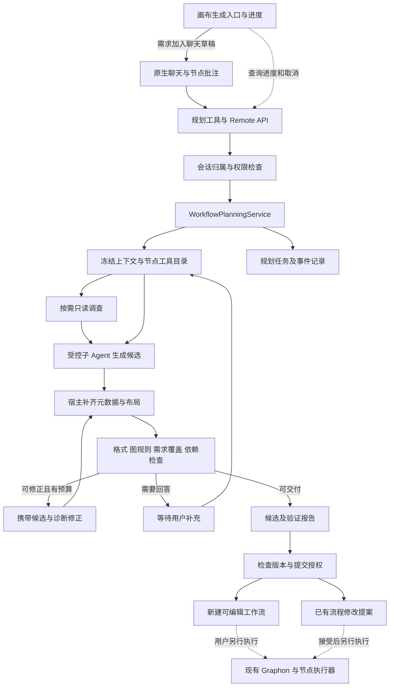
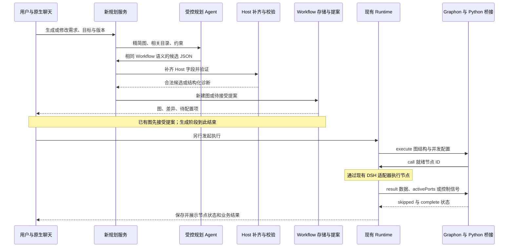
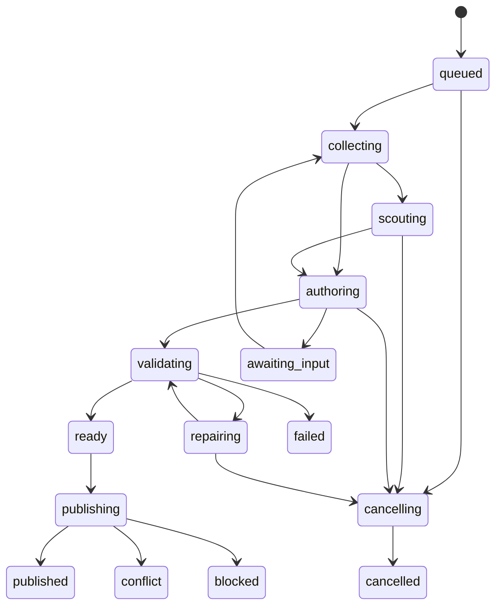
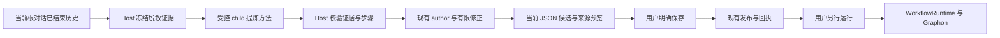

# Agent 辅助生成工作流后端引擎执行方案

> 2026-10-21 说明：工作流预算系统已于 2026-10-20 移除（见 [S12](<../doc/workflow-manual/规划引擎/设计/tasks-规划提速与上下文复用.md>)）。本文涉及预算问答、额度、增额或费用的内容仅为历史记录，不再执行；Token 用量只作性能计量保留。

> 2026-10-19 当前状态：新编译工具已安装到 Desktop，保留 JSON v2/Graphon；复用原试做完成 R7 两组生成图验收，详见[第 21 篇](../doc/workflow-manual/规划引擎/21-编译工具安装与R7闭环验收.md)与[实际耗时及结果](evidence/r7-compiler-desktop-20261019/README.md)。下表及正文保留原设计阶段记录，历史暂停限制已被本次用户明确恢复授权取代。

| 项目 | 内容 |
| --- | --- |
| 方案版本 | v0.0.2；R7 自动执行、验证与反推代码已冻结安装；真实闭环验收按用户要求暂停，原 v1.4/v1.5 为历史方案修订号 |
| 引擎版本 | 原实现 v0.0.1 → 本轮 v0.0.2；与 Workflow `formatVersion:2`、Graphon 版本分开 |
| 日期 | 2026-10-18 |
| 适用项目 | `dsh-visible-dynamic-workflows` |
| 引擎名称 | 工作流生成引擎；内部服务名 `WorkflowPlanningService` |
| 本轮范围 | 先提交第 22 节 R7 方案，再实现 managed 执行 child、执行前冻结验收规范、Host 读回验证和独立 verified-trial 来源，复用提炼、局部编辑、优化与 Graphon；当前对话提炼及已有图修改不强制重执行。预算目标超出保留候选。R7 已安装并完成真实试做及文件核验；提炼引用校验失败后修复被暂停，先优化工具算法再恢复闭环 |
| 源码基线 | R7 计划先行提交 `b0591e1`，实现冻结于 `021c293954bc4e17cec5aa589d271c2e0676443c`，已本地安装；R6 基线为 `2ecf15d`。v0.0.1 基线 `19011b9`，R1 `130dc1e`、R2 `4316630`、R3 `ef954db`、R5 `5482db6` 为历史版本；当前安装及暂停交接见第 22.7 节，第 21 节保留 R6 历史证据 |
| 宿主基线 | 实装 Desktop `0.2.1-rc.2`；项目编译 SDK `0.2.1-rc.1`，两者接口差异按本轮官方审计记录核实 |
| 上位要求 | [PRD v0.0.2](../PRD-v0.0.2.md)、[现有实现与验收](PRD-v0.0.2-实现与验收.md)；本方案补充生成能力，不替代既有执行、权限和 Secret 规则 |

**采用本项目自己的生成引擎：宿主控制任务、权限、阶段和校验，原生子 Agent 负责结构化生成和有限修正，最终产物仍是本项目的 Workflow 节点图。借鉴外部包的调查、结构化生成和有限修正方法；官方 workflow 脚本编排仅作为后续可选能力。**

**保留 Graphon 作为业务图调度内核。Agent 复用现有 Workflow 语义，通过局部编辑由 Host 补齐完整 JSON。现有 author/optimizer 不执行业务；第 22 节已为新建可复用任务接入独立的受控执行与验证阶段，完整闭环验收现已暂停。原任务完成、候选生成、节点回归、工作流保存及生成图的业务运行分别留证，不直接借用导入覆盖入口发布改图，也不新增第二套图运行器。**

文中“现有”表示对应阶段源码已核对；“新增”“拟”“必须”表示方案要求，实施事实按各节日期及验收记录区分。当前安装及暂停事实见第 22.7 节；首轮定向、冻结自动回归、真实试做和未完成的生成图验收分别记载；默认值不是实测性能。引用 `[Pxx]` 指本项目，`[Exx]` 指外部插件，`[Oxx]` 指官方包；完整出处与适用范围见第 15 节。

## 0. 本轮修订编号与唯一基线

| 编号 | 修订内容 | 影响章节/阶段 |
| --- | --- | --- |
| J01 | 当前 `formatVersion:2` 是唯一交换格式；拒绝 v1，不转换旧包；本地存储 schema 2 拒绝旧 schema，不改写旧文件 | 5.5、P0、A35 |
| J02 | Agent 角色仅由 `workflow.subAgents[]` 和 `config.subagentId` 表达；移除 Agent 节点旧 rolePresetId 及自动迁移。其他模型节点仍可引用角色预设 | 5.2/5.3/5.5、P0/P3 |
| J03 | 保留真人预算问答，v1.5 明确为 workflow × 真实主对话一次；新对话重问，明确修改才重开；`budgetDecision/executionPolicy` 由 Host 采用已确认选择，模型不能代答或提高额度 | 5.1、7.1、10、19.4、P4/P5/P9 |
| H01 | 实装宿主升级至 0.2.1-rc.2，项目 SDK 当前为 0.2.1-rc.1；分别记录，不把编译 SDK 当作实装版本 | 9、15、P0/P1 |
| H02 | 新 planner 只采用 `startActivation` 和 caller delivery，不使用旧 start/toolFilter/persona 参数 | 7.3、9.1、P1 |
| H03 | 子作用域首次组装及实际工具执行均施加限制；仅目录查询和 structured_output；禁止借 agentPreset 引入其他工具 | 9.1/9.2、P1、A14/A31 |
| H04 | 已发布 activation 的取消必须 dispose 并清理结果；signal 本身不足以停止任务 | 6、9.1、P4、A32 |
| H05 | 官方 workflow 仍是脚本编排；其子任务已用 activation，但未提供本项目完整图规划/权限契约。继续采用自有图规划服务，P7 后置 | 4、12.1、15、P7 |
| H06 | 新版子 Agent 可 continuable；本项目用每阶段独立 activation 并 dispose 实现单阶段生命周期，不依赖 SDK one-shot 假设 | 6、7.5、9.1、P1/P4 |
| I01 | 当前实现固定精简图投影，共用当前 kind/config schema；不新建另一套业务 JSON，Host 补齐元数据后走原保存/提案 | 5、P0/P2/P3 |
| I02 | 首版仅 author/repair 和冻结目录查询；额外资料走澄清，scout 和官方脚本后端继续后置 | 7、P1/P7、17 |
| I03 | 内部任务采用有界原子快照，发布回执与图/提案同写；明确记录当前额度、存储与预览限制 | 10、P4、17 |
| I04 | 聊天新建/修改/批注全部调用 plan；保留当前发送回执、目标图定位和提案接受；专门进度 UI 另行验收 | 11、P5、17 |
| R01 | 新增“从本次任务生成工作流”入口，只允许当前根会话、create 与 preview:true；不接受任意 sessionId | 11、18.1、P8 |
| R02 | Host 使用一次 sessionQuery.observeSession 固定历史，排除当前转换轮次与 fork 继承前缀，释放 observation；超限明确拒绝 | 18.2、P8 |
| R03 | 先生成有证据引用的 TaskProcedure，再交同一 planner 生成图；原始全文不重复进入图修正 | 18.3、P8 |
| R04 | 每条采集证据须被步骤引用或说明排除理由，未知、失败、摘录证据须保留待核对标记；每个保留步骤映射真实节点 | 18.3/18.4、P8 |
| R05 | distill 与 author 同享既有额度、准入、取消、澄清；提炼最多两次，图候选最多三次 | 18.5、P8 |
| R06 | 来源和 TaskProcedure 仅为规划任务伴随元数据；沿用唯一 v2 JSON 与 Graphon，不新增业务执行格式 | 18.4、P8 |
| R07 | 首版只采当前根会话公开记录，不展开子会话、附件或文件；子任务只使用父级已有摘要并提示证据缺口 | 18.2、P8 |
| R08 | 同步原子文档和离线验收记录；真实模型、桌面安装体验和跨样本复用效果另行验收 | 18.6、P8 |
| F01 | 注册官方原生 /dsh-visible-workflows 命令，直接调用同一规划服务；空命令原生补需求、明确选择新建或已有图 | 19.1、P9 |
| F02 | “交给 Agent”、@ 引用及明确自然语言优化继续经主 Agent 调用 planner；保留现有需求弹窗和用户发送，不做关键词硬拦截 | 11、19.1、P9 |
| F03 | 当前会话画布同步稳定目标、版本和 dirty 提示；Host 复核真实根对话、可见性与保存基线，不跨窗口猜测 | 19.2、P9 |
| F04 | 仅以真实发布回执同步完成提示或待接受提案；预览不冒充保存，不抢占画布，不自动接受或运行 | 19.3、P9 |
| F05 | 预算按 workflow × 真实主对话确认一次；显式修改单独问答并保持幂等/取消保留；preview 推迟到 publish；旧答案不回滚明确手动设置 | 7.1、19.4、P9 |
| F06 | 新增第 13 篇原子文档并同步当前说明；不改变 Workflow v2 或 Graphon，不合并历史与本轮测试计数 | 19.5/19.6、P9 |
| V02-01 | 引擎升级 v0.0.2，冻结 v0.0.1 工作区基线；JSON 继续仅支持当前 formatVersion:2 | 20.1、P10.1 |
| V02-02 | 当前对话已完成任务先提炼方法并生成不可变基线，再进入同服务的优化阶段，不重复执行业务 | 20.2、P10.2 |
| V02-03 | 最多两轮确定性替换；仅顶层 llm 替换为 template/JavaScript code；agent 暂保留，使用 Graphon 受控片段回放，不新增业务运行器 | 20.3、P10.3 |
| V02-04 | 只接受完整记录样本，拒绝合成样本；仅对受支持的无副作用节点变换使用真实 Graphon 回归，模型建议不充当验证证据 | 20.4、P10.4 |
| V02-05 | 运行目标是优化指标，不是规划停止错误；质量检查、基线保留、无收益/失败回退和有限停止共同约束候选选择 | 20.5、P10.5 |
| V02-06 | 返回基线/最终候选、替换说明、回归范围及成本对比；金额和 Token 无可靠证据时保持未知 | 20.5、P10.5 |
| V02-07 | 新任务统一 v0.0.2；旧任务仅保留回执/恢复所需的兼容读取边界，分阶段退役重复路径 | 20.6、P10.6 |
| V02-08 | 同步原子文档、版本记录与独立验收，不以历史安装或模型测试代替本轮证据 | 20.7、P10.6 |
| R7-01 | 新建可复用任务增加先执行、验证后提炼的闭环；已有完成证据和局部修改继续走原路径 | 22.1、P12.1 |
| R7-02 | 验收规范在执行前冻结，Host 独立读回产物；复杂语义和不足证据进入 needs-review | 22.2、P12.2 |
| R7-03 | managed 执行 child 与只读规划 child 分权；独立 verified-trial 来源只接受 Host 可信回执 | 22.2/22.3、P12.3 |
| R7-04 | 复用 distill、局部编辑、候选校验和 Graphon 片段回归；不将试做成功扩大为生成图全流程成功 | 22.3、P12.4 |
| R7-05 | 预算仍为优化软目标；保留合法候选，取消、权限、清理和未知副作用不降级为成功 | 22.4、P12.4 |
| R7-06 | 请求幂等、取消与冷恢复不重放原任务；持久化来源摘要及归属校验；冷恢复阻止旧执行 child 自动重放 | 22.4、P12.5 |
| R7-07 | 冻结源码与同版本独立归档后安装，隔离真实执行验收并核对用户数据保留 | 22.5/22.6、P12.6 |


当前字段说明以 [JSON 字段与导入导出](../doc/workflow-manual/原理/10-JSON字段与导入导出.md) 和同源 schema 为准。可选字段缺省仍是当前合法结构；未填写 Agent 身份可保存为待配置，但运行前须绑定合法定义。这不等于支持旧字段或自动迁移。历史验收原始文件保留为历史证据，不用作当前格式示例。

## 1. 产品目标与完成条件

### 1.1 用户能够完成什么

1. 用自然语言描述目标、输入、输出和约束，获得可以继续编辑的节点图。
2. 对已有流程或选定节点提出修改，获得范围明确、可以接受或拒绝的提案。
3. 看到生成进度、必要的澄清问题、待配置依赖及失败原因。
4. 生成错误可在有限次数内自动修正；无法修正时保留候选和诊断。
5. 沿用当前 DSH 模型和授权工具，不重复配置 API Key。
6. 生成结束后自主决定是否执行；生成过程不启动所生成的业务流程。
7. 在当前对话完成任务后，提炼可复用方法、参数和质量检查，返回来源可核对的工作流预览。

### 1.2 后端的交付物

每次生成返回一个可追踪的规划任务，包含：需求摘要、明确假设、待回答问题、候选 Workflow、验证报告、变更摘要、用量、来源摘要及发布结果。发布结果只能是以下之一：

- 新建：保存一个可编辑工作流，返回其 ID 和实际 revision。
- 修改：创建一个待接受的 `WorkflowProposal`，返回 proposal ID 和 baseRevision。
- 预览：只保留候选，尚未保存到流程库或提交提案。

这里的“可编辑工作流”沿用现有 `Workflow`；不能误存到只用于输入框等编辑状态的 `WorkflowDraft`。[P01][P04]

### 1.3 首版明确范围

| 纳入首版 | 留到后续 |
| --- | --- |
| 新建、整图修改、节点批注修改 | 无人值守地改变正在执行的图 |
| 单个受控子 Agent 的结构化生成；必要时增加一次只读调查 | 自由递归派生 Agent、自主无限优化 |
| 现有 20 类节点的配置目录与最终宿主校验 | 新节点运行语义、完整 Dify DSL 兼容 |
| 有限修正、取消、任务记录、版本冲突处理 | 任意 JavaScript 工作流反编译为画布 |
| 缺资料、模型、工具或 Secret 时给出待配置结果 | 代用户开通工具、填入凭据或切换供应商 |
| 当前聊天与画布入口接入同一个后端服务 | 新建一套聊天系统、工作流运行器或插件市场 |

## 2. 三方能力如何组成我们的引擎

✅ 表示本方案采用或借鉴，不表示该模块已经实现。

| 能力 | 本项目 | 外部 `@dsh-external/workflow` | 官方 DSH 包 | 实施决策 |
| --- | --- | --- | --- | --- |
| 节点图、稳定 ID、变量、容器 | ✅ 直接复用 | 输出格式不同 | 无对应画布协议 | Workflow 是唯一可执行定义 |
| 调查后再生成 | 补阶段控制 | ✅ 借鉴算法 | 提供原生子 Agent | 按上下文缺口决定是否调查 |
| 结构化输出、取消、子任务清理 | 复用适配经验 | 可参考生命周期处理 | ✅ 复用 `subagents.startActivation` | 新增独立 planner adapter，所有退出路径 dispose |
| 格式、图规则、宿主依赖校验 | ✅ 直接复用并补诊断代码 | 脚本校验不适用 | 仅辅助校验结构化输出 | 宿主校验为准 |
| 有限生成修正 | 新增控制器 | ✅ 首次加最多两次修正 | 无图规划器 | 最多三次候选生成 |
| 规划模式 | 扩充图模板 | ✅ 借鉴六类模式 | 可表达脚本编排 | 转成当前图规则，不导入任意脚本 |
| 修改提案、固定保护、版本检查 | ✅ 直接复用 | 审批语义不同 | 无对应画布提案 | 保留现有用户接受流程 |
| 模型选择与节点执行 | ✅ 复用现有宿主适配 | 不复制模型分档路由 | ✅ 宿主提供基础能力 | 默认锁定本次会话有效模型 |
| 复杂规划的多 Agent 分工 | 后续可扩展 | 不引入整套运行系统 | ✅ 满足权限条件后可选 | 首版不依赖 workflow 脚本引擎 |
| 最终执行、预算、运行恢复 | ✅ 保留现有执行系统 | 不另建平行运行系统 | 提供底层能力 | 规划账本与业务运行账本分开 |
| 导入导出 JSON 与图生成 | ✅ 共用 Workflow 语义和校验 | capsule 格式不同 | 脚本格式不同 | Agent 输出精简图；Host 补齐和导出 v2 包 |

外部包的 `create` 只生成 capsule，而 `run_workflow({request})` 会生成后启动脚本；本方案借鉴前者的职责分离，不调用后者作为生成入口。其 author schema 固定为脚本 capsule，不能通过传入图 schema 直接改成我们的生成器。[E01][E02]

## 3. 当前基础与需要填补的缺口

| 当前接入点 | 已有行为 | 本方案需要增加 |
| --- | --- | --- |
| `chat-bridge.tsx` | 新建请求分配目标 ID；修改先读最新图，再保存；新建后精确定位对应画布 | 从引导主 Agent 直接拼图，迁移到调用规划服务并跟踪 task ID |
| `visible_workflow_tools` | 返回当前会话可用的真实工具目录 | 为 planner 输出有界目录摘要和按 ID 读取详细参数的能力 |
| `visible_workflow_save` / `agentSave` | 新建保存；已有图提交提案；限制工作区和模型选择 | 抽取可复用的提交策略，让规划服务和旧工具走同一规则 |
| `workflow-validation.ts` | 外层 schema、逐 kind 配置解析、图规则、固定保护 | 给节点能力目录提供统一来源；提供稳定错误代码与路径 |
| `inspectWorkflowReadiness` | 检查真实模型、工具、文件、子流程等资源 | 作为生成前/提交前的被动检查，不执行任何节点 |
| `native-agent.ts` | 工作流节点使用原生子 Agent，首轮前绑定权限 | 复用生命周期和隔离模式，不直接复用节点执行器 |
| `WorkflowEditorState` | proposal、拒绝、接受、乐观版本控制 | 添加规划来源与幂等提交回执，保持现有接受操作 |

上述行为分别依据 [P01][P02][P03][P04][P05][P06]。实施前尚无专用规划任务状态机；本轮新增实现见第 17 节。

**两个不同的 Agent 角色：**规划 Agent 设计图；图里的 Agent 节点在业务运行时执行任务。后者现有的禁止递归委派、工具白名单和预算限制保持原样。不能为了规划能力放宽业务节点的执行权限。[P06]

## 4. 后端架构与模块划分

### 4.1 架构



### 4.2 文件与职责

以下均是拟新增或拟调整路径，实施前不得把路径存在与否当作完成证据。

| 拟建模块 | 单一职责 | 主要依赖 |
| --- | --- | --- |
| `src/shared/planning-types.ts` | 请求、状态、候选、问题、报告、事件的公共类型 | 现有 Workflow 类型 |
| `src/shared/planning-schema.ts` | 外部请求和模型输出 envelope 的严格解析与容量限制 | Zod、SDK 支持的 JSON Schema 子集 |
| `src/shared/node-capabilities.ts` | 20 类节点说明、输入输出、端口和配置规则的统一目录 | 从现有逐 kind schema 提取，不复制第二套规则 |
| `src/host/planning/service.ts` | 状态机、阶段调度、取消、修正次数和发布调度 | 下列独立模块 |
| `src/host/planning/context.ts` | 当前图、目标范围、目录、模型、引用资料的快照 | storage、catalog、model-defaults |
| `src/host/planning/agent.ts` | 原生 单阶段受控 activation 的创建、能力检查、工具约束、结果与清理 | DSH subagents、agents、tools |
| `src/host/planning/prompts.ts` | 版本化调查、生成、修正提示词 | 结构化上下文，不承担授权判断 |
| `src/host/planning/candidate.ts` | 将模型草稿补齐为 Workflow，保留未修改内容 | 节点 schema、编号、布局纯函数 |
| `src/shared/planning-projection.ts` | 从 Workflow 提取模型可编辑字段；按可信基线合并，限制修改范围 | 现有 Workflow/config 语义，不定义另一套执行格式 |
| `src/host/planning/validate.ts` | 汇总分层验证与需求覆盖结果 | parseWorkflow、graphIssues、readiness |
| `src/host/planning/publish.ts` | 同步重验后保存新图或提交提案；处理幂等回执 | 共用提交策略、storage、editor |
| `src/host/planning/store.ts` | 原子保存任务快照、事件及恢复状态 | 私有状态目录及现有 Host 生命周期 |
| `src/host/planning/budget.ts` | 规划调用预留、结算、未知用量、排队和时限 | 可抽取的 admission 原语 |
| `src/host/planning/tools.ts` | 向主 Agent 注册规划接口 | `WorkflowPlanningService` |

`src/host/index.ts` 只负责装配服务、注册 Remote 和绑定现有策略。前端只接收结构化任务状态，不自行串联模型调用，不保存另一份权威执行图。

### 4.3 Graphon、规划引擎与现有 Runtime 的职责边界

| 组件 | 负责什么 | 与其他组件交换什么 |
| --- | --- | --- |
| 新规划引擎 | 理解需求、查询受控目录、生成图、有限修正、诊断、发布候选 | 输入需求和上下文；输出 Workflow 或修改提案，不输出业务运行结果 |
| 本项目 TypeScript Runtime | 节点业务逻辑、分支条件计算、模型/Agent/工具调用、变量作用域、权限、预算与持久化 | 把图结构交给 Graphon；接收就绪节点 ID；回传节点结果和控制信号 |
| Graphon 0.7.0 | 依赖就绪、边激活、未选分支跳过、汇合与有界并行调度 | 按图结构请求执行节点；汇总调度状态 |
| Python 桥接层 | 将本项目结构映射为 Graphon 图；用 JSONL 传递节点调用和结果 | `execute/call/result/skipped/complete/cancel`；只在本机子进程间通信 |
| DSH 原生服务和节点适配器 | 实际调用当前宿主模型、子 Agent、工具、受控文件与凭据能力 | 接收 Runtime 已核验的节点请求，返回执行结果 |

这里的 Graphon 集成是现有能力，不属于待开发的 planner。`GraphonBridge.execute()` 只向 Python 发送节点 `id/kind`、连线 `id/source/target/port` 和 `maxWorkers`；完整配置、权限及变量解析保留在 Host。所有节点在 Python 中统一包装为 `BridgeNode`，不会自动使用 Graphon 内置模型或文档节点。[P16][P17][P18]

循环和迭代的轮次、输入集合、变量作用域、终止条件由 TypeScript 实现，每轮/项的内部图再交给 Graphon。人工介入或预算等待时，Host 返回控制信号，由桥接层映射为 Graphon 暂停事件；恢复时重新建立图并复用 Host 已记录成功的节点结果，不持久化 Graphon 栈帧。该机制避免重放有成功检查点的节点；外部动作完成但成功记录尚未落盘时发生崩溃，不在此保证范围内，不能宣称所有外部副作用跨崩溃恰好执行一次。[P17][P18]

当前代码接受每图 1–8 个 worker；默认使用执行策略的并发数，未配置为 3，当前作用域含 `human` 或 `assigner` 时降为 1。桥接 README 的“单 worker”段落尚未跟上当前代码，本方案以源码为准。这是当前实现边界，不是本轮并发性能验收。[P16][P17][P18]

### 4.4 数据流与具体接入方式



具体实施约束：

1. 在现有 Host 生命周期装配一个 `WorkflowPlanningService`，注入目录、存储、共用提交策略、模型准入与原生子 Agent adapter。其依赖中不注入可执行业务图的 `runtime.start` 或 `graphon.execute`。
2. `planning-projection` 只做字段筛选与合并；`candidate` 从可信任务上下文补齐 ID、工作区、布局和元数据，再走 `parseWorkflow → 图/引用/保护检查 → readiness`。不把“跑一遍 Graphon”当作生成校验，否则会经节点回调执行实际操作。
3. `publish` 沿用/抽取 `agentSave` 的政策：新建调用 Agent 保存路径，已有图调用 `editor.propose`。接受提案仍走现有入口，不能直接修改运行中的图快照。[P01][P04]
4. 用户独立发起执行后继续使用现有 readiness、Runtime 启动和图快照机制；Runtime 内部调用现有 `GraphonBridge`。规划产物不需要新增 Graphon DSL、编译脚本或并行运行器。[P18]
5. 保持当前 Graphon 版本与桥接协议；本方案新增模块不修改 Python 调度协议。规划任务取消只清理规划 child，业务运行取消仍交给 Runtime；二者不会因复用 Workflow ID 而互相误取消。
6. 导出时从有效 Workflow 调用现有 `exportWorkflowPackage/exportWorkflowJson`；可移植包继续声明 `runtime: { engine: 'graphon', protocol: 1 }`。导出 JSON 不是传给 Graphon 的执行消息。[P13][P16]

## 5. 核心协议

### 5.1 用户请求与可信调用上下文

请求参数和宿主身份必须分开。`workspaceId`、会话归属、有效模型、实际权限和是否允许发布，由 Host 根据调用会话核实；模型传入同名字段不能改变这些值。

```ts
// 已落地的请求契约；权限与目标归属仍须由 Host 验证。
type PlanningRequest = {
  requestId: string;                 // 调用方稳定幂等标识
  operation: 'create' | 'revise';
  instruction: string;
  targetWorkflowId?: string;         // revise 必填；create 可绑定尚未存在的预分配 ID
  expectedRevision?: number;         // revise 必填且 >0；create 省略或为 0
  targetNodeIds?: string[];          // 批注目标；空表示整图
  preview?: boolean;                // 请求仅预览；不能以 false 绕过宿主只读策略
};

type PlanningCaller = {
  parent: Agent;                     // Host 持有，不进入模型 JSON
  sessionId: string;
  workspaceId: string;
  signal: AbortSignal;
};
```

普通可写规划请求允许保存新图或提交修改提案，不表示接受已有提案，更不表示执行。普通生成入口沿用已有语义，不新增重复确认；处于 DSH Plan Mode 或只读策略时只能预览，现有保存/执行限制继续有效。[P01]

创建请求中的 `targetWorkflowId` 是现有聊天生成入口预留的新图身份，Host 必须确认其尚未存在；不能借 `operation:create` 覆盖已保存流程。没有预留 ID 时，由上下文装配生成新图身份，不改写已用于幂等摘要的原请求。创建请求不能携带既有节点范围；修改请求的期望版本必须等于保存快照。身份预留属于规划调用协议，与是否支持旧工作流 JSON 无关。`referenceIds` 不属于当前首版请求，资料调查接入后再单独扩展可信引用契约。

### 5.2 规划上下文快照

当前 `PlanningTask` 保存调用会话与工作区、稳定请求 ID、原始需求和输出契约；`PlanningContext` 冻结：

- 原 Workflow（含 revision、固定状态与本地元数据），用于发布前版本与摘要对比。
- 目标节点范围和 Host 预分配的节点、子 Agent、环境变量 ID 池。
- 当前 subAgents 定义；只向模型投影 id/name/prompt，本地 sessionId/预设来源仍由 Host 保留。
- 创建预算的真人选择；已有预算从基线保留。只读预览不收集或写入预算，明确发布时补问。
- 当前请求的模型与思考强度，真实工具目录与参数 schema；节点目录从逐 kind validator 生成。
- 澄清答案、有限候选、校验诊断及已知/未知用量。模型只看到允许编辑的图投影和必要摘要。

当前不读取额外文件，也不保存虚构的资料来源标识。独立 scout、消息证据引用和 prompt/schema 多版本管理是后续扩展目标，必须另加可信契约，不能由模型填写权限字段。

目录查询采用“摘要 → 按 kind/ID 读取详情”。当前默认每页 3 条，返回 total、offset、limit 标明范围；精确 kind/ID 匹配优先于名称描述搜索。author/repair 可以调用仅返回冻结快照的 `planner_node_catalog`、`planner_tool_catalog` 获取详情；这两项不读取新文件、不查询外部系统、不执行目录中的工具。调用计入 child 步数和预算，不把正常目录分页变成用户澄清。不能默默删掉依赖后声称目录完整。资料文本、图中提示词和工具描述作为不可信数据，不作为权限或阶段指令。[P02][P06][E03]

### 5.3 模型输出与 Workflow 的关系

当前官方 SDK 的结构化输出支持有限的 JSON Schema 关键词。不能直接把含 `$ref`、复杂约束和递归引用的 Zod 导出结果交给 provider，并假设完整生效。[O01][O02]

首版基线使用兼容 envelope；`graphJson:string` 是当前方案的兼容选择，不是 SDK 强制只能接收字符串：

```ts
type PlannerOutput = {
  outcome: 'candidate' | 'needs-input';
  graphJson: string;                 // candidate 时为严格 JSON；needs-input 时必须为空
  summary: string;
  assumptions: string[];
  questions: { id: string; question: string; options: string[] }[];
  requirementCoverage: { requirementId: string; nodeIds: string[]; note: string }[];
};
```

SDK 层只约束 envelope 的基本形状；Host 再检查条件关系、字节上限、图 JSON 和逐 kind 配置。`graphJson` 是当前 Workflow 的模型编辑投影，不是第二种执行 DSL：

1. 包含 title、description、nodes、edges、subAgents 和本次明确允许调整的环境变量声明；Agent 的 config.subagentId 引用同图定义，config.prompt 仅表示该节点任务。
2. 不接受模型决定 workspace、revision、时间、运行状态、授权、Secret 原值和凭据绑定；budgetDecision、executionPolicy、subAgents[].sessionId/rolePresetId/rolePresetRevision 由 Host 保留或设置。
3. 修改时已有节点必须保留稳定 ID；新增节点只能使用 Host 预分配的 ID。ID 池不足时给出容量诊断，不让模型自行扩容。
4. 节点语义配置直接采用现有 `kind/config`；容器 `body` 递归使用相同投影规则。
5. 坐标、结构编号、新边 ID 和时间由 Host 补齐；已有节点位置、便签和编辑状态默认保留。模型不能通过伪造布局字段改动固定节点。
6. 不做全文字符串替换来重命名节点引用。提前使用稳定 ID，避免误改普通文本、字段名或代码字符串。

首版 `graphJson` 顶层只接收 `title/description/nodes/edges` 及可选 `subAgents/environmentVariables`；节点只接收 `id/kind/title/config`，边只接收 `source/target` 及可选 `port`，容器 `body` 递归使用同样投影。旧节点删除须在 `targetNodeIds` 明确指定，指定容器包含其内部节点；未指定目标的整图修改也不能静默删除已有节点。局部修改不能改写范围外节点、移动其容器归属，或通过共享角色/变量间接修改范围外节点。Host 保留已有位置、编号与本地绑定，为新增对象补齐展示字段。

模型输出中的 `config`、端口、变量引用和容器语义直接来自现有导入导出 JSON 的 `workflow` 字段。精简投影本身不能直接传给当前 `parseWorkflowPackage` 或导入 Remote；只有经过 Host 补齐才成为完整 Workflow，可再包装为合法的导出包。传输兼容与 token 取舍见 5.5—5.6 节。[P13]

现有外层 `workflowSchema` 对 `node.config` 的约束较宽，实际配置靠 `parseWorkflow` 二次解析。节点目录必须从逐 kind 配置定义产生，并包含 HTTP 受控凭据分支、容器和公共执行字段，不能只导出外层 schema。[P03]

### 5.4 任务结果

结果分别报告三个维度，避免一个“成功”掩盖差异：

| 维度 | 字段示例 | 含义 |
| --- | --- | --- |
| 候选有效性 | `validity: invalid / valid` | 格式、结构、引用和保护规则是否通过 |
| 运行准备度 | `readiness: ready / needs-configuration / unknown` | 检查时点宿主依赖是否齐备 |
| 发布结果 | `publication: preview / created / proposed / conflict / blocked` | 是否进入流程库或提案系统 |

业务需求覆盖另用 `coverage` 报告。`ready` 不表示已经运行，更不证明模型输出、网络调用或业务结果正确。[P05]

### 5.5 直接复用导入导出 JSON 的方式

采用“一套 Workflow 语义、三种用途”，不增加第二套节点 DSL，也不为规划功能提升公开包格式版本：

| 数据形态 | 内容 | 由谁构造、用于哪里 |
| --- | --- | --- |
| 完整 `Workflow` | 节点、连线、配置、变量声明、布局、编辑状态和宿主元数据 | Host 补齐；画布、存储、提案与 Runtime 的共同定义 |
| 可移植 `WorkflowPackage` | `format/formatVersion/runtime`、主 workflow、附带 workflows、presets、dependencies | 现有导入导出；仅接受当前 v2；不提供旧结构转换 |
| 规划编辑投影 | Workflow 中允许模型设计的字段，保留同名 `kind/config/edges` 与引用语法 | Agent 输入输出；不单独持久化为可执行图或冒充可导入文件 |

现有包的 `format` 为 `dsh-visible-workflow`；`formatVersion:2` 与 `runtime.protocol:1` 是不同维度，规划内部 schema 版本也不得混用这两个字段。[P13]

**直接共享或提取共用的部分：**

- 逐 kind 配置 schema、`parseWorkflow`、图与引用检查；规划上下文和导出包都从相同 Workflow 类型派生。
- `workflowDependencies()` 的依赖发现，结合真实 Host catalog 检查可用性；包中的 `dependencies` 不能授予权限，也不能替代从图重新计算。[P13][P14][P15]
- JSON 容量、深度、危险键、Secret 声明与文件边界规则。包解析的 8 MB 上限不是模型输出预算；规划输出继续执行更小的独立限制。
- 现有 JSON 导出函数和 UI。JSON 导出主要调用共享函数；Host 的 `exportArchive` 返回资料 ZIP/base64，不把 ZIP、附件 base64 或文件全文作为模型需要回传的数据。[P01][P13]

**不直接复用导入提交动作的原因：**

| 现有导入行为 | 对 Agent 生成/修改的影响 | 规划引擎处理方式 |
| --- | --- | --- |
| `importWorkflowJson` 重建 workflow、node、edge、环境变量、角色等 ID | 破坏预分配目标 ID、已有节点身份及聊天定位；重复 repair 会反复换 ID | 本地新建用任务预分配 ID；修改保留已有 ID；外来模板的身份映射仅在任务初始化建立一次 |
| `importPackage → storage.importBundle` 可新建或按版本覆盖 | 覆盖是用户导入语义，不经过 `agentSave` 的模型策略和修改提案流程 | Agent 发布统一走共用 Agent 提交策略，不把 import Remote 交给规划 child |
| 导出/导入清理绝对文件路径、上传句柄、凭据绑定，环境值默认省略 | 可移植副本不等于当前工作区完整上下文 | 规划上下文从当前可信图取值并按权限裁剪；缺失字段从冻结基线保留，不用导出包覆盖本地图 |
| 随包附带子流程和角色 | 全量包增加 token，也引入多实体创建与提交语义 | 首版规划只生成一个根 Workflow，引用已有授权子流程/角色；批量生成新子流程/角色另立契约 |

上述区别不改变用户显式导入文件时的现有流程。已有 JSON 包若作为规划参考，先 `parseWorkflowPackage`，再提取获准引用的模板语义及依赖；共享纯校验/诊断，不能把包含 ID 重建的完整 `prepareWorkflowImport` 当作每轮候选规范化函数。[P13][P15]

要求补充两类兼容验收：一是模型投影补齐后可经现有解析、画布展示和导出，导出包可被现有导入预览识别；二是对导出后的可移植语义进行 round-trip 比较，允许身份重建和约定的本地绑定清理。不能要求 import/export 前后逐字节相等，也不能把这些预期变化误当作模型改图授权。

### 5.6 token 优化与本轮离线估算

复用现有 JSON 有助于减少第二套格式说明和转换出错，但不天然减少所有 token。收益来自让模型少生成可推导字段、少读取无关上下文、减少失败后的重试。优先顺序如下：

| 策略 | 首版决策 | 约束 |
| --- | --- | --- |
| 去掉模型不应决定的元数据、布局和包外壳 | ✅ 默认启用，Host 补齐 | 修改时保留可信原值；不能丢失业务配置或 fixed 约束 |
| dependencies、runtime 标识由 Host 推导 | ✅ 默认启用 | 仍给模型必要的真实工具/资源目录 |
| 紧凑 JSON，不重复输出同一份图和长篇说明 | ✅ 默认启用 | 保留简短 summary、必要问题与需求覆盖，输出不可截断 |
| 目录按需加载，仅提供相关工具 schema | ✅ 使用任务冻结目录 | 标明截断范围，不隐瞒所需能力 |
| 省略重复模型配置 | 只对 Host 能确定的新增节点应用 | 已有显式模型和语义相关默认值不得盲目移除 |
| 局部变更操作代替整图返回 | 后续可选优化，首版仍用完整精简候选 | 需要 baseRevision、稳定 ID、范围检查、完整合并和重验；不能靠截断图省 token |
| 将 `graphJson` 改为原生 `graph` 对象 | P0 契约探测候选，未通过前保留字符串基线 | SDK 基本 object 能力不等于支持完整递归 schema；每个 provider 验证，不静默切换协议 |

`graphJson` 嵌在外层 JSON 中需要转义，存在额外开销。P0 可比较浅层结构化 `graph` 对象加 Host 深校验与当前字符串方式，选定后固定 schema 版本、同步 fixtures；两种方式都保持同一 Workflow 语义。不能称字符串方案为最省 token，也不能为了省转义开销绕过结构化输出和 Host 校验。[O01][O02]

本轮使用当前导出/解析函数构造两个串行样例，离线比较如下。前三列均带同一个 `PlannerOutput` envelope，包含 `graphJson` 字符串转义；因此比较口径一致。[B01]

| 人工样例 | 完整格式化导出包 | 完整紧凑导出包 | 精简投影 JSON | 相对紧凑完整包减少 |
| --- | --- | --- | --- | --- |
| 3 节点：input → llm → output | 906 | 607 | 385 | 36.6% |
| 8 节点：input → 6 个 llm → output | 2,310 | 1,641 | 1,235 | 24.7% |

单位为 `cl100k_base` 估算 token。用随项目分发、校验过摘要的词表，计数期间禁止网络，没有真实模型调用；原始样例、序列化文本和指标保存在 [离线测量记录][B01]。这份测量保留的是此前两个示例，不包含本轮新增的子 Agent/预算字段，也未针对本轮最终请求重新计数；当前实现和契约回归另见第 17 节。

这些数字**只表示两个样例的输出序列化开销**，不含提示词、schema、目录、输入上下文、推理和修正轮次，也不是 DeepSeek 或其他当前模型的计费数字。长提示词、复杂 config、容器或大量已有节点会改变比例，不能承诺整个生成任务节省 25%—37%。正式实施须比较相同任务的总 input/output token、失败重试、成功率和时延；当前建议以保持正确率为先。

## 6. 状态机与生命周期

### 6.1 主要状态



图中省略的 collecting、validating、awaiting_input、ready 同样可以取消。任一运行阶段遇到宿主关闭可进入 `interrupted`；模型或基础设施不可恢复失败可进入 `failed`。`published` 结束生成任务，但其提案是否被用户接受仍由现有提案系统管理。

### 6.2 状态不变量

1. 每次状态更新带单调递增 `taskRevision`；事件带单调 `sequence`。
2. 每次 child 调用带 `attemptId` 与任务 generation epoch；晚到结果必须匹配当前 epoch。
3. 取消先进入 `cancelling`，阻止新调用和提交；收到子任务终止/清理回执后才成为 `cancelled`。清理超时保持阻断并报诊断，不伪称已停止。
4. `failed/cancelled/interrupted/conflict` 不自动重试；用户发起明确的新请求或有界继续操作。
5. `awaiting_input` 期间不保留活跃模型调用；回答与问题批次 ID、任务版本绑定，拒绝旧回答覆盖新请求。
6. 单纯缺运行时输入应生成 input 节点；只有会改变图设计的关键歧义才进入澄清，例如是否需要发送到外部系统。
7. Host 重启后不会自动重新调用模型或执行流程；未结束任务标记中断，候选与诊断保留。

### 6.3 幂等和取消竞争

- 幂等键为 `workspaceId + sessionId + requestId`。相同键和相同规范化请求返回原 task；相同键、不同内容返回 `REQUEST_ID_CONFLICT`。
- 取消与发布使用同一任务提交锁。发布前取消胜出则不保存；发布先完成则返回已有发布回执，不能谎报取消成功，也不自动删除已保存图。
- 首版采用等待结果的工具协议：service 创建 task ID 后，`visible_workflow_plan` 保持等待，直到 ready/published、awaiting_input 或失败/取消；前端可以在等待期间读取 task 进度。返回 awaiting_input 时没有活跃 child，用户回答后由新的工具调用继续同一任务。
- 每轮任务控制器组合当前 `exec.signal`、用户取消、总时限和 Host dispose 信号。页面关闭本身不取消；原调用停止或父 Agent 失效则停止当前 child，保留中断记录。正常工具返回时不留下后台模型调用，不创建无关父会话。
- 后续若增加立即返回 task ID 的后台模式，必须先绑定宿主实际的父会话停止/销毁事件并独立验收取消传播；不把该模式作为首版默认协议。

## 7. 生成算法

### 7.1 阶段 A 归属与上下文

1. 从工具的 `exec.agent` 或宿主认证的会话上下文获取 parent；核实 workspace 成员关系。
2. 校验输入长度、操作类型、target ID、expectedRevision 和目标节点是否存在。
3. 冻结图、模型和目录。新建 ID 沿用现有入口预分配值，避免聊天侧栏跟踪到另一张图。
4. 普通可写的新建、修改和优化，在当前真实主对话尚未回答此 workflow 的执行预算时，先完成真人问答；账本按工作区、根对话和 workflow ID 隔离。同对话复用，新对话重问；只有用户明确修改预算才重开。只读或显式预览不提前询问，后续发布补齐。已有图元信息或导入 JSON 不能代答。
5. 将用户目标拆为有稳定 ID 的需求项；用户原话和引擎推导的假设分开。
5. 大图超过当前上下文预算时返回范围限制或请求缩小修改范围，不截断完整图后做全图覆盖。

### 7.2 阶段 B 按需调查

默认先做不调用模型的上下文装配。只有用户要求结合资料、当前上下文确实缺少事实且已授权读取时，启动一次 scout：

- 调查工具只允许可信的只读能力，并与父会话实际权限求交集。
- 首版优先开放插件自有的目录和授权引用读取接口；任何通用文件读取都要限制在已授权范围并检查真实路径、符号链接、大小和文件类型。
- 不因名称包含 `read` 就认定工具只读；未能确认能力的 MCP 工具不向 scout 开放。
- 不开放 shell、`run_code`、写文件、网络业务操作、CLI Worker、任意委派或 workflow 执行工具。
- 调查结果列出证据来源、缺口及事实，不输出可执行宿主指令；没有读取回执的“已查看文件”只能作为未验证声明。

简单的节点提示词修改可跳过 scout，直接使用当前图、批注与目录。调查机制参考外部只读筛选和两阶段 authoring，但不照搬每次必调 fast/deep 两种模型的策略。[E01][E03]

### 7.3 阶段 C 结构化生成

通过原生 `subagents.startActivation({provider:'spawn', request, signal, delivery:'caller'})` 启动 单阶段受控 activation。输入包含用户需求、已有图、受控目录、必要证据、输出契约和不可变约束。生成 child 无业务工具权限，只保留冻结节点/工具目录的查询接口及结构化输出机制。目录查询包装器只能访问本任务快照，并绑定精确 child 身份；不能将 child sessionId 直接当作顶级工作区会话。[P06][O01][O02]

模型选择遵循本次有效会话快照；不静默切换 provider、模型或提高思考强度。现有节点显式模型原则上保留，新增节点由 Host 按规则补齐。父会话模型在生成途中变化时，旧任务继续使用冻结模型；发布时若现有提交策略不再允许该模型，报告 `MODEL_CONTEXT_CHANGED`，不暗中改成另一模型。[P01][P07]

生成器默认优先使用确定性节点完成确定性任务。合法流程可以没有 Agent 或 LLM 节点，因此不复制外部包 `NO_AGENT_WORK` 一类脚本质量规则。[E01]

### 7.4 阶段 D 宿主补齐和校验

模型输出通过 envelope 校验后，Host 解析 graphJson，补齐服务器字段、位置和编号，保留未要求修改的内容，再执行第 8 节的分层校验。补齐只处理可证明无歧义的元数据，不自动改变分支条件、工具选择或业务意图。

新建图使用稳定的分层布局；修改图只布局新增节点和用户明确要求重新布局的区域。布局方法可从现有前端纯函数中提取，不能让后端 import React 或浏览器模块。

### 7.5 阶段 E 有限修正

- 最多三次候选生成，即首次生成加最多两次修正；scout 不计入这三次，但计入总调用和预算。合法的 needs-input 输出计入澄清次数、child 次数和模型用量，不占候选修正次数；无效 envelope 或无效候选计入失败尝试，不能靠反复格式错误无限重试。[E01]
- 修正输入必须包含上次候选、稳定 issue code、字段/节点路径、原需求、允许编辑范围和不可变约束；不能只发送一句错误字符串。
- 只有可由修改候选解决的问题进入修正；缺用户资料、权限、模型、Secret 配置和版本冲突不消耗修正轮次。
- 每次修正重新通过全部校验。连续出现同一候选摘要和同一问题集合时提前终止。
- 不能为让校验通过而移除用户要求的步骤、删除未解决分支或扩大工具权限。

### 7.6 阶段 F 交付与发布

候选结构有效但缺外部配置时，可以交付带“待配置”标记的可编辑图或提案。涉及未知业务选择时停在澄清；无效结构保留为规划诊断候选，不进入正常流程库。

进入发布前重新核实会话权限、工作区、版本、固定保护、模型策略和资源目录变化。新建调用共用保存逻辑；修改调用共用 proposal 逻辑。引擎始终不调用 `runtime.start`、`visible_workflow_run` 或外部 `run_workflow`。

## 8. 分层验证与错误处理

| 层级 | 检查内容 | 现有基础 | 失败处理 |
| --- | --- | --- | --- |
| V0 输入边界 | envelope、JSON、大小、递归深度、保留字段、ID 池 | 新增 planning-schema；现有 JSON 容量约束 | 可修正格式错误；越权字段直接阻断 |
| V1 节点配置 | 所有 kind 的配置与容器 body | `parseWorkflow` | 回传 kind/path 诊断修正 |
| V2 图与作用域 | ID 唯一、端口、拓扑、入口可达性、容器、引用范围 | `graphIssues`、reference-scope | 图错误修正；不吞掉坏分支 |
| V3 修改保护 | fixed、未授权范围、baseRevision、会话归属 | `protectFixedNodes`、storage/editor | 保护违规阻断，过期保留冲突候选 |
| V4 资源条件 | 模型、effort、工具来源、参数、角色、子流程、文件、Secret 状态 | `inspectWorkflowReadiness` 加规划依赖校验 | 真实缺配置保留；编造依赖或错误参数由模型修正 |
| V5 需求覆盖 | 每项需求映射节点/输出，解释假设和遗漏 | 新增覆盖检查 | 确定性遗漏可修正；语义不明询问 |

现有 `graphIssues(flow, false)` 允许未完成草稿，不能用它替代执行级检查。实现时应将纯图语义诊断与运行配置不足分离，稳定代码由规则产生，不能靠匹配中文错误字符串分类。V2 必须覆盖普通变量引用，V4 在补入有效模型快照后检查配置。[P03][P05]

V4 进一步区分依赖来源和参数错误：冻结目录或已有基线中存在的工具当前断连/失去权限，属于待配置；模型生成目录外且无既有依据的 ID，属于 `UNKNOWN_TOOL_ID`，不能作为合法图发布。用户明确要求但尚未接入的能力保存为 `unresolvedDependencies` 需求记录，不伪造可执行 tool ID，也不在能力尚未落实时标记需求覆盖完成。

现有 readiness 的工具参数检查主要覆盖存在性和必填键，不足以证明完整参数类型正确。新增规划参数校验：静态字面量按真实工具 schema 检查；含变量映射的参数通过引用类型和必填映射检查；实际运行时才有值的约束标记延迟验证，不能把模板字符串当作最终数值直接判错。正确声明的运行时输入尚未填写属于正常输入收集。[P05]

`code` 节点在规划期只检查配置与可提供的静态规则，不执行其源码；HTTP、工具、Agent、文档解析、子流程同样不执行。“模拟检查”只能指无副作用的结构检查，不能声称覆盖全部运行分支或业务结果。

拟定诊断格式：

```ts
type PlanningIssue = {
  code: string;
  severity: 'error' | 'warning' | 'needs-configuration';
  stage: 'input' | 'graph' | 'policy' | 'dependency' | 'coverage';
  nodeId?: string;
  path?: string;
  message: string;
  repairability: 'model' | 'user' | 'host' | 'none';
};
```

| 代码示例 | 归类 | 动作 |
| --- | --- | --- |
| `OUTPUT_NOT_JSON` / `NODE_CONFIG_INVALID` | model | 候选尝试次数内修正 |
| `EDGE_PORT_INVALID` / `REFERENCE_OUT_OF_SCOPE` | model | 给出端口/作用域证据后修正 |
| `REQUIREMENT_UNCOVERED` | model 或 user | 明确遗漏则修正，需求歧义则澄清 |
| `UNKNOWN_TOOL_ID` / `TOOL_ARGUMENT_INVALID` | model | 按真实目录修正；不能转换成让用户配置编造工具的提示 |
| `FIXED_NODE_CHANGED` / `EDIT_SCOPE_EXCEEDED` | none | 阻断；重新规划允许范围 |
| `WORKFLOW_REVISION_CONFLICT` | user | 保留旧候选，基于新版本另起任务 |
| `TOOL_UNAVAILABLE` / `FILE_REQUIRED` / `SECRET_UNCONFIGURED` | user 或 host | 列出待配置项；不自动重试模型 |
| `PROVIDER_CAPABILITY_MISSING` / `MODEL_CONTEXT_CHANGED` | host 或 user | 明确原因，禁止静默换模型或降权失效 |
| `BUDGET_EXHAUSTED` / `DEADLINE_EXCEEDED` | user | 停止后续调用并保留结果 |

## 9. Agent 权限与宿主兼容

### 9.1 原生 adapter

固定使用新版托管激活：`subagents.startActivation({provider:'spawn', label, request:{parent,prompt,agentOptions,outputSchema,maxDepth}, signal, delivery:'caller'})`，返回 `childId/result/dispose`。`maxDepth` 为 parent 绝对深度加一。新接口不再接收 `toolFilter/persona`，不回退旧 `start`；权限必须在精确 child 的首轮组装之前用宿主工具限制和执行 guard 实施，角色指令通过 `interpolate:false` 的受控提示段注入。[O01][O02]

激活的 `signal` 只保证发布前取消。发布后取消必须主动调用并等待该 activation 的 `dispose()`，同时观察 result 的 rejection；正常完成、异常、超时和 Host 卸载全部执行清理。不能只 abort signal 后将任务标记为 cancelled。

只有 `stopReason === 'completed'`、`structured !== undefined`、child 身份正确且任务未被取消/替代时，才进入候选校验。其他情况均不能从最终自然语言文本猜测一个成功结果。

启动前核实 provider 能力，首版要求原生 spawn、独立上下文和所需的结构化输出、深度限制、模型参数能力，以及 Host 可证明有效的首轮工具限制/实际执行 guard；不能再要求 provider 声明已删除的 toolFilter/persona capability。能力缺失返回明确错误，不退回不受控的文本聊天生成。

现有 `createNativeAgentExecutor` 与业务 WorkflowRun、节点配置、业务预算和输出修复绑定，不能直接套一个假运行来使用。新增 `planning/agent.ts`，必要时只抽取首轮前绑定、原生工具模式、执行入口拦截和清理等小型共享原语；不能扩大现有节点执行器允许工具的正则范围。[P06]

### 9.2 调查与生成分权

| 阶段 | 可见工具 | 可写对象 |
| --- | --- | --- |
| 上下文装配 | Host 受控元数据读取 | 规划任务内部记录 |
| scout | 已确认的只读工具与父会话授权的交集 | 无业务写操作 |
| author / repair | 冻结节点/工具目录查询与结构化输出；不提供业务工具 | 仅返回候选数据 |
| Host validate | 被动目录和路径检查 | 验证报告 |
| Host publish | 现有保存/提案接口 | 受权限与版本限制的流程定义或 proposal |

工具必须在首轮模型请求前受约束，并在实际执行入口再次验证；只从提示词移除工具不足以构成权限边界。父会话正文、工具返回及资料内容都不能新增权限。[P06][O02]

### 9.3 Plan Mode 与只读策略

保持现有 `assertMutable` 的保存/执行限制。预览请求只允许宿主政策本身允许的模型和只读操作；若政策不允许子任务或任务持久化，则使用允许的会话记录/内存预览或返回不支持，不能自行宣布豁免。

退出 Plan Mode 不触发自动提交。用户继续原生成任务并明确选择保存时，使用 `publishPlanning` 重新检查当前权限和 candidate digest。正常模式下原本已经授权“生成可编辑工作流”的请求可以自动保存非运行图，不增加额外确认。

### 9.4 Secret 和工具目录

planner 只接触 Secret 声明与被动状态，绝不读取、索取、记录原值或本机凭据绑定。结构化输入和输出对 Secret 附加字段使用严格拒绝规则。普通环境变量是否送入模型按实际需要最小化，缺失值可保留待配置。

工具目录来自本次会话真实 registry；规划器不能发明 tool ID。工具目录中出现业务 workflow 工具，不代表生成 child 有调用它的权限。目录文本和工具执行权限分别控制。[P02][P05]

## 10. 并发、预算、持久化与原子提交

### 10.1 初始限制

以下按 2026-10-18 B 修订更新。实现由规划服务和驱动管理；不把用量统计误作模型价格或金额预算。

| 限制 | 拟定默认值 | 执行方式 |
| --- | --- | --- |
| 同一任务活跃模型调用 | 1 | 首版各阶段串行 |
| 同工作区活跃规划任务 | 1 | 其余有界排队；可取消 |
| Host 活跃规划任务 | 2 | 与现有模型准入协调 |
| 等待队列 | 每工作区最多 5 个 | 超出明确返回繁忙，不丢任务 |
| 候选生成次数 | 3 次总尝试 | 首次加最多 2 次修正 |
| scout 次数 | 每个澄清版本最多 1 次 | 不重复读取已冻结事实 |
| 澄清次数 | 默认最多 2 批，每批最多 3 个问题 | 超出保留未完成计划，由用户重新明确需求 |
| child 调用上限 | 整个任务最多 8 次 | scout、author、repair、澄清轮次都累计 |
| 单 child 推理步数 | 当前 distill/author/repair 最多 8 步；scout 尚未实现 | 首轮前安装 `agent/pre-step` 准入和步数检查 |
| 全任务推理步数 | 最多 24 个 Agent step | 与 child 次数分别计数；不是供应商 HTTP 请求次数 |
| 每个连续处理阶段时限 | 20 分钟 | 含排队和模型等待；澄清回答后新阶段重新计时，总步数/次数/用量继续累计 |
| 单 child 无进展期限 | 5 分钟，模型流和工具进展刷新；另受总阶段期限约束 | 原生事件监听与 AbortController |
| 单次输出配置 | 沿用宿主对当前模型的默认选项 | 不强制 8,192；仍受模型和供应商能力限制 |
| 规划累计 Token 门槛 | 不设置 | 只记录可信用量和未知调用；请求字节不与 Token 混算 |
| 图生成范围 | 每任务最多分配 60 个新节点 ID、20 个子 Agent ID、20 个环境变量 ID | 同时受已有 schema 的每层 200、总节点 500、容器 5 层等约束；已有身份占用总容量 |
| 上下文与候选 | 每步输入和整个结构化输出各最多 2 MB | 请求体积保护单独报错，不称为预算不足；不静默截断 |

这些限制只针对生成任务，不修改现有业务运行上限。大模型供应商的实际计费、隐藏推理 token 和无法精确估计的输入意味着 token 预算是调度控制，不保证账单严格等于该值。

### 10.2 用量和共享准入

分别记录 `childAttempts`、`agentSteps` 和可观测的 `modelRequests`。一个 child 可能执行多次推理，SDK/provider 也可能重试；不能把 8 个 child 宣称为 8 次模型请求。真实请求计数没有可信事件时标记 unknown。[P06]

在精确 child 的首轮开始前安装 `agent/pre-step` hook，先检查步数和请求体积，单独记录输入字节和在途调用，不按混合估算拒绝 next step。工具目录查询所引起的后续推理同样准入。`maxTokens` 是单次输出上限，不是整个 child 的用量上限。[P06][P08]

每个 child 记录预留组和原生 task ID。优先按可信的逐请求回执结算；只能取得 child 累计用量时，在该 child 结束后对预留组一次性结算并去重，期间不重复释放占额。SDK result 若不直接提供 usage，读取该子任务的可信宿主用量回执；不可用记为 unknown，不按零计算。失败和取消也要结算，不能把规划成本混入后来启动的业务运行。供应商内部重试如果无法逐次准入，明确列为预算精度限制，最终累计回执仍须计入。[P06][P08][E01]

`ModelAdmission` 是实例级计数器。planner 另建一个实例并不能与业务运行共享总并发。若要声称插件内共同上限，必须由服务装配注入同一个实例，或抽取明确的 Host 级协调器，并验证公平性、排队取消和不同工作区的限制。[P08]

### 10.3 规划任务存储

在现有私有状态目录下新增 `planning/`，不写入工作区业务文件，也不采用外部 capsule/run store：

```text
$DSH_HOME/visible-dynamic-workflows/planning/tasks.json
```

- 当前首版采用一个 version 1 的任务快照文件；这是内部规划记录版本，与唯一工作流交换格式 v2 无关。
- 目录 0700、文件 0600；单 Host 管理，拒绝符号链接与非法 task ID；临时文件写入、fsync 后原子 rename。
- 每个任务保存状态、单调事件序号（最近 120 条）、基线图和冻结目录、候选、诊断、已知/未知用量及提交回执。损坏记录明确拒绝加载，不猜测恢复内容。
- 上限 100 个任务、32 MB。当前不自动删除历史，不在上限后静默丢记录；超限明确拒绝新任务。自动保留策略和用户清理入口后续单独实现。
- 预览仅在内存，重启后失效；明确发布且权限检查通过才转为持久任务。重启只恢复状态和原子回执，执行中的任务记 interrupted，不自动调用模型。
- 不保存私有推理文本；导出工作流不自动携带规划上下文、会话文本或权限状态。

### 10.4 发布事务与重复提交

仅有“先写图、再写 planning task 状态”会在进程崩溃后重复提交。实现时新增 Host 内部幂等提交包装：

1. 生成 `commitKey = taskId + candidateDigest + operation`；同一任务仅允许一个有效发布结果。
2. 新建图与其 commit receipt 在 `WorkflowStorage` 的同一次原子 persist 中写入。
3. 修改提案与其 commit receipt 在 `WorkflowEditorState` 的同一次原子 persist 中写入。
4. planning task 的 published 状态可稍后同步；重启先查目的存储中的 receipt，返回原 ID，不重复写图或重复提案。
5. 两类目的存储不需要彼此跨文件事务，但各自不能把内容与回执拆成两次写入。当前通过 `save(..., commit)`、`propose(..., commit)` 的 Host 内部可选参数共享已有校验和原子写入逻辑；该参数不开放给模型或工作流 JSON。
6. receipt 只属于宿主内部状态，不加入可交换 Workflow JSON，不由模型传入。保留期限覆盖任务幂等期限，避免清理后重新发布旧请求。

发布必须使用冻结的 baseRevision；不能在冲突时读取最新 revision 后原样重交。修改范围和固定保护在候选验证、提案创建、用户接受时均检查。[P04][P09]

## 11. 对外接口与现有入口接入

### 11.1 已注册 Agent 工具

| 工具 | 用途 | 边界 |
| --- | --- | --- |
| `visible_workflow_from_conversation` | 从当前对话已结束历史提炼任务并生成预览 | 仅当前根会话；来源由 Host 绑定；不保存、不执行业务 |
| `visible_workflow_plan` | 创建生成/修改任务，等待本轮结果，返回 taskId、状态和摘要 | 新建先真人预算问答；只读/Plan Mode 自动预览；不执行业务 |
| `visible_workflow_plan_get` | 按 task_id 读取状态、摘要、问题、回执与最近事件 | 精确主对话和工作区归属；预览可返回完整候选 |
| `visible_workflow_plan_answer` | answers_json 传完整 questionId/answer 批次，继续同一任务 | 绑定当前 revision；不重置累计预算；只转达用户回答 |
| `visible_workflow_plan_cancel` | 取消排队或生成，等待 activation 清理 | 清理失败标 blocked，不能报告已停止 |
| `visible_workflow_plan_publish` | 明确保存预览结果 | task_id + revision + candidate_digest，重验权限、基线和工具参数目录；不接受提案、不执行 |

`planner_node_catalog`、`planner_tool_catalog` 只注册在受控 child；分页返回冻结元数据。候选验证属于服务内部确定性函数，不开放绕过 task 的保存能力。没有为本轮新增 Remote 方法。

保留 `visible_workflow_list/get/tools/save/run/status/cancel`；自然语言生成与修改优先走 plan，save 保留明确提交当前完整 Workflow JSON 的能力。[P01][P02]

### 11.2 后续专门 UI 的 Remote 设计

以下接口尚未注册；专门规划 UI 接入时，可在现有 Typert namespace `visibleWorkflows` 下增加：

```text
startPlanning(requestJson, sessionId) -> task summary JSON
getPlanning(taskId, afterSequence, sessionId) -> snapshot + events JSON
answerPlanning(taskId, expectedTaskRevision, answerJson, sessionId) -> task summary JSON
cancelPlanning(taskId, sessionId) -> task summary JSON
publishPlanning(taskId, candidateDigest, expectedTaskRevision, sessionId) -> receipt JSON
```

这些是服务边界的拟定签名。首版 `startPlanning/answerPlanning` 不直接注册为 UI 写入口，生成与回答通过仍在等待的主 Agent 工具调用驱动，避免另建后台授权生命周期。`getPlanning/cancelPlanning/publishPlanning` 可供 UI 使用，但 `sessionId` 不能单独充当授权凭据，handler 必须从宿主连接/已绑定调用上下文验证归属。若 Remote 层无法提供足够身份信息，相关写操作也只经主 Agent 工具调用，读取同样不能凭可猜 ID 访问其他会话。

### 11.3 入口接入顺序

1. 保持现有聊天草稿插入及用户发送语义；不要让点击“生成”在用户发送前偷偷启动模型。
2. 主 Agent 接到生成请求后调用 plan，携带相同目标 Workflow ID 和请求标识。
3. 当前保留已有新图轮询、发送回执及提案定位。后续专门进度 UI 再按 task 跟踪状态；本轮不宣称已有该界面。
4. 节点批注的 nodeIds 和完整修改文本进入 PlanningRequest，Host 按可信基线图重验容器范围；不能仅靠显示编号定位节点。
5. 当前通过工具结果显示状态、问题与回执；后续专门界面可增加“准备／规划／检查／修正／待补充／已生成”，不显示私有推理文本。
6. 接受已有提案继续沿用 `ProposalReview`；新建不会额外出现一次与原意重复的审批，运行按钮保持独立。[P01][P04][P10]

## 12. 分阶段执行清单

各阶段完成均以代码、验证和可查看证据为准。下表是完整验收目标，当前构建范围和已完成检查见第 17 节；不能因为某个模块已经出现，就将该阶段全部标为完成。

| 阶段 | 任务与主要文件 | 依赖 | 完成标准 |
| --- | --- | --- | --- |
| P0 契约固定 | planning-types/schema/projection；错误代码；20 类节点 schema 同源导出；固定 JSON 复用和 Graphon 边界，比较字符串/对象传输 | 本方案确认 | 同一 Workflow 语义；选定一个经过 SDK 验证的传输协议；只接受当前包 v2，旧结构明确拒绝；明确发布语义 |
| P1 原生调用适配 | planning/agent、context、prompts；验证原生 spawn 能力、首轮权限、取消与 dispose | P0 | 离线 SDK 契约测试通过；author/repair 仅冻结目录/结构化输出、scout 仅获准只读工具 |
| P2 最小完整生成 | service、candidate、validate；先贯通 input/template/llm/if/output 的新建与修改，接通现有 JSON 导出 | P1 | 完整生成/提案链路通过；保留稳定 ID；生成期间 Graphon 和业务运行入口调用数为 0 |
| P3 覆盖现有节点 | 补齐其余 15 类节点、容器、环境变量、作用域、真实工具与子流程依赖 | P2 | 每种 kind 有合法/非法样例；JSON 可移植语义 round-trip；用户发起运行后仍走现有 Graphon |
| P4 治理和原子提交 | store、budget、共享 admission、取消竞争、幂等 receipt、崩溃恢复、权限复验 | P2，可与 P3 并行 | 无重复生成发布、无迟到覆盖、无自动重跑外部动作；未知用量保守处理 |
| P5 宿主入口接入 | tools、Remote、系统提示、chat bridge、进度与提案定位 | P3、P4 | 原生聊天、画布、批注均使用同一后端；旧 save/run 不回归 |
| P6 浏览器和桌面验收 | 官方 Harness Web 后 Desktop；真实模型、JSON 总用量比较及 Graphon 执行链路分别留证 | P5 | 第 13 节验收表通过；不把离线输出估算当成真实任务节省率 |
| P7 可选多 Agent 规划 | 新增显式 backend adapter 或受控多 child 阶段 | P6 稳定后另行决定 | 工具边界、预算、取消和输出协议与首版同等约束；独立验收 |
| P8 当前对话任务提炼 | retrospective schema、conversation-evidence、planner distill 阶段、Host 工具和文档 | 已有 P0—P5 后端，不依赖 P7 | 证据范围及来源校验、两阶段同账本、只预览不落业务存储、现有 JSON 和 Graphon 回归；真实模型验收另记 |
| P9 现有前端接入 | planning/command、planning/ui-state、client/planning-ui、Host Remote/工具、聊天桥接、会话预算账本和文档 | 已有规划服务及前端，不依赖 P7 | 原生命令直达 planner，普通聊天经主 Agent 工具路由；目标和未保存修改保护、真实回执通知、会话预算及当前 JSON/Graphon 回归；不以离线检查代替实机 |

P0 的 schema/诊断和 P1 的 child adapter 可以在接口固定后并行；P3 节点覆盖与 P4 生命周期治理可以并行。P4 未完成前不能把 P2 的演示当作可交付版本。首版正式验收以 P0—P6 为范围，不把 P7 作为前置依赖。

### 12.1 官方 workflow 后端的准入条件

官方 workflow 支持脚本编排和结构化子任务结果，当前版本脚本侧已改用 startActivation，但 guest 子任务参数仍未暴露本方案需要的 preset/depth 约束，旧 toolFilter/persona 已从 SDK 移除。给外层 planner 限权不证明其所有后代都受相同限制。[O03][O04]

因此 P7 只能二选一并显式配置：

- 继续由本项目状态机直接创建多个受控原生 child，复用本方案 adapter。
- 在官方 workflow 后端增加可证明有效的受限 provider/桥接，确保每个 child 启动前受到同样限制；没有该能力时拒绝启用该后端。

官方脚本仅负责编排设计任务，最终返回当前 Workflow 候选。它的 phases 不能当作可直接导入的画布节点。总时限仍由 Host 控制，不依赖脚本提示词或引擎默认值。[O03][O04]

## 13. 测试与验收

### 13.1 验证层次

| 层次 | 验证方式 | 能证明什么 |
| --- | --- | --- |
| 纯函数 | 节点 schema、候选补齐、图验证、诊断分类 | 确定性规则与输入边界 |
| SDK 契约 | 可控 provider fixture、tool attempt、结构化结果、取消异常 | adapter 对协议的使用，不证明真实模型效果 |
| 存储与竞争 | 控制调度、故障注入、重启、并发提交 | 幂等、版本、固定保护和恢复行为 |
| 官方宿主集成 | Harness Web，随后 Desktop | 原生会话、任务、工具、提案和 UI 数据闭环 |
| 真实模型评估 | 明确使用实际模型的一组需求 | 当前模型下的生成质量、用量和时延 |

### 13.2 必测场景

| 编号 | 场景 | 通过标准 |
| --- | --- | --- |
| A01 | 新建简单图 | 保存目标 ID，结构合法，无业务 run 产生 |
| A02 | 修改已有图 | 返回 pending proposal，原图不被覆盖 |
| A03 | 接受/拒绝提案 | 接受才写新 revision；拒绝保持原图 |
| A04 | 20 类节点 | 每类至少一条合法配置；非法配置返回定位诊断 |
| A05 | 分支和汇合 | 端口有效、兄弟分支引用被拒绝；互斥路径同名输出不误判 |
| A06 | 嵌套 iteration/loop | body 递归正确、ID 全图唯一、作用域与退出语义合法 |
| A07 | 固定节点与批注范围 | 不可借改边、改变量或重排容器绕过保护 |
| A08 | 第二次生成期间用户改图 | 发布冲突，旧候选保留，不使用新 revision 偷偷覆盖 |
| A09 | 需要模型修正 | 首次失败后最多两次修正；重复错误可提前终止 |
| A10 | 纯模板或数据处理流程 | 无 Agent 节点也可通过，不受 NO_AGENT_WORK 规则误伤 |
| A11 | 缺模型/工具/文件/Secret | 待配置报告准确；不浪费修正次数或虚构依赖 |
| A12 | 关键需求歧义 | 返回有界问题；回答保持 task ID、预算和问题版本 |
| A13 | SDK 结构化能力缺失 | 启动前明确失败；不悄悄退回无约束生成 |
| A14 | 第一个模型请求的工具列表 | author/repair 无业务工具；scout 只见允许的只读工具 |
| A15 | Agent 尝试越权调用 | 执行入口拦截，不能靠直接构造 tool name 绕过 |
| A16 | 资料中的注入指令 | 不扩大权限，不触发执行或获取凭据 |
| A17 | 取消排队、调查、生成、修正 | 释放队列和准入；迟到结果不能发布；清理结果可核验 |
| A18 | 发布与取消同时发生 | 只有一个明确结果；不同时报告 cancelled 和新建成功 |
| A19 | 重复请求、重复发布 | 返回相同 task/receipt；不同内容复用 requestId 被拒绝 |
| A20 | 保存成功后进程崩溃 | 重启从目的存储 receipt 恢复，不重复图或提案 |
| A21 | 模型用量缺失或请求失败 | 保留 unknown 用量；不显示零成本或重置预算 |
| A22 | 多窗口、跨工作区查询 | 所有读取与写入都校验归属，不能凭 task ID 越权 |
| A23 | Plan Mode 与只读策略 | 可允许的预览正常；保存和运行仍被阻止 |
| A24 | 模型/工具目录中途变化 | 发布前重验；不静默换模型或替换工具 |
| A25 | 新图 ID 与聊天回执 | 打开精确目标，不误开同一会话中的另一张图 |
| A26 | 无副作用验证 | 监听业务执行 adapter，HTTP、tool、Agent、code、子流程调用次数均为 0 |
| A27 | 原有业务 Agent 节点回归 | 原工具白名单、深度、修复和运行预算规则保持有效 |
| A28 | 宿主关闭和重启 | 任务中断可见，无自动新模型调用和无自动业务执行 |
| A29 | 一个 child 连续多次推理 | 每步准入与 child/step 计数独立；用量去重，达到限制阻止下一步 |
| A30 | 编造工具 ID 与断连工具 | 前者修正或阻断，后者待配置；参数类型错误与运行时输入分开 |
| A31 | 大目录按 ID 查询详情 | author/repair 只能读本任务冻结目录，不能借目录查询调用业务工具 |
| A32 | 工具等待与父请求取消 | plan/answer 正常返回时无活跃 child；用户取消可靠传播到本轮任务 |
| A33 | 规划与执行入口隔离 | 生成、修正、校验、保存/提案全过程不调用 `runtime.start/graphon.execute`，不创建 WorkflowRun |
| A34 | 用户发起生成图执行 | 用无外部副作用 fixture 经现有 Runtime、实际 Graphon 桥接和替身适配器执行；覆盖分支跳过、人工暂停恢复、容器子图；有成功检查点的节点不重放外部动作 |
| A35 | 现有 JSON 格式兼容 | 所有支持的 kind 投影补齐后可导出 v2 包并被现有解析/导入预览识别；v1 包、Agent 节点旧角色字段被拒绝；不进行自动迁移；按可移植语义比较 |
| A36 | 本地规划与外来模板身份 | 修改保留已有 ID，新建沿用预分配 ID；参考模板的映射仅生成一次；repair 不走全量 ID 重建 |
| A37 | 发布方式与包内容 | Agent 修改产生 proposal；不借 importPackage 覆盖，不自动创建随包角色/子流程；伪造 dependencies 不授予权限 |
| A38 | 本地上下文与可移植副本 | 省略字段从基线保留，包清理不误删本地配置；Secret、附件身份和文件路径不因模型 JSON 获得授权 |
| A39 | JSON 字符串/对象契约 | 对实际选用协议验证转义、中文、长提示词、代码字符串、递归 body、容量和诊断；另一协议不得静默替代 |
| A40 | token 比较可复核 | 同图、同 envelope、同估算器；分别记录离线载荷与真实任务总量，公布配置、失败与重试，不把字符数当 token |

### 13.3 真实模型评估与通过口径

建立版本化评估集，首批建议 12 个需求：简单串行 2、分支 2、工具/文件依赖 2、人工介入 1、迭代/循环 2、局部修改 2、关键澄清 1。每例保存模型/effort、schema/prompt 版本、候选、报告、真实用量和时延。

至少记录：首次图合法率、三次内图合法率、需求覆盖判定、资源待配置率、错误类型、用户修改量、调用次数、已知/未知 token、总时延。小样本逐例报告分子和分母，不用一个百分比掩盖高风险失败。

正式验收必须满足：所有确定性与权限测试通过；12 个真实案例逐例说明通过、待配置或失败；没有业务流程被生成阶段意外启动；关键案例全部能完成“用户需求 → 图或提案 → 用户检查”的闭环。非关键模型质量失败也要公开记录并决定是否阻断交付，不能拿替身测试替代真实模型验收。

真实调用消耗用户模型额度，应在后续实施阶段按用户授权执行；本方案撰写不发生模型试跑。先验 Harness Web，再验 Desktop；只有验证过的平台可列入交付支持。

### 13.4 开发验证命令

新增对应测试后，按阶段先运行相关测试，再做类型与构建检查。示例命令为未来执行清单，不表示本轮已经运行：

```sh
pnpm exec vitest run tests/planning-schema.test.ts tests/planning-service.test.ts tests/planning-agent.test.ts
pnpm exec vitest run tests/planning-publish.test.ts tests/planning-cancellation.test.ts tests/planning-store.test.ts
pnpm exec vitest run tests/chat-bridge.test.ts tests/draft-concurrency.test.ts tests/native-agent.test.ts tests/workflow-readiness.test.ts
pnpm run typecheck
pnpm run build
```

涉及模型准入、共用 schema、storage 或原生 Agent 的变更，在针对性测试通过后运行相应完整回归。仅修改提示词或文档，不机械追加与行为无关的测试。

## 14. 一个端到端示例

用户提出：“对输入文本分类，紧急内容先由我确认，再生成摘要；普通内容直接生成摘要；最后统一返回结果。”

1. **上下文**：已有当前 DSH 模型，无需查询外部资料，跳过 scout。
2. **需求项**：R1 接收文本；R2 分类；R3 紧急人工确认；R4 两条路径生成摘要；R5 输出结果。
3. **必要澄清**：紧急内容被拒绝或超时时怎样输出？若用户未说明，问一次；不能自作主张忽略这一条路径。
4. **生成**：input → classifier；urgent 出口进入 human，批准后进入 llm；normal 出口进入另一 llm；拒绝/超时输出状态说明。每条互斥路径到自己的 output，按当前规则使用相同输出名。
5. **验证**：检查 classifier 类别 ID、human 行动/超时出口、模型配置、输入引用、分支范围和可达性；不能错误地把互斥输出当作同一次运行重复写入。
6. **交付**：新建时保存可编辑图，显示需求覆盖和待配置项；修改时提交提案。没有运行记录被创建。
7. **用户执行**：用户检查并点击执行，才进入既有业务运行器；人工确认发生在实际运行到 human 节点时。

这条案例的通过标准是图语义与用户选择一致。模型生成一段解释文字、或者只给出没有执行配置的流程示意，都不算完成。

## 15. 参考来源与采用范围

### 15.1 本项目源码

以下行号为 2026-10-17 本地工作树定位，后续变更可能移动；以符号名和第 16 节摘要辅助复核。

| 编号 | 文件与关键位置 | 支持的事实／采用范围 |
| --- | --- | --- |
| P01 | [src/host/index.ts][P01] | 系统提示、Plan Mode/只读限制、模型策略、Agent 保存与导入/导出入口差异 |
| P02 | [src/client/chat-bridge.tsx][P02] | 原生聊天草稿、稳定目标、批注、生成回执与真实工具目录 |
| P03 | [src/shared/workflow-validation.ts][P03] | 外层与逐 kind schema、递归解析、图规则、固定保护 |
| P04 | [src/host/editor-state-store.ts][P04] | proposal、接受/拒绝、版本和固定校验；UI 草稿与图定义分离 |
| P05 | [src/host/workflow-readiness.ts][P05] | 被动依赖检查、Secret 仅状态检查、模型/工具/文件/子流程 |
| P06 | [src/host/native-agent.ts][P06] | 原生执行适配、能力检查、首轮工具约束、输出与任务清理 |
| P07 | [src/host/model-defaults.ts][P07] | 会话选择、运行请求模型与宿主默认的解析边界 |
| P08 | [src/host/run-budget.ts][P08] | 预算预留/结算、未知用量和实例级并发准入 |
| P09 | [src/host/storage.ts][P09] | 保存校验、revision、稳定编号及原子持久化；importBundle 的身份与覆盖语义 |
| P10 | [src/client/proposal-review.tsx][P10] | 提案差异、版本冲突、接受/拒绝和运行快照边界 |
| P11 | [src/shared/types.ts][P11] | 当前 Workflow、节点、连线与编辑元数据格式 |
| P12 | [src/client/nodes.ts][P12] | 节点目录、默认配置和端口；可提取纯函数的候选位置 |
| P13 | [src/shared/workflow-format.ts][P13] | WorkflowPackage、版本、依赖提取、便携化、JSON 导出/解析、导入 ID 重建与绑定清理 |
| P14 | [src/shared/workflow-import.ts][P14] | 导入映射/覆盖参数、可信 Host catalog 与预览协议 |
| P15 | [src/host/workflow-import.ts][P15] | 工作区文件校验、重新发现依赖、真实目录映射、缺配置及身份重建 |
| P16 | [src/host/graphon.ts][P16] | 私有 Python 生命周期、JSONL 节点回调、最小图结构和并发参数 |
| P17 | [runtime/graphon_bridge/main.py][P17] | Graphon 0.7.0、BridgeNode、图转换、分支激活、暂停与有界调度 |
| P18 | [src/host/runtime.ts][P18] | Host 节点执行、变量、并发选择、循环/迭代、模型适配及恢复 |


### 15.2 外部插件

本地基线为 `@dsh-external/workflow@0.1.4`。这是独立社区插件；“官方 bundle 形态”是安装方式表述，不能据此称为 DeepSeek 官方出品。上游仓库旧地址会跳转到 [omdsh-dev/dsh_workflow](https://github.com/omdsh-dev/dsh_workflow)。

| 编号 | 已核查来源 | 采用范围与边界 |
| --- | --- | --- |
| E01 | [lib/author.js][E01]：7–17、22–71、347–399 | scout、输出契约、最多三次总生成、静态/模拟校验与修正；不直接复用 capsule schema 或 fake-agent smoke |
| E02 | [lib/service.js][E02]：108–113；[lib/index.js](<~/.dsh/profiles/desktop/node_modules/@dsh-external/workflow/lib/index.js>)：613–615 | create 与执行分开；run_workflow(request) 生成后会启动，不作为我们的入口 |
| E03 | [lib/engine.js][E03]：261–266 | 可信只读工具与父会话可见工具求交集 |
| E04 | [README_CN.md][E04]：97–108；[compatibility.json](<~/.dsh/profiles/desktop/node_modules/@dsh-external/workflow/compatibility.json>) | 六类编排模式；记录的兼容基线是 0.1.3-alpha.1，2026-09-05，不能当作当前 0.2.1 宿主的兼容验收 |
| E05 | [LICENSE][E05] | MIT 许可；如复制或改编实质代码，保留原版权和许可文本 |

本方案优先独立实现图生成控制器，保留方法出处。若后续直接移植代码，应在对应文件注明来源和版本，并随分发包保留适用版权/许可。许可文本的出处以安装包及上游文件为准。

### 15.3 官方包

实现依据使用版本固定的 `dsh-v0.2.1-rc.2`，不使用 master 作为 API 兼容承诺。已核对实装 app.asar 的官方包版本；本次涉及的 12 个官方源文件在 rc.1/rc.2 间摘要一致，因此保留当前 rc.1 编译依赖，不据此推断所有 SDK 完全相同。详见 [官方包审计](evidence/workflow-official-021-audit.json)。

| 编号 | 版本固定来源 | 采用范围与边界 |
| --- | --- | --- |
| O01 | [subagent/src/types.ts][O01]：26–54、113–171、235–260 | 托管 activation、caller delivery、agentPreset、结构化结果及显式 dispose |
| O02 | [subagent/src/manager.ts][O02]：379–471、880–922；同目录 structured.ts | managed continuable child、创建与结构化捕获；每阶段由本项目主动释放，不依赖不可续聊假设 |
| O03 | [workflow/src/runtime-types.ts][O03]：18–46；[元数据和 phases 定义](https://github.com/deepseek-ai/deepseek-harness/blob/dsh-v0.2.1-rc.2/packages/workflow/workflow/src/types.ts) | 启动请求是 script/meta/args/parent/signal，句柄含 result/cancel/dispose；phases 只是进度分组，不是画布节点 |
| O04 | [workflow-ptc/src/host.ts][O04]：200–228 | 已改 startActivation/caller/cwd；guest 未暴露所需 preset/depth，仍须独立权限桥 |
| O05 | [官方 workflow 包组说明][O05] | 版本固定的包组职责导航；WorkflowEngine 服务入口位于 workflow/src/index.ts |

官方 workflow 仍接收 script/meta/args 并执行脚本，没有新增本项目节点图规划器。工具层后台 job 已关联 callId/rootCallId；本方案首版仍主动使用同步等待，若以后启用后台再独立验收父请求结束后的授权与取消。新版 child 实际可 continuable，本项目每阶段新建 activation 并显式 dispose，修正不恢复旧 child。

### 15.4 本轮实现位置

- [规划服务与状态机](../src/host/planning/service.ts)：有限候选、澄清、取消、额度、持久化恢复与发布。
- [官方 activation 适配](../src/host/planning/agent.ts)：首次组装、工具执行边界、结构化输出和清理。
- [当前 JSON 投影与检查](../src/shared/planning-projection.ts)、[同源节点目录](../src/shared/node-capabilities.ts)：不调用 Graphon、不执行生成代码。
- [Host 接入](../src/host/index.ts)：权限归属、预算问答、模型与目录复验、五个主对话工具。
- [原子回执](../src/host/planning/receipt.ts) 随 [流程存储](../src/host/storage.ts) 或 [提案存储](../src/host/editor-state-store.ts) 同写。
- [Host 集成回归](../tests/fixtures/planning-host-fixture.ts)：真实 Cordis/注册工具/保存入口，模型 driver 为显式离线替身。

### 15.5 哪些设计是本项目新增

以下是根据现有项目约束提出的设计，不应归因于外部包已有实现：规划任务状态机、Workflow 编辑投影、稳定节点 ID 池、分层图诊断、发布幂等回执、规划专用预算、节点目录同源化、Plan Mode 预览路径、规划与 Graphon 的接入边界和上述阶段/验收清单。

### 15.6 本轮离线测量

| 编号 | 记录 | 适用范围 |
| --- | --- | --- |
| B01 | [workflow-planning-json-token-estimate.json][B01] | 两个人工样例、完整序列化文本、字节数与 cl100k_base token 估计；仅比较输出表示，不是模型质量或总成本基准 |

## 16. 本轮核查与实施前检查

### 16.1 实施前来源摘要

以下摘要保留 v1.1 调研时的实施前基线，不是本轮完成后的源码身份。本轮已修改 Host、共享 schema 与聊天接线；当前源码及构建产物摘要另记于[本轮验收记录](evidence/workflow-planner-build-20261017.json)。这些历史摘要不表示上游全部 SDK 或真实模型已经验收。

| 来源 | SHA-256 |
| --- | --- |
| P01 `src/host/index.ts` | `df724aa0eaf8592407412a212c5c9c3872214c71048df958419ab2dc58814f53` |
| P02 `src/client/chat-bridge.tsx` | `67027b14079ba019a087a1cbba4d5678c1b647bcb54d9091176e8bb75fb7f004` |
| P03 `src/shared/workflow-validation.ts` | `a478de08500b21356ae5c38d3123ea352b8aa5a850ec379f5461eda0bed6cf83` |
| P04 `src/host/editor-state-store.ts` | `c9c9d2b5f28d627e150de2082fc9754ba48712322fb4fb4f1bbd274afe6f7ff4` |
| P05 `src/host/workflow-readiness.ts` | `8833697e68d9d116f6f7a190b8806a987522c16f546e96afeea65b0dcb9c4bfd` |
| P06 `src/host/native-agent.ts` | `dedb2884551a4504bdd4e5a9910b403a7f8e11ec83aeeaa1e0cc3e70a28a8816` |
| P08 `src/host/run-budget.ts` | `4ab11f8e7debbedd7d7cdb837591f9645ba81da605eac4c943182f35202ea8a0` |
| P13 `src/shared/workflow-format.ts` | `ea1b791bcdf8cf336d5fbf457ee500b2ae983cb95377719878a8787e96a5b0f8` |
| P14 `src/shared/workflow-import.ts` | `2eb9e5fa2ec9c0d0a09fc65e96be1f1d56af3da2ae3cefab32799757d4241e86` |
| P15 `src/host/workflow-import.ts` | `c298343434a09a89ef1ee0c8d384bbee3c9fa39a49bba3f816d90f88ddeb9272` |
| P16 `src/host/graphon.ts` | `6d39400db94f3229c78b436a7ec03934475e3deaa92ec38e1522d9457c84f7b1` |
| P17 `runtime/graphon_bridge/main.py` | `df6613bd08a15ec4588b31b3c81d7eb7e2905458fd0498507bc82298ba32dc8f` |
| P18 `src/host/runtime.ts` | `e27afd6a158852545f14dcb2d5a639af3a07b6e89f6c1d06ba8e5292a6baaab7` |
| E01 `lib/author.js` | `37017b9f938a8c07533ad8423be1c24751945e84a489168034bd89042950848a` |
| E02 `lib/service.js` | `f48d728b91cd487e74012e9820a932839a7e78cc2a76510c01a8b5fb1387fd13` |
| 外部 `compatibility.json` | `c7fd6e46b71eb7d8ddbf011abec9eb488000d37c2b6bb975ec9bc8b66d242abb` |

### 16.2 开始实施前

- [x] 重新查看当前工作树与依赖版本，保护已有未提交工作。
- [x] 固定 P0 输出投影、发布语义和诊断契约；本轮同步为 v1.3。
- [x] 固定完整 Workflow、可移植包和模型投影之间的映射；保留 Graphon，planner 不启动业务图。
- [ ] 以同一 envelope 和语义样例核对 JSON 开销；验收时补真实任务总量，不沿用本轮样例比例作为指标承诺。
- [ ] 用锁定 SDK 做最小 child 能力探测；不因“包已安装”推断所有 provider 能力可用。
- [x] 固定工具分类与权限边界，并验证共享 ModelAdmission 实例及排队取消。
- [ ] 确认本阶段真实模型调用、平台验收和交付范围；未获授权不发布、不安装覆盖现有插件。
- [ ] 按阶段记录实现、测试、真实宿主和真实模型证据，不把计划勾选等同于运行验收。

## 17. 本轮实际构建与验收状态

记录日期：2026-10-17。本节区分已存在的实现、已实际执行的检查和仍待完成的集成验收；第 12—13 节继续保留完整目标，不将规划目标改写为已完成事实。

| 部分 | 当前源码范围 | 验收状态 |
| --- | --- | --- |
| 当前 JSON 唯一标准 | 包只接受 v2；Agent 节点只使用 `subAgents[]/subagentId`；取消旧包及旧节点预设迁移入口；缺失身份仍可保存待配置 | 当前指南已统一；格式、保存、运行及迁移拒绝测试包含在 1,129 项全量结果内 |
| 请求和输出协议 | `planning-types.ts`、`planning-schema.ts`；请求版本/范围校验、DSH 支持的结构化 envelope、候选与澄清互斥 | 已执行共享层回归，见下文 |
| 精简投影与候选校验 | `planning-projection.ts`；Host 补齐、ID 池、固定保护、目标范围、图与引用检查、真实工具目录及参数 schema；不执行生成代码 | 已执行共享层回归，见下文 |
| 节点目录 | `node-capabilities.ts` 从实际逐 kind schema 生成全部 20 类目录，容器只移除 Host 管理的节点/边元数据 | 已检查全目录生成及 HTTP 两类配置、Agent 当前字段、容器投影 |
| 托管 activation adapter | `planning/agent.ts`；仅 `startActivation`、caller delivery、首轮前工具过滤与执行 guard、结构化结果及 dispose | 16 项离线契约回归通过；包括启动中取消、迟到 publication、清理失败和精确目录查询 |
| 规划服务与持久化 | `planning/service.ts`、`store.ts`、`receipt.ts`；有限修正/澄清、额度预留、取消、任务归属与原子回执；最多 100 条，不自动清理 | service 28 项离线测试通过；全局2/工作区1规划额度，与业务运行共享模型准入 |
| scout 资料调查 | 当前只装配可信图、模型与冻结目录；需要额外资料时通过问题收集 | 尚未实现只读调查 Agent，不把 author 目录查询计作 scout |
| 聊天与画布入口 | 新建、整图修改、节点批注已改调用 plan，保留预留图 ID、发送回执和提案流程 | 聊天桥接 44 项回归通过；专门规划进度/澄清 UI 和真实桌面体验仍待验收 |
| 官方 workflow/PTC 编排后端 | 保留 P7 的可选接入设计，当前生成通过直接受控 activation | 未接入，不宣称脚本编排已启用 |

共享层已执行 `pnpm exec vitest run tests/planning-projection.test.ts`，32 项通过。包括独立审阅后补充的环境变量点号/两类括号引用保护、动态工具参数 oneOf 分支校验；覆盖当前包往返、Host 字段拒绝、ID 池、Secret 附加字段、子 Agent 本地绑定、固定容器无变更、授权删除、范围外修改/移动、分支引用、工具静态参数与动态类型、未知工具及不支持的 schema。验证使用本地函数与测试夹具，未发起真实模型、业务工具或 Graphon 运行。

工具参数使用当前 DSH 官方 schema 校验子集。已知工具 schema 含不受支持的约束时返回 `TOOL_SCHEMA_UNSUPPORTED`，不会忽略约束后声称校验通过。动态引用只检查可推断的类型及映射结构，其实际值、枚举和整数性等条件在执行时复核；该检查不代替业务工具运行验收。

最终结果：**109 个测试文件、1,129 项测试全部通过**；Host/Client 类型检查通过；`pnpm run build` 成功，50 个 Remote 方法双端 schema 一致。77 篇手册均已纳入索引，20 类节点文档完整，当前 JSON 字段说明的 4 个 JSON 示例均可解析。结构化记录及当前源码/产物摘要见[本轮验收记录](evidence/workflow-planner-build-20261017.json)。

其中新增 planner 相关 6 个测试文件共 87 项，包含 projection 32、activation 16、service 28、原子发布 9、真实 Host 工具接入 1、Graphon 与 planner 共享准入 1。Host 集成使用实际 Cordis 服务、注册工具与存储，替换模型 driver；断言业务运行和外部模型请求均为 0。另对最终提交前主会话失效竞态单独复跑通过：拒绝写图/提案、没有回执、原文件字节不变。第一轮全量发现保存工具说明漏模板引用示例，补回后最终全量通过；未将失败轮次计作通过。

**尚未安装或发布本轮产物，也没有执行真实模型验收。**真实 Harness Web/Desktop、实际模型生成与改图、首次预算问答、Plan Mode、保存提案、取消及安装后的端到端体验仍须另行留证；离线测试不能替代这些结果。首版还有 100 条规划记录的硬上限、无自动归档，以及缺资料走澄清的限制；scout、专门规划 UI、PTC 后端不在本轮已完成能力中。第 13 节 40 项正式验收场景未因此全部勾选。

## 18. v1.4：从本次任务生成工作流

### 18.1 入口和范围

本节是本轮实现依据。用户在同一主对话完成任务后说“把刚刚完成任务的流程做成工作流”，主 Agent 调用 `visible_workflow_from_conversation`，传 `request_json`：`requestId`、`instruction`、可选 `fromSeq/throughSeq`。Host 从真实工具上下文绑定当前根会话和工作区，不接受来源会话 ID。内部转换为 `operation:create, preview:true, source:{kind:current-conversation,...}`；普通 `visible_workflow_plan` 传相同 source 时执行完全相同的限制。

第一版返回方法卡片、当前标准候选、证据警告和步骤到节点映射。预览仅存在内存，不创建流程、提案或首次业务预算记录；用户明确保存时继续复用已有 publish 和真人预算问答。保存不执行图。当前未新增独立画布预览组件，候选通过规划工具结果提供。

### 18.2 冻结与裁剪证据

1. 核对调用者是当前活跃根 Agent，并取得当前工作区；探测官方 `sessionQuery.observeSession` 能力，缺失即给出明确诊断，不伪装成已读取历史。
2. 只 observe 这个 session 一次。读取返回的 cursor、inheritedEventCount 和固定事件截面，最后释放 observation；await 后重新验证当前身份/工作区，防止等待期间失效。
3. 默认选择当前转换轮次之前已闭合的自有历史；当前轮次、未来 seq、未闭合区间及 fork 继承前缀均不进入材料。多个逻辑任务不能靠时间强行合并，提炼阶段询问用户选择。轮次结束只表示日志边界，不证明业务成功。
4. 仅保留公开真人消息、assistant 文本、工具调用及结果的白名单字段。私有思考、系统消息、原始 meta 不进入材料；注入消息不伪装成人类要求。工具返回成功仍需结合最终纠正和验收证据解释。
5. 先限制观察日志长度，再物化 events；再限制证据记录和序列化体积。超限要求缩小范围，不能静默遗漏；必要的单字段摘录明确标记。SDK 本身可能物化整份历史，Host 限制不等于 SDK 范围分页。
6. 删除敏感键和常见凭据文本，保留稳定 `e{seq}` 引用并计算 digest。这是有界脱敏而非完整数据防泄漏保证；不读取附件正文、工作区文件或任意其他会话。子任务只保留父日志摘要并提示未展开。

具体默认阈值及诊断以 collector 常量和离线测试为准。日志缺失、外部 CLI 没有上报步骤、未知工具结果均必须在预览中可见。

### 18.3 提炼与图生成

在已有 `WorkflowPlanningService` 中增加 distill 阶段，不再额外建立一套调度器。`createPlanningAgent` 依据 Host 提供的 `purpose` 选择固定角色和固定输出 schema。distill 仅输出 `procedure` 或 `needs-input`；其结构化 procedure 包含目标、可变参数、固定规则、步骤、依赖、证据引用、排除理由和待核对事项。它不是可执行 DSL。

Host 验证步骤 ID 唯一、依赖无环、引用存在、所有证据被保留或解释排除、失败/未知/摘录证据有待核对标记。无法确定任务范围或必要规则时返回问题，沿用完整批次的 `plan_answer` 继续同一任务，不由模型代答。

完成提炼后，author 只接收方法说明、Host 冻结目录、ID 池和原需求；图修正不反复附带原始会话全文。最终纠正优先于废弃方案，参数替代样本值，未来输出必须来自新输入及新运行；不把历史答案直接放成通用输出。

### 18.4 来源、JSON 和 Graphon

`ConversationEvidence → TaskProcedure → requirementCoverage → candidate` 形成追踪链。每个保留步骤除总体需求 R1 外，都必须关联至少一个实际节点；候选变化后重新验证映射。来源摘要与对应 digest 保存在规划任务元数据中，最终 Workflow、v2 可移植包和 Graphon 协议不增加字段。



映射通过只能证明引用结构成立，不能自动证明语义完全正确或方法可推广。候选仍走既有 JSON、图、工具、引用与 readiness 检查；需要人工核对的环节须被预览转达；`requiresReview:true` 步骤必须映射至少一个真实 human 节点，否则进入有限修正而不能 ready。未来执行受现有运行规则约束。

### 18.5 额度、生命周期与持久化

两阶段使用同一个 task、同一个模型准入和累计账本：不设隐藏 Token 总量，最多 8 个 child、24 个 step、单 child 8 步、5 分钟无进展期限、每段生成 20 分钟、最多两批澄清。提炼首次方法结果加一次修正；图生成首次候选加两次修正。needs-input 不计方法/候选提交次数，但每次调用计入 child 和总额度，且两阶段合计最多两批澄清。达到任何总上限都停止，不因新增阶段重置预算。

child 仍不继承父上下文，只允许 `structured_output`、冻结节点目录和冻结工具目录；没有历史查询、任意文件读取、业务工具或 Graphon 执行权。取消、清理失败、未知用量和恢复继续沿用原服务规则。预览不持久化；明确发布、通过权限/readiness 复核并进入 publishing 时保存来源伴随元数据，后续预算问答或提交失败也可能留下任务记录。恢复时检查归属和 digest，不自动调用模型。

### 18.6 交付和验证

实现文件：`src/shared/retrospective.ts`、`src/host/planning/conversation-evidence.ts`；扩展 planning request/schema/service/agent、Host 工具入口及官方 session-query 依赖。同步 `doc/workflow-manual/规划引擎` 的当前能力、入口、阶段、预算和证据说明，并将研究页与实现范围区分。

验收覆盖：当前转换轮次排除、明确范围、fork 前缀、注入消息、工具结果配对、缺失/失败/截断、超限、脱敏、observation 释放、归属失效；步骤来源及依赖、有限修正/澄清、取消、同账本、跨会话拒绝；实际 Cordis Host 加模型替身跑完整两阶段，预览不落流程/提案/业务预算、不调用 Graphon 或外部模型。随后执行受影响回归、类型检查、构建、全量测试和文档链接检查。具体通过结果将在完成后补入，不能以此清单代替验收。

参考：此前[可行性研究](../doc/workflow-manual/规划引擎/设计/01-从已完成任务提炼工作流.md)；官方 [session-query](https://github.com/deepseek-ai/deepseek-harness/blob/dsh-v0.2.1-rc.2/packages/session-query/session-query/src/index.ts)、[observation](https://github.com/deepseek-ai/deepseek-harness/blob/dsh-v0.2.1-rc.2/packages/session-query/session-query/src/observation.ts)、[事件契约](https://github.com/deepseek-ai/deepseek-harness/blob/dsh-v0.2.1-rc.2/packages/core/session/src/types.ts)。方法提炼与参数化参考 [Agent Workflow Memory](https://arxiv.org/html/2409.07429v1)，只借鉴思路，不采用其输出格式或声称复现研究效果。

### 18.7 本轮实际交付与验收

R01—R08 的当前主对话首版已写入源码：新增受限证据采集及方法契约，已有规划服务增加 distill 阶段，Host 注册第六个规划工具并返回方法与来源映射。两个阶段共用原额度、权限、取消与发布路径；当前 Workflow v2、Graphon 协议和业务执行代码沿用原实现。交付的是后端接入与工具候选预览，未新增独立画布预览面板。

- `node scripts/build.mjs` 成功，Host/Client 类型检查通过，50 个 Remote schema 一致。
- 九个规划/提炼测试文件共 **137 项全部通过**，较原规划验收新增 50 项。包含真实 Cordis Host + 合成会话 + 模型替身的两阶段集成；无业务运行、真实模型调用、预览文件写入或执行预算问答。
- 全量首轮 **113 文件 / 1,190 项，1,185 通过、5 失败**。随后复跑九个规划文件及全部五个失败文件，共 **174 项，171 通过、3 失败**。两项监听 127.0.0.1 的测试因沙箱 EPERM 失败，允许本地临时端口后通过。
- 尚余三项本轮未修改的画布 UI 断言失败：`editor-heading` 的 saving 文案、`save-lifecycle` 的保存反馈元素数、`workflow-readiness-client` 的配置提示文案。**全量尚未全绿**；没有通过修改这些测试来掩盖失败。
- 独立审阅发现的配对证据问题已修复：工具结果 unknown/截断时，调用记录也降级，不能仅引用调用记录绕过 human 复核。另补齐嵌套裁剪标记及 activation/步骤前身份复核。
- 文档共 91 篇全部被索引，链接零错误，当前 20 类节点完整；规划引擎新增第 12 篇原子文档，四段 JSON 示例可解析，新增请求示例通过 schema。

结构化结果、失败明细、源码/产物 SHA-256 见[本轮增量验收记录](evidence/workflow-retrospective-build-20261017.json)。首轮构建曾遇到同期客户端导出尚未就绪；该客户端变化完成后复跑成功，本轮未修改其文件。旧第 17 节通过数字继续作为历史记录，不替换或叠加。

当前使用入口和实现细节见[当前对话任务提炼与预览](../doc/workflow-manual/规划引擎/12-当前对话任务提炼与预览.md)。尚未安装或发布产物，也未进行真实模型、桌面端和换输入业务复跑验收；P6 的真实体验目标仍需另行验证。

## 19. v1.5：前端入口与规划后端适配

### 19.1 三个入口与职责

本轮复用现有需求弹窗、原生聊天、画布和提案面板，不新增独立规划 UI。

1. `/dsh-visible-workflows [需求]` 使用官方 `commands` 注册表。命令处理器从 invocation 取得实际 Agent、commandId、完整输入和取消信号；空输入经原生问答补齐，有已有图时明确选择新建或修改目标，再直接调用 `WorkflowPlanningService`。commandId 派生稳定请求 ID，命令不变成主 Agent 的模型消息。
2. “交给 Agent”保持现有需求弹窗和聊天草稿；用户发送后，序列化的稳定目标、完整 instruction 和请求身份交给主 Agent 调用 `visible_workflow_plan`。插入草稿不等于启动规划，发送准入后才消费相应版本草稿。
3. 明确说“帮我优化这个 workflow”时，主 Agent 优先使用本消息的精确 @ 引用；无引用时读取 `visible_workflow_current`，确认当前对话可用目标后读取最新图并调用 planner。自然语言依靠系统/工具/引用指引，不对任意消息关键词强制拦截；普通任务和明确执行请求保持原有行为。

slash 的需求、目标和后续澄清问答均通过真实 userQuestions。`awaiting_input` 续跑同一任务，不能代答或以新任务绕过预算。官方 command service 缺失时不注册、不伪装成功；本入口暂只接收文字。

### 19.2 当前画布提示与基线保护

客户端 `bindPlanningUi` 为各会话挂载 `setPlanningContext`：稳定 workflow ID、revision、dirty、clientId 和递增序号。离开画布或卸载清除本客户端提示，定期续期；Host 的有界内存状态丢弃过期上下文。同一会话多个窗口指向不同图时要求精确引用。

提示不能授权。Host 再检查活跃根 Agent、调用方工作区、目标可见性和保存基线。全局图保持原定义身份和 scope，但规划使用调用方的工具和权限；不能访问定义所属项目资源。当前图有未保存修改、版本已变化或目标不明确时，不以旧持久图替代眼前画布。

“交给 Agent”提交在目标读取前保存当前画布，并在异步等待后复核源工作流、对话和需求；失败保留输入。slash/自然语言读取到 dirty 提示时要求用户先保存或还原，不暗中丢弃草稿。

### 19.3 真实结果同步

Host 仅将 `published` 且具有真实 receipt 的任务加入 `planningUpdates` 通知。通知按调用方工作区和主对话过滤、按回执去重；客户端游标隔离会话，重挂载不重播，Host 重启后重置对应游标。通知失败不导致再次模型生成或重复发布。

- `created`：现有会话显示精确新图的“工作流已就绪”通知，由用户点击查看；不抢走已有画布。
- `proposed`：当前对应画布刷新提案，继续通过“查看提案 → 接受并应用”；其他图不被静默切换或覆盖。
- `ready/preview`：仅工具或命令结果中的候选状态，不加入已发布通知，不宣称保存完成。
- 需要补充问题、失败、取消：呈现真实状态和同一任务身份，不用“成功”通知掩盖未完成阶段。

通知是有界内存提示，不承担持久化恢复；保存事实仍以规划回执、流程库和提案为准。发布不自动接受提案，也不启动 Graphon 业务执行。

### 19.4 会话预算与明确修改

预算回答的唯一作用域为「工作区 × 真实根对话 × workflow ID」。同一图在本主对话首次可写规划、修改或优化时问一次；后续复用，换新对话再问一次。不是每次请求都问，也不能因为图内已有 `budgetDecision` 而跳过新对话问答。预览延后到显式可写发布时处理。

`visible_workflow_budget(workflow_id, request_id)` 仅用于用户明确要求修改预算。通过原生真人问答后形成纯预算修改提案，不调用规划模型、不自动接受。稳定 request_id 确保完成重试不重复提问或提案；较旧请求重放不能回滚后来选择。

`WorkflowCreationBudgets.prepare` 增加可选 `mode:'change'`、requestId 和 validate。未完成修改与旧有效选择分开，取消或无效详情保留旧值；问答前后及缓存返回重新核验根对话。新完成时间严格晚于同作用域上一完成时间；Host 保护较新的有效设置和高级设置中的明确手动更改，较旧会话答案不能静默回滚它们。内部预算记录兼容原带精确 scope 的账本，与工作流旧 JSON 兼容无关。

完成过显式修改的内部 choice 返回 `explicitChange:true`（由账本修改回执推导，不新增 Workflow 字段）。普通 agentSave 对该类 choice 保留当前已保存预算；只有显式预算入口将选择交给专属提案。待接受或已拒绝预算不能通过普通优化重新混入，接受后则继承保存值。

另以内部 `baselineBudgetDigest` 冻结问答开始时的 `budgetDecision`、`tokenBudget`、`perTaskTokens` 和 `maxAgentTasks` 摘要。缓存和详情重试保留原摘要，新显式修改请求绑定新的基线。Host 应用答案前对照当前保存值；若摘要不同，保留期间已保存的手动设置或其他会话更改，不能仅凭较新的问答时间覆盖它们。缺少摘要的既有记录按原时间逻辑兜底，不倒填伪基线。该字段只属会话预算账本，不改变 Workflow JSON 或 `decidedAt` 语义。

执行阶段继续采用工作流已配置预算，本轮不增加每次运行问答。规划固定额度、模型并发及 Graphon 调度边界继续沿用原实现。

### 19.5 实施顺序及验收清单

1. 注册和验证官方 native command，直接连接现有 service 的 start/answer，处理真实输入和取消。
2. 连接当前画布提示、Host current 工具与自然语言指引；验证同名目标、全局范围、多个窗口、过期提示、dirty 及异步切换。
3. 接通真实发布回执通知，复用当前画布完成提示和提案；覆盖重复回执、跨会话隔离、重挂载和 Host 重启。
4. 接入会话预算及明确修改，覆盖同会话复用、新会话重问、预览不问、取消保留、幂等和手动设置保护。
5. 运行受影响离线回归、Host/Client 类型检查、构建和文档链接检查；记录实际执行集合，不能将重叠局部测试计数相加。

离线官方 registry fixture 验证的是命令注册和分派契约，模型使用替身；自然语言指引测试不证明真实模型一定选择该工具。真实模型、安装后的命令面和桌面完整操作另行验收。

### 19.6 本轮实际验收登记

2026-10-18 最终代码验收：

- 完整离线回归 **137 个文件、1431 项通过，0 失败、0 跳过**；这是同一次最终运行的计数，未累加各 Agent 的局部测试。
- 整包构建、Host / Client 类型检查通过，**52 个 Remote 方法**的前后端 schema 一致。
- 原子文档检查 **92 篇全部索引、20 类节点完整、0 错误**；`git diff --check` 通过。
- 真实 Cordis Host 和本地官方 CommandRuntime 的离线 fixture 覆盖三个入口的接线契约、当前画布权限、版本和未保存保护、发布回执隔离、每对话一次预算、显式修改幂等、预览延后问答、手工预算保护和拒绝预算提案后的普通优化。
- UI 回执覆盖相同 Host 响应乱序、Host 重启、组件重挂载及通知等待期间切换 Host；仅真实发布回执产生完成提示。

验证记录和完整测试文件集合：[workflow-planning-entry-20261018.json](evidence/workflow-planning-entry-20261018.json)。本轮未安装或发布到正式环境，未发起真实模型请求，也未进行安装后的原生 Web/Desktop 端到端验收；自然语言的实际模型选工具表现仍属未验证边界。第 17、18 节保留各自历史证据。

来源：[原子文档 13](../doc/workflow-manual/规划引擎/13-前端入口与规划引擎接入.md)、[命令适配](../src/host/planning/command.ts)、[前端同步](../src/client/planning-ui.ts)、[Host UI 状态](../src/host/planning/ui-state.ts)、[预算账本](../src/host/creation-budget.ts)、[Host 入口](../src/host/index.ts)。官方参考为 `@deepseek-ai/dsh-commands` SDK 0.2.1-rc.1 的 [注册表源码](https://github.com/deepseek-ai/deepseek-harness/blob/dsh-v0.2.1-rc.1/packages/interaction/commands/src/index.ts)、[类型契约](https://github.com/deepseek-ai/deepseek-harness/blob/dsh-v0.2.1-rc.1/packages/interaction/commands/src/types.ts)及[说明](https://github.com/deepseek-ai/deepseek-harness/blob/dsh-v0.2.1-rc.1/packages/interaction/commands/README.zh.md)；本轮实际核验本地安装包和[官方注册表 fixture](../tests/fixtures/planning-command-fixture.ts)。

[P01]: ../src/host/index.ts
[P02]: ../src/client/chat-bridge.tsx
[P03]: ../src/shared/workflow-validation.ts
[P04]: ../src/host/editor-state-store.ts
[P05]: ../src/host/workflow-readiness.ts
[P06]: ../src/host/native-agent.ts
[P07]: ../src/host/model-defaults.ts
[P08]: ../src/host/run-budget.ts
[P09]: ../src/host/storage.ts
[P10]: ../src/client/proposal-review.tsx
[P11]: ../src/shared/types.ts
[P12]: ../src/client/nodes.ts
[P13]: ../src/shared/workflow-format.ts
[P14]: ../src/shared/workflow-import.ts
[P15]: ../src/host/workflow-import.ts
[P16]: ../src/host/graphon.ts
[P17]: ../runtime/graphon_bridge/main.py
[P18]: ../src/host/runtime.ts
[B01]: evidence/workflow-planning-json-token-estimate.json
[E01]: ~/.dsh/profiles/desktop/node_modules/@dsh-external/workflow/lib/author.js
[E02]: ~/.dsh/profiles/desktop/node_modules/@dsh-external/workflow/lib/service.js
[E03]: ~/.dsh/profiles/desktop/node_modules/@dsh-external/workflow/lib/engine.js
[E04]: ~/.dsh/profiles/desktop/node_modules/@dsh-external/workflow/README_CN.md
[E05]: ~/.dsh/profiles/desktop/node_modules/@dsh-external/workflow/LICENSE
[O01]: https://github.com/deepseek-ai/deepseek-harness/blob/dsh-v0.2.1-rc.2/packages/subagent/subagent/src/types.ts
[O02]: https://github.com/deepseek-ai/deepseek-harness/blob/dsh-v0.2.1-rc.2/packages/subagent/subagent/src/manager.ts
[O03]: https://github.com/deepseek-ai/deepseek-harness/blob/dsh-v0.2.1-rc.2/packages/workflow/workflow/src/runtime-types.ts
[O04]: https://github.com/deepseek-ai/deepseek-harness/blob/dsh-v0.2.1-rc.2/packages/workflow/workflow-ptc/src/host.ts
[O05]: https://github.com/deepseek-ai/deepseek-harness/blob/dsh-v0.2.1-rc.2/packages/workflow/README.zh.md


### 19.7 实机反馈后的原生对话接入（2026-10-18）

本节替代第 19 节前述“原生命令直接等待规划”的入口设计。用户实机反馈明确要求：输入需求后进入正常对话页，需求追问和 Agent 执行反馈使用正常聊天，不单独占用首页、不新增规划状态卡片。

因此 `/dsh-visible-workflows` 保留原生注册和候选菜单，但命令处理器仅校验当前真实根对话、输入长度和附件限制，然后调用官方 `agent.followup(createUserMessage(...))` 提交原始命令与需求，立即返回无独立正文的成功结果。空闲 Agent 启动真实轮次，忙碌 Agent 将其排入下一完整轮次；插件不写虚构的 `turn/start`、用户消息或工具调用事件，不让前端重复发送，也不把已经结束的命令信号绑定到后续规划。

主 Agent 在正常对话里使用宿主原生 `ask_user_question` 确认缺失需求，调用 `visible_workflow_current/get/list` 定位已有图，再通过 `visible_workflow_plan` 接入同一后端。预算仍由后端按工作流与真实主对话收集。`awaiting_input` 经主 Agent 追问后，通过 `visible_workflow_plan_answer` 继续同一任务；创建、提案、失败等反馈必须依据实际工具回执。系统指引要求调用规划工具，但最终选工具表现仍以真实模型验收为依据。

独立状态卡片及命令观察器已移除；输入区只保留不渲染界面的选择与发布同步。执行过程使用宿主流式回复、工具运行状态及官方子 Agent 入口；详细子任务历史不伪造为主 Agent 思考内容。原有工作流 Header 入口、画布和提案审阅继续保留。

实机同时发现并修复了模型来源、预算估算与逐次用量结算问题：规划工具冻结实际主请求模型；有效历史和当前输入只估算一次；最外层步骤钩子过滤无权使用的技能目录；不把内部消息来源索引当作模型正文；真实用量在下一步骤前结算，错误或取消保留已知费用。64,000 规划额度及每步 8,192 输出预留不变。工作流执行预算仍与规划额度分开。

依据：本地实际 Desktop `0.2.1-rc.2` 的官方 `dsh-command-goal` followup 先例、Agent 循环及 `dsh-llm-pi-ai` 消息转换源码；项目实现见 [command.ts](../src/host/planning/command.ts)、[planning/agent.ts](../src/host/planning/agent.ts)、[planning/service.ts](../src/host/planning/service.ts)、[原子说明](../doc/workflow-manual/规划引擎/13-前端入口与规划引擎接入.md)。

最终安装与验收已完成，详见[实机验收报告](工作流规划入口与会话预算实机验收-2026-10-18.md)及[结构化汇总](evidence/workflow-planning-live-20261018.json)：

- 当前安装为本地 fix5 包，macOS Desktop 0.2.1-rc.2、GLM-5.3-Flash；四个运行 bundle 与本地构建摘要一致，未升级插件版本或公开发布。
- 裸命令、交给 Agent、明确自然语言优化均产生真实规划任务；裸命令使用原生询问。正常对话显示工具状态，官方子 Agent 菜单显示实际子任务，插件不新增规划卡片。
- 同一图在新对话 B 询问一次预算；B 中纠正提案、按钮入口和自然语言入口不再询问。明确修改预算时再次询问，通过专属预算工具形成提案，接受后 v5 保存为 20,000 Token，未启动新的规划子 Agent。
- 首个描述修改提案误改标题，已识别并拒绝；更正提案经核对后接受。该案例证明需要保留提案审阅，结构合法不能代替语义正确。
- 原生对话实现的完整离线回归为 **138 个文件、1439 项通过**；随后 fix5 仅强化原生询问指引，**13 项针对测试及 Host / Client 类型检查通过**。不累加重叠测试数量。fix5 构建通过，52 个 Remote schema 一致。
- 原 13 个工作流、预设、36 个运行/历史文件和 4 个原有草稿保持；没有新增业务运行。`cordis.patch.yml` 相对初始基线存在未完全归因的差异，因此不宣称全部配置保持；详见报告第 6 节。

第 19.6 节为安装前离线阶段的历史快照，本节及实机报告取代其中“尚未安装、尚未调用真实模型”的当前状态；不扩展为所有模型或平台均已验收。


## B 修订：预算误报与语义词典（2026-10-18）

B01：三次实际失败证明，执行“不限”已保存，但规划固定 64,000 门槛将 UTF-8 字节与实际 Token 相加；另一次被持续输出期间的 180 秒总期限截断。移除混合门槛和短总期限，区分步数、无进展、总期限、请求体积及供应商错误。历史 64,000 / 8,192 的验收描述仅表示当时状态，已由本修订替代。[当前诊断](../doc/workflow-manual/规划引擎/14-不限预算仍规划失败的诊断.md)

B02：规划记录实际用量、字节体积、未知调用三种不同事实；修复、取消、重启和逐次回执去重均不得伪造用量。运行器的调度预留与模型输出上限解耦，不限运行不再默认施加 100 个 Agent 任务上限；明确设置的限制仍参与准入。普通预算问答只保留是否设限和总量，原同对话一次、新对话重问、明确修改才重问的规则保留。[资源保护与并发](../doc/workflow-manual/规划引擎/07-资源保护与并发.md)

B03：共享 `workflow-semantics.ts` 解释当前唯一 JSON 标准。主 Agent 通过 `visible_workflow_dictionary`，规划 child 通过 `planner_node_catalog` 按需查询最多 5 种节点及主题；提供字段含义、输出路径、配置例子和可选实时 schema。覆盖 20 种节点、Workflow/投影/导入包区别、连线、容器作用域、角色与环境变量。文档从同源生成，避免第二份契约漂移。[语义词典](../doc/workflow-manual/规划引擎/15-Agent工作流语义词典.md)

B04：语义缺口与预算错误是独立问题。预算失败促使主 Agent 尝试绕过引擎，而现有目录本来也缺少输出和字段说明。主提示及保存工具说明统一要求自然语言生成走规划引擎；失败先读诊断，不把“优先”解释成可自行改走猜测 JSON 保存。运行期仍以当前 schema、引用校验、readiness 和 Graphon 为准；词典不授予业务工具或 Secret 权限。

本修订验证按实际证据记录在诊断文档：离线回归不等于模型业务执行；安装后的真实模型规划也不等于 GitHub 抓取和写文件已完成。


## 20. v0.0.2：已完成任务的证据驱动优化

**R3 历史验收：v0.0.2 R3 曾本地安装，源码提交 `ef954db`；145 文件、1639 项最终断言通过，双端类型及 52 个 Remote schema 一致。两份 HTTP 夹具解除端口限制后复测 11 项，不重复计数；17 项元数据事务测试另计。真实 R3 Low 优化与节点回归已通过，白屏首次触发仍未闭合，未公开发布。** 详细契约、流程、退役阶段和验收矩阵见 [16-v0.0.2 证据驱动优化执行方案](../doc/workflow-manual/规划引擎/16-v0.0.2证据驱动优化执行方案.md)。本节优先于第 18 节对“生成候选后直接预览”的描述；普通自然语言规划、预算问答和发布保护继续共用既有服务。

### 20.1 版本与基线（V02-01）

产品/引擎从 `v0.0.1` 进入 `v0.0.2`。Workflow 的唯一交换标准仍为 `formatVersion:2`，存量当前格式的图不因引擎版本变化而转换；不恢复旧 JSON 格式迁移。

v0.0.1 本地工作区基线提交为 `19011b9b6f6b7aa263d69397b5bc040a070c8ca2`，分支为 `codex/v0.0.1-working-baseline`；本轮在 `codex/v0.0.2-evidence-optimization` 分支实施。包与引擎版本均为 `0.0.2`，详见[版本记录](../CHANGELOG.md)。修改前归档 791 个源文件至 `artifacts/version-baselines/v0.0.1-before-v0.0.2-20261018-183653.tar.gz`，SHA-256 为 `ef91a83177685a9589f6c8d058794724abc680e1b532c65f4751c113ae5807bf`；同前缀 manifest 记录文件摘要。此归档保存当时大量未提交修改，不代表已发布版本或远端标签。

### 20.2 先复用证据，再生成基线（V02-02）

本阶段限定当前对话已完成任务，继续沿用 R01—R08 的范围冻结、脱敏、TaskProcedure 和来源映射。不会自动重新执行任务、读取任意会话、打开附件正文或抓取真实网站。公开“已完成”说明不自动证明业务成功，缺失证据仍进入待核对项与 human 节点。

第一份通过当前 schema、图、引用、需求覆盖和权限检查的候选作为基线冻结。后续优化不覆盖基线；每一轮必须保留需求、来源映射、必要人工检查与当前唯一 JSON 语义。

### 20.3 确定性替换（V02-03）

优化与 author/repair 共用 WorkflowPlanningService 和受控模型生命周期。最多两轮，自动替换仅限顶层 llm 节点；agent 即使 tools:[] 也暂不自动替换，目标仅为 template 或受控 JavaScript code。保留稳定节点 ID、标题/位置、全部连线、其他节点/共享配置及人工检查，不做拓扑重写。替换节点的 kind/config（含 inputs）可重新设计；回归必须原样使用优化候选 config.inputs，不能为通过测试临时覆盖。结构化 LLM 只能转为 code 并保留既有 outputSchema，不绕过输出类型检查。只有每个替换节点至少有一条记录样本、本轮所选样本全部完整输出匹配且真实 Graphon 回放通过的替换才可自动采用；无样本、不支持、无收益或失败时保留已有最佳候选。Agent 节点的原生运行输出合同尚不在本轮自动替换范围内。

规划不启动用户完整业务图。回归在私有临时存储中复用现有 WorkflowRuntime 与真实 Graphon，对允许的 template/JavaScript code 做受控片段回放；所有业务模型、工具、网络、业务文件写入及其他适配器均不开放，回放结束清理临时运行记录。该回归对外部上游使用完整记录结果作为 seed，对累计确定性替换的上游则实际回放候选配置，不能以历史常量遮盖其新输出；scope 固定为 node-transform，验证局部变换，不验证上游引用在完整图中一定产生正确值。正式业务执行仍由用户另行发起，交由 Graphon 调度；不另建运行器。

### 20.4 有限回归与证据分层（V02-04）

第一阶段仅接受真实记录样本，不提供合成样本回归入口。离线测试可构造事件，但不能把夹具称为真实任务成功。证据样本须绑定固定来源的完整成功工具调用/结果配对，通过安全 JSON pointer 提取；expected/upstreamOutputs 仅允许完整工具结果根路径 pointer:""。expected 必须满足原 LLM 的运行输出合同且属于该节点方法步骤的证据；不得将局部对象冒充完整输出。缺失、截断、私有字段脱敏/省略、失败、未知或只有口头完成说明时均视为不完整证据，不猜测补齐。模型提出的样本引用或“测试通过”不直接成为 Host 已验证结果。

回归报告逐项记录样本来源引用、受测节点/片段、实际/期望输出摘要、通过/失败/跳过/取消/超时，以及采用或拒绝替换的原因；不回传原始输入输出。每轮最多 20 样本，单例 5 秒、本轮工作 30 秒，清理另计。仅支持固定白名单的节点变换，不重放整个任务；通过少量样本不能宣称覆盖未执行分支、所有业务规则或新环境。

### 20.5 预算优化与前后对比（V02-05、V02-06）

区分探索/设计成本、未来运行目标及实际执行硬上限。第一阶段可评估显式模型调用和 Agent 调用目标；结构计数须说明循环、条件分支、子 Agent 内部多步的未知性，不当作实测调用或费用。缺少输入规模、模型价格与真实用量时，Token 与金额保持未知。

候选超过目标时记录差距并继续剩余轮次，不产生“用户预算不足所以规划失败”。达到两轮、没有收益、缺少可验证替换或优化异常时保留最佳候选与原因；用户取消、权限失效或清理失败继续按原生命周期处理，不能用回退掩盖安全或状态错误。

工具结果须包含：原始基线与最终候选摘要、已采用/未采用替换、独立回归结果及覆盖限制、前后结构指标、目标是否达成、未知成本及停止原因。不能承诺固定 Token 节约比例。实际运行仍遵守用户明确设置的 executionPolicy，本轮优化目标不替用户修改运行预算。

### 20.6 分阶段退役 v0.0.1（V02-07）

1. 冻结基线，标记新任务与报告的引擎版本；旧任务的版本来源不能倒填成已执行 v0.0.2。
2. 新任务使用同一 v0.0.2 服务和当前 JSON 校验；提炼优化作为明确阶段接入，不复制第二套发布、权限、预算、取消或执行服务。
3. 新路径通过回归后移除重复的旧生成分流/提示与失效分支；仍被普通规划、回执恢复或安全校验依赖的公共模块保留。
4. 旧任务恢复/回执兼容集中在明确边界，具备版本识别与测试后再逐项删除无消费者代码。不删除旧工作流、运行记录或审计证据，不启动旧活动任务自动重跑。

### 20.7 实施顺序与验收（V02-08）

| 阶段 | 工作 | 完成证据 |
| --- | --- | --- |
| P10.1 | 归档 v0.0.1，先写本方案，确定版本分层和不变契约 | 源文件归档、manifest、方案修订 |
| P10.2 | 接入提炼后的不可变基线与优化元数据 | 当前对话入口和来源/范围回归 |
| P10.3 | 最多两轮确定性替换及有限回退 | 替换、无收益、无效候选与取消/权限测试 |
| P10.4 | 独立片段回归，仅接受完整记录样本 | 精确输入输出、缺证据和无副作用测试 |
| P10.5 | 运行目标评估、超目标不丢候选、前后对比 | 达标/未达标/未知及基线保留测试 |
| P10.6 | 版本记录、旧路径收敛、文档和构建 | 类型、适当范围回归、双端 schema、文档链接及退役清单 |

R3 历史安装为 v0.0.2 R3，源码提交 `ef954db`。冻结源码的 145 个文件、1639 项测试通过：初跑两份 HTTP 夹具文件遇到本机端口 `EPERM`，开放本地端口后定向复测 11 项通过，按同一冻结源码的最终断言计数，不重复累加。构建、Host/Client 类型及 52 个 Remote 方法 schema 一致性通过；17 项元数据事务测试单独计数。引擎独立阶段 143 文件、1613 项与 R1/R2 的 145 文件、1636 项继续保留为历史证据，不与当前结果混同。

Desktop 已完成两轮真实 1 分钟自动保存，版本均为 `10 → 10`，随后恢复原视图及手动保存/5 分钟设置。Tabbit 隔离存储与合并前端验证的是手动视图保存 `1 → 1`，接受提案 `1 → 2` 后关闭卡片并保留 90% 视图。

R1 的真实 GLM-5.3-Flash Max 失败，记录了 13 项 `INVALID_REFERENCE`，并在 20 分钟期限后返回 `PLANNING_DEADLINE_EXCEEDED`。R2 Low 返回 `ready` 并保留基线；两轮替换均因改写 `description` 触发 `OPTIMIZATION_SCOPE_CHANGED`，未进入 Graphon 回归。R3 Low 已完成真实预览验收：3 个子 Agent、7 个模型回合，首轮 LLM→template 替换被接受，Graphon 对 1 条完整历史样本回放通过；模型节点从 1 降为 0，人工核对仍保留，图级调用次数仍标为 unknown。未发布、未执行业务，不能将节点样本通过称为全流程验收。 R1 白屏和资源 404 的首次触发原因尚未闭合；已验证的宿主缓存/事件流恢复风险不能直接当作本次根因，R2 运行期间未复现。宿主 SDK 和安装文件未修改，详见白屏核查。见[合并安装与验收记录](evidence/v002-merged-install-20261018/README.md)及[白屏核查](evidence/v002-merged-install-20261018/crash-diagnosis.md)。

参考来源：项目现有 [证据提炼](../doc/workflow-manual/规划引擎/12-当前对话任务提炼与预览.md)、[语义词典](../doc/workflow-manual/规划引擎/15-Agent工作流语义词典.md)、[资源保护边界](../doc/workflow-manual/规划引擎/07-资源保护与并发.md)；[Agent Workflow Memory](https://arxiv.org/abs/2409.07429) 支持从经历提炼可复用方法的研究方向；[DSPy Flex](https://dspy.ai/3.4.0/api/modules/Flex/) 提供确定性计算与模型调用分工、用质量指标约束优化的参考。两项研究/框架均不是本项目新增运行依赖，也不能代替本项目验收。


### 20.8 当前接入接口与退役结果

- 新任务 `engineVersion:0.0.2`；`PlanningRequest.optimizationTarget?={maxModelCalls?,maxAgentCalls?}` 用于有证据的来源预览（当前对话与 R7 verified-trial），由 `visible_workflow_from_conversation` 透传。目标与 executionPolicy 独立，不指定目标也可优化。
- 服务新增 `optimizing/regressing`，已有合法基线后，优化错误、资源保护或内部总时限保留候选；外部取消、权限、清理失败及冲突保持原有结束语义。
- `task.optimization` 保存 `baseline`、`selected`、`target`、`selection`、最多两条 `attempts`、`stopReason`；完整结构与边界见[第 16 篇第 10 节](../doc/workflow-manual/规划引擎/16-v0.0.2证据驱动优化执行方案.md#10-实际接口与报告)。默认工具结果省略重复图，`visible_workflow_plan_get(include_candidates:true)` 按需返回基线和每轮完整候选。
- 实际模块为 `src/shared/planning-optimization.ts`、`src/host/planning/optimization.ts`、`regression.ts`、`version.ts`、`legacy-task.ts`，并接入现有 service/agent/Host；没有复制新的业务运行器或第二套规划控制器。
- 已把历史混合 Token 预留收尾移至 `legacy-task.ts`；新任务不走旧准入。缺版本旧任务按 v0.0.1 读取，不自动重新优化。权限、发布、回执和当前 JSON 公共模块继续保留；其他旧路径按后续消费者与回归情况逐步移除。

本轮回归、构建和文档证据统一见[第 16 篇第 11 节](../doc/workflow-manual/规划引擎/16-v0.0.2证据驱动优化执行方案.md#11-本轮验证状态)。v0.0.2 R3 合并包及其 Low 节点回归保留为历史；此前 R6 阶段已完成自动回归和安装；R5 单字段和完整提炼优化预览保留历史归属，仍有协议与证据纠错。自动保存/提案场景保留原验收范围，R6 只修复展示编号、未重做模型实测，原生重启、对话与工作流入口及原始配置恢复已核验；首次白屏触发未闭合，不宣称所有模型、整体加速或用户完整业务均已通过。


## 21. v0.0.2：局部编辑意图与宿主编译

**R6 阶段历史状态：已实现并本地安装，源码 `935a801475b77e2d4eb71ee3ac0edc68637395dc`；147 文件、1682 项测试通过，元数据事务另有 17/17。R5 历史单字段真实预览 25 秒、一次模型调用、607 字节，只改模板正文；完整提炼优化预览 290 秒、5 个子 Agent、13 步，第二轮替换通过 Graphon 完整节点样本 1/1，人工核对保留。仍有覆盖、引用和证据纠错，不宣称整体加速；均未发布、未执行业务。R6 展示编号定点修复已安装，没有再次调用真实模型，R6 原生重启、对话及工作流入口恢复已核验，原始 Max 与完整配置哈希已恢复。** 详细合同见 [17-局部编辑意图与宿主编译](../doc/workflow-manual/规划引擎/17-局部编辑意图与宿主编译.md)。本节替代新模型 author/optimizer 必须重写完整 graphJson 的交互方式；当前 Workflow JSON、Graphon、业务运行预算及发布校验不变。

- **V02-E01**：增加带基线摘要的内部编辑协议，模型通过短引用指定节点操作；Host 分配身份、精确解析引用并拼装当前完整 JSON。
- **V02-E02**：普通生成/修正使用增删节点、合并指定配置、增删连线及受限声明操作；省略字段保留基线，草稿修正仍受原请求范围约束。
- **V02-E03**：确定性优化只允许节点 kind/config 替换及证据，不能改图名称/说明、拓扑或人工核对环节；仍须独立范围检查与 Graphon 记录样本回归。
- **V02-E04**：新模型调用移除全图输出分支；Host 生成 canonical PlannerOutput 供现有存储使用，历史 graphJson 仅留在旧任务恢复边界。不恢复旧 Workflow JSON 兼容。
- **V02-E05**：回归覆盖摘要冲突、未知/重复短引用、嵌套作用域、固定节点、Secret、本地绑定、需求覆盖、取消/权限与历史恢复；R5 冻结构建和安装后完成两项真实模型预览，记录回合数、输出体积及纠错。见[单字段实测](evidence/v002-merged-install-20261018/real-model-r5-single-edit.json)和[完整提炼优化实测](evidence/v002-merged-install-20261018/real-model-r5.json)。
- **V02-E06**：针对 R5 实测发现的展示编号冲突，由 Host 确定性修复编号分配；R6 已完成构建、147 文件/1682 项自动回归及安装；Host/Client 类型与 52 个 Remote schema 一致，安装元数据事务另有 17/17。没有再次调用模型，不修改 JSON 版本或把 R5 模型结果改记为 R6。见[R6 构建](evidence/v002-merged-install-20261018/r6-verification.json)、[安装回执](evidence/v002-merged-install-20261018/r6-install.json)及[数据保留](evidence/v002-merged-install-20261018/r6-preservation.json)。

直接依据是 [R1/R2 性能记录](evidence/v002-merged-install-20261018/planning-efficiency.md)：简单图的主要重复工作来自协议纠错和完整图重复输出；不能由单例推导普遍耗时或固定 Token 节约率。本轮不额外引入跨任务缓存、自动执行原任务或另一套运行器。

## 22. v0.0.2 R7：先执行、验证，再反推优化

**状态：R7 已冻结并本地安装，真实闭环验收已按用户要求暂停；先优化后端工具算法，再恢复。** 方案于 `b0591e1` 先行提交，实现冻结于 `021c293954bc4e17cec5aa589d271c2e0676443c`。真实试做与 Host 核验已完成，尚无生成图候选，详见第 22.7 节。产品/引擎保持 `0.0.2`，Workflow 仍仅支持 `formatVersion:2`，Graphon 协议不变。完整接口、限制、源码与验收计划见 [18-先执行验证再生成工作流](../doc/workflow-manual/规划引擎/18-先执行验证再生成工作流.md)。R1—R6 历史证据不改记为 R7。

### 22.1 入口和完成条件（R7-01）

可写的无来源 create 默认要求主 Agent 在同一次 `visible_workflow_plan` 调用中提供 `execution:{mode:"execute-first",task,tools,inputs,artifacts,reviewItems}`。Host 冻结规范，执行原任务、独立核验，再自动提炼方法、生成当前 JSON 候选和优化比较，不要求用户完成后另发转换指令。缺规范返回 `EXECUTION_SPEC_REQUIRED`，必要信息先通过原生询问补齐；不能因试做失败静默降级。

用户明确仅设计时用 `execution:{mode:"design-only"}`。只读/Plan Mode 下，无执行规范的 create 自动保持设计预览；显式 execute-first 也降为 design-only 预览，冻结规范仅作为设计资料，不启动试做、业务验收或证据驱动优化。当前对话已完成任务继续 `visible_workflow_from_conversation`；已有图、节点或提示词修改继续 revise，不强制重执行业务。试做不会自动发布工作流，后续保存、接受提案和运行生成图仍是独立操作。

### 22.2 冻结规范与独立验证（R7-02、R7-03）

实际合同为 [planning-trial.ts](../src/shared/planning-trial.ts)：冻结业务 task、明确工具名称、输入文件、产物和检查条件、reviewItems。输入与产物为互不重复的工作区相对路径，合计最多 30 项；每文件最多 4 MiB、总读回最多 16 MiB。Host 在执行前保存输入/产物指纹，执行后自行读回，拒绝路径跳转、敏感位置、符号链接、非普通文件及读取中漂移。该读回检查不等于对所有业务工具参数实施通用 OS 沙箱。

自动验收只支持工作区 JSON/文本产物，检查白名单是 json-equals、json-type、json-length、text-includes；不支持任意 JavaScript 或模型 verifier 脚本。预期来自用户要求或可复核规则，不能读到结果后倒填；Host 验证已冻结断言，不保证模型所拟断言完整涵盖所有业务语义。completed 自述、工具成功、文件存在均不能替代内容核验与完整执行证据。

[trial-agent.ts](../src/host/planning/trial-agent.ts) 使用原生 managed activation、当前实际模型、工具白名单和调用 guard，禁止工作流工具及再委派，不放宽 author/optimizer 的只读工具范围。执行 child 使用 approval never；需要新增权限/信息时返回 needs_input 并停止，原生询问回答不会自动续跑该 child。用户明确选择后可在正常对话只完成剩余动作，再从当前对话提炼；不能换 requestId 自动重复已发生动作。

复杂语义保留 needs-review。只有机械检查全部通过且完整执行证据可用，才可通过原生真人问答确认后继续；报告仍保留 needs-review，另记 humanReview。用户稍后要求继续可调用 `visible_workflow_trial_review(task_id)`：重新读回并核对原产物/输入指纹，再询问真人，回答后再查指纹；不执行业务、不续跑 needs_input。不完整执行证据保留 needs_review 并阻止可信提炼，真人确认不能豁免。reviewItems 原样保留到方法并映射到 human 节点，不能由模型代答或优化删除。

### 22.3 verified-trial、trialTask 与原规划管线（R7-03、R7-04）

公开来源只接受 `{kind:"verified-trial",trialId}`，由 Host 从自己的 durable journal 解析并校验工作区、根会话、child、规范/验证/证据及回执摘要；不接受模型上传的 passed、events、sessionId 或裸验收对象。它独立于 current-conversation，不放宽当前根已闭合历史和转换轮次排除规则。

可信上下文中的 `trialTask` 独立保留 task/inputs/artifacts/reviewItems，送入 distill 与 author，并参与来源和 provenance 摘要。它与图外规划 instruction 分开，避免漏掉冻结的业务条件；样本值、路径及一次性答案须合理参数化，不能直接硬编码成可复用算法。

后续复用现有 TaskProcedure、语义词典、局部编辑编译、固定节点/targetScope/Secret/引用检查、不可变基线和最多两轮优化。每个确定性替换仍须满足完整历史输出合同并通过受限 Graphon 节点回归；试做 passed 不能替代替换回归，节点回归不能证明生成图完整运行。原候选已确定性实现则记录无需替换，不制造收益。

### 22.4 预算、身份、持久化与恢复（R7-05、R7-06）

optimizationTarget 继续是设计软目标。超目标保留合法候选并继续有限优化；无收益、缺样本或优化结束保留基线与差距。试做 usage.scope=trial 与规划 scope=planning 分开，未知用量保持未知，不估造金额。试做最多 32 步、20 分钟总期限、5 分钟无进展保护，共享模型并发；这些不是隐藏 Token 门槛，也不替用户修改未来图 executionPolicy。预览明确发布时才补齐会话预算。

返回的 taskId 为 trial- 身份；plan_get/plan_cancel 可用它查询或取消；产生规划任务后另返 planningTaskId，规划澄清/发布须使用后者及 planning 内的 revision/candidateDigest。trialState=ready 只表示已交给规划器，顶层 state 以实际 planning.state 为准。

相同工作区/根会话/requestId 的同内容请求复用原试做；异内容冲突，同工作区只允许一个活动试做。`trials/planning/tasks.json` 保存必要执行日志，其 verified-trial 预览也写 planning/tasks.json；这是恢复日志，不是发布业务图。普通 current-conversation 预览仍只在内存。取消等待清理，未知副作用不自动重试。

冷恢复重新校验内部合同、来源及完整摘要；活动试做转 interrupted，不自动执行业务或调用模型。原生驱动对持久化已知 child 安装 cold-resume guard；合法 ready 候选可读取，之后发布仍检查来源、权限和版本。只有受控重新复核路径重读现有文件，不能把反序列化说成新验收；不承诺跨崩溃恰好一次。

### 22.5 实施清单与当前定向证据（R7-01—R7-07）

| 阶段 | 实现位置/状态 | 当前证据与剩余门槛 |
| --- | --- | --- |
| P12.1 | 计划先提交，版本保持 0.0.2 | 方案 `b0591e1`；实现 `021c293`；R7 已安装，R6 归档可回退 |
| P12.2 | planning-trial.ts、trial-verification.ts 已接入 | 冻结规范、文件/输入/路径核验；不支持任意验收脚本 |
| P12.3 | trial-agent.ts、trial-evidence.ts 已接入 | managed 工具/身份 guard、公开证据、清理和 cold resume 单测 |
| P12.4 | trial-service.ts、Host、原 planning/service.ts 已接入 | verified-trial/trialTask、自动提炼及原优化；超目标保留候选 |
| P12.5 | 必要 journal、归属/摘要、重新复核已接入 | 取消、重启与重新复核已纳入冻结回归；本次原生停止后 planner 为 cancelled |
| P12.6 | 已冻结安装，真实验收暂停 | 152 文件/1781 项通过，元数据另 17 项；双端类型与 52 个 schema 通过；真实试做通过，提炼修复取消，无候选/Graphon 整图验收 |

2026-10-18 首轮定向：trial-agent/verification/evidence 三文件 63 项通过；新 trial-host 与原 planning-host/entry/model-source/retrospective-host 五文件 5 项通过。Host 夹具使用生产注册入口、验证器和存储，真实读写临时文件，但 execution/model driver 为离线替身。它复现并验证修复了 trial 绑定字段顺序引起的来源摘要误判；同时覆盖超目标保留、输入/产物核验、真人复核、来源隔离、取消与恢复。数字仅为该轮定向记录，不是最终冻结全量或真实模型验收。

来源：[Host 集成](../tests/trial-host.test.ts)、[夹具](../tests/fixtures/trial-host-fixture.ts)、[执行驱动](../tests/trial-agent.test.ts)、[文件核验](../tests/planning-trial-verification.test.ts)、[证据](../tests/planning-trial-evidence.test.ts)。详细源码对应见第 18 篇第 9 节。

### 22.6 原冻结安装与真实验收计划（R7-07）

以下为实施前计划，实际完成项与暂停位置以第 22.7 节为准。

为 R7 创建独立 stage/artifact/journal，保持 0.0.2；冻结源码及 README 后完整测试、双端类型、Remote schema、文档检查和构建，生成包后才记录真实 SHA。复用原子插件安装器和两文件 profile 事务，只调整本插件来源及 integrity，核对 dependencies/peers 和 SDK 不变；前序包为 R6。保存画布、正常退出 Desktop 后安装，重启复核入口、安装树/四 bundle、原配置及用户数据保留。

真实验收使用独立临时工作区五条合成订单：paid book 1200、book 2500、food 300，refunded food 900，cancelled book 700；冻结期望三笔/4000 分、book 3700/food 300。真实模型调用工具生成 summary.json/report.md，由 Host 读回核验后自动提炼/规划/优化；另一输入用于检查硬编码。原任务验收、候选生成、实际采用/拒绝替换、Graphon 回放与 UI 分层留证；没有合格替换时保留真实限制，不手改模型结果制造通过。

R6 的 147 文件/1682 项和 R5 的两项真实预览仍仅为历史基线。R7 安装、真实任务执行、验证、提炼、优化、生成图完整运行和数据保留分别记录，未执行项保持待验收。

### 22.7 已安装、暂停交接与恢复前置条件

2026-10-18，用户要求暂停执行，先优化后端工具算法。已停止原生对话和规划子任务，planner 为 `cancelled`；不继续调用模型、改业务代码、安装或自动重试。R7 保持已安装状态，完整闭环未验收通过。

- 冻结提交 `021c293954bc4e17cec5aa589d271c2e0676443c`；152 个测试文件、1781 项通过，元数据事务另 17 项，Host/Client 类型及 52 个 Remote schema 通过。包、配置和原 17 个工作流、15 个规划任务的保留见[证据目录](evidence/v002-execute-first-r7-20261018/README.md)。
- GLM-5.3-Flash Max 真实执行 6 步，生成订单汇总 JSON/Markdown；11 项机械检查通过，定性项有原生真人复核记录。试做成功不代表尚未生成的工作流正确。
- 首次提炼约 5 分 11 秒；把任务规范路径和 `requirement.R1` 混入执行 `evidenceRefs`，产生 11 处引用错误，触发整份结果修正。诊断为 `INVALID_PROCEDURE`，不是预算耗尽；修正阶段被用户取消。尚无候选、发布、替换对比或生成图完整运行结果。
- 优先改进引用类型、Host 确定性补齐、失败草稿保留及字段级纠错，再恢复闭环。恢复时复用原试做的 verified-trial 来源，发起新的纯规划请求，不自动重执行业务。

完整说明、来源、任务身份及恢复步骤见[19-R7 自动闭环阶段说明与暂停交接](../doc/workflow-manual/规划引擎/19-R7自动闭环阶段说明与暂停交接.md)；分优先级的未完成事项见[20-后端工具优化与闭环恢复待办](../doc/workflow-manual/规划引擎/20-后端工具优化与闭环恢复待办.md)。本清单留待用户完成后端算法后明确恢复，不是后台执行授权。
