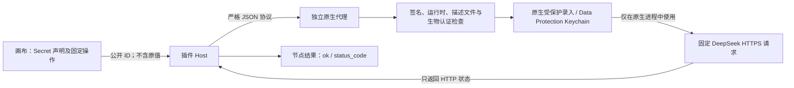

# Secret 受保护凭据代理：接入与验收

> 后续状态：2026-10-17 已完成真实 Desktop 的本地组件部署，Secret 继续禁用；最新阻断项和证据见 [本地隔离组件部署与阻断项](Secret本地隔离组件部署与阻断项.md)。本文保留部署前阶段的调查与测试事实。

更新日期：2026-10-17（北京时间）  
适用项目：现有 `dsh-visible-dynamic-workflows` 插件及真实 DeepSeek Harness Desktop。

当前结论：已加入受保护凭据代理的原生实现、插件接入契约、HTTP 受控模式和失败关闭逻辑；**尚不能宣布 Secret 已安全启用或主 Agent、子 Agent 的完整攻击验收已经通过**。本机没有有效代码签名身份，不能在当前诊断构建中录入或使用真实密钥。用户随后要求改为 Mac / Windows 通用隔离并调研 GitHub；Mac 专用分发已暂缓，未替换真实 Desktop 中现有插件。后续方向见 [跨平台隔离方案与开源调研](Secret跨平台隔离方案与开源调研.md)；本文件保留原生分支的实现与验证事实。

## 1. 在现有插件中的位置

保留现有画布、节点、连线和节点批注。画布右上角 ENV / SYS 继续使用纯图标与悬停说明，没有新增独立工作流产品或替代运行环境。

- 环境变量仍保存 Secret 的名称、稳定 ID、说明等声明；不增加原值、凭据句柄、加密材料或授权布尔字段。
- ENV 面板的“管理凭据”打开随插件提供的原生代理窗口；网页没有 Secret 值输入框或复制原值功能。
- 现有 HTTP 节点增加“受控凭据操作”；原来的普通 HTTP 请求保持兼容。
- 受控节点配置只有 `credentialOperation: { secretVariableId, operationId }`，另可保存验证和缓存等执行策略；认证与操作总时限固定为 3 分钟，网络请求最长 25 秒，不提供无效的自定义超时。这些字段只声明意图，不代表已经取得权限。
- 受控模式与直接 URL、method、headers、bodyText、inputs 互斥；不能通过隐藏字段或手写 JSON 混入任意请求。
- `{{env.Secret_ID}}` 仍不能用于提示词、模板、代码、工具参数、普通 HTTP 或输出节点。导入、复制后会生成新的声明身份，必须重新在原生窗口配置。

首版操作固定为 `deepseek.account-status.v1`，由原生代理执行 `GET https://api.deepseek.com/user/balance`。该接口的官方业务响应含 `is_available` 和余额字段；本插件不接收或解析这些字段。工作流结果仅为 `{ ok: boolean, status_code: number }`，其中 `ok` 表示收到 2xx HTTP 状态，**不能据此认定账户有可用余额**。[DeepSeek 查询余额接口](https://api-docs.deepseek.com/zh-cn/api/get-user-balance/)

## 2. 密钥经过哪些边界

这里的“严格 JSON 协议”只传操作与作用域标签，不传 Secret 原值。原生 Keychain 条目内部包含作用域、版本和凭据内容；它不属于工作流 JSON、Node 进程、编辑草稿或运行快照。原生程序没有“解密并返回原值”的命令。

原生响应采用闭合字段和错误码。Node 不保留或转发任意原生诊断；ENV 文案由已知错误码重建。HTTP 请求在取得响应状态后拒绝正文交付，响应头、正文、任意服务端错误和凭据回显都不能成为节点结果。这里不是依靠匹配 Secret 字符串做事后脱敏。

## 3. 原生安全前提

| 前提 | 当前源码采取的约束 | 不能据此推断的结论 |
|---|---|---|
| 应用身份 | 固定 bundle identifier，校验 Developer ID Application 签名、Team ID、证书及代码完整性 | 有一个签名命令成功，不等于该构建可以访问受保护凭据 |
| 独立访问组 | 固定专属 Keychain access group，并核验应用 entitlement 和 Apple 签署的有效 provisioning profile | 普通同用户文件权限不能替代此边界 |
| 运行时 | Hardened Runtime、App Sandbox、仅出站网络 entitlement；拒绝调试及敏感环境变量等异常条件 | 尚未完成重签名、动态注入与调试攻击验收 |
| 存储 | 显式使用 Data Protection Keychain；关闭同步；`WhenUnlockedThisDeviceOnly` 与 `biometryCurrentSet` | 不承诺跨设备同步或无生物认证设备可用 |
| 每次批准 | 管理和读取使用新 `LAContext`，认证复用时长为 0，不回退到密码或普通确认按钮 | 画布按钮点击和图内 `actor` 字段不是可信批准 |
| 网络 | 目标、方法和认证位置写死；禁用代理配置、Cookie 与缓存；拒绝重定向；使用系统内置根验证 TLS | 仍需在真实签名构建中验证 MITM、代理和异常响应路径 |

Apple TN3137 明确区分文件型 Keychain 和 Data Protection Keychain；后者的访问组由代码签名 entitlement 决定，受限 entitlement 还需描述文件授权，并要求用户登录上下文。此实现使用后者，不能退回“同 UID 可读文件里放密钥”。[Apple TN3137](https://developer.apple.com/documentation/technotes/tn3137-on-mac-keychains)

`userPresence` 允许生物认证或设备密码，不等于“只有当前录入的生物特征能通过”；本实现选择 `biometryCurrentSet`，增加或移除已录入指纹会使相关条目失效，需重新配置。[Apple userPresence](https://developer.apple.com/documentation/security/secaccesscontrolcreateflags/userpresence)、[Apple biometryCurrentSet](https://developer.apple.com/documentation/security/secaccesscontrolcreateflags/biometrycurrentset)

生产签名私钥必须位于 Agent 无法读取、调用或用于重签名的发布环境。不要将该私钥及其可自动授权的签名能力放进工作区、Harness 的工具进程或本机 Agent 可以访问的发布配置。开发签名、临时 ad-hoc 签名和伪造描述文件不启用 Secret。诊断构建只用于核对协议、编译与阻断状态。

## 4. 用户批准、录入和撤销

原生管理窗口先显示固定操作和作用域，再要求系统生物认证。首次录入要求在原生安全文本框直接输入；源码禁用复制、粘贴、拖放、明文回显及相关编辑能力，不从剪贴板导入密钥。更换和删除既有凭据还要读取受保护条目并核验版本，不能凭普通窗口确认直接覆盖或删除。

作用域包含 workspace / workflow / variable 标签；`nodeId` 用于说明本次请求。**这些标签来自调用方，不是可信调用者身份，也不是不可伪造的授权凭证。** 任何主 Agent、子 Agent 或其他进程即使知道这些 ID，也必须面对原生固定操作和每次生物认证；不能把标签匹配解释成“已证明请求来自某个合法 Agent”。原生窗口必须持续向用户说明这一点。

凭据的更新与删除用于阻止后续读取旧条目；已经发出的网络请求无法撤回。取消、删除或轮换也不能保证把已进入另一个原生进程内存的旧值立即回收。因此应在没有在途请求时完成轮换/删除，并在验收中检查并发窗口，不能承诺“删除瞬间所有在途使用全部失效”。

恢复和缓存同样不产生权限：受控 HTTP 及递归调用它的 Tool / Agent 不能用 `cache: reuse` 延续旧许可；节点及下游结果失效，已执行动作需要现有外部动作审查。选择“重做”后仍须再次通过原生认证。历史结果可以查看，但不能被当作当前授权。

## 5. 本机事实与当前状态

| 检查 | 本轮事实 | 判定 |
|---|---|---|
| `security find-identity -v -p codesigning` | 返回 `0 valid identities found`；文档编写时再次只读核对一致 | 当前没有可用于生产代理的有效签名身份 |
| Secure Enclave | 本轮机器信息确认物理存在；受限探测上下文曾返回不可用 | 不能把沙箱内探测失败说成“电脑没有 Secure Enclave”，也不能把硬件存在说成生物认证已通过 |
| 诊断构建 | ad-hoc 路径用于构建和协议检查，不满足生产身份门槛 | 应返回 `signing_untrusted` 并禁用录入和消费 |
| ENV 报告 | v1 的伪造 `available: true` 仍被拒绝；v2 只接受闭合原生 probe 状态 | `available: true` 仅代表启动检查通过，不代表凭据已配置或攻击验收完成 |
| 真实凭据与生物认证 | 未完成真实签名代理内录入、认证、消费的完整验收 | 不要求用户在当前诊断构建填写真实密钥 |
| 真实 Desktop 安装 | 本文件撰写时尚未完成本轮新包安装验收 | 由主任务补录安装包、哈希、宿主状态和结果 |

## 6. 已实现与尚未验证

| 项目 | 已实现的代码边界 | 当前验收状态 |
|---|---|---|
| 原生代理及协议 | 独立 App 包、固定命令、闭合输入输出、签名与运行时检查 | 以主任务编译/诊断记录为准；不是生产启用证明 |
| 受保护存储 | 专属访问组、Data Protection Keychain、生物认证、版本核验、更新/删除 | 真实签名与条目读写待验收 |
| HTTP 受控使用 | 固定 DeepSeek 操作，仅返回状态；普通 HTTP 兼容 | 正向真实凭据请求待验收 |
| 画布接入 | 原有 HTTP 模式切换、Secret 声明选择、原生管理入口、禁用状态解释 | 真实 Desktop 交互待验收 |
| 普通通道隔离 | Secret 原值不进入 workflow JSON、草稿、提示词、工具参数和快照；禁止通用引用 | 自动化边界检查不替代主/子 Agent 的真实攻击验收 |
| 导入、固定节点与恢复 | 新声明 ID、结构化引用保护、缓存失效、重新批准 | 相关自动化结果由主任务汇总 |

本轮冻结结果：82 个测试文件、835 项通过；完整 Host / Client 类型检查、Remote 生成与构建通过。原生诊断程序实际 probe 返回 signing_untrusted，8 项拒绝路径通过；独立 Swift 协议检查为 4 项合法、54 项拒绝、4 项作用域检查。未触碰凭据、未触发生物认证、未安装或重启 Desktop。原生二进制 SHA256：`f2cef9b6e57cfec7051878f205eaf30ae0d0b6eac95066af8f3124f76521bd0c`。这些证据不等于真实 Secret 正向消费或隔离验收。

## 7. 真实签名与本人认证后的待验收清单

以下为未完成的验收，不是已经成功阻断的攻击清单。应使用专门的可撤销测试凭据，每项保留脱敏证据，不记录原值。

- 主 Agent 与原生子 Agent 分别尝试通过文件、shell、MCP、环境变量、进程参数、日志、历史会话和 Keychain CLI 读取原值；应得不到原值。
- 对代理进行 ad-hoc 重签名、开发签名、错误 Team / access group / profile 替换、调试附加、动态库注入、敏感日志环境变量注入；应在读取凭据前拒绝。
- 通过辅助功能 AX、键盘快捷键、上下文菜单、拖放、剪贴板、撤销和截屏路径测试安全文本框；不能自动读取或粘贴原值，不能替代系统生物认证。
- 伪造作用域、复用旧请求、直接启动代理、伪造管理结果或 probe；不能取得任意解密能力，每次消费仍由用户判断固定目标并认证。
- 对网络进行用户根证书 MITM、代理设置、重定向、认证挑战和异常证书测试；服务端正文/headers 即使回显原值，也不能传回 Node 或 Agent。
- 测试错误 HTTP 状态、非 JSON / 巨大响应、连接中断、超时和取消；输出仍只能是固定状态或固定错误码，不能自动重试。
- 测试创建、替换、删除、错误版本竞争、并发请求、锁屏、指纹集合变化；明确记录哪些已发请求仍可能完成，不能把撤销描述为回收网络请求。
- 测试运行暂停/恢复、缓存复用、子流程递归、导入/复制和手工“已完成”核验；旧回执不能替代新的原生批准。
- 在真实 Harness 中回归现有普通 HTTP、Agent 节点、原画布、节点批注、ENV/SYS 图标和原历史记录。

## 8. 实现入口与本版范围

代码入口：`native/secret-broker/Sources/`、`scripts/build-secret-broker.mjs`、`src/host/protected-secret-broker.ts`、`src/shared/protected-secret.ts`、`src/shared/secret-boundary.ts`、现有 HTTP adapter / ENV 面板 / recovery planner。

本版只处理一个预定义只读 HTTPS 操作，不提供任意 URL/headers/body 的凭据注入，不向通用工具目录开放解密能力，不支持后台免认证批量执行，也不声称跨平台支持。今后增加操作时，需要逐个定义目标、参数、响应与认证策略，并补做相同的隔离验收。
