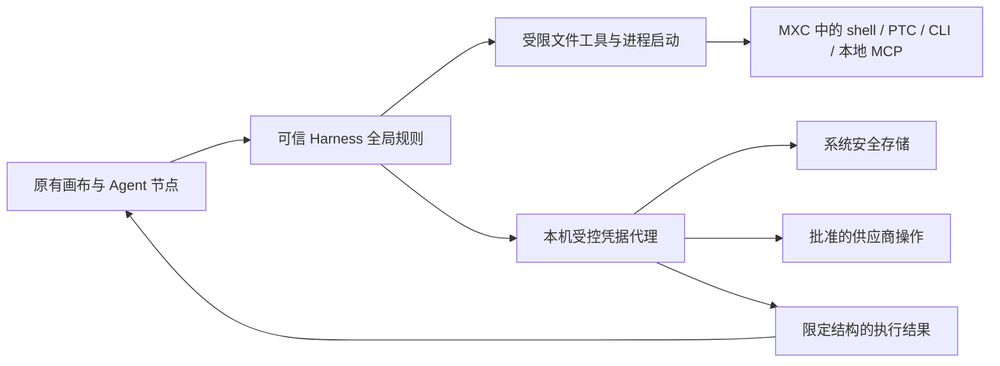

# Secret 本地免管理员隔离实测与轻量化评估

> 后续状态：2026-10-17 已完成真实 Desktop 的本地组件部署，Secret 继续禁用；最新阻断项和证据见 [本地隔离组件部署与阻断项](Secret本地隔离组件部署与阻断项.md)。本文保留部署前阶段的调查与测试事实。

日期：2026-10-17。对象：现有 DeepSeek Harness Desktop 与 `dsh-visible-dynamic-workflows`、CLI Worker 插件。本文是评估与无凭据局部实测，**不是已安装、已完成双平台隔离的交付声明**。

## 1. 决策结论

**建议继续验证 MXC 的原生进程隔离路线。真实 Harness 有可复用的统一工具拦截接口，但需要补齐实际执行路径；MXC 的 Mac ARM64 轻量性已有局部实测依据，Windows 免管理员能力有系统条件，现阶段不能承诺所有 Mac / Windows 和现有 CLI / MCP 都无影响。**

| 用户要求 | 本轮结论 | 证据与限制 |
| --- | --- | --- |
| 在真实 Harness 上迭代 | ✅ 有现成接入点 | 从当前安装的 ASAR 提取 387 个文件检查；主 Agent、原生子 Agent 和 PTC 嵌套工具可经过统一 guard。没有另建工作流运行环境 |
| 主、子 Agent 都不能读 Secret | 尚未满足 | 文件读取、搜索、MCP 启动、可信宿主插件还有不同执行路径；只包住 Agent 节点或 shell 不够 |
| 纯本地 | ✅ 架构可行 | 本机可信凭据代理 + 受限工具进程，不需要远端保险库、VM、Docker 或新的服务账户；供应商 API 请求仍需网络 |
| 不要求管理员权限 | Mac ARM64 局部通过；Windows 有条件 | Mac 探针以 UID 501 运行，无 sudo/UAC/系统服务安装；Windows 只考虑满足能力的原生 PSEC 路线，禁止需要管理员准备的回退 |
| Mac / Windows 兼容 | 不能承诺全覆盖 | Mac 官方门槛为 macOS 15+；npm 1.0.1 缺 Intel Mac 发行物。Windows 有版本及运行时能力门槛，未实机运行 |
| 现有 CLI / MCP 正常使用 | 可保留协议，但需适配和逐类验收 | 流式管道局部通过；简单终止 MXC 外层会遗留子进程，已实测发现。登录、PTY、额外控制通道、动态端口尚未通过完整验收 |
| 轻量化 | ✅ 独立执行器符合候选方向 | Mac ARM64 3.76 MiB，Windows x64 11.59 MiB；Mac 空命令启动中位数 14.31 ms。完整凭据服务的开销尚未测量 |
| 保留画布和节点批注 | 继续保留 | 改造位置是可信 Host 的权限和执行服务，原画布、Agent 节点、批注、ENV/SYS 图标入口继续复用 |

这里的 ✅ 表示对应事实或推荐方向，不能理解为整个 Secret 功能已经安全可用。

## 2. 本轮检查的真实基线

| 项目 | 结果 |
| --- | --- |
| 真实应用 | `/Applications/DeepSeek Harness.app`，`0.2.0-rc.2` |
| 本机系统 | macOS 27.0.1（26A434），ARM64 |
| Desktop 实际运行时 | 通过应用自身可执行文件的 `ELECTRON_RUN_AS_NODE=1` 读取：Node 24.18.1、Electron 44.0.0 |
| 安装包 ASAR | 121,387,457 字节；SHA-256 `18d5036bbb58eaff41d351ede99314b8d06505aec06fb2e164c49874ada30f9e` |
| CLI Worker | `0.8.1`，实际安装链接指向 `~/AI-Project/DeepSeekHarness/cliworker-now`，正式代码在 `lib` |
| CLI 取证时点 | 2026-10-17 10:34，`lib/index.js` SHA-256 `7a72d5518ec39b43f12673bb59bd52859b609ec2aedff7f2b46313d21bd64952` |
| MXC | 官方 npm `@microsoft/mxc-sdk@1.0.1`；固定源码提交 `fda29ac63bc306b7f97f3b86b4b63d44f7f40cf2` |

CLI 另一个聊天正在更新协议统计与界面，已协调：本轮不占用安装/重启窗口。以上是明确时点的审计基线，不将并行构建后的字节冒充本轮已查版本；实施前重新核对。四个已知 rc2-context 界面扩展也完成静态检查。

证据分为三层：

1. **真实安装包静态检查**：检查当前应用、已知配置覆盖和正式 CLI 文件，不是只看网上 README。没有向正在运行的 Host 注入审计插件，也未动态枚举全部服务 composition。
2. **本机 OS 级局部探针**：真实 MXC 二进制、普通用户、合成文件和临时监听器；额外使用真实安装的 Harness 内嵌 Node 检查管道。不是模拟 Harness，也不是完整工作流/CLI/MCP 端到端验收。
3. **Windows 静态检查**：官方固定版本的文档、源码和真实发行物；没有 Windows 实机结果。

本轮没有录入或读取真实密钥，没有触发 Keychain 认证，没有安装系统服务，没有更改 Harness 权限、profile 或插件运行代码，没有发起 CLI 模型请求。本机探针需要离开 Codex 自身的执行沙箱才能检查 OS 行为，但实际进程仍是普通 UID 501，未取得管理员身份。

## 3. Harness 能否统一限制工具入口

### 3.1 有统一工具入口，但执行侧需要补齐

下列路径和行号来自当前 ASAR 原样提取的 JavaScript。`tools.guard` 是应用层检查，不会自动把任意宿主 JavaScript 放进操作系统沙箱。

| 入口 | 当前真实实现 | 必须补齐的部分 |
| --- | --- | --- |
| 全局工具分发 | `dsh-tools/lib/index.js:2911` 有全局/作用域 guard；`:3241` 检查，`:3331` 执行 middleware | 在 Agent 和 MCP 初始化前安装可信全局规则。子作用域不能放宽全局拒绝；middleware 本身也必须可信 |
| 主 Agent、原生子 Agent | `dsh-agent-loop:578` 使用 scheduler；`dsh-subagent-in-process-driver:161` 通过父 Context 创建子 Agent | 保护策略覆盖创建、继续、重试和恢复。不能仅给 workflow 子 Agent 添加白名单 |
| PTC `tools.*` | `dsh-tools:1361` 的嵌套调用仍走 scheduler | 可统一审查；但 PTC 直接 Node API 另行进入进程隔离 |
| bash、PowerShell、PTC 代码 | 有 `ctx.sandbox.confine` 接口；`danger-full-access` 会跳过 | 接入新后端，保护模式禁止不受限回退。审批设为 never 不代表安全隔离 |
| `read`、图片读取 | `dsh-tool-fs:345,1009` → `ctx.fs`；`dsh-fs-local:825` 直接由 Host 读取 | 使用受限文件执行器或经过安全审计的文件代理；不能只拦 shell。处理 realpath、符号链接及路径检查与打开之间的竞态 |
| grep / glob | `dsh-tool-fs-search:130,166` 明确使用不受限的 ripgrep 子进程 | 搜索结果也是文件读取，必须进入相同边界 |
| MCP 工具调用 | `dsh-mcp-client:127,226` 注册工具并转发 | 调用可以被 guard 拦截；允许调用不等于服务器进程已经被约束 |
| stdio MCP 启动 | `dsh-mcp-client:38,809` 由 SDK 的 `StdioClientTransport` 启动，插件初始化即连接 | 不经过当前 `ctx.subprocess`，需要改 transport 启动路径；否则服务器可在首次工具调用前读取文件 |
| 外部 CLI | CLI Worker 的 ProcessBackend 有 `spawn` 和 `spawnTerminal`，还有终端/协议桥 | 两条启动路径都需受管；保留子进程树、流式输入输出、停止和控制通道契约 |
| CLI 回调 Harness 工具 | 桥接最终调用 `child.ctx.tools.execute`；部分 skill/resource 由 Host 读取 | 回调也必须进全局规则，防止沙箱内 CLI 借 Host 工具越界 |
| HTTP MCP、已有本地服务 | 外部服务器不在新建沙箱的后代树里 | 采用固定能力的受控代理，或拒绝不满足保护条件的连接；不能因地址是 localhost 就信任 |
| 宿主插件、配置、UI 自动化 | 插件直接 dynamic import 到可信 Host，可直接使用 Node API；Cordis isolate 只是服务作用域 | 锁定可信插件与配置，禁止 Agent 改写、注入和重载。浏览器/桌面自动化不能接触凭据管理界面 |

实际默认沙箱也不满足 Secret 读取隔离：

- Mac `dsh-sandbox-local:65–74` 使用 `(allow default)` 再禁止文件写入，读取仍被允许。
- Windows 同包 `:79–97` 明确保留不受限读取，当前实现是 ACL 写入约束，不是 MXC ProcessContainer。
- 自定义 runner 的现有协议是另一套参数约定，不能直接填入 MXC 可执行路径就算接入完成。

本轮把安装包中的 Mac 只读策略原样用于合成 canary 文件，**能够读到内容**；同一 canary 在新 MXC 拒绝策略下读不到。它证明默认策略的读取限制不足，但不是对正在运行的主 Agent 发起了攻击测试。

### 3.2 安全范围必须覆盖整个 Harness

推荐边界如下：

MXC 负责限制工具进程，**不是凭据保险库**。存储加密、可信录入、代理身份、IPC 授权、固定操作、撤销与输出约束仍需单独实现。

- 不能保留一个可读取同用户全部文件的主 Agent，再只限制几个 workflow 子 Agent。
- 必须覆盖其他聊天、后台任务和持久化凭据的整个生命周期。退出“保护模式”后恢复任意同用户 shell，不能继续保证普通用户凭据库中的 Secret 不可读；停止代理也不等于消除持久化风险。
- 首次录入 Secret 前必须排空并终止既有不受限 CLI、MCP 和后台后代，让所有聊天重新应用可信策略；只限制后来新建的进程不够。不能回收或验证的进程存在时，不开放录入。
- 当前 CLI 插件链接到开发仓库。必须保护真实安装目标、依赖、启动配置、策略文件、父目录及链接替换；否则 Agent 可通过修改下一次加载的代码绕过隔离。
- 启动时清理继承的文件句柄、FD 和 IPC 能力；控制管道只能暴露受审计操作。路径被禁止不意味着旧句柄不可读，也不意味着 Host socket、Unix socket 或 Windows 命名管道自动安全。
- 不能让 Agent 借登录、更新、插件管理、任意 URL 请求或桌面自动化取得更高权限。操作授权必须由可信宿主决定，不能接受 Agent 自报的可信身份。
- 目标是受限的 Harness 主/子 Agent 读不到 workflow Secret。未受限的其他同用户程序、系统管理员、被攻陷的可信 Host 不在这项保证内。若必须防御这些对象，单靠本地同用户免管理员方案不够。

## 4. MXC 的平台条件

### 4.1 Mac

官方 Seatbelt 后端标注 macOS 15+，不要求 root、守护进程或系统安装。真实包的 Mac ARM64 独立执行器只链接系统库。本机普通用户的局部测试通过，说明该系统与该构建存在可用的免管理员路径。[固定版本后端说明](https://github.com/microsoft/mxc/blob/fda29ac63bc306b7f97f3b86b4b63d44f7f40cf2/docs/backends/seatbelt/seatbelt-backend.md)

但需要保留三个边界：

1. npm 1.0.1 **没有 Intel Mac executor/dylib**；源码存在 x64 分支不等于已有可分发、可验收版本。
2. Seatbelt API 已被系统标记 deprecated，需要持续做 OS 兼容验收；当前可运行不代表长期保证。
3. Mac 网络约束不能直接等同于任意域名防火墙。需要断网或仅放行受控本机代理端口，再由代理固定上游目的地；不得开放整个 loopback、HOME 或宿主 IPC 所在目录。

配置由 Host 生成，禁用 Agent 可控的 `profileOverride`、额外 Mach 权限、GUI/Keychain 访问和环境继承。UI 捕获、进程内存、复杂 IPC 与真实凭据库的对抗用例本轮尚未完成。

### 4.2 Windows

固定版本文档列出的原生 Process Isolation 最低版本如下；版本号只是筛选，最终需要运行时 capability probe。[官方版本表](https://github.com/microsoft/mxc/blob/fda29ac63bc306b7f97f3b86b4b63d44f7f40cf2/docs/backends/process-container/os-version-support.md)

| Windows 11 版本 | 原生 Process Isolation 起点 |
| --- | --- |
| 24H2 | 26100.9278 |
| 25H2 | 26200.9278 |
| 26H2 | 26300.9550 |
| 26H1 | 28000.2804 |

原生路径使用系统 PSEC 安全环境，网络规则由系统的特权上下文执行；产品不需要因此安装自己的防火墙服务或驱动。但这只是官方实现的条件路径，**本轮没有在 Windows 普通用户账户验证无 UAC 启动**。[网络实现说明](https://github.com/microsoft/mxc/blob/fda29ac63bc306b7f97f3b86b4b63d44f7f40cf2/docs/backends/process-container/networking.md)

产品接入应：

- 仅接受符合请求语义的原生隔离能力，特别检查 `FileSystemDeny` 等所需 capability；失败时关闭受保护执行。
- 显式设置 `fallback.allowDaclMutation=false`，并拒绝落入需要宿主准备的路径。该选项单独设置不等于所有能力已经具备。
- 不运行 `wxc-host-prep.exe`。它的 manifest 请求管理员权限，部分 AppContainer 回退需要更改系统根 ACL / `\\Device\\Null`，不符合本项目约束。
- 不启用实验 BFS 回退、学习放行模式，也不自动转 VM 或不受限进程。[host-prep 文档](https://github.com/microsoft/mxc/blob/fda29ac63bc306b7f97f3b86b4b63d44f7f40cf2/docs/backends/process-container/host-prep.md)

因此目前可以承诺的是“设计支持满足条件的 Windows 原生免管理员路径”，不能承诺 Windows 10、旧补丁 Windows 11 或所有 Windows 电脑。

### 4.3 不直接引入完整 Node SDK

完整 npm 包解压为 107,993,729 字节，约 103 MiB，包含多平台及其他后端资产。SDK 要求 Node >=24；Windows 原生 stdio 转移进一步要求 `>=24.21 <25` 或 `>=26.8`。

当前 Mac Desktop 实际 Node 24.18.1 满足 Mac SDK 下限；项目 shell 的 Node 22.23.1 和包声明 `>=22.19` 不是 Desktop 实际版本。Windows Desktop 未实测，不能推定它已满足 Windows SDK 的要求。

**优先选平台独立 executor，通过现有 ProcessBackend 的管道接入**，避免 FFI 句柄转移要求与额外 Node 安装。但 executor 的进程协议仍要适配，不能视为无缝替换。

## 5. 本机局部实测

使用 npm 完整性校验通过的官方 1.0.1 二进制，先审查入口与策略，再执行无凭据合成任务。Mac executor SHA-256：`c54390e48a25187fdae10758c6a286bede49416cb610c88c6705fd8445e97f60`。读取了本地代码签名元数据，但本轮不宣称完成 Apple 公证、在线证书链或源码可复现构建验证。

### 5.1 隔离与基础协议

| 探针 | 结果 |
| --- | --- |
| dry-run 策略生成 | 通过 |
| 指定文件可读、禁止文件不可读 | 通过 |
| 通过符号链接读取禁止文件 | 被拒绝 |
| 新建子进程读取禁止文件 | 被拒绝，限制继承 |
| 指定目录可写、其他目录不可写 | 通过 |
| 外部环境变量不自动继承 | 通过 |
| stdin / stdout / stderr、退出码 | 通过 |
| 300 ms 超时 | 约 314 ms 结束；不代表所有后台后代都已回收 |
| 临时 loopback 监听器 | 普通进程可连、受限进程连接被拒绝 |
| 合计 | 12/12 局部探针通过 |

结果见 [mac-probes.json](evidence/secret-local-isolation-2026-10-17/mac-probes.json)。12 项不包括 GUI、进程注入、真实 Keychain、Windows、所有网络旁路及完整凭据代理的攻击验收。

### 5.2 使用真实 Harness 内嵌 Node 的兼容探针

首次启动因 Electron Framework 读取被拒绝而失败；仅增加 `/Applications/DeepSeek Harness.app/Contents` 的只读权限后，真实 Node 24.18.1 成功处理两轮持续 stdin/stdout JSON 消息，第二次输入前进程仍在运行。没有开放用户 profile 或凭据目录。

这说明管道方式可用，也说明运行时、动态库与模块需要精确授权；它是合成协议测试，**不是已验证真实 MCP 或任何 CLI 模型调用**。单次 ready 为 304.13 ms，不作为稳定性能结论。

另一个取消探针发现：**只对 MXC executor 发 SIGTERM，executor 退出后，内层 Node 与其 sleep 子进程仍然存活。** 探针随后清理自身创建的进程。接入必须保留 Harness 的进程组/Job Object、后代观察与最终退出语义，不能直接以外层退出代表任务停止。

结果见 [compat-probes.json](evidence/secret-local-isolation-2026-10-17/compat-probes.json)。

### 5.3 空命令性能

同机执行 `/usr/bin/true`；两组各 2 次预热、20 次测量。`/usr/bin/time -l` 的 maximum RSS 是命令进程测量，不是整个 Harness、全部后代或未来代理服务的总占用。

| 路径 | 启动至结束中位数 | P95 | maximum RSS 的中位数 |
| --- | ---: | ---: | ---: |
| 直接执行 | 4.52 ms | 9.47 ms | 1.02 MiB |
| 经 MXC 执行 | 14.31 ms | 19.23 ms | 6.70 MiB |

两组中位数相差约 9.79 ms。这是热运行的小样本基线，没有测冷启动、长任务吞吐、并发峰值和 Windows，也不能据此声称完整 Secret 服务只占 6.7 MiB。

## 6. CLI 与 MCP 的兼容性影响

### 6.1 应保留的行为与明确影响

| 场景 | 可保留的行为 | 接入要求或实际限制 |
| --- | --- | --- |
| Codex / Claude / Pi 等 stdio 协议 | 原 CLI、模型、子会话、增量输出、继续输入 | 保留双向 stdin、stdout/stderr 分离、背压、消息顺序和退出码；启动探针不能代替真实协议验收 |
| Kimi / Grok 的 ACP、ZCode 会话协议 | 原生握手、权限请求、取消与模型选择 | 原有未通过的 CLI 不因 MXC 可启动而自动开放；不静默换 CLI 或账号 |
| MiMo / OpenCode / Hermes 的 HTTP/SSE | 原管理服务、随机端口、事件流 | 按运行授予必要连接，保留认证与生命周期；不能放开整个 localhost，也不能附着到不受管的已有服务器 |
| Mac 终端与 Windows 终端/后台任务 | 输入、窗口大小、原生进程管理 | 覆盖 `spawnTerminal`；Windows 普通后台任务的 spawn、Job、额外 `stdio.control` 管道，与人工账号终端的 ConPTY、PowerShell owner/Job 分别验收。control FD 不是 PTY 的同义词 |
| 停止与超时 | 现有 stop、cancel、超时提示 | 必须终止全部受管进程；已发现 naive executor SIGTERM 遗留子进程的问题 |
| 登录与退出 | 人工原生登录流程 | 作为独立可信管理操作，不能变成 Agent 获取不受限进程的入口；账号刷新/回写需要明确权限 |
| 工作区读取与修改 | 被授权的项目文件操作 | CLI 运行时只读，任务目录按最小范围可写；拒绝 workflow Secret 库、Host 配置和插件源代码路径。CLI 自身账号文件另见 6.2；原来任意 HOME 访问会受到限制 |
| MCP stdio 服务 | 原 MCP 消息协议 | 由可信启动层启动且继承隔离，不能沿用 SDK 私有未受控 spawn；启动期也要约束 |
| MCP 回调/资源读取 | 必要工具与资源 | Host 端执行仍需独立限制，防止通过宿主代读敏感路径 |
| HTTP / 远端 MCP | 被明确批准的有限操作 | 本地 MXC 不能限制远端服务器；本机已有高权限 HTTP 服务也不能仅凭 localhost 放行 |

不能承诺“原先任何能力都不受影响”：任意用户目录访问、未受控本地端口、桌面自动化、全权限模式，本来就与 Secret 不可读的目标冲突。应保存正常业务路径，拒绝无法满足保护条件的调用，不在失败后静默移出沙箱。

另一个实现细节是现有启动器以 executable + argv 数组传参，而 MXC 的配置使用 `commandLine`；必须正确处理 Mac/Windows 引号与转义，或使用固定可信 launcher，不能把 Agent 文本直接拼进 shell。

### 6.2 CLI 自身登录材料是另一项边界

当前 CLI Worker 的部分账号兼容依赖原生配置、API Key / OAuth 文件、环境变量或账号快照。若让整个 CLI 及其任意工具拥有相同文件权限，CLI 内的 shell 可能读取 CLI 自己必须读取的登录材料。

因此必须区分：

- **本轮目标：workflow Secret 原值不进入 CLI 环境、配置、快照、stdin 或工具结果。** 由代理完成批准操作，CLI 只拿到受限结果。
- **更强目标：CLI 自己的所有原生登录材料也对其工具不可读。** 需要继续拆分 CLI 认证与工具执行，或把相关提供商认证移入代理。仅包一层 MXC 不够；不能以保留登录兼容为由宣称已经实现这一目标。

### 6.3 验收顺序

1. 先用合成协议验证 stdio、PTY、额外控制 FD、argv、进程树、网络策略与文件策略。
2. 在真实 Harness 中先验证 Codex / Claude / Pi 三类双向协议；保留当前执行资格，无订阅或未授权时只做离线验证。
3. 再覆盖 ACP / ZCode、HTTP/SSE、登录/退出和账号刷新，分别验收 Mac、Windows。
   全矩阵包含 Codex、Claude Code、Pi、Kimi、Grok Build、ZCode、OMP、MiMo Code、OpenCode、Hermes Agent、Antigravity。OMP 的原生 addon/扩展加载、Antigravity 既有原生 sandbox 与多级后台进程需单列，不因其他 CLI 通过而视为通过。
4. MCP 同时验证调用和启动路径；对危险宿主工具、外部 HTTP 服务器做拒绝测试。
5. 最后使用专门测试凭据验证主 Agent、原生子 Agent、CLI 子 Agent、其他聊天和恢复流程，才讨论开放真实 Secret。

## 7. 轻量化设计与验收指标

### 7.1 分发体积

以下是官方 1.0.1 实包的单文件测量；gzip 是重新压缩该文件的结果，不是最终插件安装包。

| 平台执行器 | 未压缩 | 单文件 gzip-9 |
| --- | ---: | ---: |
| Mac ARM64 | 3.76 MiB | 1.06 MiB |
| Windows x64 | 11.59 MiB | 4.25 MiB |
| Windows ARM64 | 5.67 MiB | 2.12 MiB |

数值见 [mxc-package.json](evidence/secret-local-isolation-2026-10-17/mxc-package.json)。这些是 executor 体积，尚未计入我们未来的 broker、策略适配及全部许可通知。

### 7.2 推荐实现

- **按平台分发一个 executor**，附固定版本、完整性校验和许可证；不把约 103 MiB 的全平台 npm 包、测试工具、VM/WSL 后端打进插件。
- **复用现有 Host 的 Node 与进程管理**，不新增 Electron、Node、Python 或 .NET 运行时。本插件已有运行时不计为本次新增依赖。
- **按受管任务建立进程隔离范围**，后代继承约束；避免为同一个 CLI 的每条流式消息重复启动 MXC。不同任务不共享可导致越权的可写目录或身份。
- **凭据代理按需启动**，同一 Host 的活动操作可复用一个小型原生代理；空闲及时退出，不安装开机服务，不要求常驻数据库。短暂复用不等于复用旧任务授权。
- **优先使用受限管道/本地 IPC**；确需 loopback 时只开放本次端口和有限操作，禁止通用任意 URL/转发接口。Secret 不进入 argv、环境、配置文件或诊断日志。
- 缓存不含秘密的策略模板与静态能力探测，更新程序或平台后失效；每次执行仍核验授权、撤销、可信程序路径及请求范围。

### 7.3 建议纳入 PRD 的指标

下表是**待实现后的验收目标**，只有上文单独列出的 executor 测量已经完成。

| 指标 | 建议目标 | 当前状态 |
| --- | --- | --- |
| 每平台新增组件未压缩体积 | ≤20 MiB，包含 executor、broker、适配资源和许可文件 | executor 单项符合，完整服务未构建 |
| 每平台新增下载体积 | ≤8 MiB，按最终分发包实测 | 仅有单文件压缩测量 |
| 空闲后台进程 | 无活动运行且超时退出后为 0；不装开机常驻服务 | 架构目标，完整服务未实现 |
| 代理存活且无请求时的增量 RSS | ≤20 MiB，独立报告 Host、broker、executor 和整个进程树 | 未测 broker |
| 空闲 CPU | 不做轮询型后台工作；持续测量均值 <0.5% 单核 | 未测完整服务 |
| 热启动新增延迟 | P95 ≤50 ms，匹配工作负载并与直接启动比较 | Mac 空命令两组基线已测，正式成对评测及 Windows 未测 |
| 取消清理 | 正常停止/超时/Host 崩溃均不留受管后代；强制阶段结束后 2 秒内确认回收 | naive SIGTERM 不通过，需要适配进程管理 |
| 并发资源 | 1/4/8 个受管任务分别记录总 RSS、延迟、句柄和进程数 | 未测，不以单进程峰值替代 |

性能目标不应以扩大路径权限、关闭网络隔离、复用已撤销授权或跳过退出清理来达成。

## 8. 推荐实施顺序与开放门槛

| 阶段 | 在现有项目中的改动 | 完成标准 |
| --- | --- | --- |
| A：受管启动适配 | 真实 Harness ProcessBackend、MCP transport、shell/PTC/search 共用策略接缝；先无真实凭据 | 参数、管道、PTY、进程树取消通过；失败不回退到不受限启动 |
| B：全局执行边界 | 全局 guard、Host 文件/资源读取、所有聊天与原生子 Agent、CLI 回调；锁定插件/配置/管理入口 | 无可达的不受限读取、执行、UI 控制或持久化改写路径；危险工具被明确拒绝 |
| C：本机凭据代理 | 继续复用既有 Secret 引用和受控 HTTP 协议；实现安全录入/存储/IPC/固定操作/撤销；仅使用合成或专用可撤销测试凭据 | 原值只在可信范围内；主/子 Agent 请求原值失败，合法操作成功；快照、日志、导出不含原值；清理旧进程并验证句柄/IPC 继承 |
| D：平台和兼容验收 | Mac ARM64 真实 Harness；满足条件的 Windows x64/ARM64；Intel Mac 单独解决发行物 | 普通用户首次运行、无管理员提示/系统权限修改、CLI/MCP 正常业务矩阵与攻击矩阵都通过 |
| E：资源验收与启用 | 测量第 7 节全部指标；给不支持机器明确的不可用原因；全部门槛通过前不录入生产 Secret | 未通过机器保持 Secret 关闭，普通画布与非 Secret 功能保留；没有自动降级 |

**当前适合进入 A 阶段原型验证，不适合直接把 MXC 当作依赖安装后就启用 Secret。** 本轮保留原有代码和界面行为，仅形成评估与证据；已有 Secret 禁用状态不因此解除。

## 9. 可复核证据

- [真实安装包基线](evidence/secret-local-isolation-2026-10-17/host-baseline.json)
- [Mac 隔离及性能原始结果](evidence/secret-local-isolation-2026-10-17/mac-probes.json)
- [真实 Harness Node 管道与取消探针](evidence/secret-local-isolation-2026-10-17/compat-probes.json)
- [MXC 实包体积与哈希](evidence/secret-local-isolation-2026-10-17/mxc-package.json)
- [本轮证据范围及本地缓存索引](evidence/secret-local-isolation-2026-10-17/README.md)
- [MXC 固定源码版本](https://github.com/microsoft/mxc/tree/fda29ac63bc306b7f97f3b86b4b63d44f7f40cf2)

安装包提取文件、逐文件哈希、探针代码及输出保留在工作区 `.cache/secret-local-audit/`。该目录为本地审计缓存，不是分发依赖；关键结果已另存上述小型证据文件。本文与 [既有跨平台方案](Secret跨平台隔离方案与开源调研.md)、[PRD v0.0.2 验收记录](PRD-v0.0.2-实现与验收.md) 一起阅读，不能用本轮局部探针替代之前尚未完成的 Secret 端到端验收。
