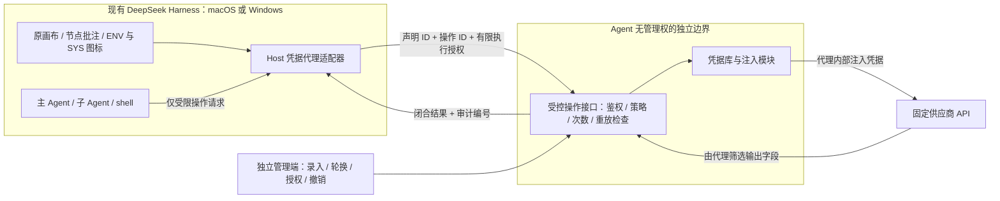

# Secret 跨平台隔离方案与开源调研

> 2026-10-21 说明：工作流预算系统已于 2026-10-20 移除（见 [S12](<../doc/workflow-manual/规划引擎/设计/tasks-规划提速与上下文复用.md>)）。本文中“工作流 Token 预算 / 预算账本”指当时的设计，现仅作用量与性能计量；供应商 API 次数与费用限制的建议仍然有效。

日期：2026-10-17。适用项目：现有 DeepSeek Harness 的 `dsh-visible-dynamic-workflows` 插件。

状态：**已补充真实安装包检查与 Mac 无凭据局部探针，尚未实施完整跨平台代理或完成 Windows 实机验收。** 当前 Mac 原生诊断实现已冻结，暂缓安装；本文件替代“必须先取得 Apple 发行签名才能继续设计”的单一路线，不代表 Secret 已可用。最新结果见 [本地免管理员隔离实测与轻量化评估](Secret本地免管理员隔离实测与轻量化评估.md)。

最新产品约束：用户明确选择**纯本地、同时适配 macOS 与 Windows、插件安装不依赖管理员授权，并要求轻量化**。原独立系统服务账户方案需要提权，不再作为已接受的默认安装路径；免管理员路线见第 9 节、实测进展见第 10 节。真实宿主已有全局工具 guard，但实际执行旁路仍需补齐；MXC Mac ARM64 局部可行，不代表所有机器或现有 CLI/MCP 均已兼容。不以远端部署为前提，本轮没有改变主 Agent 工具权限。

## 1. 推荐结论

可以设计 Mac / Windows 通用方案。应统一的是**受控操作协议与策略核心**，然后用真正独立的权限边界保护凭据。加密文件、隐藏环境变量、另起同一用户的进程，都不能单独保证拥有 shell / MCP 的 Agent 读不到原值。

采用统一接口；以下为此前本地服务路线的比较。新增免管理员约束后，实施选择须以第 9 节为准：

| 方式 | 推荐用途 | 隔离边界 | 成本与限制 |
| --- | --- | --- | --- |
| 独立机器上的凭据代理 | 调研参考，不属于当前选定实施范围 | 原值、解密能力、代理管理权限留在独立机器；本机只取得限定操作的执行权 | 需要用户可控的服务端与运维；当前不部署 |
| 本地独立账户的系统服务 | 隔离方案保留，但不满足最新免管理员安装目标 | macOS 独立非登录 UID；Windows 独立服务身份；Agent 用户无权读取存储、修改服务或附加调试 | 首次安装需要系统管理员授权；两个平台分别做安装、IPC、存储和攻击验收 |
| 同用户 sidecar / 普通 Keychain 包装 | 不作为本任务安全底座 | 默认仍与 Agent 共享用户权限 | 能隐藏提示词中的密钥，但不能据此承诺防同用户 shell 读取 |

✅ 表示推荐使用场景，不代表已经验证通过。两种推荐方式都继续在**原来的 DeepSeek Harness 中运行工作流**。新组件只负责保管凭据和执行授权操作，不另建工作流环境、画布或调度器。

本地版本共享策略与协议核心，分别补齐系统服务边界；不将 Agent Vault 或 OpenBao 作为首版必需依赖。开源调研可提供凭据注入、策略和审计的实现参考，但本次未找到可直接安装、且已证明满足这项威胁模型的 Mac / Windows 双平台成品。

兼容性目标是相同操作协议、节点配置、错误语义和工作流 JSON；平台安装与存储适配分别实现。跨机器导入流程后重新绑定本机凭据，JSON 不携带原值、解锁材料或旧授权。本地保管不意味着供应商 API 可以离线调用：网络请求仍由本机代理向已批准的供应商发出。

## 2. 我们需要保护的具体范围

主 Agent、工作流子 Agent、它们启动的 shell / MCP / 插件代码都视为可能主动尝试读取凭据的调用者。它们可能读取工作区、用户文件、环境变量、日志、快照，也可能绕过前端直接调用服务。

因此不能仅在提示词中要求保密，也不能只隐藏表单或检查调用程序名字。即使攻击者改掉本地 TypeScript 检查，保护仍应由独立服务执行。

必须成立的前提：

- 本地模式下，Agent 无 root / Administrator、免交互 sudo、调试其他身份进程或修改系统服务的权限。已有这些权限时，本机隔离不成立，应选独立远端服务。
- 远端模式下，Agent 无服务端 SSH、容器管理、数据库、备份、管理员会话或云平台控制权。能读取服务器数据卷的 Docker 控制权等价于突破该边界。
- 凭据初次录入和管理也必须在 Agent 无权观察或控制的管理环境完成。Agent 若有当前桌面的键盘捕获、辅助功能或浏览器控制权，普通原生密码框或同浏览器的管理页面不足以证明安全；优先使用独立管理设备或隔离管理会话。
- 信任操作系统、代理实现、凭据管理员与被批准的供应商。系统或供应商遭控制不在“Agent 无原值读取权”的保证内。

**原值不可读与调用不可滥用是两件事。** Agent 可能读取本机执行令牌；这个令牌必须只能做批准的有限操作，不能换取原值。它仍有使用风险，需要期限、操作限制、次数/额度及撤销，而不能把它宣传成“不是秘密所以不用保护”。

## 3. GitHub 项目横向比较

下表是官方文档和公开源码静态核查，未安装或运行这些第三方项目。动态文档记录的是调研当日状态；正式接入须锁定提交、版本及依赖清单。

| 项目 | 已核实能力与平台 | 对当前目标的不足 | 推荐使用部分 |
| --- | --- | --- | --- |
| [Infisical / agent-vault](https://github.com/Infisical/agent-vault) | 面向 Agent 的 HTTP 凭据注入代理；项目建议与 Agent 分机部署。发布配置列 Linux / macOS；开源版标注 Preview | 没有核实 Windows 原生代理包；通用代理不能代替严格操作授权；管理员可读取原值 | ✅ 远端代理候选，外加服务端固定操作接口；Mac / Windows 的 Harness 共用 HTTPS 客户端 |
| [CyberArk / secretless-broker](https://github.com/cyberark/secretless-broker) | 代理负责连接上游与认证；核实发布 v2.0.0。构建目标含 Linux 与 macOS | README 明确不提供客户端认证；已核实配置无 Windows 发布目标 | 借鉴连接代理与凭据注入；不能裸露一个本机端口直接作为授权入口 |
| [OpenBao](https://github.com/openbao/openbao) | 凭据库，官方安装文档覆盖 macOS 与 Windows；核实 v2.7.1 | 获准读取 KV 的客户端能拿到原值；其 Agent 模板/环境注入也不符合我们的隔离目标 | ✅ 有集中存储需求时放在代理后面；Harness 不持有 KV 读取、管理员或解封能力 |
| [AgentCordon](https://github.com/agentcordon/agentcordon) | CLI / broker 覆盖 Mac / Windows；服务端策略、签名请求、凭据转交 | 默认本机 broker 按用户运行，并在本机解密凭据；平台支持不等于独立权限隔离 | 借鉴策略授权与审计结构；不能直接采用默认本机部署作为安全保证 |
| [AgentSecrets](https://github.com/The-17/agentsecrets) / [Keychain-Auth](https://github.com/The-17/keychain-auth) | 二进制哈希、命名空间、OS 凭据库与 IPC | 实码系统安装仅 Linux；Mac / Windows 默认当前用户启动，授权客户端能读原值 | 借鉴 IPC 接口思路；不作为本任务双平台隔离底座 |
| [Phantom Secrets](https://github.com/ashlrai/phantom-secrets) | 多平台凭据代理、路由约束；安全文档明确威胁边界 | 官方明确不防御同用户 shell / 文件系统 / 调试等访问 | 借鉴固定路由与边界说明，不直接据此承诺主 Agent 隔离 |

平台与版本依据：[Agent Vault 发布配置](https://github.com/Infisical/agent-vault/blob/main/.goreleaser.yml)、[Secretless v2.0.0](https://github.com/cyberark/secretless-broker/releases/tag/v2.0.0)、[Secretless 构建配置](https://github.com/cyberark/secretless-broker/blob/main/.goreleaser.yml)、[OpenBao 安装](https://openbao.org/docs/install/)、[OpenBao v2.7.1](https://github.com/openbao/openbao/releases/tag/v2.7.1)。AgentCordon 的本机解密见[凭据加密设计](https://github.com/agentcordon/agentcordon/blob/main/docs/credential-encryption.md)；Phantom 的边界见[安全政策](https://github.com/ashlrai/phantom-secrets/blob/main/SECURITY.md)。

### 3.1 Agent Vault 最接近，但需要补齐操作边界

我们不直接让 Harness 使用通用代理端口。它的服务规则按 host / port / path 匹配，**不检查 method、headers、query、body**；未匹配请求默认透传，应显式改为 `unmatched_host_policy=deny`。[服务规则](https://docs.agent-vault.dev/learn/services)

权限应使用最小的 `instance:no-access` 与 `vault:proxy`。member / admin 能管理及读取凭据；这类身份、浏览器会话和管理令牌不能放在 Agent 可访问的环境中。[权限](https://docs.agent-vault.dev/learn/permissions)

代理监听与管理传输需要另行保护，不能直接把明文代理口暴露到公网；无主密码模式会把数据加密密钥明文放进数据库，不能以“内容已加密”代替访问隔离。我们选择 HTTPS 操作入口，内部代理网络只供可信服务访问，存储启用受保护的解锁机制。[安全说明](https://docs.agent-vault.dev/learn/security)

因此推荐评估其组件能力，不建议现在将 Preview 包直接捆入正式插件，也不向整个 Harness 设置全局 `HTTPS_PROXY` 或安装 MITM 根证书。

### 3.2 Keychain-Auth 的源码核查

检查提交：AgentSecrets `02d3a45130aebb08fde24780e0c8a2ded2f9d895`；Keychain-Auth `06497d7e1ec774a46e2368ea7ed1ceba74e01f6a`。

| 核查点 | 实码事实 | 对我们的含义 |
| --- | --- | --- |
| 系统安装 | `install.go` 在非 Linux 平台返回不支持 | 不能按 README 的跨平台介绍推断已有 Mac / Windows 独立服务账户安装。[源码](https://github.com/The-17/keychain-auth/blob/06497d7e1ec774a46e2368ea7ed1ceba74e01f6a/internal/cli/install.go#L14) |
| 自动启动 | 非 Linux 注册不要求 sudo；Windows 直接启动，Mac 首选用户 LaunchAgent | 默认 daemon 与 Agent 共享当前用户权限。[源码](https://github.com/The-17/agentsecrets/blob/02d3a45130aebb08fde24780e0c8a2ded2f9d895/pkg/keychainauth/setup.go#L627) |
| 授权配置 | Windows 路径在 `%APPDATA%`；authorize 写配置，handler 重读配置 | 同用户能修改授权名单时，二进制哈希门禁不能形成安全边界。[路径](https://github.com/The-17/keychain-auth/blob/06497d7e1ec774a46e2368ea7ed1ceba74e01f6a/internal/config/paths_windows.go#L10)、[授权写入](https://github.com/The-17/keychain-auth/blob/06497d7e1ec774a46e2368ea7ed1ceba74e01f6a/internal/cli/authorize.go#L24) |
| 返回协议 | read 将凭据内容放进返回值 | 不能给 Harness / Node 授予此读取能力。[源码](https://github.com/The-17/keychain-auth/blob/06497d7e1ec774a46e2368ea7ed1ceba74e01f6a/internal/handler/handler.go#L366) |

其依赖 `go-keyring v0.2.4` 的 [macOS 实现](https://github.com/zalando/go-keyring/blob/v0.2.4/keyring_darwin.go#L42)调用系统 `security`，而 [Windows 实现](https://github.com/zalando/go-keyring/blob/v0.2.4/keyring_windows.go#L11)读取 CredentialBlob。同用户可以尝试直接走底层系统接口，绕过 daemon 自己的哈希检查。macOS 是否另有提示取决于 Keychain 状态与 ACL；这不是本次实际读取测试，不能宣称所有 Keychain 条目均可无提示读取。

## 4. 统一架构



这是本项目建议的架构，不是任何一个开源仓库已经完成的组合。

### 4.1 必须在可信服务执行的规则

1. **只接收操作，不接收任意请求。** 根据 `operationId` 在服务端确定协议、host、port、path、method、认证位置、参数 schema 和响应 schema。拒绝重定向、任意代理设置、动态代码及未允许字段。
2. **不提供取值 API。** 执行接口不存在 `getSecret`、`resolveSecret`、`decrypt`、环境变量导出或将密钥发回客户端的能力。
3. **服务端决定绑定。** 客户端的 workflow / variable / node ID 都是可伪造标签。服务根据已认证主体、管理员批准的绑定和当前策略版本查找凭据，不能只凭 ID 放行。
4. **限制调用权。** 执行授权绑定服务受众、操作、凭据映射、参数摘要、到期时间、最大使用次数及策略版本；单次授权应由服务原子消费 nonce。客户端不拥有管理员签发密钥。以服务端接收和认证结果为准，不信任客户端 `approved: true`。
5. **分别控制泄露与滥用。** 允许 Agent 使用操作不等于允许任意 API 行为。对有费用或写入副作用的操作设置独立额度、频率和人工授权；工作流现有 Token 预算不能代替供应商费用限额。
6. **先限制输出，再考虑脱敏。** 固定响应字段，禁止返回上游原始 headers/body、异常堆栈和凭据管理响应。字符串扫描不能可靠拦住编码、分片或变形回显；新增操作必须单独审查供应商行为与输出语义。
7. **取消和重试保守处理。** 撤销阻止后续授权使用，不能收回已发出的网络请求。超时不自动重试有副作用操作；未知结果记为待核查。恢复不能兑换旧授权或复用旧批准。
8. **审计不记录原值。** 保存认证主体、操作版本、允许/拒绝原因、策略版本、时间、状态与审计编号。主/子 Agent 标签可用于诊断，但同用户运行时不能把标签当成不可伪造身份。

### 4.2 第一个受控操作保持现有范围

沿用已写入插件的配置：

```ts
credentialOperation: {
  secretVariableId: '已声明的稳定 ID',
  operationId: 'deepseek.account-status.v1'
}
```

代理固定执行 `GET https://api.deepseek.com/user/balance`；首版仅回传 `{ ok, status_code }`。`ok` 只表示 2xx 状态，不能推断余额可用。该操作用于验证“能完成认证请求但不能读取原值”；其他业务 API 逐项扩展操作目录，不放开任意 URL 或通用认证注入槽。

## 5. 两个平台如何落地

### 5.1 远端后端：保留调研，不属于当前实施范围

调用链为：现有 Harness → HTTPS 固定操作服务 → 内部 Agent Vault → 固定供应商。

- Harness 只安装本插件的协议适配器；不需要 Windows 版 Agent Vault，也不依赖 Mac 的 Apple Keychain access group。
- 管理接口与执行接口分离。绑定、凭据和批准在受保护管理侧完成；ENV 只显示已绑定、失效或未配置等状态。
- Agent Vault 的代理端口只对固定操作服务开放。操作服务使用 proxy 角色，服务端负责生成完整的固定请求；本机不获得直连通用代理端口的凭证。
- 管理员令牌、解锁材料、数据库和备份只留在服务端管理边界。正式部署使用固定版本、验证构建来源、关闭未匹配透传，验收失败保持禁用。
- 有集中审计、动态凭据或统一轮换需求时，可以选择 OpenBao 作为另一种存储后端；需另行实现和验证 adapter，不声称 Agent Vault 已内置本项目所需的 OpenBao 适配。

这里“跨平台”指我们的 HTTPS 客户端协议可用于两种宿主；**不是声称现有插件已完成 Windows 包装或实机验收**。当前仓库公开安装包仍是 macOS Apple Silicon。

### 5.2 本地后端：需管理员安装的独立系统服务账户路线

| 部分 | macOS | Windows | 共享核心 |
| --- | --- | --- | --- |
| 常驻服务 | 系统 LaunchDaemon，独立非登录 UID，非 root 常驻 | Windows Service，专用服务身份，按需采用受限 Service SID | 生命周期、固定操作协议 |
| 文件所有权 | 系统拥有程序/策略；服务身份拥有私有数据；交互用户不可写 | 安装目录及服务配置由系统管理；数据仅服务身份和管理员可访问 | 配置版本与原子更新 |
| IPC | 系统拥有路径的 Unix socket；核验 OS peer 身份和授权 | 命名管道精确 ACL、首实例保护、拒绝远程客户端、核验双方身份 | 严格 schema、限长、拒绝未知字段、取消与错误码 |
| 凭据存储 | 专用服务可访问的加密存储；解锁材料不在用户目录；不能直接假设 GUI 登录会话的 Data Protection Keychain 可用于 daemon | 服务身份的 DPAPI / CNG 存储方案，按实际服务账户 profile 与密钥 ACL 验证 | 不提供原值返回、轮换、版本及审计 |
| 人工管理 | 隔离管理会话或可信管理端；不在 Agent 控制的 React 表单输入原值 | 同左 | 绑定、撤销和操作批准语义 |
| 安装与更新 | 一次管理员授权；安装和更新包完整性校验 | 一次管理员授权；服务和包完整性校验 | 更新失败保留可恢复状态，拒绝降级 |

依据：[Apple launchd 系统 daemon 与用户 agent](https://developer.apple.com/library/archive/documentation/MacOSX/Conceptual/BPSystemStartup/Chapters/CreatingLaunchdJobs.html)、[Apple Keychain 类型与登录上下文](https://developer.apple.com/documentation/technotes/tn3137-on-mac-keychains)、[Microsoft 服务用户账户](https://learn.microsoft.com/en-us/windows/win32/services/service-user-accounts)、[命名管道安全](https://learn.microsoft.com/en-us/windows/win32/ipc/named-pipe-security-and-access-rights)。

Windows 的 `CRYPTPROTECT_LOCAL_MACHINE` 不等于仅服务可解密；微软说明同一机器的任意用户均可能解密这种数据，因此不能据此忽略 ACL、账户与 profile。具体存储提供方在 Windows 实机验证后才定案。[DPAPI 文档](https://learn.microsoft.com/en-us/windows/win32/api/dpapi/nf-dpapi-cryptprotectdata)

这个方案的保密基础是不同系统身份与访问控制，**不依赖我们先拥有 Apple Developer ID**；签名、安装来源和更新完整性仍是发布要求。它也不应伪装成“Mac / Windows 所有代码完全相同”。可用 Go 或 Rust 共享协议、策略与网络核心，平台差异留在安装、IPC、存储与批准模块。

若未来需要统一的人在场批准，可评估 [Yubico libfido2](https://github.com/Yubico/libfido2)。它不能代替系统隔离；普通安全钥匙触摸也不能证明用户看到了具体交易。服务必须验证绑定操作与期限的一次性 challenge，强意图确认还需可信显示。首版不强制用户购买额外硬件。

## 6. 如何迭代现有插件

以下是下一步改造计划，尚未实施这些后端抽象。

| 现有部分 | 保留 | 计划增量 |
| --- | --- | --- |
| 原画布、节点与批注 | 全部保留 | 不增加第二套编辑器或调度器 |
| ENV / SYS | 两个纯图标按钮及 Tooltip；SYS 只读 | ENV 展示后端类型、连接/绑定状态、管理入口；前端仍无 Secret 原值字段 |
| Secret 声明与 JSON | 名称、类型、说明、稳定 ID、必填信息 | 不保存服务管理令牌、解密材料、执行授权或可兑换凭据句柄 |
| HTTP 受控模式 | `credentialOperation` 和当前固定操作 ID | 从原生代理调用改为统一后端接口；普通 HTTP 保持兼容 |
| Host 适配层 | 当前严格协议校验、预检、闭合错误 | 提取 `CredentialBrokerBackend`，能力包含 probe / status / openManager / execute / cancel；没有 getSecret |
| 安全状态报告 | 拒绝未知字段和自报授权 | 新增严格报告版本区分 remote / local-service / mac-native；不能把远端就绪包装成“原生生物认证通过” |
| 凭据映射 | 当前 workflow/variable 作用域意图 | 可信代理保存经管理员确认的主体、声明与凭据映射；导入/复制生成新声明后重新绑定 |
| 主 Agent / 子 Agent | 使用真实 Harness 的原生任务调用链 | 可以请求被授权操作；两者都不取得原值或凭据库读取能力；外层 Agent 标签不构成安全身份 |
| 快照恢复与预算 | 既有运行快照、历史和预算账本 | 恢复重新取当前授权；旧快照不保留执行令牌；新增 API 次数/费用限制独立于 Token 预算 |
| Mac 原生实现 | 当前诊断代码与拒绝测试作为备选保留 | 暂不安装；不降低签名检查来绕过当前不可用状态；待通用后端稳定后决定是否保留发行路径 |

代理地址、TLS 信任及允许后端应由管理配置控制，不能从导入的工作流 JSON 自动接受。修改这些配置必须重新建立信任，不能以 probe 返回 `available:true` 自动证明端点可信或允许录入凭据。

## 7. 分期与验收

### 阶段 A：共同协议与本地权限边界

- 固定本文件威胁模型、首个操作、错误码和输出；在现有 Host 提取后端接口，不再依赖 Mac 专属认证状态描述。
- 共享协议、策略、网络操作、审计和授权核心；分别设计 Mac LaunchDaemon 与 Windows Service 的身份、ACL、IPC、存储和更新。
- 优先验证最关键的“普通 Agent 用户不能访问服务数据、修改服务或伪装管理端”，然后再开放凭据录入；不以加密文件或同用户进程替代权限边界。
- 设计并验证独立本地管理会话；主/子 Agent 有桌面控制权限时，同桌面密码框不得被当作可信录入保证。

### 阶段 B：双平台真实宿主闭环

- 使用专用可撤销测试凭据，分别在真实 macOS / Windows 的 DeepSeek Harness 中验证正常受控调用及主 Agent、原生子 Agent、直接 shell 的读取尝试。
- 验收同用户读取、服务替换、调试附加、授权伪造、管理界面访问等路径；自动测试与跨编译不能替代两台真实系统的验证。
- 验证相同工作流 JSON 可导入，凭据须在目标机器重新绑定；原流程、历史、画布与节点批注保留，ENV / SYS 仍只有图标。
- 提供两个平台各自的安装与卸载产物，首次安装明确由用户完成管理员授权；没有管理员安装时保持 Secret 禁用，不静默降低为同用户存储。

### 核心验收矩阵

| 验收对象 | 预期结果 |
| --- | --- |
| 正常固定操作 | 取得 `{ok,status_code}` 与允许的审计信息；本机无原值 |
| 主/子 Agent 文件、环境、参数、日志、快照和历史扫描 | 不含测试原值及可读取凭据库的管理材料 |
| 直接 shell 请求代理、伪造 workflow / node ID | 未获当前有效操作授权时拒绝，不能以标签冒充身份 |
| 改本地 JS 校验或伪造就绪报告 | 可信服务仍独立拒绝非法目标、字段和越权操作 |
| 密钥读取、导出、设置、管理登录 | 执行身份无此权限；Agent 环境无管理会话 |
| 任意 host / port / path / method / body、跳转、TLS MITM | 由可信边界拒绝，不携带凭据转发到未批准目标 |
| 上游回显原值、编码内容、巨大 body 或错误栈 | 固定操作不回传这些字段；不能只依赖文本替换 |
| 重放、超时、并发、取消、轮换与撤销 | 原子消费授权、固定错误；不自动重复有副作用动作，明确在途请求边界 |
| 暂停恢复、导入、复制、旧授权 | 重新检查当前绑定与权限；旧快照不产生授权 |
| 本地代理文件、配置、进程及 IPC 攻击 | 普通 Agent 用户不能读取、修改或注入；验证双方身份及管道竞争 |
| 初次录入与管理 | 原值只在独立可信管理环境出现，不通过 Harness 表单、剪贴板或 Agent 可控会话 |
| 卸载与更新 | 不将凭据复制回用户目录；明确保留/销毁策略；拒绝损坏或降级包 |

## 8. 本轮完成与未完成

已完成：GitHub / 官方资料调研、关键源码静态复核、跨平台架构与现有插件改造映射。已有 Mac 原生诊断分支及插件防护代码冻结，82 个测试文件 / 835 项通过，完整构建通过；详情见[原生代理接入与验收](Secret受保护凭据代理接入与验收.md)。

未完成：远端部署、本地独立账户服务、后端抽象、Windows 安装包及实机验收、真实凭据正向使用、主/子 Agent 的完整隔离攻击验收。本轮没有安装第三方服务、没有读取真实凭据、没有触发系统认证，也没有替换或重启现有 Desktop。

原本下一步是提取统一代理接口并实施两平台系统服务。用户新增免管理员约束后，先执行第 9 节的宿主能力与兼容性评估，暂不安装系统服务。当前不安排远端部署。在对应验收通过前，Secret 继续明确显示不可用，不能因单元测试或探测成功就宣布安全存储已交付。

## 9. 免管理员安装：限制 Agent 执行权限的候选路线

### 9.1 可行边界

有可研究的免管理员本地路线，但需要**由 Harness 将所有 Agent 可利用的执行入口纳入限制**。目前未核实到“仅安装这个插件、主 Agent 保留任意同用户 shell / MCP 能力、同时 Mac / Windows 原值不可读”的等价现成方案。

前面的独立账户服务是通过给代理另一个系统身份来保护凭据。免管理员路线则保留用户态的可信 Host / 凭据代理，把 Agent 发起的文件操作、代码和工具执行放进受限环境。被限制的进程可以处理工作区文件，但不能访问代理存储、用户凭据库、代理内存、管理窗口或修改隔离策略。

这项保证只针对被完整限制的 Agent 及其工具链，不能声称能抵御同一电脑上任意未受限的同用户恶意程序。仅让代理自己进入 AppContainer，而把 Agent 留在外面，不产生所需保护。

### 9.2 新核查的系统与开源证据

| 路线 | 已核实事实 | 对当前选择的影响 |
| --- | --- | --- |
| Windows PasswordVault | 普通非 AppContainer 桌面应用可访问当前用户全部 lockers，包括 AppContainer 应用的 locker | 不能仅换存储 API 或给代理包装 MSIX 就声称防同用户 Agent。[官方说明](https://learn.microsoft.com/en-us/uwp/api/windows.security.credentials.passwordvault) |
| Windows AppContainer | 提供凭据、文件、进程及窗口访问限制；可为当前用户创建 profile | 适合作为受限执行候选；具体程序兼容、网络策略及部署权限须验收。[隔离说明](https://learn.microsoft.com/en-us/windows/win32/secauthz/appcontainer-isolation)、[创建 profile](https://learn.microsoft.com/en-us/windows/win32/api/userenv/nf-userenv-createappcontainerprofile) |
| macOS App Sandbox / Seatbelt | 操作系统可限制不可信进程的访问；Apple 建议使用 XPC 做应用内权限分离 | 可评估用户态受限执行；不得将现有只限制写入的策略当作完整凭据隔离。[Apple 文档](https://developer.apple.com/library/archive/documentation/Miscellaneous/Reference/EntitlementKeyReference/Chapters/EnablingAppSandbox.html) |
| Microsoft MXC | SDK 支持 Windows、macOS 等平台，提供文件、网络、UI 策略；Windows 默认 processcontainer，Mac 默认 seatbelt | ✅ 优先评估的宿主级候选，不是已验收的免管理员插件依赖。Windows 有明确版本/补丁要求，须检查各后端安装条件。[仓库](https://github.com/microsoft/mxc)、[Windows 要求](https://github.com/microsoft/mxc/blob/main/docs/backends/process-container/os-version-support.md) |
| Anthropic Sandbox Runtime | 当前 Windows alpha 后端需要一次提权的 windows-install，创建专用用户与 WFP 规则 | 不满足本次完全免管理员安装要求，不能因包可用 npm 安装就忽略系统初始化。[仓库安装说明](https://github.com/anthropics/sandbox-runtime#windows-alpha) |
| Mac 专属签名代理 | Data Protection Keychain 的访问组提供应用身份边界 | 可以单独研究用户态部署，但仍有签名/profile条件，也不能推导 Windows 存在同等成品。[Apple TN3137](https://developer.apple.com/documentation/technotes/tn3137-on-mac-keychains) |

Microsoft 的[架构说明](https://blogs.windows.com/windowsdeveloper/2026/10/07/microsoft-execution-containers-policy-driven-containment-for-ai-agents/)强调隔离策略由执行负载之外的宿主决定。我们需要在真实 Harness 中落实这一点；仅给 Agent 节点传一份策略 JSON 不构成安全边界。

### 9.3 对现有项目的具体影响

- 画布、节点批注、ENV / SYS 图标、Secret 声明、固定 HTTP 操作协议继续复用。
- 凭据由沙箱外的可信代理保管并注入；Agent 只接收有限操作结果。代理管理权限不能通过同一执行接口获得。
- 主 Agent、子 Agent 的 shell / Node / 外部 CLI / 本地 MCP 进程必须统一受限，子进程继承限制。已有外部常驻 MCP 不能因“来自本机”而直接信任。
- 限制范围包括同一 Harness 的其他聊天和插件，并覆盖凭据持久化后的整个生命周期。若其他聊天仍有不受限的同用户 shell，或退出保护模式后恢复此权限，普通 DPAPI / Credential Locker 中的凭据仍可能被读取；关闭代理进程本身不能解决这一点。
- 在 Host 进程中执行的文件工具也要强制校验读取范围；不能把受限 shell 与无限制 read_file 同时交给 Agent。
- 策略、Host 程序、插件安装目录、启动脚本与解锁材料不允许 Agent 修改，防止它通过修改后再启动来绕开限制。
- 浏览器、桌面自动化、剪贴板与输入观察必须防止触及凭据管理会话。无法限制的工具在 Secret 保护模式下不得开放，不能只在录入时显示提示。
- 不兼容的 CLI / MCP 可以明确拒绝或要求用户调整权限；不能静默在沙箱外重试。免管理员不代表所有现有工具都能保持无限制兼容。
- 当前仓库的 `src/host/native-agent.ts` 只约束工作流子 Agent 的工具白名单，不能控制主 Agent 经其他插件取得的能力。完成本路线需要宿主支持或受控宿主扩展，不是单靠当前前端/节点配置改造。

### 9.4 下一步评估门槛

1. 列清真实 Harness 中主/子 Agent 的全部文件、代码、MCP、外部 CLI 和 UI 执行入口，确认是否有不可拦截路径。
2. 固定 MXC 或原生后端的版本，核对 Mac / Windows 系统要求、SDK 与当前 Node 运行时兼容性，实际验证标准用户首次安装和运行不触发管理员提权。
3. 先用无真实凭据的探针检查读取、写入、进程访问、IPC、UI 与子进程继承边界，再引入专用可撤销测试凭据。
4. 只有主 Agent 和子 Agent 都完成受限执行及正向受控调用，才开放 Secret 安全使用；不能用仅一个节点的成功测试替代。

本节只是研究结论与评估建议。本轮没有安装 MXC、改变 Harness 全局工具权限、增加系统服务或使用真实凭据。

## 10. 真实宿主检查与轻量化实测进展

后续已完成 [专门评估报告](Secret本地免管理员隔离实测与轻量化评估.md)，第 9 节“本轮没有安装 MXC”描述的是当时的调研轮次。本次只在审计缓存中运行官方独立执行器，没有将它安装到 Harness 或修改运行权限。

- **真实宿主**：从当前 `0.2.0-rc.2` ASAR 检查 387 个文件。`tools.guard` 可覆盖注册工具，文件读取、搜索、MCP SDK 启动及宿主插件代码仍需分别约束。现有默认 Mac/Windows 沙箱主要限制写入，不满足 Secret 读取隔离。
- **Mac 局部实测**：普通用户完成 12/12 项合成探针；真实 Harness 内嵌 Node 的持续输入输出通过。只终止 MXC 外层会遗留后代，必须适配现有进程管理。
- **平台条件**：MXC 1.0.1 实包缺 Intel Mac 资产；Windows 只考虑满足能力的原生 PSEC，禁用需要管理员准备的 DACL 回退。Windows 尚未实机验证。
- **轻量化**：独立 executor 为 Mac ARM64 3.76 MiB、Windows x64 11.59 MiB；Mac 空命令启动中位数 14.31 ms。完整服务体积、代理 RSS、并发、PTY 和 Windows 性能仍待测；报告已列具体资源指标。
- **下一步**：适合在原 Host 的进程启动和 MCP transport 接口做无凭据原型。全局读取边界、凭据代理及真实主/子 Agent 对抗验收通过前，继续保持 Secret 不可用；不以局部探针解除禁用状态。
