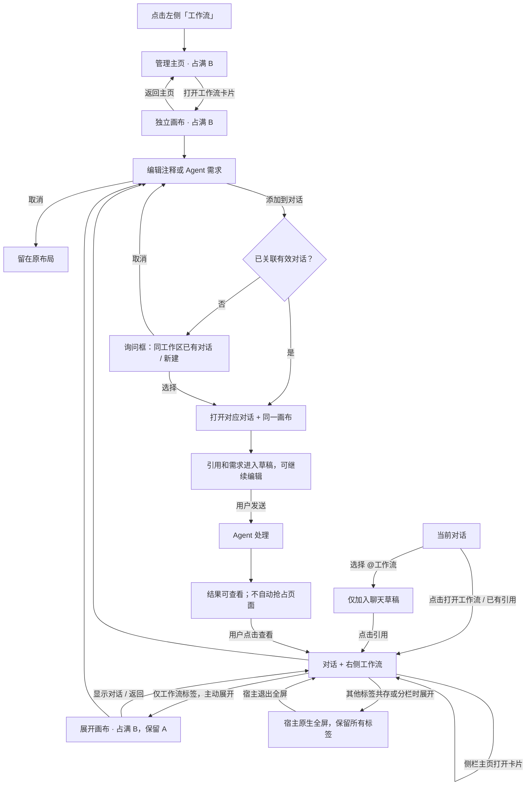

# 工作流导航与布局交互

## 交互原则

入口决定初始布局，用户决定后续展开；返回位置由来源决定。左侧 A 为宿主导航，B 为内容区；“展开画布”只占 B，保留 A。

| 操作 | 结果 |
| --- | --- |
| 点击左侧工作流 | B 显示管理主页；从卡片进入全宽画布 |
| 对话中打开工作流、点击引用 | 保留该对话，在右侧打开画布 |
| 侧栏管理页打开卡片 | 留在侧栏，不自动展开 |
| 输入框选择 @工作流 | 只加入草稿引用，不改变页面 |
| 配置节点、执行、查看运行结果 | 保持当前布局 |
| 仅一个工作流标签时使用宿主展开 | 画布占满 B；提供“显示对话”回到来源对话 |
| 与 CLI Worker 等其他标签共存或分栏 | 保留宿主原生全屏；不切换到工作流主页面 |
| 从管理页进入画布后返回 | 返回管理主页，保留筛选 |
| 编辑注释 / Agent 需求 | 仍在当前画布；提交到草稿时才显示对话 |
| 独立画布首次提交协作需求 | 选择同工作区已有对话或新建对话；以后复用关联 |
| 后台生成完成 | 显示“查看工作流”入口，不抢走正在操作的页面 |
| 关闭或收起画布 | 不终止运行，重新打开恢复画布状态 |

[查看 SVG 流程图](工作流导航交互流程图.svg)

## 主交互流程图

## 状态与异常

- 每个对话分别保留工作流、节点选择、缩放、位置、节点面板、运行面板、未提交需求和撤销历史；全宽/侧栏切换复用同一状态。
- 管理主页筛选、搜索单独保存。不能借用“最近一次对话”作为协作目标。
- 对话不在同一工作区或已被删除时，重新选择；取消选择不得丢失注释或需求。
- `提交到草稿`不发送消息。只有宿主发送按钮提交给 Agent。
- 导航前保存失败时显示错误，不丢弃未保存内容；过期异步返回不得覆盖较新的导航。
- 窄窗口沿用宿主单面板适配；宽窗口手动展开采用 B 区画布，避免遮盖 A。
- 本图定义交互，不代表 Dify 全功能对标已经完成。实际验收另行记录。
