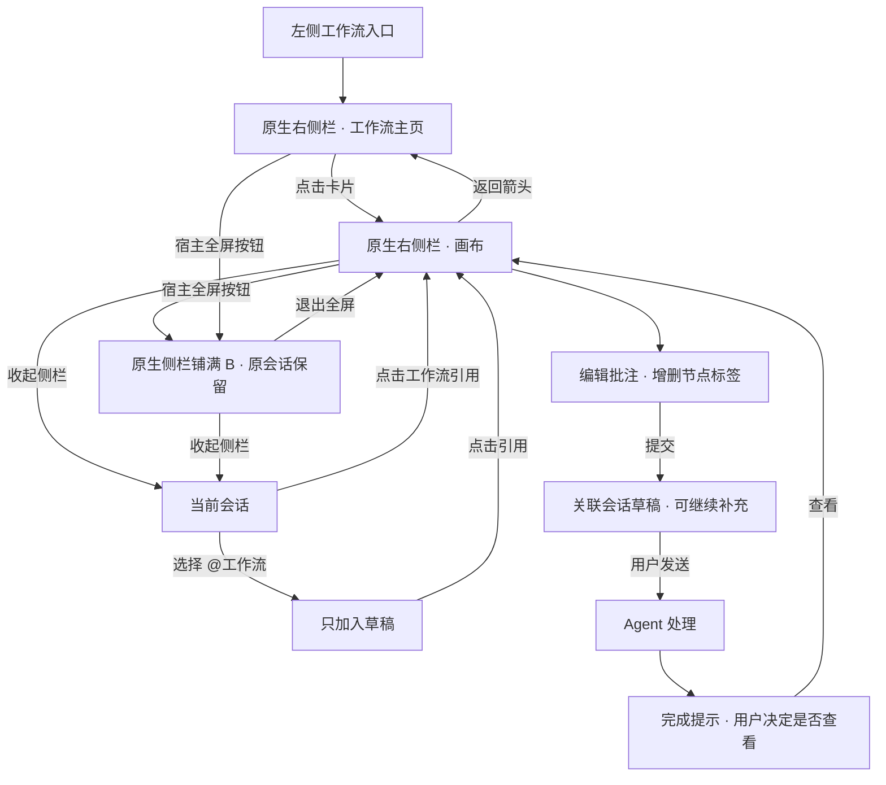

# 工作流导航与布局交互

2026-10-16 修订。所有工作流入口使用原生右侧栏，用户通过宿主按钮放大和收回；会话不被工作流主页面替换。

| 操作 | 结果 |
| --- | --- |
| 点击左侧工作流 | 保持当前会话，在原生侧栏打开管理主页 |
| 管理卡片 / 对话引用打开工作流 | 在同一侧栏展示画布，保持当前侧栏大小 |
| 输入框选择 @工作流 | 仅加入草稿引用，点击引用才打开侧栏 |
| 使用宿主侧栏全屏 | 原生侧栏铺满内容区 B，会话与草稿留在后方 |
| 退出全屏 | 同一会话与侧栏重新并排，画布状态不变 |
| 画布返回箭头 | 返回侧栏管理主页，保留筛选 |
| 配置、执行、结果更新 | 保持当前布局 |
| 编辑节点批注 | 在节点或批注入口附近打开轻量浮层 |
| 批注提交到草稿 | 更新关联会话的草稿，不发送，不自动收回全屏 |
| 无匹配协作对话 | 询问选择同工作区对话或新建；取消保留批注 |
| 后台生成完成 | 显示查看入口，不抢占正在操作的页面 |
| 关闭 / 收起侧栏 | 不停止运行；重新打开仍保留当前状态 |

[查看 SVG 流程图](工作流导航交互流程图.svg)

- 全屏与侧栏复用同一状态，不重建工作流、不修改其他插件的布局。CLI Worker 等标签、分栏及尺寸继续由宿主管理。
- 没有打开的会话时，由宿主新建或复用当前工作区的空白会话，不能自动选中某条历史会话。
- 每个对话保留工作流、节点选择、缩放位置、配置面板、运行详情、未提交需求和撤销历史；会话草稿由宿主管理。
- 导航前保存失败时保留原内容并显示错误；较旧异步返回不得覆盖新导航。
- 本图定义交互，不代表 Dify 全量对标已完成。实测结果另行记录。
