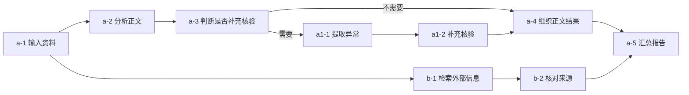
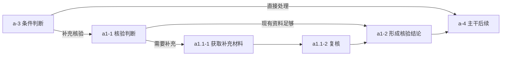

# 节点编号与稳定引用规则

本文把“编号随结构调整、引用保持稳定”补成 v0.3 的产品设计方案。主干、分支和嵌套编号的具体算法是本项目设计，不是 Dify 原生编号规则；后续实现应按本规范和样例验证。

## 1 两种标识各自负责什么

| 标识 | 用途 | 变化规则 |
| --- | --- | --- |
| 工作流身份 | 区分不同流程，支撑 @ 引用 | 重命名不变；复制流程生成新身份 |
| 节点身份 | 配置、变量引用、连接、注释、运行记录的关联键 | 修改、移动、改名不变；复制节点生成新身份 |
| 结构编号 | 供人阅读和表达，如 `a-2` | 结构修改后重新计算；不是执行顺序和数据库键 |
| 运行实例 | 区分同一节点的重试、循环和不同运行 | 由运行身份、节点身份、迭代路径和尝试次数共同区分 |
| 注释序号 | 本次待发送注释的临时定位标记，如 ① | 成功发送清除；新批次从 1 开始 |

结构化引用至少携带工作流身份、节点身份、引用时版本和当时的显示编号；发送给 Agent 时以身份解析目标，并携带当前编号。用户看见的名称与编号变化不影响目标定位。

## 2 路径与作用域

1. 每个流程有根作用域，默认主路径记为 `a`。
2. 根作用域的其他并行或条件路径依次记为 `b、c……z、aa、ab……`。前缀顺序依据流程结构，不依据屏幕左右位置。
3. 某路径内部新建子分支时，原路径继续使用原前缀；第一条替代子路径为 `a1`，后续同级子路径为 `a2、a3……`。`b` 下对应 `b1、b2……`。
4. 更深层采用点分层，例如 `a1.1、a1.2`，避免 `a11` 无法区分“a 的第十一条支路”与“a1 下第一条支路”。
5. 每条路径上的节点按结构顺序编号，得到 `a-1、a-2` 或 `a1.1-1`。控制节点、汇合后的处理节点和循环容器都各计一个节点，不因多条入边重复编号。
6. 同级分支使用端口声明顺序；可保存明确的主分支选择。若需要人工改变主分支，这是一次结构编辑，不是拖动布局。
7. 路径归属和作用域是图模型中的结构信息。生成器、编辑器和导入器都必须建立它，不能让展示组件根据坐标临时猜测。

分支的控制条件、并行关系、变量依赖决定实际执行；路径标签不增加新的执行限制。

## 3 正常结构示意

`a-5` 是按其实际节点类型处理并行结果的步骤，例如接收两份输入的代码或模型节点。图中的连接汇合不意味着 Dify 的“变量聚合器”可以合并并行结果；各节点的执行语义见节点规格。

### 3.1 嵌套分支

### 3.2 迭代和循环

容器在外层路径中拥有编号，如 `a-4 逐文件迭代`。容器内部另建作用域，显示 `a4: a-1`、`a4: a-2`；继续嵌套时作用域标签可叠加，如 `a4/a2: a-1`。画布内显示短编号，跨容器引用展示完整路径和名称。冒号前是容器的当前定位路径，同样不作为稳定身份。

迭代第 1、2、3 次执行仍然使用同一节点身份和同一结构编号；运行详情另显示“第 3 项 / 第 2 次尝试”。容器重编号后，内部完整显示路径同步变化，旧引用不失效。

## 4 结构编辑后的计算流程

1. **形成候选图**：在当前版本上应用一次用户操作或完整 Agent 修改批次，暂不覆盖有效图。
2. **先校验结构**：固定节点保护、端口类型、引用、作用域、容器边界、循环结构均通过后，才进入编号计算。任意回边不能用重编号掩盖成合法循环。
3. **确定作用域与路径归属**：使用已有结构信息；新增分支按所属容器、控制分支及端口顺序归属。汇合后返回相应共同父路径。
4. **生成路径顺序**：在每个作用域内进行稳定拓扑排序；输入控制顺序优先，平级使用已保存的端口顺序、节点创建序次，最后用稳定身份作确定性兜底。不使用像素坐标或本次 API 返回顺序。
5. **计算显示编号**：每条路径从 1 连续分配；计算嵌套容器的显示路径；每个节点只获得一个编号。
6. **校验映射**：同一作用域内编号唯一，全部节点都有身份和编号，引用仍按身份指向原对象。
7. **一次性提交**：图、配置、编号表和撤销记录一起成为新版本。界面不出现“结构已变、编号仍旧”的半更新状态。

对同一份图和排序元数据重复计算，必须得到相同编号。

## 5 非典型结构的确定规则

| 情况 | 处理方式 |
| --- | --- |
| 根级多个触发入口 | 以显式入口顺序分配根路径；同一次运行只记录实际选择或触发的入口，未触发入口不误计为失败 |
| 并行路径汇合 | 汇合节点归最近共同父作用域的继续路径；共同父为根时归根主路径 `a`。执行仍按真实输入依赖和控制语义 |
| 多个不对称分支汇合 | 同样归共同父；不要求分支节点数量相等，也不按最长分支猜主干 |
| 一条控制边跨越不同分支 | 校验是否允许跨作用域；允许时不复制目标节点，重新计算目标的共同父归属及受影响后续路径 |
| 仅新增数据引用 | 数据依赖变化需要类型与运行检查；若未改变控制结构或容器归属，不单因引用而改变路径标签 |
| 不形成唯一结构化区域的 DAG | 导入或编辑校验器选择最小共同祖先作用域，按稳定端口和拓扑规则归属；不得仅因无法推断漂亮树形而拒绝合法 Dify 图 |
| 结构信息缺失的导入 | 根据控制边、容器和入口建立路径元数据，保留外部节点 ID 到本地身份的映射；在导入预览中展示编号结果 |
| 不可达或孤立节点 | 草稿中保留并标“未连接”；在独立未连接区按创建顺序分配 `u-1、u-2……`，接入有效图后重新编号 |
| 节点移入或移出容器 | 是结构修改，重新计算完整路径并校验越界变量引用；身份不变 |
| 同一节点在多个入口可达 | 只有一个节点身份与一个显示编号，归共同父路径；运行记录区分入口 |

结构边和数据边的分类由节点端口契约决定。前端不能通过“线看起来相连”自行推断条件路径、并行屏障或变量可用性。

## 6 引用解析与失效

| 输入 | 解析规则 |
| --- | --- |
| 注释、点击节点生成的结构化引用 | 根据工作流身份和节点身份解析；版本用于判断是否已被修改 |
| 用户输入原始文字 `a-2` | 优先使用发送时关联画布的版本与作用域；有多个容器或流程同号时弹出询问框，不猜测 |
| 用户引用历史聊天中的编号 | 使用该历史消息保留的版本映射；说明当前编号，必要时显示当时与现在的差异 |
| 引用存在但节点配置已变化 | 显示目标现状；与要求冲突时询问，不能覆盖并发更新 |
| 节点已删除 | 草稿显示失效；不能重新指向占用同一编号的新节点；用户可重新选择或移除引用 |
| 撤销删除 | 恢复被删除对象的身份与该版本关联；当前未发送草稿可重新解析 |
| 复制节点或跨工作区复制流程 | 副本使用新身份，批量重写副本内部引用；原会话引用继续指向原流程 |

引用被解析成功不构成修改固定节点的授权；仅当用户明确指定目标及要求时适用一次定向授权。

## 7 注释序号的独立生命周期

一条注释可关联多个节点，各位置显示同一序号。编辑或删除注释同步影响本批草稿；成功发送后删除本批标记和计数，历史消息不恢复这些序号。新草稿从 1 开始。发送失败保留旧批次；在发送等待期间创建的新批次不能被旧回执清除。

协作评论是另一个对象，拥有独立的讨论串、解决状态和成员引用，不能因发送给 Agent 而被清除。

## 8 编号验收样例

| 编号 | 操作 | 应观察到的结果 |
| --- | --- | --- |
| NUM01 | `a-1 → a-2 → a-3` 中间插入一步 | 新节点为 `a-2`，旧后续依次后移，旧节点引用不变 |
| NUM02 | 删除旧 `a-2` | 后续连续重编号；指向已删身份的引用失效 |
| NUM03 | 只移动、缩放或整理画布 | 所有结构编号不变 |
| NUM04 | 根路径新增并行分支 | 新分支获得确定前缀，汇合节点只出现一次 |
| NUM05 | 在 a 的子分支中再次分支 | 得到 `a1.1-*`，不会与 a 的第十一条支路混淆 |
| NUM06 | 不等长分支汇合 | 汇合后回共同父路径，编号不依赖哪条先执行完 |
| NUM07 | 循环执行 5 次并重试第 3 次 | 画布编号不变，记录通过迭代与尝试序号区分 |
| NUM08 | 将节点移入迭代容器 | 显示完整路径变化，身份保持，越界引用被检查 |
| NUM09 | 用同一快照计算两次 | 完整编号映射相同 |
| NUM10 | 复制一组含内部连接和变量引用的节点 | 新身份间相互关联，外部引用按明确复制规则处理，不混接旧对象 |
| NUM11 | 撤销并重做结构编辑 | 恢复对应图、编号和身份映射，不重新调用模型 |
| NUM12 | 原始文字编号同时命中两个容器 | 弹出询问框，不自动选择其中一个 |
| NUM13 | 发送注释后再添加新注释 | 旧标记消失，新序号从 1 开始，便签和协作评论不受影响 |
| NUM14 | 对合法非树形 DAG 导入两次 | 同一结构得到一致编号；各次导入的本地流程身份独立 |
| NUM15 | 用户与 Agent 同时改同一目标 | 检测基础版本冲突，不静默覆盖，不把原要求挪到新同号节点 |

上述覆盖了编号的产品规则与测试输入类别；实现时需保留对应图样例文件及断言结果，不能把本页文字当作算法已运行通过。
